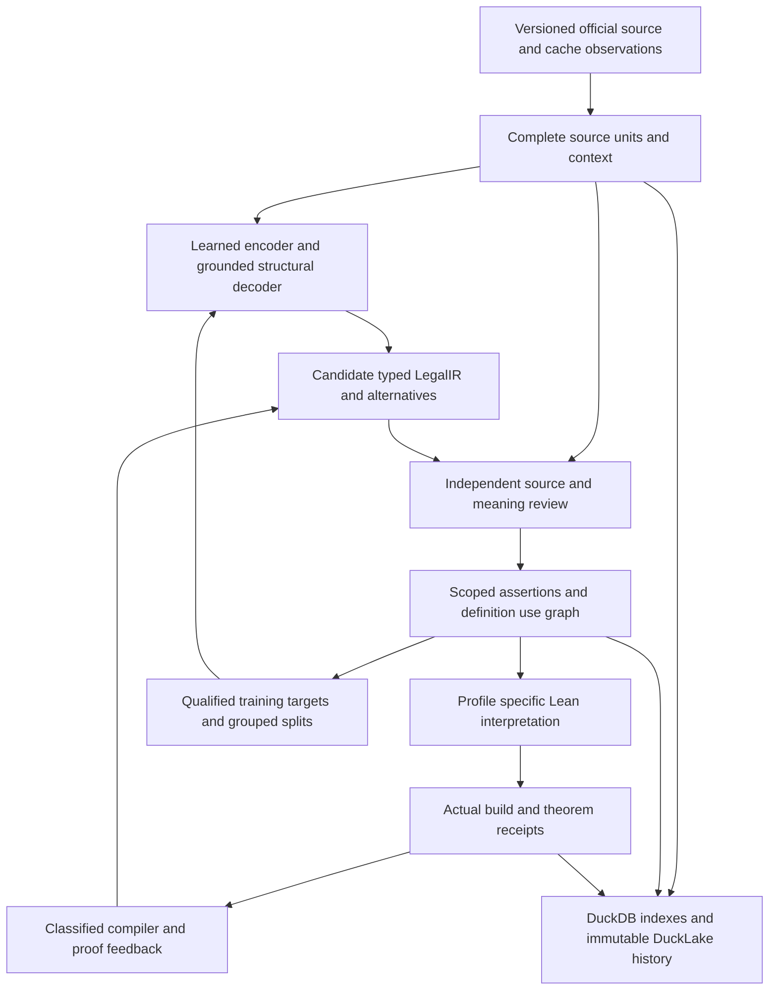

# LegalIR autoformalization and unified Lean 4 corpus roadmap

Date: October 15, 2026. Scope: improve the `ipfs_datasets_py` LegalIR autoencoder and learned decoders, connect the US Code span and entity caches, and assemble a versioned semantic corpus in Lean 4.

Build around one source-grounded pipeline: **versioned law → complete source units → candidate LegalIR → reviewed scoped assertions → connected semantic graph → Lean interpretations and checked consequences**. The autoencoder proposes representations and interpretations; source evidence, semantic review and deterministic validation establish which outputs can enter each corpus view. Train subsequent models on those separately qualified targets.

The first milestone is one real statutory definition with two complete, supported uses, a shared scoped identity, a connected graph and an actual Lean build. Broader model training follows a usable reviewed training/evaluation population. Existing source, graph, review and build components provide most of the engineering foundation; the remaining work concentrates on real content, semantic coverage and integration.

This is the current reading entry point. Preserve the [detailed implementation history](legal-ir-span-graph-lean4-implementation-plan-2026-10-13.md), [training review](legal-ir-training-review-and-corpus-plan-2026-10-13.md), [connected pilot specification](legal-ir-connected-statutory-pilot-spec-2026-10-15.md) and [definition profile specification](legal-ir-definition-profile-extension-spec-2026-10-15.md). The existing [24-task backlog](../../artifacts/autoencoder-comprehensive-review-20261013/implementation-backlog.json) remains the dependency contract. This roadmap changes no task status or experiment result.

## Active repository integration

The [integration receipt](../../artifacts/legal-ir-v2-active-integration-20261015-01/integration-receipt.json) records the additive import of seven runtime modules, five test modules and three guides from isolated commit `8f33492f4a639aa0ee3218653c63e467cd01d3ea` into `external/ipfs_datasets`. The active handbook links the sampling, definition candidate and V2 context/review APIs. Both legacy source owners and the package initializer retain their exact original bytes; unrelated existing file changes remain preserved. Imported Python source and tests match the committed snapshot.

**463 tests passed with no failures, errors or skips:** 161 cases in the five imported suites and 302 legacy regressions. This qualifies the active integration of source preparation, typed candidates and review evidence, including unsupported-input and tamper refusals. It does not complete the broader statutory or model acceptance gates.

A separate owned real-source replay passed 15 checks and reproduced the original §101 sampling report, records and candidate inputs byte for byte. It retains 560 source blocks, 1,681 records, 134 candidate paragraphs and 3,360 open context requirements. The [block 48 source input](../../external/ipfs_datasets/workspace/test-logs/federal-corpus-audits/legal-ir-v2-active-integration-20261015-01/actual-source-replay-01/exports/block-0048-source-review-input.json) and [block 54 source input](../../external/ipfs_datasets/workspace/test-logs/federal-corpus-audits/legal-ir-v2-active-integration-20261015-01/actual-source-replay-01/exports/block-0054-source-review-input.json) preserve exact Unicode/UTF8 geometry, twelve open V2 context slots and 26 unanswered questions. Independent readback passed 58 checks. These handoffs are preparation files, not compatible signed submissions or typed legal interpretations; actual reviews, semantic admission, training gold and Lean builds remain zero for this contribution.

The definition/context/review APIs are available in the active repository. The sampled-source response/proposal flow described below now precedes them. The remaining Phase 0 cache alignment and broader task dependencies still apply.

## Sampled source review and blank handoff migration

The [sampled-source integration receipt](../../artifacts/legal-ir-sampled-source-review-20261015-01/integration-receipt.json) records the active `legal_source_sampling_review` intake and new `legal_source_sampling_review_handoff` adapter. The intake retains its exact implementation from commit `8aebfd95c8f028aa5b44a42aca6462c452ad3562`; its fifteen-question catalog separates seven source findings from eight meaning proposals. The adapter binds each earlier thirteen-question packet to the complete current source bundle, checks its original occurrence and V2 context geometry, and prepares a new blank declaration template. It rejects partially answered packets rather than discarding their contents. Source findings, reviewer identity and exposure are never invented during migration.

**137 focused tests passed with no failures, errors or skips:** 28 new migration cases, 47 imported intake cases and 62 sampler/context regressions. These overlap the earlier integration's regressions and are not an additional disjoint population of statutory examples. The real §101 replay passed thirteen checks, including four refusals for blank submissions, a wrong bundle pin, foreign occurrence evidence and a resealed authority mutation.

The [complete review bundle](../../external/ipfs_datasets/workspace/test-logs/federal-corpus-audits/legal-ir-sampled-source-review-20261015-01/actual-source-review-01/exports/review-bundle.json) contains 560 guides and 8,400 unanswered question slots, retaining all 3,360 original open context requirements. The [block 48 draft](../../external/ipfs_datasets/workspace/test-logs/federal-corpus-audits/legal-ir-sampled-source-review-20261015-01/actual-source-review-01/exports/block-0048-blank-review-draft.json) and [block 54 draft](../../external/ipfs_datasets/workspace/test-logs/federal-corpus-audits/legal-ir-sampled-source-review-20261015-01/actual-source-review-01/exports/block-0054-blank-review-draft.json) retain original packet hashes, source references and unknown reviewer/exposure fields. Original packet bytes accompany the new exports. The actual population has zero responses and 560 pending subjects; two explicitly synthetic unresolved responses live only in separately named diagnostic files. Actual reviews, meanings, ASTs, training gold, graph admission and Lean builds remain zero for this contribution.

The intake records declarations and structured unresolved/disputed/unsupported outcomes without authenticating people or choosing a latest answer. Different prose does not establish agreement or contradiction, and unavailable evidence remains an explicit unresolved gap. The [intake guide](../../external/ipfs_datasets/docs/autoencoders/legal_source_sampling_review.md) documents these boundaries, including v1's explained `not_applicable` disposition and its separate downstream evidence policy.

The next binding adapter has now been implemented, with runtime qualification pending as described below. Multi-occurrence assembly, compatible authenticated review, and real definition-use/selected-lookup-to-native bindings remain separate gates.

## Interpretation-to-candidate binding: implemented, qualification pending

The new [sampled-source definition binding](../../external/ipfs_datasets/docs/autoencoders/legal_source_sampling_definition_binding_v2.md) accepts original explicit V2 request bytes, the complete source-review bundle, ordered independently pinned responses, original HTML and acquisition inputs. It delegates full review replay and candidate generation to the existing owners. Its bounded envelope retains the definition report, candidate, whole review population and exact role-to-subject metadata. It preserves multiple roles and repeated occurrences, separately selected scope evidence, affected withheld parent contexts and unselected pending subjects. Reviewer prose supplies no AST, and no declaration grants source, meaning, training or Lean authority.

The focused new test module and [actual-source driver](../../artifacts/legal-ir-definition-candidate-binding-20261015-01/run_actual_definition_binding.py) are prepared. The driver explicitly declares block 54's “enlisted member” head and opaque “a person in an enlisted grade” body, with the separately supplied block 48 title-scope literal. It is designed to regenerate FOL and TDFOL candidates while retaining all 560 pending source subjects, 8,400 unanswered slots and 3,360 open original context requirements. These are planned assertions, not completed replay results: the driver has not run.

The existing owned validation launcher refused storage admission before launching tests. Thirteen individually reviewed stopped attempts were closed through the existing administrative recovery owner: 5.75 GB of full reservation promises were released while all 570 files (166,580,714 bytes) and every foreign reservation were preserved. No storage cap changed and no output was deleted. The [actual postwrite census](../../artifacts/legal-ir-definition-candidate-binding-20261015-01/storage-closeout-readback.json) still found insufficient filesystem free space after a roughly 20 GB concurrent decrease. This contribution has **zero productive tests, actual-source candidate runs, native Lean builds or training runs** so far; prior qualified stages above keep their own results.

Resume the frozen focused validation request through the unchanged resource owner, resolve any failures, then run the frozen actual-source request and independently read back its outputs. Do not bypass admission or treat static review as a passing suite. After that, add a separate V2 definition build wrapper: the existing `legal_source_definition_lake.py` accepts V1 inputs. Reuse the installed-toolchain, bounded process and closed-project owners to build regenerated V2 Lean sources with exact native Lean/Lake binaries, full module/artifact coverage and negative controls. Record compilation in a separate receipt; successful compilation of supplied unary predicates does not establish legal meaning, source applicability or model convergence.

## Current implementation and cache evidence

The active repository is `external/ipfs_datasets`, with package name `ipfs_datasets_py`. Its inspected HEAD is `74f5d98c8ffff3c284cffddf430091b5fc4c6f8c`, with local changes including the additive integration above. The original corpus implementation and historical qualification remain in `artifacts/legal-corpus-contracts-20261013-01/datasets`. Historical isolated receipts and newly regenerated active receipts retain their own producer identities.

| Area | Current evidence | Consequence for the plan |
| --- | --- | --- |
| Span cache | Inspected revision `6107f6818fbac35465fc8d3a8a0fd66631294999`; paired-v1 and paired-v2 coexist with newer training branches | Ingest by declared schema and producer lineage; inventory each branch before selecting training rows |
| Documented paired autoencoder path | The card describes mock eight-dimensional embeddings and no learned formula decoder. Two inspected eight-row shards retain diagnostic/compiler outputs and unqualified statuses | Preserve observations as observations; verify genuine learned output capture independently for every eligible lineage |
| Reconstruction diagnostic | One sampled V2 observation has target-conditioned projected loss zero and cosine one, while canonical compilation abstains and Lake has not run | Projected reconstruction and guided/direct agreement cannot supply semantic learning or proof evidence |
| Entity cache | Revision `79d54378c5d6a89ab56e7a27e0f0ba867e800e19`; 1,960,876 rows in 99 Parquet row groups; all rows have `admitted=false`, `formalized=false` | Treat the present export as an index awaiting semantic enrichment |
| Entity relationships | Footer statistics show empty `src` and `dst` throughout the first 1,960,000 rows. Bounded samples contain named relations without instance endpoints; the tail includes classification rules | Repair/export actual evidenced endpoints or retain an explicit unresolved disposition; labels cannot reconstruct them |
| Source preparation | Existing §101 preparation retains 560 source blocks, 134 candidate paragraphs and 3,360 open context requirements | Reuse complete source/context populations; paragraphs are inputs, not reviewed definitions |
| Definition candidates | Isolated commit `4e4ea1afa0226c62fdd28e1678cd4046feb90218` implements V2 unary Boolean definition candidates and graph companions; saved validation reports 290 passing tests | Reuse the implemented profile; extend it only for concrete unsupported meanings |
| V2 review preparation | Newer isolated commit `8f33492f4a639aa0ee3218653c63e467cd01d3ea` adds context and definition-only review APIs; saved validation reports 251 passing tests | The review API is implemented. Integrate its qualified dependencies and obtain actual independent reviews; its example retains seven contexts and 42 open slots |
| Semantic graph and Lean | Typed graph envelopes, scoped lookup, shared definitions, actual authored Lean builds and incremental reuse already exist | Carry reviewed statutory content through these owners and extend their supported semantic profiles |
| Training frontier | Retained F18 fails scientific acceptance and promotion; F19 is a completed saved-score diagnostic | Preserve those controls. A new experiment needs a changed hypothesis and compatible targets |

The two test counts describe separate saved suites with overlapping regressions and must not be added. Their fixtures establish engineering behavior. The latest V2 review example has no actual reviews, authenticated review evidence, statutory meaning, training gold or Lean admission. See the [V2 candidate receipt](../../artifacts/legal-corpus-definition-v2-implementation-20261015-01/implementation-receipt.json), [V2 review validation](../../artifacts/legal-corpus-definition-v2-review-20261015-01/precommit-validation-v01.json) and [independent example readback](../../artifacts/legal-corpus-definition-v2-review-20261015-01/independent-pending-example-readback-v01.json).

Cache inspection covered public cards/tree metadata, complete entity Parquet footers, bounded entity samples and two small span shards containing eight rows each. It does not estimate corpus-wide autoformalization accuracy or the proportion of operative law in the span cache. Dataset Viewer validity/split requests returned HTTP 500; immutable Hub files remain available for schema inspection.

## End to end architecture

Store canonical source, interpretation and expression records independently of learned vectors. A vector is a retrieval or compression representation. The semantic graph and its expression companions must remain reconstructable without a model checkpoint. A proof receipt binds an exact formal statement and assumptions; it cannot independently establish that the statement captures the source law.

Maintain separate dimensions for source integrity, context completeness, interpretation review, representational completeness, binding/dependency closure, translation, Lean compilation and theorem verification. Preserve pending, disputed, unsupported, stale and failed outcomes. Derive eligibility views from validated evidence rather than allowing one `formalized` boolean to cover all stages. A signed declaration authenticates its issuer and subject; semantic acceptance requires the separately defined review and admission policy.

## Source alignment and cache migration

Pin dataset commit, manifest, file hash, row identity, schema, producer implementation and checkpoint for every imported observation. Support paired-v1 and paired-v2 through explicit adapters. Inventory newer branches independently; a legacy card does not describe every newer producer. Preserve malformed or unresolved observations with their original bytes and disposition.

The materialized entity index has twelve columns: `record_kind`, `meta_category`, `graph_kind`, `label`, `legal_id`, `node_id`, `src`, `dst`, `logic_role`, `in_formula`, `admitted`, `formalized`. It is distinct from the local `EntityCache` queue/resume schema. Reuse `legal_entity_index_intake` for the former and the existing queue owner for the latter. Transport readiness, queue completion and source semantics remain separate.

Align a cached string with its actual versioned source occurrence. Record all matching positions, repeated-text ambiguities and unavailable joins. A shared citation or `legal_id` is a search key; it does not identify a physical passage, governing edition or applicable definition. Separately verify correspondence between decoded Parquet strings and official XML/HTML views; their coordinate systems are not interchangeable.

Retain whole clauses, list introductions, shared conditions, exceptions, scope preambles and referenced context. One assertion may require several spans, and one paragraph may contain several assertions. Classify operative provisions, definitions, construction rules, headings, source credits, amendment history, editorial notes and administrative material through explicit source-role decisions. Keep excluded material in the source inventory with its reason.

Bind raw bytes, normalized view, extractor version and character/UTF8 selectors separately. Preserve a normalization map where available and mark unavailable mappings explicitly. Record source release, jurisdiction, instrument, legal effective interval and observation/review time as distinct fields. Official [OLRC downloads](https://uscode.house.gov/download.html) provide release points and structured source formats; adopting a new official source release requires a new correspondence decision for old cache rows.

Migration is additive: preserve legacy shards, publish versioned tables and a compatibility mapping, and retain the original qualification flags. Missing graph endpoints become unresolved records until evidenced bindings exist. No migration upgrades a heuristic relation or cached formula into a reviewed legal assertion.

Publish the following table families as new, versioned configurations after local qualification. These are proposed additions, not claims about the current Hub schema.

| Destination | Tables and responsibility |
| --- | --- |
| Span cache | Source versions/units, occurrences, interpretations, coverage issues and review references; preserve original observations separately |
| Entity and semantic graph cache | Typed nodes/edges, mentions, senses, definitions, assertions, resolution decisions and dependency manifests |
| Lean corpus artifacts | Shared semantics, generated modules, declaration/source maps, toolchain/import lock and build/theorem receipts |
| Cross-dataset release manifest | Immutable revisions, required external companions, qualification policy, complete populations and release root |

The proposed join chain is `cache observation → source occurrence → interpretation → assertion/definition node → Lean declaration → receipt`. Keep each link explicit and independently replayable. One observation may support several occurrences or interpretations; one assertion may require several observations. Original row/file identities remain distinct from semantic record CIDs.

## Canonical LegalIR and graph contract

Use the existing content-addressed corpus records and typed graph envelopes. Extend them through versioned semantic profiles with explicit supported constructors. Keep the full expression AST as a companion; a collection of actor/action triples cannot preserve quantifier scope, alternatives or qualifier attachment.

| Record | Required semantic content |
| --- | --- |
| Source version and occurrence | Immutable source identity, view identity, exact selectors, source role and complete context references |
| Interpretation | Supporting occurrences, declared reading, profile, alternatives, covered meaning units, unresolved residuals and producer/review references |
| Mention | Exact physical occurrence and proposed or reviewed denotation; separate repeated occurrences |
| Term sense | Scoped concept identity, declared applicability, source version, sort and arity; distinguish the same spelling in different contexts |
| Entity | Particular referent with explicit identity evidence; distinguish a class, office, office holder and organization |
| Definition assertion | Defined sense, operator, typed binders/body, applicability, temporal qualifiers and source evidence |
| Norm or other assertion | Typed actors/arguments, modal or constitutive operator, condition, exception, temporal structure and exact attachment |
| Resolution | Full query, searched partitions, candidates, chosen binding or unresolved result, applicability evidence and resolver profile |
| Review and issue | Exact subject/dependencies, decision, alternatives, disagreement, representability and admission eligibility |
| Lean artifact and receipt | Exact expression/graph inputs, generated module/declaration, toolchain/imports, assumptions, execution result and checker evidence |

Keep `MENTIONS`, `DENOTES`, `DEFINES`, `USES_DEFINITION`, `APPLIES_WITHIN` and ordered role edges distinct. Each assertion edge needs actual node endpoints, provenance and an interpretation identity. Existing graph v1 requires local endpoint closure; initially materialize a complete bounded dependency component. A future external-import profile needs its own manifest and validator before publishing dangling references as valid graph edges.

Definition identity follows reviewed scope and applicability. Preserve lexical occurrence, scoped sense and entity as different records. Neither spelling normalization nor embedding similarity authorizes merging. Title applicability is an explicit declaration, separate from physical document nesting. Use the current explicit external-target resolver for the first cross-document case; do not invent cross-document parent links or equate a global scope with a title.

Specify constructor semantics before training or compiling them. Unary `means` equivalence is the initial implemented fragment. Inclusion, exclusion, relational definitions, equality, quantities, exceptions, priorities, temporal validity and legal powers require their own supported profiles. Preserve the difference between a conditional obligation, an obligation with conditional content, permission and a prohibition. An open-textured or unresolved term remains explicit instead of receiving an invented predicate interpretation.

Definition cycles require classification: a benign mutual reference, an unsupported recursive definition and an inconsistent theory are different cases. Cycles do not permit automatic recursive Lean definitions. Preserve competing interpretations as separate alternatives rather than unioning them into one asserted theory.

Maintain a projection capability matrix for the existing logic families, including FOL, TDFOL and any selected CEC/deontic profiles. Record supported constructors, sort/time assumptions and refused or lossy translations per family. Use the same canonical AST and symbol identities at each projection boundary. A successful parse in one family does not establish equivalence with another; cross-family semantic preservation needs its own supported theorem or explicitly bounded test evidence.

## Autoencoder and learned decoder improvements

The legacy `AdaptiveModalAutoencoder` reconstructs vectors. Its qualification describes an embedding model plus a deterministic source compiler and declares that the model does not emit formulas. Separate learned implementations already exist: source-attention formula generation, source-span pointers, latent-conditioned residuals and grouped actor/action extraction. Keep their producer and checkpoint contracts distinct.

| Existing model path | Useful capability | Required extension |
| --- | --- | --- |
| `legal_formula_learning` | Actual token training, source attention, grammar masking and resumable Adam | Broader vocabulary/copying and richer typed structures; current codec is a bounded single-rule profile |
| `legal_span_formula` | Source-grounded copying of roles and qualifiers | Repeated occurrence selection, multiple atoms, nested attachments and multiple assertions |
| `legal_grouped_span_decoder_v2` | Ordered member attention, support prediction and grouped actor/action training | General argument/qualifier structure and context binding; currently a separate two-to-eight-member diagnostic |
| `legal_hybrid_formula` | Explicitly bound latent residual with parent-parity initialization | Demonstrate active representation benefit against matched latent-disabled controls |
| Vector autoencoder | Retained embedding/reconstruction baselines | Measure raw reconstruction separately from target-conditioned projection and from semantic generation |

Build the next model interface around five outputs: supported provision/profile classification; complete source-unit selection; typed AST construction; exact source pointers and scope/argument attachment; and candidate sense/definition bindings with calibrated abstention. The model may propose a candidate without making an admission decision.

Use source hierarchy and complete declared context as encoder inputs. Retrieve version-compatible definitions through the index, retaining retrieval provenance and missing-context outcomes. Begin with bounded, explicit context windows that preserve full selected meaning units; add hierarchical encoding only when a measured context-length failure justifies it. Overflow must produce a visible refusal or complete partitioning, never silent truncation.

Combine a structural decoder for operators, binders, assertion count and attachments with pointer/copy heads for grounded literals. Constrained decoding enforces sorts, arities, reference availability and AST grammar. It must still expose semantic errors: a syntactically valid formula is a candidate. Do not allow a compiler fallback or reference target to masquerade as model generation.

Train with separately reported losses for AST generation, occurrence pointers, argument/qualifier attachment, definition resolution, support/abstention and optional vector reconstruction. Use reviewed equivalence pairs for semantic invariance and reviewed hard negatives for modality, scope, negation, date and attachment changes. Unknown or disputed relations stay masked. Definition wording, compiler agreement and successful compilation do not automatically supply gold labels.

Preserve an explicit architecture comparison: source-only decoder, source-plus-latent decoder, latent-only bottleneck decoder, and source-plus-retrieved-context decoder. Report which paths retain the source text. A residual model that requires its original source cannot establish a self-sufficient compressed semantic representation. Include zero, shuffled and mismatched latent controls; hold decoder, data and compute budgets constant where possible.

Before each experiment, declare the hypothesis, donor, trainable tensors, optimizer reset/resume, losses, update budget, selection rule and regression floors. The retained F19 diagnostic found gold spans already within the actual top eight on six inspected donor/case records, yet shorter competitors were selected. Target structural selection/whole-condition margins with a matched control before proposing wider candidate search as the repair. A changed freezing policy plus a margin loss needs a same-freezing control to attribute the effect.

A decreasing loss is an optimization observation. Track complete interpretation accuracy, semantic error and held-out generalization separately. Any claim of empirical convergence needs a fixed objective/data protocol, retained checkpoints, repeated seeds and a stated stopping rule. A theorem about a restricted optimizer or formal model does not prove that arbitrary statutory training converges to the intended legal meaning.

## Training data and evaluation design

Create supervision from reviewed source→AST→graph bundles. Every target identifies its original source, context dependencies, interpretation, reviewers, representability and exposure history. Keep synthetic fixtures, weak compiler targets, model suggestions, independently reviewed statutes and rejected examples as separate populations. Preserve compiler abstentions and nonoperative fragments as explicit evaluation cases.

Group splits by provision/source revision, near duplicates and actual semantic definition dependencies. Audit crossing dependencies and declare which source definitions are available as inference context. Broad citation connectivity alone is unsuitable for split grouping because it can connect otherwise unrelated provisions. Withheld answer graphs, review labels and future interpretations must not enter retrieval, vocabulary fitting or negative mining. Previously inspected examples remain development material.

Start with a small reviewed component to validate mechanics, then expand toward 20–40 connected provisions and later 200–500 reviewed passages as source structure and review capacity permit. A single component establishes an integration milestone; broader generalization needs independent components. Use a bounded single-seed engineering comparison before at least three matched seeds for a promotion claim, with paired case-level results and uncertainty across independent groups.

| Measurement | Required reporting |
| --- | --- |
| Source fidelity | Exact occurrence/boundary accuracy, complete contributor coverage, context omissions and source-role errors |
| Interpretation | Complete AST/whole-rule accuracy, assertion count, quantifier/modal scope, exceptions, time and residual omissions |
| Linking | Mention/sense/definition accuracy, scope/date applicability, argument binding and ambiguous/unavailable resolution behavior |
| Graph | Endpoint closure, companion reconstruction, dependency completeness and alternative isolation |
| Selective generation | Error versus coverage, calibrated abstention, unsupported emissions and refusals included in denominators |
| Lean | Supported translation coverage, actual compilation, exact theorem discharge, assumptions and failed controls |
| Representation | Raw reconstruction, active latent contribution, retrieval contribution, source access and equal-budget comparisons |
| Operations | End-to-end bytes/tokens, GPU/CPU time, review effort, cold/warm builds and cost per reviewed and checked assertion |

Freeze class/case/length regression floors before fitting. Promotion requires an independently evaluated complete-meaning improvement with the declared retention and unsupported-emission gates satisfied. Keep model archival publication, model promotion, graph release and Lean release as separate decisions. The existing F18 archive is useful retained evidence despite failed scientific acceptance.

## Lean 4 semantics and proof obligations

Maintain a shared typed interpretation library, profile-specific lowering and generated statute modules. The existing `law_package` fingerprints and modality codes provide structural inventory; its fingerprint theorems do not establish statutory semantics. Extend the semantic emitters and shared definition compiler instead of treating structural packaging as the final semantic corpus.

Represent a reviewed law as a formal statement under a named interpretation. Keep legal definitions, normative assumptions, case facts and derived consequences separate. Opaque modal operators may support structural/conditional theorems; substantive deontic reasoning requires an explicitly declared semantic theory. Do not infer real-world performance of an action from an obligation to perform it. Preserve contrary duties as a classified conflict unless the selected logic specifies how they interact.

For each supported profile, define its LegalIR interpretation and Lean translation together. Prove well-formedness and semantic preservation for the supported AST constructors, preferably by structural induction. Those theorems establish the relationship between formal representations. Independently reviewed source correspondence supplies the separate law→LegalIR boundary. Finite examples and compiler round trips remain useful controls but do not replace a general translation theorem.

Emit versioned modules for shared semantics, scoped definitions, provision assertions and consequences, with a manifest mapping every declaration to graph/expression/source identities. The first shared-use proof should retain explicit hypotheses for the definition, norm and case facts. Extend beyond unary/Boolean definitions only when the emitter's sorts, quantifiers, modalities and temporal representation preserve the selected profile. Existing discrete `Nat` traces do not silently establish calendar/deadline semantics.

Run the actual pinned Lean/Lake toolchain on exact generated sources and imports. Require declaration coverage, statement identity, complete assumptions and axiom inventories, rejected placeholders, and meaningful false-theorem/changed-definition controls. Audit transitive axiom dependencies with `#print axioms` and an explicit allowlist; substring checks for `sorry` alone are insufficient. Pin the native-evaluation policy because its trust behavior depends on the toolchain. The official [Lean proof validation reference](https://lean-lang.org/doc/reference/latest/ValidatingProofs/) explains these distinctions; evaluate additional checker support against the pinned version before making it a gate.

Track compilation, theorem discharge, source review and semantic preservation as separate results. A conditional theorem can be correct under supplied premises while the premises are inappropriate interpretations. Check vacuous or inconsistent premise sets through satisfiability/countermodel checks where supported, plus explicit witness cases. A unified corpus is a versioned family of compatible modules with declared contexts and imports; mutually exclusive readings or editions need separate theory views.

## Indexes proof reuse and incremental updates

Use DuckDB for queryable source/occurrence, assertion, scope, dependency, retrieval and proof-receipt indexes. Keep vectors associated with their producer/checkpoint and source version. Reuse the existing single-owner registry and scoped Quack transport for short control operations. Numerical training consumes immutable local batches; database traffic need not occur inside each gradient step. DuckLake can retain immutable history/export snapshots through the existing delivery interfaces; activating it is a separate integration milestone.

A proof cache key binds the statement, assumptions, semantic profile, expression/graph inputs, selected definition resolutions, complete relevant search partitions, translator implementation, Lean toolchain and imported dependencies. Include unavailable/negative lookup partitions so that adding a competing definition invalidates an earlier result. A model checkpoint belongs in the derivation lineage and candidate-generation key; reuse an existing formal proof only when its exact formal inputs and trusted dependencies remain compatible.

Recompute affected descendants after changes to source bytes/views, applicability, definitions, interpretation choices, schema, resolver policy or compiler dependencies. Compare incremental results with a clean build on the pilot. Keep source/review invalidation separate from `.olean` compatibility: an unchanged theorem artifact cannot preserve a revoked source interpretation.

Derived semantic capsules can expose a bounded assertion/dependency summary for retrieval or agents. Bind each capsule to a corpus root, interpretation and unresolved obligations, and preserve access to the full source and AST. Measure total context and tool tokens against raw-source retrieval at equal task quality. Capsules and minified representations are delivery formats; they do not change semantic qualification.

## Delivery sequence and acceptance gates

The roles below describe work ownership; they do not assign named people or production review authority. Phases may overlap where their dependencies permit, while statutory acceptance waits for the prerequisites.

| Phase and backlog mapping | Responsible roles | Deliverable and acceptance gate |
| --- | --- | --- |
| 0 Integration and immutable inventory; LIR-01–04 | Repository maintainer and data engineer | Reconcile active and isolated implementations, exact dependency pins, paired schema adapters and entity-index export. Reproduce supported legacy behavior; preserve original rows and flags; account for every imported record |
| 1 Reviewed source component; LIR-05–07 | Source curator, legal reviewer and formal reviewer | Select a complete actual definition with applicability evidence, then one complete use and a second shared user. Record independent source/meaning decisions, alternatives, unsupported residuals and exposure. No sentence-fragment shortcut |
| 2 Scoped semantic graph; LIR-08–11 | IR and graph engineers with reviewers | Typed AST companions, exact source origins, evidenced `DEFINES`/`USES_DEFINITION`, complete endpoint/dependency closure and explicit unresolved cases. Preserve LIR-04→08 and LIR-09→10 |
| 3 Statutory Lean component; LIR-12–15 | Formal methods and build engineers | Supported interpretation library and actual generated build; exact statements/assumptions; negative controls; definition change rebuilds dependants and matches a clean build. LIR-11 and LIR-14 precede LIR-15 |
| 4 Learned structure and representation; LIR-17–20 | Model and evaluation engineers | Reviewed relation targets, untouched grouped holdouts, source-only and latent/context controls. Improve complete meaning under frozen regression gates; retain completed LIR-16 and F18/F19 evidence |
| 5 Coherent release and expansion; LIR-21–24 | Release/data maintainers and reviewers | Cross-dataset manifest pins span records, graph companions, model lineage and Lean artifacts. Independent readback reconstructs the component; measured coverage/cost governs expansion |

The first three implementation contributions should be concrete:

1. **Finish cache alignment around the integrated V2 profiles.** Sampling, definition candidates, context/review APIs and typed sampled-source declaration intake now operate in the active repository. Qualify the newly implemented interpretation-to-candidate binding, then add schema-migration and source-correspondence checks at the remaining cache boundaries. Older statements that call the qualified APIs missing are superseded.
2. **Connect an actual reviewed definition to real users.** Reuse existing review, scope and graph owners; add only the minimal typed constructors and explicit lookup-to-native binding required by those complete cases. If no supported user exists, retain the definition-only result and select a suitable component rather than inventing a norm.
3. **Build and invalidate the first statutory semantic component.** Generate shared definition and user modules, run actual Lean checks, retain exact assumptions and demonstrate a definition change affecting both users. Produce candidate/reviewed/checked views and a coherent local release manifest.

Candidate 45/block 54 in the existing §101 packets and its separate scope preamble are available review inputs, not preselected meanings or gold. The older nine operative candidate units and repeated mentions elsewhere do not automatically supply users of that definition. Source selection must establish a real connected component.

## Validation and release contract

Preserve existing no-target/compiler-fallback controls, zero/tied-head abstention, active-gradient checks, latent-disabled parity, checkpoint tamper refusal and exact optimizer continuation. Add tests only for new boundaries: repeated occurrences, Unicode/view drift, shared list qualifiers, scope/edition collisions, include-versus-equivalence, missing/ambiguous definitions, changed negative partitions, external closure, review-domain changes, AST/endpoint corruption and interrupted releases. Reuse current owners rather than creating parallel custody, authentication or resolver engines.

Keep one immutable release root that references the span-cache revision, entity/semantic-graph revision, all required companions, review/admission policy, model lineage where applicable, and Lean sources/build receipts. Use staged candidate publication and complete-manifest readback so a partial upload cannot advertise a complete checked corpus. Publishing a release is a later action; this roadmap starts no training, native build or remote publication.

The initial milestone is complete when exact sources and context can be reconstructed; every selected meaning unit has a reviewed supported interpretation or explicit disposition; two real uses share the evidenced scoped definition; the graph has complete endpoints and dependencies; the supported Lean component actually builds and its requested theorems pass under declared assumptions; and a definition change invalidates the correct graph/review/build descendants. Report selected, supported, reviewed, compiled and proved counts against their own denominators alongside unresolved work.

## Implementation owners and evidence references

Python module paths below are relative to the active package root `external/ipfs_datasets/ipfs_datasets_py`.

| Work | Existing owners to extend |
| --- | --- |
| Lossless intake and source custody | `logic/autoformal/legal_span_cache_intake.py`, `legal_entity_index_intake.py`, `corpus_source.py`, `corpus_parent_occurrence_adapter.py` |
| Source preparation and latest definition/review profiles | `logic/autoformal/legal_source_sampling.py`, `legal_source_definition_bridge_v2.py`, `corpus_definition_adapter_v2.py`, `legal_statutory_context_v2.py`, `corpus_definition_review_v2.py` |
| Sampled source declarations and old blank packet migration | `logic/autoformal/legal_source_sampling_review.py`, `legal_source_sampling_review_handoff.py` |
| Explicit interpretation to sampled-source candidate binding (qualification pending) | `logic/autoformal/legal_source_sampling_definition_binding_v2.py` |
| Typed graph and eligibility | `logic/autoformal/corpus_contracts.py`, `corpus_graph.py`, `corpus_graph_exchange.py`, `corpus_qualification.py` |
| Definition and use binding | `logic/autoformal/legal_source_definition_bridge.py`, `corpus_definition_norm_adapter.py`, `scoped_definition_resolution.py`; existing `legal_graph_review`/dependency owners |
| Learned generation | `optimizers/logic_theorem_optimizer/legal_formula_learning.py`, `legal_formula_codec.py`, `legal_span_formula.py`, `legal_hybrid_formula.py`; `logic/formalization/autoencoder/legal_grouped_span_decoder_v2.py` |
| Semantic Lean and rebuilding | `logic/formalization/autoencoder/native_family_lean_emitters.py`; `logic/autoformal/legal_corpus_lake.py`, `legal_corpus_shared_lake.py`, `legal_corpus_incremental.py` |
| Registry and history | `duckdb_control/autoencoder_registry.py`, `autoencoder_quack.py`, `autoencoder_ducklake.py`; `ducklake/autoencoder_history.py` |

Pinned public inputs:

- [Span cache card](https://huggingface.co/datasets/justicedao/uscode-autoformal-span-cache/blob/6107f6818fbac35465fc8d3a8a0fd66631294999/README.md), [paired-v1 inspected manifest](https://huggingface.co/datasets/justicedao/uscode-autoformal-span-cache/blob/6107f6818fbac35465fc8d3a8a0fd66631294999/autoformal/uscode/paired-v1/manifests/legacy-cuda-census/manifest-00319d67e72123f28457c42f94e4ed395b39c5476c6f3a8a33893486afcec92d.json) and [paired-v2 inspected manifest](https://huggingface.co/datasets/justicedao/uscode-autoformal-span-cache/blob/6107f6818fbac35465fc8d3a8a0fd66631294999/autoformal/uscode/paired-v2/manifests/legacy-cuda-census/manifest-00a5825cab671864b6f8f3df52998e7bdd6d8a659df9df8012caa97cb70e627f.json).
- [Entity cache card](https://huggingface.co/datasets/justicedao/uscode-autoformal-entity-cache/blob/79d54378c5d6a89ab56e7a27e0f0ba867e800e19/README.md) and [inspected entity Parquet](https://huggingface.co/datasets/justicedao/uscode-autoformal-entity-cache/blob/79d54378c5d6a89ab56e7a27e0f0ba867e800e19/autoformal/uscode/kg-logic-index.parquet).

Repository references: [autoencoder handbook](../../external/ipfs_datasets/docs/autoencoders/README.md), [learned formula training](../../external/ipfs_datasets/docs/autoencoders/learned_legal_formula_training.md), [control plane and synchronization](../../external/ipfs_datasets/docs/autoencoders/control_plane_and_sync.md), [active V2 definition guide](../../external/ipfs_datasets/docs/autoencoders/legal_source_definition_v2.md) and [active V2 review guide](../../external/ipfs_datasets/docs/autoencoders/corpus_definition_review_v2.md).
