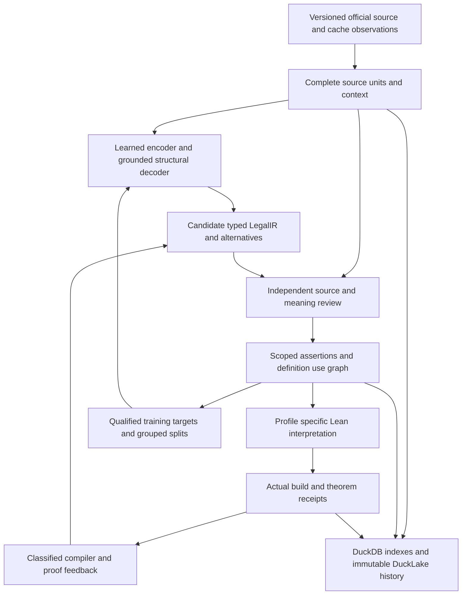

# LegalIR autoformalization and unified Lean 4 corpus roadmap

Date: October 15, 2026. Scope: improve the `ipfs_datasets_py` LegalIR autoencoder and learned decoders, connect the US Code span and entity caches, and assemble a versioned semantic corpus in Lean 4.

Build around one source-grounded pipeline: **versioned law → complete source units → candidate LegalIR → reviewed scoped assertions → connected semantic graph → Lean interpretations and checked consequences**. The autoencoder proposes representations and interpretations; source evidence, semantic review and deterministic validation establish which outputs can enter each corpus view. Train subsequent models on those separately qualified targets.

The first milestone is one real statutory definition with two complete, supported uses, a shared scoped identity, a connected graph and an actual Lean build. Broader model training follows a usable reviewed training/evaluation population. Existing source, graph, review and build components provide most of the engineering foundation; the remaining work concentrates on real content, semantic coverage and integration.

This is the current reading entry point. Preserve the [detailed implementation history](legal-ir-span-graph-lean4-implementation-plan-2026-10-13.md), [training review](legal-ir-training-review-and-corpus-plan-2026-10-13.md), [connected pilot specification](legal-ir-connected-statutory-pilot-spec-2026-10-15.md) and [definition profile specification](legal-ir-definition-profile-extension-spec-2026-10-15.md). The existing [24-task backlog](../../artifacts/autoencoder-comprehensive-review-20261013/implementation-backlog.json) remains the dependency contract. This roadmap changes no task status or experiment result.

## Implementation priorities and target deliverables

Improve the system in three coordinated areas: complete grounded LegalIR generation, aggregation into scoped semantic graphs, and translation into a versioned Lean corpus. Keep the source/compiler diagnostic pipeline as a baseline. Extend the genuine learned decoders already present; a new generic formula decoder would duplicate existing work without addressing their representational limits.

The following work packages refine the existing backlog. They describe proposed deliverables and gates, not completed implementation. Cache inventory and formal semantics work can proceed alongside source review; semantic training and corpus acceptance require their respective evidence dependencies.

| Priority and backlog | Deliverable | Acceptance gate |
| --- | --- | --- |
| P0 Cache inventory and compatibility; LIR-01–04 | Per-configuration and per-producer inventory at immutable Hub revisions, schema adapters, source correspondence and qualification census | Every imported row and artifact has exact provenance, a reconstructable payload and an explicit disposition. Preserve legacy observations and flags |
| P0 Finish candidate integration; LIR-01–04 | Preserve qualified sampled-source binding, active V2 use/review/preparation and separate native observations; finish remaining cache boundaries | Binding and definition-only builds are qualified. Active use integration passed 351 tests with one deselection; its new executor passed 109 tests and two authored six-module builds. Actual statutory use/review and unsupported cache adapters remain separate gates |
| P1 Reviewed connected pilot; LIR-05–10 | One complete definition and two complete real uses, with edition, applicability, source context and reviewed interpretations | Every selected meaning unit has an accounted disposition; both uses bind the evidenced scoped sense. Unsupported meanings remain explicit |
| P1 Typed aggregation; LIR-04, 07–11 | Source/AST companions, mentions, scoped senses, entities, definitions, assertions and evidenced role/use edges | Complete endpoints and dependencies, faithful AST reconstruction and isolated alternatives. A transport link or shared label cannot count as semantic resolution |
| P1 Native V2 build; LIR-12–14 | V2 definition build wrapper followed by a compatible shared definition/use project | Exact pinned native Lean/Lake build covers every expected module and artifact; statements, assumptions and source identities are retained |
| P2 Learned structure; LIR-17–20 | Supported multi-assertion decoder, occurrence/argument attachment and definition-binding heads; reviewed training bundles | Matched held-out improvement in complete interpretations, with frozen regression and unsupported-emission limits; active latent/context contribution measured separately |
| P2 Translation and reuse; LIR-12–15 | Extend qualified corpus preservation, observational SQL, typed header and closed kernel claims, exact native type checks and planned request preparation into fresh request-bound theorem authority and incremental invalidation | Six standalone instances, two authored V2 corpus projects, strict retained packet replay, exact observational SQL close/reopen, typed header candidates, thirty original/header-alias kernel-type checks, thirty closed kernel candidates and thirty planned theorem requests are qualified. The prospective execution profile, resource telemetry and typed attempt/result/receipt issuance, compiler artifact reuse, graph/source query projection, broader constructors, general translation correctness and changed-definition/lookup invalidation remain required |
| P3 Release and expansion; LIR-21–24 | Cross-dataset release manifest, immutable history, classified repair feedback and coverage/cost dashboard | Independent reconstruction of source, graph, model lineage where applicable, Lean artifacts and receipts; expand by complete qualified dependency components |

The first useful end-to-end product is a small reconstructable statutory component, rather than a large count of strings or graph labels. Once its interfaces work, expand annotation and modeling to independent components. Use the existing reviewer, source-custody, graph, scheduler and build owners rather than creating parallel systems for them.

## Active repository integration

The [integration receipt](../../artifacts/legal-ir-v2-active-integration-20261015-01/integration-receipt.json) records the additive import of seven runtime modules, five test modules and three guides from isolated commit `8f33492f4a639aa0ee3218653c63e467cd01d3ea` into `external/ipfs_datasets`. The active handbook links the sampling, definition candidate and V2 context/review APIs. Both legacy source owners and the package initializer retain their exact original bytes; unrelated existing file changes remain preserved. Imported Python source and tests match the committed snapshot.

**463 tests passed with no failures, errors or skips:** 161 cases in the five imported suites and 302 legacy regressions. This qualifies the active integration of source preparation, typed candidates and review evidence, including unsupported-input and tamper refusals. It does not complete the broader statutory or model acceptance gates.

A separate owned real-source replay passed 15 checks and reproduced the original §101 sampling report, records and candidate inputs byte for byte. It retains 560 source blocks, 1,681 records, 134 candidate paragraphs and 3,360 open context requirements. The [block 48 source input](../../external/ipfs_datasets/workspace/test-logs/federal-corpus-audits/legal-ir-v2-active-integration-20261015-01/actual-source-replay-01/exports/block-0048-source-review-input.json) and [block 54 source input](../../external/ipfs_datasets/workspace/test-logs/federal-corpus-audits/legal-ir-v2-active-integration-20261015-01/actual-source-replay-01/exports/block-0054-source-review-input.json) preserve exact Unicode/UTF8 geometry, twelve open V2 context slots and 26 unanswered questions. Independent readback passed 58 checks. These handoffs are preparation files, not compatible signed submissions or typed legal interpretations; actual reviews, semantic admission, training gold and Lean builds remain zero for this contribution.

The definition/context/review APIs are available in the active repository. The sampled-source response/proposal flow described below now precedes them. The remaining Phase 0 cache alignment and broader task dependencies still apply.

## Sampled source review and blank handoff migration

The [sampled-source integration receipt](../../artifacts/legal-ir-sampled-source-review-20261015-01/integration-receipt.json) records the active `legal_source_sampling_review` intake and new `legal_source_sampling_review_handoff` adapter. The intake retains its exact implementation from commit `8aebfd95c8f028aa5b44a42aca6462c452ad3562`; its fifteen-question catalog separates seven source findings from eight meaning proposals. The adapter binds each earlier thirteen-question packet to the complete current source bundle, checks its original occurrence and V2 context geometry, and prepares a new blank declaration template. It rejects partially answered packets rather than discarding their contents. Source findings, reviewer identity and exposure are never invented during migration.

**137 focused tests passed with no failures, errors or skips:** 28 new migration cases, 47 imported intake cases and 62 sampler/context regressions. These overlap the earlier integration's regressions and are not an additional disjoint population of statutory examples. The real §101 replay passed thirteen checks, including four refusals for blank submissions, a wrong bundle pin, foreign occurrence evidence and a resealed authority mutation.

The [complete review bundle](../../external/ipfs_datasets/workspace/test-logs/federal-corpus-audits/legal-ir-sampled-source-review-20261015-01/actual-source-review-01/exports/review-bundle.json) contains 560 guides and 8,400 unanswered question slots, retaining all 3,360 original open context requirements. The [block 48 draft](../../external/ipfs_datasets/workspace/test-logs/federal-corpus-audits/legal-ir-sampled-source-review-20261015-01/actual-source-review-01/exports/block-0048-blank-review-draft.json) and [block 54 draft](../../external/ipfs_datasets/workspace/test-logs/federal-corpus-audits/legal-ir-sampled-source-review-20261015-01/actual-source-review-01/exports/block-0054-blank-review-draft.json) retain original packet hashes, source references and unknown reviewer/exposure fields. Original packet bytes accompany the new exports. The actual population has zero responses and 560 pending subjects; two explicitly synthetic unresolved responses live only in separately named diagnostic files. Actual reviews, meanings, ASTs, training gold, graph admission and Lean builds remain zero for this contribution.

The intake records declarations and structured unresolved/disputed/unsupported outcomes without authenticating people or choosing a latest answer. Different prose does not establish agreement or contradiction, and unavailable evidence remains an explicit unresolved gap. The [intake guide](../../external/ipfs_datasets/docs/autoencoders/legal_source_sampling_review.md) documents these boundaries, including v1's explained `not_applicable` disposition and its separate downstream evidence policy.

The binding adapter and separate definition-only native build wrapper are now runtime-qualified as described below. Multi-occurrence assembly, compatible authenticated review, and real definition-use/selected-lookup-to-native bindings remain separate gates.

## Interpretation to candidate binding qualification

The new [sampled-source definition binding](../../external/ipfs_datasets/docs/autoencoders/legal_source_sampling_definition_binding_v2.md) accepts original explicit V2 request bytes, the complete source-review bundle, ordered independently pinned responses, original HTML and acquisition inputs. It delegates full review replay and candidate generation to the existing owners. Its bounded envelope retains the definition report, candidate, whole review population and exact role-to-subject metadata. It preserves multiple roles and repeated occurrences, separately selected scope evidence, affected withheld parent contexts and unselected pending subjects. Reviewer prose supplies no AST, and no declaration grants source, meaning, training or Lean authority.

The [qualification receipt](../../artifacts/legal-ir-definition-candidate-binding-qualification-20261015-01/qualification-receipt.json) records **154 passing tests with no failures, errors or skips**: 59 new binding cases, 35 V2 definition compiler cases, thirteen corpus adapter cases and 47 review-intake cases. Existing regressions overlap prior suites and do not add statutory examples. The production owner and original driver retain their prepared bytes.

The [actual-source driver](../../artifacts/legal-ir-definition-candidate-binding-20261015-01/run_actual_definition_binding.py) passed fourteen checks, including six refusal controls. It explicitly declares block 54's “enlisted member” head and opaque “a person in an enlisted grade” body, with the separately supplied block 48 title-scope literal. FOL and TDFOL each produce a closed candidate graph with fifteen nodes, twenty-six edges and one `DEFINES` edge. Each retains all 560 pending source subjects, 8,400 unanswered question slots and 3,360 open original context requirements. Two original and four derived selected occurrences retain 36 open context requirements. This is one unreviewed definition represented through two routes, not two reviewed statutes.

The [independent readback](../../artifacts/legal-ir-definition-candidate-binding-qualification-20261015-01/independent-actual-readback.json) verified all twenty-six exports (7,026,566 bytes), 29 producer files, 2,407 CID seals, 1,131 all-false authority objects and 2,250 strict integer-zero masks. Actual human reviews, semantic admission and model training remain zero for this contribution. Native compilation is recorded in the separate build phase below.

The earlier storage refusals and exact administrative closeout evidence remain intact. Restored capacity allowed the unchanged validation owner to admit both successful runs and release their durable reservations. The replay's first request also exposed the launcher's four-MiB source-watcher bound: its 5.66-MB data bundle is now checked by the unchanged driver's fixed transport/canonical pins, bounded identity-preserving snapshot and full replay. All 48 remaining source/small-input watcher pins were preserved; no source limit or compiler acceptance criterion changed.

The separate [V2 definition build wrapper](../../external/ipfs_datasets/docs/autoencoders/legal_source_sampling_definition_lake_v2.md) now reuses the installed-toolchain, bounded process and closed-project owners. The existing `legal_source_definition_lake.py` continues to accept V1 inputs. Each V2 project has six exact inputs and three modules; public validation regenerates the original binding and native fragment before and after execution. Successful receipts require the exact offline command, installed binary pins, six unchanged executed inputs, three nonempty artifacts and confirmed owned sampled cleanup. Full bounded logs remain separate from their 32 KiB receipt previews.

Its [qualification receipt](../../artifacts/legal-ir-definition-lake-v2-20261015-01/qualification-receipt.json) records **207 passing tests**: 169 new wrapper cases, seven V1 build regressions and 31 shared-corpus regressions. The actual §101 driver passed ten checks, including two pre-build refusals. Installed Lean 4.26.0 built both family projects and all six expected modules. A separate deliberately invalid second module produced a native type mismatch after compiling only its prelude; this diagnostic contributes no successful primary build. Three build commands and four version probes ran in total. Both owned validation reservations were durably released.

The [independent native readback](../../artifacts/legal-ir-definition-lake-v2-20261015-01/independent-actual-native-readback.json) passed nine checks over all seventy-two exports (7,111,225 bytes), 35 active producer files, both binary pins, 2,413 CID seals, 1,138 all-false authority objects and 2,264 strict integer-zero masks. The full source bundle, candidate and population bytes remain unchanged. These are two projections of one opaque definition in one physical document, with 560 subjects pending in each family. They cannot serve as two distinct definitions or definition users. Compilation of supplied unary predicates establishes neither legal meaning, source applicability, translation preservation nor model convergence.

The existing V2 definition-use, combined-review and closed-project preparation owners are now selectively integrated and requalified below, with a separate six-module executor. Preserve original sampled-source review populations alongside any endpoint evidence; the latter has a different input contract. Actual supported, independently reviewed definition/use sources remain a subsequent gate.

The [read-only integration audit](../../artifacts/legal-ir-definition-lake-v2-20261015-01/next-definition-use-gap-audit.json) pins all nine selected owner/test/guide files and eleven matching active prerequisites. Matching bytes establish compatibility candidates; they do not qualify dynamic imports or execution. The existing use profile requires distinct document identities and exact shared declared applicability. It retains an unproved alias assumption and one representative occurrence lookup, with per-occurrence governing resolution false. Its endpoint review and separate joint-review domain cannot be replaced by the sampled-source declaration envelope, and endpoint signatures alone cannot authorize the joint alias.

## Definition-use integration and conditional native checks

The [active integration](../../external/ipfs_datasets/docs/autoencoders/definition_use_v2_integration.md) copied all nine selected files unchanged and added two unchanged graph composition test files from the pinned integration commit. Its [qualification receipt](../../artifacts/legal-ir-definition-use-integration-20261015-01/qualification-receipt.json) records **351 passed, zero failures, errors or skips, and one explicitly deselected symlink parameter**. These checks include candidate/review/preparation behavior, exact Parquet cold-reader roundtrips, scoped lookup, signature/dependency boundaries and actual competing-donor-table invalidation. All 111 frozen source pins remained unchanged; historical isolated results were not substituted for this active run.

The first attempt stopped because an absolute-path deselection failed to match pytest's node ID and the symlink case ran. The successful replacement used a relative node ID and matching name filter, preserving all authored test bytes and reporting exactly one deselection. That filesystem case remains separately unqualified. Its failed attempt and full 250-MB storage claim remain retained; the [recovery audit](../../artifacts/legal-ir-definition-use-integration-20261015-01/recovery-audit.json) confirms that existing closeout profiles reject the preserved link. Successful-run release does not release this failed claim or weaken the storage profile.

The new [conditional native executor](../../external/ipfs_datasets/docs/autoencoders/legal_corpus_definition_use_native_v2.md) passed **109 focused tests**, then built two authored FOL/TDFOL projects using installed Lean 4.26.0. It retained all twelve expected compiled modules, eighteen exact executed inputs and six actual empty-axiom observations covering three conditional theorem kinds per family. Two resealed pre-build controls refused without a process. Both original preparations and pending assessments remained unchanged, including `build_eligible=false`. The two native-phase successful resource reservations were durably released.

Its [independent readback](../../artifacts/legal-ir-definition-use-native-20261015-01/independent-authored-native-readback.json) verified all 98 files (6,940,049 bytes), thirty producer sources, four fixture sources, 906 sealed-record occurrences representing 273 unique CIDs, sixty all-false authority objects, 36 strict integer-zero masks and 1,609 false semantic fields. Each family retains thirteen physical contexts with 78 slots. The [qualification receipt](../../artifacts/legal-ir-definition-use-native-20261015-01/qualification-receipt.json) binds source/binary/artifact/log observations and sampled process cleanup. Two builds and four version probes ran in total. Source inputs are explicitly fictional, trust is unavailable, and actual human/statutory reviews remain zero.

These checks prove conditional engineering obligations under the supplied donor, consumer and alias hypotheses. They do not discharge those hypotheses, establish the alias as a legal fact, prove general serialized-AST denotation preservation, or establish model convergence. The original source-meaning, review, graph admission, training/gold and corpus gates remain false. A future versioned receipt schema should namespace inherited preparation flags separately from actual tool observations: current conservative `toolchain_probed=false` and related fields coexist with explicit successful native version-probe records. Consumers must use the named observations and must not relabel this receipt as corpus admission.

Next select a real supported source component and retain source-first interpretation, applicability and independent review/exposure evidence. Choose distinct documents for the current use profile, or implement the evidenced same-document scope extension before using a same-document component. Extend per-occurrence resolution only with complete physical queries and dependencies. The bounded concrete serialized-AST preservation checks below now provide a separate engineering certificate; source review, corpus integration and target eligibility retain their own gates.

## Concrete serialized native AST preservation

The new [preparation and native execution profile](../../external/ipfs_datasets/docs/autoencoders/legal_native_ast_preservation.md) retains each complete native fragment and the existing emitted `formula_0` unchanged. It separately embeds the whole native JSON value and a typed Lean AST, then checks three concrete obligations: the typed AST reconstructs the complete native value, all variables are bound, and its independent denotation is equivalent to the emitted expression for arbitrary carriers, interpretation and time. Closed unary predicates, null-sort named variables, universal quantification, negation and binary conjunction/disjunction/implication/equivalence are supported. Lexical shadowing, child order, association and duplicates remain explicit; unsupported constructors refuse.

The [qualification receipt](../../artifacts/legal-ir-ast-preservation-20261015-01/qualification-receipt.json) records **200 passing tests and one existing optional native-route skip**. Separate installed Lean 4.26.0 execution passed six four-module projects and all eighteen theorem observations with empty axiom inventories. Two projects carry the retained §101 fragment through FOL and TDFOL; four authored projects cover mixed Boolean structure, repeated predicates, nested quantifiers and lexical shadowing. They represent one unreviewed historical source interpretation and four engineering formulas, not six reviewed statutes.

Three re-sealed mutations were refused before native execution. A fourth control changed only an emitted conjunction to disjunction; Lean rejected the denotation obligation while the embedded ASTs remained unchanged. A singleton-domain valuation independently distinguishes the statements. The [independent readback](../../artifacts/legal-ir-ast-preservation-20261015-01/independent-native-readback.json) verified all 175 exports (6,762,235 bytes), independently decoded both Lean constructor values back to each complete original AST, and rechecked 28 producer files, exact imports, compiled artifacts, executed inputs, logs, seals and sampled cleanup observations. Native receipts namespace original preparation flags separately from actual compiler observations.

Two initial failed attempts remain retained: a driver envelope re-sealing error before native execution and a reserved Lean identifier rejected in the semantics module. The corrected source then passed both final qualifications. Neither failed result was promoted. The final native run contains twelve version probes, six successful builds and one failed semantic diagnostic. Historical §101 source/review qualification is not refreshed here: the [producer-drift observation](../../artifacts/legal-ir-ast-preservation-20261015-01/producer-drift-observation.json) records changed review-source/test files. Current native owners regenerate the whole original fragment; current full source/review replay remains unperformed.

This closes a concrete representation-to-expression gap for the selected instances. It does not prove a universal Python emitter theorem, a raw JSON byte-parser theorem, prose-to-AST fidelity, cross-family general equivalence, model convergence or legal meaning. Source/review authority, training/gold masks and corpus admission remain unchanged. The following compatible V2 profile extends this boundary into original corpus declarations. Retained-certificate consumption and cache/index admission still require complete statement, interpretation, dependency and toolchain bindings; keep source-review eligibility separate from artifact reuse.

## Preservation inside the original V2 corpus

The [V2 corpus preservation profile](../../external/ipfs_datasets/docs/autoencoders/legal_corpus_definition_use_preservation_v2.md) now generates checks for all four donor, consumer, alias and joint fragments. Each certificate targets the original module's `formula_0` directly under the original `LegalCorpusV2.Interpretation`. It reuses the standalone owner's typed values and independent denotation without copying a replacement declaration or treating different nominal interpretation types as interchangeable. All original Lean files and bindings remain unchanged; only the Lake configuration changes to register both roots. The complete original nine-file envelope accompanies the sixteen-file, twelve-module extension.

The [qualification](../../artifacts/legal-ir-corpus-preservation-20261015-01/qualification-receipt.json) records **301 passing tests with no failures, errors or skips**: 133 new cases and 168 standalone regressions that overlap earlier evidence. Two authored family projects compiled 24 modules and produced 24 concrete preservation plus six original conditional theorem observations, all with empty axiom inventories. The donor, consumer and alias hypotheses remain assumptions. These are two projections of one fictional two-document component, with zero actual statutory or human reviews.

Three re-sealed preparation mutations were refused before native execution. Lean also rejected a donor preservation theorem whose original-declaration target was replaced by False, retaining both AST values and all original corpus declarations. A singleton/all-false-atom countermodel independently distinguishes the statements. The [independent readback](../../artifacts/legal-ir-corpus-preservation-20261015-01/independent-native-readback.json) reconstructed all eight role ASTs and verified every one of 156 exports (12,178,136 bytes), source/import commitments, theorem partitions, artifacts, executed inputs, logs, sampled lifecycle observations and reference identities. The initial Lake registration failure, cancelled unit run and reader count refusal remain separate unqualified evidence; the corrected final profile passed both qualifications.

The integration exports two exact engineering reference contracts and addresses their native receipt bytes through existing unreviewed `EvidenceRef` objects. Raw-file hashes/CIDs and envelope-record CIDs remain distinct. The address-only helper performs no proof validation or artifact replay, and no cache writes, backend activation, artifact reuse, theorem-receipt conversion or training admission occur. Strict retained-packet readback, bounded observational SQL projection, typed header lineage and separate exact native type checks are now qualified below. Request-bound typed theorem-receipt issuance and legal artifact binding remain required. General emitter correctness, byte parsing, reviewed law-to-AST correspondence, broader constructors and convergence remain open.

## Retained corpus byte-packet readback

The [production packet reader](../../external/ipfs_datasets/docs/autoencoders/legal_corpus_definition_use_preservation_packet_v2.md) accepts exactly 49 immutable path/byte pairs, independently trusted raw receipt and whole-bundle pins, the original typed corpus preparation and complete source/review arguments. It regenerates the current public preparation before and after checking the archived receipt, exact project/executed/artifact bytes, full logs, fifteen theorem observations and historical lifecycle consistency. Historical producer pins must match current owners; changed producers refuse this profile. A detached type-sensitive review-input snapshot detects changes even immediately after the final replay.

Its [qualification receipt](../../artifacts/legal-ir-corpus-packet-20261015-01/qualification-receipt.json) records **68 passing tests**, with no failures, errors or skips. Separate actual readback passed both previously compiled authored FOL/TDFOL packets: all 98 retained files and thirty historical theorem observations. Independent readback checked all 110 exports and reconstructed all eight role AST instances; three altered-evidence controls refused. There were zero new Lean invocations, compiler probes or cache writes. Unit historical packets are explicitly synthetic and are not the actual native evidence.

The returned observation preserves the complete old receipt unchanged and reports current readback separately. Fresh native execution, compilation, kernel checking, installed compiler validation, proof-cache compatibility and admission remain false; all source/legal/review/training authority and masks remain unchanged. The existing address references remain unreviewed. Expected pins are external provenance premises, not execution authentication from self-sealed claims. Filesystem acquisition remains the existing transport's responsibility. The qualification initializes existing reasoning dependencies during owned startup before guarding every preparation/readback call; a retained earlier attempt shows NumPy's CPU capability subprocess probe was refused when that initialization occurred inside the guard. These counters do not claim zero OS child processes across dependency startup. All three selected resource reservations were durably released, preserving the failed evidence.

This closes the strict retained-byte consumption gap for the supported engineering profile. The separate observational SQL integration below consumes that reader. Compiler artifact reuse, theorem authority, reviewed statutory correspondence and model convergence retain their own gates.

## Observational SQL index integration

The [observational index adapter](../../external/ipfs_datasets/docs/autoencoders/legal_corpus_definition_use_preservation_index_v2.md) replays complete current packet/source/review inputs on preparation, write and retrieval. It requires independently trusted raw packet-observation and full packet commitments. The existing fifteen-dimension unified key retains the original source/preparation, four role ASTs, theorem assumptions and partitions, complete declared review dependencies, producer/semantics/toolchain/binary identities, full argument commitment and exact retained byte identities. Stored entries are `UNKNOWN` with `CANDIDATE` result authority, `NONE` evidence/trust and negative polarity; retrievability grants no theorem or source authority.

Static review found the existing `DuckDBProofStore(connection=...)` previously installed its tables while retaining entries only in memory. Its shadow wrapper also ignored the store acknowledgment. The existing store now supplies actual parameterized SQL persistence on an explicitly provided connection, transactional write/readback and cold exact-key retrieval. It validates complete canonical entry JSON and normalized key/dimension/premise/evidence rows, with byte checks before fetching text. SQL corruption cannot fall back to a warm memory entry. Invalidation, clearing, expiration and finite capacity apply to persisted rows. The no-connection behavior remains process-local. The caller retains connection ownership and must invoke store operations outside a caller transaction; access counters and single-flight state remain local.

The [qualification receipt](../../artifacts/legal-ir-corpus-index-20261015-01/qualification-receipt.json) records **153 passing tests**, with no failures, errors or skips: 47 real SQL persistence cases, 47 packet-index cases and 59 unchanged store regressions. Separate owned integration used DuckDB 1.5.5 through the existing trusted connection manager, wrote both historical packet observations and verified both after closing and reopening the database. All thirty normalized key dimensions, both evidence rows and all 123 exports passed independent readback; the original 110 packet-replay exports remain byte-identical. The actual database is a retained 4,730,880-byte file. A changed policy key missed and a theorem-authority request refused. New Lean invocations, compiler probes and legal proof-cache writes remained zero. DuckLake and Quack were not activated.

Generic adapter operation receipts keep durability false because a backend acknowledgment alone cannot establish filesystem durability or cold reopen. The separate retained integration evidence establishes that bounded close/reopen result. Complete source/review replay occurs before and after acknowledged storage; a post-write replay failure remains visible and grants no successful operation receipt. It may leave an observational row, so this is not a transaction spanning source replay and storage. Actual statutory reviews, legal admission and model convergence remain unchanged.

Typed theorem-header candidate lineage, exact native type checks, closed kernel claim projection and planned theorem request preparation are qualified below. Fresh request-bound execution and theorem receipt issuance, legal formalization binding, declared reverse invalidation and clean-build equivalence for compiler artifact reuse remain required. Graph/source SQL queries require their own projection of complete entry `result_payload` paths; vectors, semantic capsules, remote Quack and DuckLake delivery are also separate work. The indexed engineering observations do not establish a semantic statutory graph, model improvement or measured token savings.

## Typed theorem-header candidates: October 16, 2026

The [theorem-lineage owner](../../external/ipfs_datasets/docs/autoencoders/legal_corpus_definition_use_preservation_theorem_lineage_v2.md) replays each complete retained packet and original source/review inputs before constructing genuine `IRClaim`, `Assumption` and `ProofObligation` objects. Each engineering candidate binds its literal Lean declaration header, fully qualified identity, exact header/proof/axiom byte ranges, original interpretation and conservative declared import closure with source, executed-source and retained compiled-artifact hashes. An independently pinned complete lineage is validated by current regeneration and type-sensitive comparisons. Counterfeit nominal claim classes are refused before their slots are read.

The [qualification receipt](../../artifacts/legal-ir-corpus-theorem-lineage-20261015-01/qualification-receipt.json) records **61 passing tests**, with no failures, errors or skips: 45 new lineage cases and 16 existing claim/proof-protocol regressions. Separate owned replay of both actual retained authored family packets produced thirty claims and obligations, with ten explicit proposition-premise occurrences across four theorems. Three resealed or mismatched candidates refused. The [independent readback](../../artifacts/legal-ir-corpus-theorem-lineage-20261015-01/independent-theorem-lineage-readback.json) independently reconstructed all thirty blocks, 150 source ranges, declared closures and typed digests across 131 exports. All 123 earlier exports, 98 original packet files, nine existing qualified owners and the retained database remain unchanged. The initial reader refused two stale diagnostic expectations; its snapshot and refusal remain retained, and only those expectations changed. Both selected resource reservations were durably released.

The original three-name conditional partition is retained, while actual binders remain theorem-specific: the alias-use theorem requires donor and alias hypotheses; `joint_of_components` requires donor, consumer and alias hypotheses; `joint_matches_original` has no proposition hypotheses. Universal carrier/interpretation/time/entity parameters remain separate. Empty historical axiom inventories do not discharge explicit premises. Actual Prelude and namespaced semantics file hashes remain distinct from standalone body hashes.

Statements have kind `lean_declaration_header` and domain `engineering_corpus_preservation`. They are opaque source identities, with no elaborated kernel-type claim or executable backend request. No new Lean runs, compiler probes, backend requests, proof receipts, formalization artifacts or cache writes occurred in that lineage qualification. All proof/source/legal/review/model/training authority and masks remain unchanged. The separate native profile below qualifies exact type checks without changing those claims. Genuine typed request/attempt/result/output bindings through `ProofReceipt.issue` and exact legal artifact-to-receipt obligation matching remain required. Declared import closures alone do not qualify elaborated term dependencies or executable artifact reuse.

## Native theorem-type elaboration: October 16, 2026

The additive [elaboration preparation and executor](../../external/ipfs_datasets/docs/autoencoders/legal_corpus_definition_use_preservation_elaboration_v2.md) carry the fully replayed typed engineering lineage into a clean Lean build. The preparation retains the original sixteen inputs, changes only Lake root registration, and adds one `LegalCorpusV2Elaboration.lean` module. Fifteen aliases copy exact original headers inside their original namespaces, changing only the declaration name and applying every ordered original parameter and proposition hypothesis. The original opaque header candidates remain unchanged; the adapter does not interpret their literal command text as an independently parsed proposition.

The generated checker requires original and alias theorem `ConstantInfo`, complete closed structured `Expr`/`Level`/`Name` representations, exact universe inventories and `Expr.equal` including binder names and annotations. It separately requires `Kernel.isDefEq`, kernel proposition-type checks and kernel checks of both theorem constants. The executor uses the existing bounded native owner and safe artifact transport, consumes seventeen source-only inputs, and requires thirteen compiled modules, fifteen exact machine type observations and thirty separate empty-axiom inventories. Full structured captures live in a separate bounded `native/type-checks.json`; the sealed receipt retains exact file/record/type/universe byte commitments and compact names/check flags, preserving the existing corpus-record depth limit. Full current source/review/lineage/preparation and producer compatibility is replayed before and after execution; lifecycle and cleanup requirements remain explicit.

The [qualification receipt](../../artifacts/legal-ir-corpus-elaboration-20261016-01/qualification-receipt.json) records **86 passing tests**, with no failures, errors or skips: 41 elaboration cases and 45 existing lineage regressions. Separate owned native replay clean-built both retained authored family projects, compiling 26 project modules and checking thirty original/header-alias type pairs with sixty empty-axiom observations. All ten explicit premise occurrences remain hypotheses. The [independent readback](../../artifacts/legal-ir-corpus-elaboration-20261016-01/independent-elaboration-readback.json) reconstructed both complete preparations, every alias and captured binder binding, standalone full type payloads and compact references across all 293 exports (26,838,301 bytes). All 131 prior exports, 98 original packet files, ten protected owners and the observational database remain unchanged.

The native control replaced one zero-parameter alias with `True` and proof `trivial`, preserving the original corpus. Its valid alias proof retained an empty axiom inventory, while the exact original/alias type comparison failed with the specific `corpus type mismatch` diagnostic and confirmed cleanup. All twelve original module artifacts, fourteen other type observations and thirty axiom inventories remain retained in the failed control. Actual calls comprised four version probes, two successful builds and one deliberate failed build. The failed control receives no successful-build credit.

The initial 85-case unit run passed; its native companion failed before retaining native logs/artifacts because full structured types exceeded the shared sealed-record depth limit. That failure, source generation and 131 prior-evidence copies remain unqualified. The corrected design retains full types in bounded standalone files and seals exact compact references, with the shared depth limit unchanged; the final suite includes a deep-type regression. Two earlier missing-attempt-directory launcher refusals occurred before worker startup and were resolved by creating the required empty private roots, using identical frozen requests. All four selected reservations were durably released, preserving failed evidence. The initial and final unit totals overlap and must not be added.

The installed standard library and dynamic compiler libraries remain external trust premises: the existing Lean/Lake ELF pair and project artifacts are pinned, while the installed library closure is not verified. The native elaboration qualification introduced no typed backend request, attempt, proof result, theorem receipt, legal formalization artifact or cache write. Source/legal/review/model/training authority and masks remain unchanged. The following profile now projects the captured complete types and universe parameters into new kernel claims and prepares prospective requests while retaining the original opaque lineage. Fresh request-bound execution remains required. The earlier observations have no request digest and cannot become retrospective request-scoped receipts. Shared invocation mappings, resource telemetry and step-limit enforcement require explicit qualification. Legal artifact-to-obligation binding, elaborated term dependencies, compiler artifact reuse, statutory correspondence and model convergence remain open.

## Closed kernel claims and planned theorem requests: October 16, 2026

The additive [retained type reader, kernel claim projection and planned request profile](../../external/ipfs_datasets/docs/autoencoders/legal_corpus_definition_use_preservation_kernel_claims_v2.md) consume the qualified native outputs without rerunning Lean. The reader requires exactly 53 immutable retained files per family, independently trusted raw receipt, standalone type-payload and whole-bundle pins, the original typed header lineage and 49-file preservation packet, and complete current source/review/preparation inputs. It reconstructs the public preparation before and after checking all frozen/executed inputs, compiled artifacts, full logs, fifteen original/alias type records and thirty empty-axiom observations. Historical lifecycle consistency and current producer compatibility remain distinct from execution authentication or current process liveness.

The projection creates thirty genuine engineering `IRClaim`/`ProofObligation` pairs. Each statement is canonical `lean-kernel-proposition/v1` JSON containing the complete closed captured type and universe parameters. Its telescope retains 68 expanded kernel binders across both families: 58 universal parameters and ten proposition-hypothesis occurrences. The earlier 44 grouped universal source ranges expand into those 58 universal kernel binders; the ten hypothesis binders are additional. External assumptions and obligation assumption IDs remain empty because the complete type already quantifies its hypotheses. Exact domain bytes, de Bruijn context, source-premise associations and original qualified declaration identities are retained. These conditional rules do not establish their premises or legal meaning.

Original opaque header claims remain unchanged and linked as separate evidence. New stable claim identity binds the pure source/preparation, assessment/review, interpretation, declared import-source, captured type/universe, producer, toolchain/binary and external-library policy commitments. Native receipts, PIDs, timing, logs, compiled artifacts, generated aliases and old header-claim digests remain outside that identity. A control changes transient historical run metadata while requiring the same new claim identities.

The request owner prepares thirty genuine `BackendRequest.for_claim` values for `THEOREM_PROOF`, with prospective backend `legal-corpus-v2-closed-kernel-theorem-native@1` and encoding `lean4-kernel-proposition-json/v1`. These are planned requests: dispatch and execution-profile qualification remain false. Requested finite bounds are annotations; elapsed time, steps, aggregate peak memory and complete output accounting still need qualified measurement and enforcement. Missing telemetry cannot be reported as observed zero. The owner checks genuine nested storage before conversion, preserves inherited producer pins, bounds argument trees before hashing and pins route/resource-policy constants.

The [qualification receipt](../../artifacts/legal-ir-corpus-kernel-claims-20261016-01/qualification-receipt.json) records **79 passing tests**, with no failures, errors or skips: forty retained-reader/kernel-claim cases, 23 planned-request cases and sixteen existing claim/proof-protocol regressions. Unit historical observations, artifacts and kernel types are explicitly synthetic. Final unit generation 04 completed in 1,704.29 seconds. Separate owned replay consumes the qualified native packets from two authored FOL/TDFOL engineering fixtures and creates thirty kernel candidates and thirty planned requests. The [independent readback](../../artifacts/legal-ir-corpus-kernel-claims-20261016-01/independent-kernel-claims-readback.json) verifies all 307 exports totaling 32,100,851 bytes, including all 293 prior exports unchanged, complete type/telescope/claim/request commitments and two refused resealed controls. The [final audit](../../artifacts/legal-ir-corpus-kernel-claims-20261016-01/final-readback.json) checks qualification, frozen sources, exports, documentation and selected resource closeout. Twelve existing protected owners and the closed observational DuckDB file remain unchanged; the database is compared by bytes and remains unopened.

The earlier generation-02 unit result of thirty passes and 49 errors and its failed actual-replay companion remain unqualified evidence. Exact registered-metaclass preflight was corrected and requalified through fresh frozen requests. Generation 03 was interrupted by the unchanged storage-capacity guard after about 712 seconds; its fifteen progress dots, absent JUnit report and [retained interruption evidence](../../artifacts/legal-ir-corpus-kernel-claims-20261016-01/validation-03-interruption-evidence.json) receive zero completed-test credit. Restored capacity allowed final generation 04 to pass under the same policy. Failed and interrupted counts are not added to the successful population. The [selected resource closeout](../../artifacts/legal-ir-corpus-kernel-claims-20261016-01/selected-resource-closeout.json) records five released reservations with durable evidence: two failed generation-02 attempts closed through the existing private recovery owner, the externally closed generation-03 interruption, and the successful final unit and actual-replay attempts. The local generation-03 recovery request was never executed; unrelated reservations remain outside this closeout. No new Lean invocation, compiler probe, backend attempt, usage measurement, proof result, typed theorem receipt, legal artifact or cache write occurs in this preparation profile. Source/legal/review/model/training authority and integer-zero masks remain unchanged.

The next execution adapter must receive a request before fresh native execution and bind its digest to genuine bounded attempt/result/output evidence before `ProofReceipt.issue`. The [telemetry follow-up memo](../../artifacts/legal-ir-corpus-kernel-claims-20261016-01/telemetry-followup-design.json) is read-only feasibility and an unqualified plan: first qualify managed-unit/cgroup ownership, scheduler leases and external charges; then define honest heartbeat coverage, cgroup-accounted memory scope, complete elapsed/output measurement and unavailable-metric failures. It authorizes no service or cgroup experiment in this preparation profile. The retained elaboration receipts cannot be retrospectively relabeled as request-scoped proof receipts. Shared-invocation mapping, resource policy, exact legal artifact-to-obligation binding, dependency invalidation, compiler artifact reuse, reviewed statutory correspondence, coherent corpus release, measured token savings and model convergence remain separate gates.

## Current implementation and cache evidence

The active repository is `external/ipfs_datasets`, with package name `ipfs_datasets_py`. Its inspected HEAD is `74f5d98c8ffff3c284cffddf430091b5fc4c6f8c`, with local changes including the additive integration above. The original corpus implementation and historical qualification remain in `artifacts/legal-corpus-contracts-20261013-01/datasets`. Historical isolated receipts and newly regenerated active receipts retain their own producer identities.

| Area | Current evidence | Consequence for the plan |
| --- | --- | --- |
| Span cache | Inspected revision `6107f6818fbac35465fc8d3a8a0fd66631294999`; paired-v1 and paired-v2 coexist with newer training branches | Ingest by declared schema and producer lineage; inventory each branch before selecting training rows |
| Documented paired autoencoder path | The card describes mock eight-dimensional embeddings and no learned formula decoder. Two inspected eight-row shards retain diagnostic/compiler outputs and unqualified statuses | Preserve observations as observations; verify genuine learned output capture independently for every eligible lineage |
| Reconstruction diagnostic | One sampled V2 observation has target-conditioned projected loss zero and cosine one, while canonical compilation abstains and Lake has not run | Projected reconstruction and guided/direct agreement cannot supply semantic learning or proof evidence |
| Entity cache | Revision `79d54378c5d6a89ab56e7a27e0f0ba867e800e19`; 1,960,876 rows in 99 Parquet row groups; all rows have `admitted=false`, `formalized=false` | Treat the present export as an index awaiting semantic enrichment |
| Entity relationships | Footer statistics show empty `src` and `dst` throughout the first 1,960,000 rows. Bounded samples contain named relations without instance endpoints; the tail includes classification rules | Repair/export actual evidenced endpoints or retain an explicit unresolved disposition; labels cannot reconstruct them |
| Source preparation | Existing §101 preparation retains 560 source blocks, 134 candidate paragraphs and 3,360 open context requirements | Reuse complete source/context populations; paragraphs are inputs, not reviewed definitions |
| Definition candidates | Isolated commit `4e4ea1afa0226c62fdd28e1678cd4046feb90218` implements V2 unary Boolean definition candidates and graph companions; saved validation reports 290 passing tests | Reuse the implemented profile; extend it only for concrete unsupported meanings |
| V2 review preparation | Newer isolated commit `8f33492f4a639aa0ee3218653c63e467cd01d3ea` adds context and definition-only review APIs; saved validation reports 251 passing tests | The review API is implemented. Integrate its qualified dependencies and obtain actual independent reviews; its example retains seven contexts and 42 open slots |
| Active V2 definition use and combined review | Existing owners from `6b5ee085a9ffc4cb2492552ca31b335badfd1fc1`, `e289e1bc059f3ad975bc2c3072a077a676337e4a` and `9ff4d29ea36d5a495d7f9f321fb1d9def73aa98e` are integrated unchanged; 351 active checks passed with one deselection | Preserve representative assumed alias lookup limits and pending statutory review; no per-occurrence governing-use claim |
| V2 conditional native execution | Separate active executor passed 109 tests and two authored six-module builds with six conditional theorem observations | Keep original preparation/build eligibility false and proof premises explicit; real-law source preservation and convergence remain open |
| Concrete serialized native AST preservation | Separate owners passed 200 tests with one optional route skip; six native projects compiled 24 modules and checked 18 concrete theorem obligations, plus a rejected semantic mutation | Preserve the supported unary Boolean profile and complete original AST/body; general translation, byte-parser proof, reviewed source correspondence and convergence remain open |
| Original-interpretation V2 corpus preservation | Separate owners passed 301 tests; two authored projects compiled 24 modules with 24 preservation and six original conditional theorem observations | Preserve all four direct original declaration targets and original review/premise state; cache/index admission remains separate |
| Retained V2 corpus byte-packet consumption | New reader passed 68 tests and replayed two real retained packets, all 98 files and thirty historical theorem observations, with zero new Lean/probe/cache operations | Require independent full-byte provenance and current producer/source/review compatibility; fresh proof authority, artifact reuse and cache admission remain false |
| Observational SQL storage and exact retrieval | Existing unified store now persists explicit connections; two packet entries survived cold reopen with all thirty key dimensions and no proof authority | Generic acknowledgments are not durability; legal theorem admission, graph/source query projection, compiler artifact reuse, DuckLake and Quack remain separate |
| Closed kernel claims and planned theorem requests | Retained 53-file elaboration packets project thirty complete closed kernel targets and thirty planned typed requests; 79 tests and 307 exports qualify this preparation profile | Bound hypotheses remain quantified, external assumptions are empty and no new theorem authority is granted; fresh request-bound execution, telemetry and typed receipts remain required |
| Semantic graph and Lean | Typed graph envelopes, scoped lookup, shared definitions, actual authored Lean builds and incremental reuse already exist | Carry reviewed statutory content through these owners and extend their supported semantic profiles |
| Training frontier | Retained F18 fails scientific acceptance and promotion; F19 is a completed saved-score diagnostic | Preserve those controls. A new experiment needs a changed hypothesis and compatible targets |

The two test counts describe separate saved suites with overlapping regressions and must not be added. Their fixtures establish engineering behavior. The latest V2 review example has no actual reviews, authenticated review evidence, statutory meaning, training gold or Lean admission. See the [V2 candidate receipt](../../artifacts/legal-corpus-definition-v2-implementation-20261015-01/implementation-receipt.json), [V2 review validation](../../artifacts/legal-corpus-definition-v2-review-20261015-01/precommit-validation-v01.json) and [independent example readback](../../artifacts/legal-corpus-definition-v2-review-20261015-01/independent-pending-example-readback-v01.json).

The earlier cache inspection covered public cards/tree metadata, complete entity Parquet footers, bounded entity samples and two small span shards containing eight rows each. Its failed Viewer requests were an availability observation, superseded by the refresh below. Neither inspection estimates corpus-wide autoformalization accuracy or the proportion of operative law in the span cache.

## Current cache inventory and migration scope

The October 15 refresh pins the span repository to `6b18d5b1e324204aa2268c06e55207062d158609` and the entity repository to unchanged revision `79d54378c5d6a89ab56e7a27e0f0ba867e800e19`. Both Viewer validity and split requests now return HTTP 200. Five successful three-row previews carry matching `x-revision` headers; row counts below are Viewer-reported inventory counts, not reviewed or unique statutory meanings. The [Hub intake](../../artifacts/legal-ir-roadmap-refresh-20261015-01/hub-intake-receipt.json) and [bounded previews](../../artifacts/legal-ir-roadmap-refresh-20261015-01/viewer-sample-receipt.json) retain exact requests and hashes.

| Configuration | Current role | Intake requirement |
| --- | --- | --- |
| Span `paired_spans` | 4,888 reported observations with nested source, autoencoder, compiler, comparison, provenance and Lake fields | Replay the exact paired bundle and artifact companions; sampled `admitted` and `formalized` flags remain false |
| Span `deferred_goals` | Source/observation-bound repair and capability records | Retain task/packet lineage; import planning and task execution remain separate |
| Span `evidence_artifacts` | Packed complete producer and compiler evidence | Verify compressed and expanded hashes and enforce decompression bounds before reconstructing observations |
| Span `formal_logic_text` | 372 reported formula occurrences from a fixed archived audit | Preserve repeated strings, origin, fallback and source-document pointers; sampled learned-generation and training-qualification flags are false |
| Span `retained_outputs_v1` | 32 reported historical observations with raw/projected vectors and retained compiler outputs | Keep schema and producer identities separate from newer paired outputs |
| Span `census_v2` | 26,952 reported diagnostic census rows | Preserve model/code identity, metric scope, compiler abstention and original input/comparison JSON |
| Span `census_v3` | Another separately declared census schema | The three-row response exceeded the 2 MiB preview bound; use bounded row/artifact readers and manifest-driven inspection instead of raising limits blindly |
| Span `supervisor_goals_v2` | Historical supervisor goal records | Preserve generation, provenance and unresolved capability status; a published goal supplies no semantic admission |
| Entity `autoformal_uscode` | 1,960,876 reported rows with the existing twelve-column materialized index | Apply the observation intake, retain absent endpoints/legacy flags, and construct semantic companions through reviewed bindings |

The Viewer configurations do not inventory every branch. The pinned file tree also contains `paired-v2`, `feature-pretraining` and `modal-ir` artifacts. One bounded paired-v2 manifest declares `uscode-paired-span-bundle/v2`; one modal-IR manifest remains unadmitted. A selected feature-pretraining report exceeded the 256 KiB metadata bound. These observations establish additional lineages to inventory, not their training quality or semantic coverage. Extend the migration ledger by manifest/schema, including branches absent from the card's configuration globs. The [additional-lineage receipt](../../artifacts/legal-ir-roadmap-refresh-20261015-01/additional-lineage-receipt.json) records this limited scope.

The [current span card](https://huggingface.co/datasets/justicedao/uscode-autoformal-span-cache/blob/6b18d5b1e324204aa2268c06e55207062d158609/README.md) explicitly distinguishes its archived compiler audit, fallback/omission evidence and diagnostic vectors from learned formula generation and semantic gold. Do not generalize that bounded audit to every newer lineage, or treat the Hub's `train` storage split as training eligibility. Keep a per-lineage ledger of source coverage, actual emitted representation, checkpoint identity, supported profile, review state and build/proof evidence.

## End to end architecture

Store canonical source, interpretation and expression records independently of learned vectors. A vector is a retrieval or compression representation. The semantic graph and its expression companions must remain reconstructable without a model checkpoint. A proof receipt binds an exact formal statement and assumptions; it cannot independently establish that the statement captures the source law.

Maintain separate dimensions for source integrity, context completeness, interpretation review, representational completeness, binding/dependency closure, translation, Lean compilation and theorem verification. Preserve pending, disputed, unsupported, stale and failed outcomes. Derive eligibility views from validated evidence rather than allowing one `formalized` boolean to cover all stages. A signature verified under the selected trusted issuer/key policy authenticates the signed subject and issuer binding; semantic acceptance requires the separately defined review and admission policy.

## Source alignment and cache migration

Pin dataset commit, manifest, file hash, row identity, schema, producer implementation and checkpoint for every imported observation. Support paired-v1 and paired-v2 through explicit adapters. Inventory newer branches independently; a legacy card does not describe every newer producer. Preserve malformed or unresolved observations with their original bytes and disposition.

The materialized entity index has twelve columns: `record_kind`, `meta_category`, `graph_kind`, `label`, `legal_id`, `node_id`, `src`, `dst`, `logic_role`, `in_formula`, `admitted`, `formalized`. It is distinct from the local `EntityCache` queue/resume schema. Reuse `legal_entity_index_intake` for the former and the existing queue owner for the latter. Transport readiness, queue completion and source semantics remain separate.

Align a cached string with its actual versioned source occurrence. Record all matching positions, repeated-text ambiguities and unavailable joins. A shared citation or `legal_id` is a search key; it does not identify a physical passage, governing edition or applicable definition. Separately verify correspondence between decoded Parquet strings and official XML/HTML views; their coordinate systems are not interchangeable.

Retain whole clauses, list introductions, shared conditions, exceptions, scope preambles and referenced context. One assertion may require several spans, and one paragraph may contain several assertions. Classify operative provisions, definitions, construction rules, headings, source credits, amendment history, editorial notes and administrative material through explicit source-role decisions. Keep excluded material in the source inventory with its reason.

Bind raw bytes, normalized view, extractor version and character/UTF8 selectors separately. Preserve a normalization map where available and mark unavailable mappings explicitly. Record source release, jurisdiction, instrument, legal effective interval and observation/review time as distinct fields. Official [OLRC downloads](https://uscode.house.gov/download.html) provide release points and structured source formats; adopting a new official source release requires a new correspondence decision for old cache rows.

Migration is additive: preserve legacy shards, publish versioned tables and a compatibility mapping, and retain the original qualification flags. Missing graph endpoints become unresolved records until evidenced bindings exist. No migration upgrades a heuristic relation or cached formula into a reviewed legal assertion.

Publish the following table families as new, versioned configurations after local qualification. These are proposed additions, not claims about the current Hub schema.

| Destination | Tables and responsibility |
| --- | --- |
| Span cache | Source versions/units, occurrences, interpretations, coverage issues and review references; preserve original observations separately |
| Entity and semantic graph cache | Typed nodes/edges, mentions, senses, definitions, assertions, resolution decisions and dependency manifests |
| Lean corpus artifacts | Shared semantics, generated modules, declaration/source maps, toolchain/import lock and build/theorem receipts |
| Cross-dataset release manifest | Immutable revisions, required external companions, qualification policy, complete populations and release root |

The proposed join chain is `cache observation → source occurrence → interpretation → assertion/definition node → Lean declaration → receipt`. Keep each link explicit and independently replayable. One observation may support several occurrences or interpretations; one assertion may require several observations. Original row/file identities remain distinct from semantic record CIDs.

## Canonical LegalIR and graph contract

Use the existing content-addressed corpus records and typed graph envelopes. Extend them through versioned semantic profiles with explicit supported constructors. Keep the full expression AST as a companion; a collection of actor/action triples cannot preserve quantifier scope, alternatives or qualifier attachment.

| Record | Required semantic content |
| --- | --- |
| Source version and occurrence | Immutable source identity, view identity, exact selectors, source role and complete context references |
| Interpretation | Supporting occurrences, declared reading, profile, alternatives, covered meaning units, unresolved residuals and producer/review references |
| Mention | Exact physical occurrence and proposed or reviewed denotation; separate repeated occurrences |
| Term sense | Scoped concept identity, declared applicability, source version, sort and arity; distinguish the same spelling in different contexts |
| Entity | Particular referent with explicit identity evidence; distinguish a class, office, office holder and organization |
| Definition assertion | Defined sense, operator, typed binders/body, applicability, temporal qualifiers and source evidence |
| Norm or other assertion | Typed actors/arguments, modal or constitutive operator, condition, exception, temporal structure and exact attachment |
| Resolution | Full query, searched partitions, candidates, chosen binding or unresolved result, applicability evidence and resolver profile |
| Review and issue | Exact subject/dependencies, decision, alternatives, disagreement, representability and admission eligibility |
| Lean artifact and receipt | Exact expression/graph inputs, generated module/declaration, toolchain/imports, assumptions, execution result and checker evidence |

Keep `MENTIONS`, `DENOTES`, `DEFINES`, `USES_DEFINITION`, `APPLIES_WITHIN` and ordered role edges distinct. Each assertion edge needs actual node endpoints, provenance and an interpretation identity. Existing graph v1 requires local endpoint closure; initially materialize a complete bounded dependency component. A future external-import profile needs its own manifest and validator before publishing dangling references as valid graph edges.

Reuse existing aggregation boundaries carefully. `legal_entity_index_intake.py` creates observation records, not semantic assertions. `corpus_proposed_graph_adapter.py` preserves its proposal AST but currently projects transport links `HAS_SOURCE` and `DERIVED_FROM`. The active V2 definition adapter adds `DEFINES`; it creates no ground entities, norms or definition-use edges. Add only the missing typed projections and qualified bindings, with their expression companions. Graph edges reference node record CIDs; stable labels or payload hashes cannot substitute for the required endpoint identity. The current 4,096-node/8,192-edge bounds and one-MiB record bound make complete bounded components the initial release unit.

The active `corpus_definition_use_v2.py` combines two distinct-document unary definitions using an explicit unproved alias assumption and a closed definition-to-definition `USES_DEFINITION` edge. `corpus_definition_use_review_v2.py` binds the full joint AST, alias, contexts and dependencies in a separate combined-review signing domain; this supersedes the older use guide's pending-review statement. These existing owners are integrated and qualified for the selected engineering checks above. Their current representative lookup is not per-occurrence governing-use verification; same-document multiple-definition scopes and arbitrary norm uses remain unsupported. Endpoint reviews cannot authorize the joint subject, and authenticating a combined declaration does not prove its alias assumption.

Definition identity follows reviewed scope and applicability. Preserve lexical occurrence, scoped sense and entity as different records. Neither spelling normalization nor embedding similarity authorizes merging. Title applicability is an explicit declaration, separate from physical document nesting. Use the current explicit external-target resolver for the first cross-document case; do not invent cross-document parent links or equate a global scope with a title.

`LegalIRScopeKind` currently includes global, document, section, subsection, formula and clause, with no title kind. V2 source definitions retain declared title applicability separately. A versioned title/instrument-scope extension needs explicit resolver and native-binding tests before it can replace the external-target route. Preserve the complete lookup query and searched partitions, including empty and unavailable partitions. An exact lookup replay does not establish that the supplied search population exhausts applicable law.

Specify constructor semantics before training or compiling them. Unary `means` equivalence is the initial implemented fragment. Inclusion, exclusion, relational definitions, equality, quantities, exceptions, priorities, temporal validity and legal powers require their own supported profiles. Preserve the difference between a conditional obligation, an obligation with conditional content, permission and a prohibition. An open-textured or unresolved term remains explicit instead of receiving an invented predicate interpretation.

Definition cycles require classification: a benign mutual reference, an unsupported recursive definition and an inconsistent theory are different cases. Cycles do not permit automatic recursive Lean definitions. Preserve competing interpretations as separate alternatives rather than unioning them into one asserted theory.

Maintain a projection capability matrix for the existing logic families, including FOL, TDFOL and any selected CEC/deontic profiles. Record supported constructors, sort/time assumptions and refused or lossy translations per family. Use the same canonical AST and symbol identities at each projection boundary. A successful parse in one family does not establish equivalence with another; cross-family semantic preservation needs its own supported theorem or explicitly bounded test evidence.

## Autoencoder and learned decoder improvements

The legacy `AdaptiveModalAutoencoder` reconstructs vectors. Its qualification describes an embedding model plus a deterministic source compiler and declares that the model does not emit formulas. Separate learned implementations already exist: source-attention formula generation, source-span pointers, latent-conditioned residuals and grouped actor/action extraction. Keep their producer and checkpoint contracts distinct.

| Existing model path | Useful capability | Required extension |
| --- | --- | --- |
| `legal_formula_learning` and `legal_formula_codec` | Source/target GRUs, attention, grammar masking and resumable Adam; one seven-facet deontic rule, at most 64 source/target tokens and four qualifier atoms per facet, with a closed training vocabulary | Broader copying and typed structures without shortening source meaning to fit the codec |
| `legal_span_formula` | UTF8 byte/BiGRU source copying and grounded role pointers, with a 256-token bound | Repeated occurrence selection, multiple atoms, nested attachments and multiple assertions; the present profile cannot express those general cases |
| `legal_grouped_span_decoder_v2` | Ordered member attention and support prediction for two–eight actor/action members and two declared coordination scopes | General argument/qualifier structure and evidenced context binding; retain the present diagnostic as its own profile |
| `legal_hybrid_formula` | Explicitly bound latent residual with parent-parity initialization | Demonstrate active representation benefit against matched latent-disabled controls |
| Vector autoencoder | Retained embedding/reconstruction baselines | Measure raw reconstruction separately from target-conditioned projection and from semantic generation |

Build the next model interface around five outputs: supported provision/profile classification; complete source-unit selection; typed AST construction; exact source pointers and scope/argument attachment; and candidate sense/definition bindings with calibrated abstention. The model may propose a candidate without making an admission decision.

Use source hierarchy and complete declared context as encoder inputs. Retrieve version-compatible definitions through the index, retaining retrieval provenance and missing-context outcomes. Begin with bounded, explicit context windows that preserve full selected meaning units; add hierarchical encoding only when a measured context-length failure justifies it. Overflow must produce a visible refusal or complete partitioning, never silent truncation.

Combine a structural decoder for operators, binders, assertion count and attachments with pointer/copy heads for grounded literals. Constrained decoding enforces sorts, arities, reference availability and AST grammar. It must still expose semantic errors: a syntactically valid formula is a candidate. Do not allow a compiler fallback or reference target to masquerade as model generation.

Train with separately reported losses for AST generation, occurrence pointers, argument/qualifier attachment, definition resolution, support/abstention and optional vector reconstruction. Use reviewed equivalence pairs for semantic invariance and reviewed hard negatives for modality, scope, negation, date and attachment changes. Unknown or disputed relations stay masked. Definition wording, compiler agreement and successful compilation do not automatically supply gold labels.

A proposed combined objective is `L = λAST L_AST + λspan L_span + λattach L_attach + λref L_reference + λsupport L_support + λcontrast L_contrast + λrecon L_reconstruction`. Enable each supervised term only where the target bundle qualifies that label; record masks, weights and per-head losses with the experiment. Weak compiler or synthetic targets may support a separately labeled pretraining experiment, but cannot enter the independently reviewed statutory evaluation population. Reconstruction remains optional and cannot dominate selection of a model whose task is complete legal interpretation.

Expand supported output structure in this order: grounded unary definitions with exact occurrence/scope pointers; complete supported uses with definition and argument bindings; multiple assertions with shared conditions and qualifier attachment; then relational/multisorted definitions, inclusion/exclusion, nested exceptions, quantities and temporal profiles. For each extension, update the typed schema, lossless examples, family capability matrix, graph projection and Lean interpretation before treating it as a supervised semantic target. A larger encoder alone cannot repair a missing constructor.

Preserve an explicit architecture comparison: source-only decoder, source-plus-latent decoder, latent-only bottleneck decoder, and source-plus-retrieved-context decoder. Report which paths retain the source text. A residual model that requires its original source cannot establish a self-sufficient compressed semantic representation. Include zero, shuffled and mismatched latent controls; hold decoder, data and compute budgets constant where possible.

Before each experiment, declare the hypothesis, donor, trainable tensors, optimizer reset/resume, losses, update budget, selection rule and regression floors. The retained F19 diagnostic found gold spans already within the actual top eight on six inspected donor/case records, yet shorter competitors were selected. Target structural selection/whole-condition margins with a matched control before proposing wider candidate search as the repair. A changed freezing policy plus a margin loss needs a same-freezing control to attribute the effect.

A decreasing loss is an optimization observation. Track complete interpretation accuracy, semantic error and held-out generalization separately. Any claim of empirical convergence needs a fixed objective/data protocol, retained checkpoints, repeated seeds and a stated stopping rule. A theorem about a restricted optimizer or formal model does not prove that arbitrary statutory training converges to the intended legal meaning.

Define convergence operationally before fitting: the checkpoint-selection metric and minimum useful effect, a fixed maximum update budget, a validation plateau rule, regression floors and the maximum permitted severe semantic error at declared coverage. Select checkpoints on development data; evaluate the sealed holdout after selection. A failed budget or plateau test is an explicit nonpromotion outcome. If formal optimizer convergence is pursued, state and prove its restricted mathematical assumptions separately from empirical stabilization and reviewed source fidelity.

## Training data and evaluation design

Create supervision from reviewed source→AST→graph bundles. Every target identifies its original source, context dependencies, interpretation, reviewers, representability and exposure history. Keep synthetic fixtures, weak compiler targets, model suggestions, independently reviewed statutes and rejected examples as separate populations. Preserve compiler abstentions and nonoperative fragments as explicit evaluation cases.

Group splits by provision/source revision, near duplicates and actual semantic definition dependencies. Audit crossing dependencies and declare which source definitions are available as inference context. Broad citation connectivity alone is unsuitable for split grouping because it can connect otherwise unrelated provisions. Withheld answer graphs, review labels and future interpretations must not enter retrieval, vocabulary fitting or negative mining. Previously inspected examples remain development material.

Start with a small reviewed component to validate mechanics, then expand toward 20–40 connected provisions and later 200–500 reviewed passages as source structure and review capacity permit. A single component establishes an integration milestone; broader generalization needs independent components. Use a bounded single-seed engineering comparison before at least three matched seeds for a promotion claim, with paired case-level results and uncertainty across independent groups.

| Measurement | Required reporting |
| --- | --- |
| Source fidelity | Exact occurrence/boundary accuracy, complete contributor coverage, context omissions and source-role errors |
| Interpretation | Complete AST/whole-rule accuracy, assertion count, quantifier/modal scope, exceptions, time and residual omissions |
| Linking | Mention/sense/definition accuracy, scope/date applicability, argument binding and ambiguous/unavailable resolution behavior |
| Graph | Endpoint closure, companion reconstruction, dependency completeness and alternative isolation |
| Selective generation | Error versus coverage, calibrated abstention, unsupported emissions and refusals included in denominators |
| Lean | Supported translation coverage, actual compilation, exact theorem discharge, assumptions and failed controls |
| Representation | Raw reconstruction, active latent contribution, retrieval contribution, source access and equal-budget comparisons |
| Operations | End-to-end bytes/tokens, GPU/CPU time, review effort, cold/warm builds and cost per reviewed and checked assertion |

Freeze class/case/length regression floors before fitting. Promotion requires an independently evaluated complete-meaning improvement with the declared retention and unsupported-emission gates satisfied. Keep model archival publication, model promotion, graph release and Lean release as separate decisions. The existing F18 archive is useful retained evidence despite failed scientific acceptance.

Use classified feedback to choose the next review batch: unsupported source structure, missing context, wrong scope, missing argument, mistaken modality, ambiguity, compiler failure and failed proof have different remedies. Sample difficult and nonoperative material as well as easy supported cases. Reviewers supply corrected targets or unresolved dispositions; accepted model predictions must not recursively manufacture their own evaluation gold. Preserve before/after targets and invalidation when review decisions change.

## Lean 4 semantics and proof obligations

Maintain a shared typed interpretation library, profile-specific lowering and generated statute modules. The existing `law_package` fingerprints and modality codes provide structural inventory; its fingerprint theorems do not establish statutory semantics. Extend the semantic emitters and shared definition compiler instead of treating structural packaging as the final semantic corpus.

Represent a reviewed law as a formal statement under a named interpretation. Keep legal definitions, normative assumptions, case facts and derived consequences separate. Opaque modal operators may support structural/conditional theorems; substantive deontic reasoning requires an explicitly declared semantic theory. Do not infer real-world performance of an action from an obligation to perform it. Preserve contrary duties as a classified conflict unless the selected logic specifies how they interact.

For each supported profile, define its LegalIR interpretation and Lean translation together. Prove well-formedness and semantic preservation for the supported AST constructors, preferably by structural induction. Those theorems establish the relationship between formal representations. Independently reviewed source correspondence supplies the separate law→LegalIR boundary. Finite examples and compiler round trips remain useful controls but do not replace a general translation theorem.

The preservation boundary must include the actual serialized LegalIR. Emit a canonical typed AST value alongside each generated statement, bind it to the source IR and source map, and prove that the statement denotes that AST under the same interpretation and environment. A proof about an abstract translator does not qualify a separate Python emitter that can produce different source. The new concrete native profile checks this relationship for six closed unary Boolean instances, including exact complete-value reconstruction. Extend that foundation through versioned corpus integration and separately specified constructors; unsupported constructors refuse until their interpretation and lowering are specified. Python JSON decoding and quotation remain explicit trusted steps rather than a proved raw byte parser.

Emit versioned modules for shared semantics, scoped definitions, provision assertions and consequences, with a manifest mapping every declaration to graph/expression/source identities. The first shared-use proof should retain explicit hypotheses for the definition, norm and case facts. Extend beyond unary/Boolean definitions only when the emitter's sorts, quantifiers, modalities and temporal representation preserve the selected profile. Existing discrete `Nat` traces do not silently establish calendar/deadline semantics.

Run the actual pinned Lean/Lake toolchain on exact generated sources and imports. Require declaration coverage, statement identity, complete assumptions and axiom inventories, rejected placeholders, and meaningful false-theorem/changed-definition controls. Audit transitive axiom dependencies with `#print axioms` and an explicit allowlist; substring checks for `sorry` alone are insufficient. Pin the native-evaluation policy because its trust behavior depends on the toolchain. The official [Lean proof validation reference](https://lean-lang.org/doc/reference/latest/ValidatingProofs/) explains these distinctions; evaluate additional checker support against the pinned version before making it a gate.

Track compilation, theorem discharge, source review and semantic preservation as separate results. A conditional theorem can be correct under supplied premises while the premises are inappropriate interpretations. Check vacuous or inconsistent premise sets through satisfiability/countermodel checks where supported, plus explicit witness cases. A unified corpus is a versioned family of compatible modules with declared contexts and imports; mutually exclusive readings or editions need separate theory views.

The native delivery sequence now has binding, definition-only builds, authored V2 conditional-use checks, bounded concrete AST-value/denotation checks, preservation inside authored V2 corpus projects, strict retained byte-packet readback, observational SQL indexing, typed theorem-header candidate lineage, exact native original/header-alias type checks, closed kernel claim projection and planned typed theorem requests qualified. Next carry actual supported source/review evidence through these owners and qualify fresh request-bound execution, resource telemetry and typed native receipt issuance, then extend shared and incremental corpus owners through versioned inputs. Existing shared-definition builds accept legacy definition/norm inputs, and existing incremental `.olean` reuse is a legacy direct-Lean profile. Neither can be relabeled as V2 qualification. Require root import coverage of all generated modules, expected nonempty artifacts, exact toolchain/source pins and retained failed-run evidence. Conditional use lemmas retain explicit definition, norm and case premises; they do not prove the source interpretation or occurrence of a legally required action.

## Indexes proof reuse and incremental updates

Use DuckDB for queryable source/occurrence, assertion, scope, dependency, retrieval and proof-receipt indexes. Keep vectors associated with their producer/checkpoint and source version. Reuse the existing single-owner registry and scoped Quack transport for short control operations. Numerical training consumes immutable local batches; database traffic need not occur inside each gradient step. DuckLake can retain immutable history/export snapshots through the existing delivery interfaces; activating it is a separate integration milestone.

Add a versioned semantic projection with `cache_observations`, `source_versions`, `source_units`, `occurrences`, `interpretations`, `mentions`, `term_senses`, `entities`, `definition_assertions`, `norm_assertions`, `typed_relations`, `scope_applicability`, `resolution_decisions`, `coverage_issues`, `review_assessments`, `dependency_edges`, `lean_declarations`, `build_proof_receipts` and `release_manifests`. These are proposed table families, not current Hub columns. Store canonical payload hashes and immutable companion references so indexes can be rebuilt without a model. Native DuckLake activation and export/readback need their own integration gate; they are not prerequisites for the first bounded local component.

A proof cache key binds the statement, assumptions, semantic profile, expression/graph inputs, selected definition resolutions, complete relevant search partitions, translator implementation, Lean toolchain and imported dependencies. Include unavailable/negative lookup partitions so that adding a competing definition invalidates an earlier result. A model checkpoint belongs in the derivation lineage and candidate-generation key; reuse an existing formal proof only when its exact formal inputs and trusted dependencies remain compatible.

`logic/legal_ir/proof_cache.py` already provides `LegalProofCache@1` for formalization artifacts and optional theorem receipts; shared-build artifact reuse has a different contract. Add an explicit compatible receipt/index adapter after the stronger statement, assumptions and toolchain bindings exist. A build receipt, candidate or integrity-valid cache envelope cannot acquire `theorem_proof`/`proved` authority through relabeling. Keep reviewed-source eligibility and compiled-artifact reuse as separate queries.

The [cache compatibility audit](../../artifacts/legal-ir-corpus-preservation-20261015-01/proof-cache-compatibility-audit.json) fixes the next integration boundary against current owners. `LegalProofCache@1` and the proof corpus store require a `FormalizationArtifact`; their theorem attachments require a typed `ProofReceipt` with declaration binding and affirmative theorem authority. Concrete corpus preservation observations use a separate engineering schema. Store their exact-byte addresses through the existing `EvidenceRef` as unreviewed runtime observations, retaining raw receipt SHA/CID, payload-record CID, complete preparation identity and engineering reference key separately. Constructing a reference performs no artifact readback or proof validation. A later typed adapter must retain each specific theorem statement, original interpretation, assumptions and complete source/review/dependency identities before any stronger receipt is eligible.

The new bounded observational adapter now implements explicit unknown result, no authority and no kernel-acceptance credit through the existing unified store. Its owned qualification includes actual SQL writes and cold reopen; legal theorem admission, graph/source query projection, remote delivery and compiler artifact reuse remain separate. Do not inherit a default proved status or infer kernel acceptance from a nonempty attachment list. A projection failure remains visible; a swallowed shadow-write error cannot count as completed hydration. Exact key dimensions and immutable payload references are mandatory; profile/source lookup slots and file existence are candidate discovery only. On retrieval, compare expected state and independently pinned complete artifacts before qualifying reuse. Reuse `legal_graph_dependencies` for declared reverse invalidation, including changed or unavailable lookup partitions, rather than adding another dependency engine. Native DuckLake activation and compiler artifact reuse require their own qualification.

Recompute affected descendants after changes to source bytes/views, applicability, definitions, interpretation choices, schema, resolver policy or compiler dependencies. Compare incremental results with a clean build on the pilot. Keep source/review invalidation separate from `.olean` compatibility: an unchanged theorem artifact cannot preserve a revoked source interpretation.

Derived semantic capsules can expose a bounded assertion/dependency summary for retrieval or agents. Bind each capsule to a corpus root, interpretation and unresolved obligations, and preserve access to the full source and AST. Measure total context and tool tokens against raw-source retrieval at equal task quality. Capsules and minified representations are delivery formats; they do not change semantic qualification.

## Delivery sequence and acceptance gates

The roles below describe work ownership; they do not assign named people or production review authority. Phases may overlap where their dependencies permit, while statutory acceptance waits for the prerequisites.

| Phase and backlog mapping | Responsible roles | Deliverable and acceptance gate |
| --- | --- | --- |
| 0 Integration and immutable inventory; LIR-01–04 | Repository maintainer and data engineer | Reconcile active and isolated implementations, exact dependency pins, paired schema adapters and entity-index export. Reproduce supported legacy behavior; preserve original rows and flags; account for every imported record |
| 1 Reviewed source component; LIR-05–07 | Source curator, legal reviewer and formal reviewer | Select a complete actual definition with applicability evidence, then one complete use and a second shared user. Record independent source/meaning decisions, alternatives, unsupported residuals and exposure. No sentence-fragment shortcut |
| 2 Scoped semantic graph; LIR-08–11 | IR and graph engineers with reviewers | Typed AST companions, exact source origins, evidenced `DEFINES`/`USES_DEFINITION`, complete endpoint/dependency closure and explicit unresolved cases. Preserve LIR-04→08 and LIR-09→10 |
| 3 Statutory Lean component; LIR-12–15 | Formal methods and build engineers | Supported interpretation library and actual generated build; exact statements/assumptions; negative controls; definition change rebuilds dependants and matches a clean build. LIR-11 and LIR-14 precede LIR-15 |
| 4 Learned structure and representation; LIR-17–20 | Model and evaluation engineers | Reviewed relation targets, untouched grouped holdouts, source-only and latent/context controls. Improve complete meaning under frozen regression gates; retain completed LIR-16 and F18/F19 evidence |
| 5 Coherent release and expansion; LIR-21–24 | Release/data maintainers and reviewers | Cross-dataset manifest pins span records, graph companions, model lineage and Lean artifacts. Independent readback reconstructs the component; measured coverage/cost governs expansion |

The first three implementation contributions should be concrete:

1. **Finish cache alignment around the integrated V2 profiles.** Sampling, definition candidates, context/review APIs, typed sampled-source declarations, interpretation-to-candidate binding and exact definition-only native builds now operate in the active repository. Add schema-migration and source-correspondence checks at the remaining cache boundaries. Older statements that call the qualified APIs missing are superseded.
2. **Connect an actual reviewed definition to real users.** Reuse existing review, scope and graph owners; add only the minimal typed constructors and explicit lookup-to-native binding required by those complete cases. If no supported user exists, retain the definition-only result and select a suitable component rather than inventing a norm.
3. **Build and invalidate the first statutory semantic component.** Generate shared definition and user modules, run actual Lean checks, retain exact assumptions and demonstrate a definition change affecting both users. Produce candidate/reviewed/checked views and a coherent local release manifest.

Candidate 45/block 54 in the existing §101 packets and its separate scope preamble are available review inputs, not preselected meanings or gold. The older nine operative candidate units and repeated mentions elsewhere do not automatically supply users of that definition. Source selection must establish a real connected component.

For implementation review, preserve the actual backlog dependencies: LIR-04→08, LIR-09→10, LIR-10/11/12→13, LIR-13→14, and LIR-11/14→15. Model binding heads depend on reviewed meanings and resolution (LIR-06/07/09→17); a coherent release depends on graph, native qualification and invalidation (LIR-11/14/15→21). Early engineering fixtures can exercise interfaces in parallel, while their statutory acceptance gates remain pending.

## Validation and release contract

Preserve existing no-target/compiler-fallback controls, zero/tied-head abstention, active-gradient checks, latent-disabled parity, checkpoint tamper refusal and exact optimizer continuation. Add tests only for new boundaries: repeated occurrences, Unicode/view drift, shared list qualifiers, scope/edition collisions, include-versus-equivalence, missing/ambiguous definitions, changed negative partitions, external closure, review-domain changes, AST/endpoint corruption and interrupted releases. Reuse current owners rather than creating parallel custody, authentication or resolver engines.

Keep one immutable release root that references the span-cache revision, entity/semantic-graph revision, all required companions, review/admission policy, model lineage where applicable, and Lean sources/build receipts. Use staged candidate publication and complete-manifest readback so a partial upload cannot advertise a complete checked corpus. The local native engineering results above are separate from release admission. Model training requires compatible qualified targets, and publishing a coherent release remains a later implementation step.

The initial milestone is complete when exact sources and context can be reconstructed; every selected meaning unit has a reviewed supported interpretation or explicit disposition; two real uses share the evidenced scoped definition; the graph has complete endpoints and dependencies; the supported Lean component actually builds and its requested theorems pass under declared assumptions; and a definition change invalidates the correct graph/review/build descendants. Report selected, supported, reviewed, compiled and proved counts against their own denominators alongside unresolved work.

The release dashboard must show at least these separate denominators: selected source meaning units; units with complete source/context; supported and reviewed interpretations; assertions with complete graph/dependency bindings; requested and compiled Lean declarations; requested and discharged theorems; and stale descendants awaiting regeneration. Report unresolved, disputed, unsupported and excluded cases alongside successes. Candidate→reviewed→checked views should be independently reconstructable; a zero-error subset at very low coverage cannot stand in for corpus-wide satisfaction.

## Implementation owners and evidence references

Python module paths below are relative to the active package root `external/ipfs_datasets/ipfs_datasets_py`.

| Work | Existing owners to extend |
| --- | --- |
| Lossless intake and source custody | `logic/autoformal/legal_span_cache_intake.py`, `legal_entity_index_intake.py`, `corpus_source.py`, `corpus_parent_occurrence_adapter.py` |
| Source preparation and latest definition/review profiles | `logic/autoformal/legal_source_sampling.py`, `legal_source_definition_bridge_v2.py`, `corpus_definition_adapter_v2.py`, `legal_statutory_context_v2.py`, `corpus_definition_review_v2.py` |
| Sampled source declarations and old blank packet migration | `logic/autoformal/legal_source_sampling_review.py`, `legal_source_sampling_review_handoff.py` |
| Qualified explicit interpretation to sampled-source candidate binding | `logic/autoformal/legal_source_sampling_definition_binding_v2.py` |
| Qualified sampled-source V2 definition-only native compilation | `logic/autoformal/legal_source_sampling_definition_lake_v2.py` |
| Typed graph and eligibility | `logic/autoformal/corpus_contracts.py`, `corpus_graph.py`, `corpus_graph_exchange.py`, `corpus_qualification.py` |
| Definition and use binding | `logic/autoformal/legal_source_definition_bridge.py`, `corpus_definition_norm_adapter.py`, `scoped_definition_resolution.py`; existing `legal_graph_review`/dependency owners |
| Active V2 alias/use, combined review and project preparation | `logic/autoformal/corpus_definition_use_v2.py`, `corpus_definition_use_review_v2.py`, `legal_corpus_definition_use_lake_v2.py` |
| Qualified authored conditional-use native compilation and kernel observations | `logic/autoformal/legal_corpus_definition_use_native_v2.py` |
| Qualified concrete native AST-value, closedness and denotation preservation | `logic/autoformal/legal_native_ast_preservation.py`, `legal_native_ast_preservation_native.py` |
| Qualified authored V2 corpus preservation under original interpretation | `logic/autoformal/legal_corpus_definition_use_preservation_v2.py`, `legal_corpus_definition_use_preservation_native_v2.py` |
| Qualified retained corpus byte-packet readback with current source/review replay | `logic/autoformal/legal_corpus_definition_use_preservation_packet_v2.py` |
| Observational packet projection and explicit-connection SQL persistence | `logic/autoformal/legal_corpus_definition_use_preservation_index_v2.py`, `logic/common/duckdb_proof_store.py` |
| Exact theorem-header, explicit-premise and declared-artifact lineage in typed engineering candidates | `logic/autoformal/legal_corpus_definition_use_preservation_theorem_lineage_v2.py` |
| Clean original/header-alias kernel-type comparison with standalone structured captures and compact references | `logic/autoformal/legal_corpus_definition_use_preservation_elaboration_v2.py`, `logic/autoformal/legal_corpus_definition_use_preservation_elaboration_native_v2.py` |
| Retained elaboration packet readback with full source/review and producer replay | `logic/autoformal/legal_corpus_definition_use_preservation_elaboration_packet_v2.py` |
| Complete closed kernel proposition candidates with scoped telescope associations | `logic/autoformal/legal_corpus_definition_use_preservation_kernel_claims_v2.py` |
| Prospective typed theorem requests with fixed route and unqualified execution/resource policy | `logic/autoformal/legal_corpus_definition_use_preservation_kernel_requests_v2.py` |
| Learned generation | `optimizers/logic_theorem_optimizer/legal_formula_learning.py`, `legal_formula_codec.py`, `legal_span_formula.py`, `legal_hybrid_formula.py`; `logic/formalization/autoencoder/legal_grouped_span_decoder_v2.py` |
| Semantic Lean and rebuilding | `logic/formalization/autoencoder/native_family_lean_emitters.py`; `logic/autoformal/legal_corpus_lake.py`, `legal_corpus_shared_lake.py`, `legal_corpus_incremental.py` |
| Registry and history | `duckdb_control/autoencoder_registry.py`, `autoencoder_quack.py`, `autoencoder_ducklake.py`; `ducklake/autoencoder_history.py` |
| Formalization and theorem receipt cache | `logic/legal_ir/proof_cache.py`, through an explicit compatible receipt adapter |

Current public inputs:

- [Refreshed span card](https://huggingface.co/datasets/justicedao/uscode-autoformal-span-cache/blob/6b18d5b1e324204aa2268c06e55207062d158609/README.md) and [refreshed entity card](https://huggingface.co/datasets/justicedao/uscode-autoformal-entity-cache/blob/79d54378c5d6a89ab56e7a27e0f0ba867e800e19/README.md); exact metadata, revision headers and bounded samples live in the [refresh evidence](../../artifacts/legal-ir-roadmap-refresh-20261015-01/hub-intake-receipt.json).

Earlier pinned inputs retained for reproducibility:

- [Span cache card](https://huggingface.co/datasets/justicedao/uscode-autoformal-span-cache/blob/6107f6818fbac35465fc8d3a8a0fd66631294999/README.md), [paired-v1 inspected manifest](https://huggingface.co/datasets/justicedao/uscode-autoformal-span-cache/blob/6107f6818fbac35465fc8d3a8a0fd66631294999/autoformal/uscode/paired-v1/manifests/legacy-cuda-census/manifest-00319d67e72123f28457c42f94e4ed395b39c5476c6f3a8a33893486afcec92d.json) and [paired-v2 inspected manifest](https://huggingface.co/datasets/justicedao/uscode-autoformal-span-cache/blob/6107f6818fbac35465fc8d3a8a0fd66631294999/autoformal/uscode/paired-v2/manifests/legacy-cuda-census/manifest-00a5825cab671864b6f8f3df52998e7bdd6d8a659df9df8012caa97cb70e627f.json).
- [Entity cache card](https://huggingface.co/datasets/justicedao/uscode-autoformal-entity-cache/blob/79d54378c5d6a89ab56e7a27e0f0ba867e800e19/README.md) and [inspected entity Parquet](https://huggingface.co/datasets/justicedao/uscode-autoformal-entity-cache/blob/79d54378c5d6a89ab56e7a27e0f0ba867e800e19/autoformal/uscode/kg-logic-index.parquet).

Repository references: [autoencoder handbook](../../external/ipfs_datasets/docs/autoencoders/README.md), [learned formula training](../../external/ipfs_datasets/docs/autoencoders/learned_legal_formula_training.md), [control plane and synchronization](../../external/ipfs_datasets/docs/autoencoders/control_plane_and_sync.md), [active V2 definition guide](../../external/ipfs_datasets/docs/autoencoders/legal_source_definition_v2.md) and [active V2 review guide](../../external/ipfs_datasets/docs/autoencoders/corpus_definition_review_v2.md).
