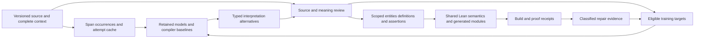

# LegalIR autoencoder and unified Lean4 corpus roadmap

Date: October 16, 2026.

<!-- shared-source-replay-20261019-01:start -->
The [shared-original catalog foundation](../../artifacts/legal-ir-shared-source-replay-20261019-01/README.md) is installed. One native invocation passed **80 current cases and 160 phases**; the completed saved-data readback passed six checks. All 20 typed body contents/origins total 45,323,135 bytes, preserving 16 physical records, 13 complete sections and 150 candidates. Two explicitly unexecuted planned epochs retain 32 logical/physical references and 300 candidate references; designated-body forecast is 724,255,288 bytes, including 716,670,192 receipt bytes. The unchanged legacy history cap remains 536,870,912 bytes. The new 1 GiB forecast ceiling does not admit that workload or execute history. Catalog equality/profile reuse and complete origin/branch preservation are qualified; shared parsed-bank validation and authority caching remain unimplemented.

The [reporting erratum](../../artifacts/legal-ir-shared-source-replay-20261019-01/test-count-reporting-erratum.json) preserves the raw harness count1 while independently deriving80 from exact calls/phases/JUnit; a future control rename is statically reviewed only. The first saved reader stopped on a profile-name collision; its preserved minimal repair passed the second metadata-only invocation. No native tests were repeated or sealed artifacts rewritten. The [next plan](../../artifacts/legal-ir-shared-source-replay-20261019-01/implementation-plan.json) specifies genuine immutable parsed-bank contexts, differential legacy replay, explicit work/custody/reference bounds and fresh trust/time/revocation/branch/all-role exclusions before history or source effects. Actual context/meaning review, definition/norm/genuine-second-use acceptance, graph/logic/Lean, learned convergence and measured total token-cost qualification remain separate. All active/deferred source questions and original unavailable contexts remain unchanged; no original backlog dependency or legacy limit was changed.
<!-- shared-source-replay-20261019-01:end -->

<!-- stored-source-adoption-20261019-01:start -->
The [unsigned stored-source adoption authoring contract](../../artifacts/legal-ir-stored-source-adoption-20261019-01/README.md) is installed and qualified: **80 current tests and six saved-evidence checks passed**. The full retained packet creates 16 physical-record-specific subjects across 13 complete stored sections, preserving all 150 candidate spans. All actual intent templates remain blank; 144 active and 112 deferred questions remain unanswered, with zero actual declarations, signatures or source decisions applied. The new API binds only explicitly supplied unsigned candidate intent and preserves original unavailable contexts. Whole-input bounds precede hashing, and closing checks cover caller/detached/offered objects and limits. The saved reader independently recomputed every subject CID and candidate projection. There is no effect-assessment or source-application engine in this version.

A newly quantified blocker is recorded in the [next implementation plan](../../artifacts/legal-ir-stored-source-adoption-20261019-01/implementation-plan.json): receipt references alone account for 358,335,096 bytes per review epoch and 716,670,192 bytes for genesis plus the required current revision, exceeding the unchanged 536,870,912-byte history cap. This is replay-reference accounting, not measured memory. The [shared-original replay design](../../artifacts/legal-ir-stored-source-adoption-20261019-01/candidate/shared-original-replay-design.json) separates unique custody, expanded references and actual work while retaining every physical request, history branch and exclusion. Its new profile, exact-text context resolutions, actual reviews, complete role inventories and declaration-bound authorization remain to be implemented. Bounded definition/norm/genuine-second-use review can proceed alongside global identity work. Meaning, semantic graph, training, Lean, convergence and measured token-cost qualification remain separate; no legacy limit or original backlog dependency is changed.
<!-- stored-source-adoption-20261019-01:end -->

<!-- source-correspondence-20261019-01:start -->
The [complete source-correspondence request packet](../../artifacts/legal-ir-source-correspondence-20261019-01/README.md) is installed and qualified: **80 current cases and six saved-evidence checks passed**. Both original banks retain all 16 physical cache references, 13 complete stored sections and 150 candidate spans through the unchanged join/review owners. The complete 1,335,711-byte packet and a 69,832-byte pointer queue are saved; all 144 active and 112 deferred questions remain unanswered, with zero occurrence selections or source decisions applied. The worker checked both exact producer receipts before/after replay without copying them. No parent/cache Parquet or 26 metadata shards were reopened. The saved reader independently hashes the full packet and checks every physical mapping and Unicode/UTF8 span against bounded originals. No actual review, source adoption, training, semantic graph, Lean or convergence authority is added.

The [next implementation plan](../../artifacts/legal-ir-source-correspondence-20261019-01/implementation-plan.json) specifies a distinct applied-source signing effect and actual source/context decisions; old answer-copy/candidate-binding authority remains insufficient. Preserve original unavailable context while adding an exact-text companion where supported. Governing meaning requires a complete definition, norm and genuine second statutory use; acquire additional bounded source units if the diagnostic cohort lacks them. This pilot can progress alongside global 60,077-row identity/dependency work and existing decoder studies. Complete-task model evaluation, source-faithful graph/logic/Lean acceptance and versioned DuckDB/DuckLake proof-cache/token-cost gates remain separate. The compact queue has no measured provider-token or total-cost saving.
<!-- source-correspondence-20261019-01:end -->

<!-- parent-identity-bindings-20261018-02:start -->
The [declared-identity preparation layer](../../artifacts/legal-ir-parent-identity-bindings-20261018-02/README.md) is installed and qualified: **55 current cases and six saved-evidence checks passed**. Every one of the 60,077 original physical/raw-row/projection commitments survives preparation and original-input regeneration. Candidate keys keep explicit qualifier states, chapter and distinct revision coordinates; conflicting receipts cannot be hidden. Actual full-population declarations (27,985,348 bytes) and preparation (50,394,656 bytes) fit the unchanged 64 MiB caps. All actual declarations remain unresolved, including all nine original missing-text/identity records. Only 13 full-row/text commitments have independent original oracles. The source/test/guide are three additions; all owned claims released. No parent Parquet was reopened or semantic/training/Lean/convergence authority assigned.

The [next implementation plan](../../artifacts/legal-ir-parent-identity-bindings-20261018-02/implementation-plan.json) separates identity evidence from actual source adoption and governing meaning review. Preserve the 13-source/16-cache/150-candidate population. Existing answer-copy and unapplied binding assessments need a separately versioned applied-review effect with actual supplied decisions before a complete definition, norm and genuine second use can enter semantic graphs/training. Retained exact text/JSON remains the input; targeted markup is optional evidence. Model evaluation, full Lean build and DuckDB/DuckLake proof-cache/capsule cost gates remain in the consolidated plan.
<!-- parent-identity-bindings-20261018-02:end -->

<!-- parent-metadata-loader-20261018-02:start -->
The [saved-parent metadata loader](../../artifacts/legal-ir-parent-metadata-loader-20261018-02/README.md) is installed and qualified: **51 current cases and six saved-evidence checks passed**. Its distinct immutable inventory validates all 60,077 physical records, 45 schema fields and 26 saved shards without reopening the parent Parquet. Grouping preparation retains every occurrence: document identity remains unresolved for all 60,077 rows, with text/normalization keys additionally unavailable for nine. Only 13 full-row/text commitments have independent retained original oracles. Three files were added; existing source/tests were unchanged, and all owned source/native/storage claims released. No splits or semantic/training/proof authority are assigned.

The [next implementation contract](../../artifacts/legal-ir-parent-metadata-loader-20261018-02/implementation-plan.json) adds independently pinned document-lineage/qualifier preparation while preserving missing rows, aliases and excluded connectors. Full qualifier companions are required where the existing legal_id serializer omits a coordinate such as chapter. The distinct 62,931-row release cannot donate identities or partitions. Complete dependency closure, actual source/span/entity and governing-meaning decisions, eligible model evaluation and source-faithful graph/Lean acceptance continue through the consolidated delivery plan.
<!-- parent-metadata-loader-20261018-02:end -->

<!-- legal-ir-comprehensive-plan-20261018-01:start -->
The [October 18 consolidated LegalIR delivery plan](legal-ir-autoformalization-delivery-plan-2026-10-18.md) provides the current source-to-span-to-scoped-graph-to-Lean4 architecture and 12 ordered work packages. It incorporates the complete historical-parent scan, current cache and decoder results, the proposed reviewed-component acceptance boundary, controlled model experiments, and measured index/capsule costs. Earlier evidence and the original 24 task states/dependencies remain preserved.
<!-- legal-ir-comprehensive-plan-20261018-01:end -->

For the consolidated October 17 delivery sequence, see the [source-to-Lean4 improvement plan](legal-ir-source-to-lean4-delivery-plan-2026-10-17.md). It connects the three datasets, current decoder/training limits, scoped graphs and Lean qualification without changing the historical results or backlog statuses below.

That plan explicitly includes the existing 384D, 768D and 4096D paths, their different dimensional roles and consumer contracts, and matched representation/conditioning comparisons. Historical native4096 formula-head results and the newer 4096-wide source-span integration remain separate.

Improve LegalIR by training and evaluating it against complete, source-grounded legal interpretations from `justicedao/ipfs_uscode`, then assemble the span-cache interpretations into scoped entity and definition graphs and a reproducible Lean4 corpus. The next milestone is one connected statutory component with reviewed meanings, explicit unresolved coverage, actual definition-use relationships and a real Lean build. Larger embeddings and more cached formulas become useful when they improve that result.

This consolidated roadmap builds on the [implementation plan](legal-ir-span-graph-lean4-implementation-plan-2026-10-13.md), [full training review](legal-ir-training-review-and-corpus-plan-2026-10-13.md) and [24-task backlog](../../artifacts/autoencoder-comprehensive-review-20261013/implementation-backlog.json). It preserves their historical results and dependencies. [Current cache observations](../../artifacts/legal-ir-roadmap-20261016/cache-metadata-review.json) and [training evidence review](../../artifacts/legal-ir-roadmap-20261016/training-evidence-review.json) supply the current background.

This refresh also includes the completed statutory evidence and snapshot work
below and [fresh public metadata observations](../../artifacts/legal-ir-plan-refresh-20261016-01/metadata-observations.json)
from October 16 at 02:33 UTC. Both dataset heads and the viewer populations below
were unchanged. Repository metadata, viewer schemas and counts were retrieved;
this refresh did not inspect all table bodies or qualify the entire corpus.
Viewer counts are separate observations, not cryptographically bound table
inventories of the reported repository heads; release qualification must resolve
the exact manifest-selected files and rows.
The current Datasets checkout is `74f5d98c8ffff3c284cffddf430091b5fc4c6f8c`
with local changes. Its HEAD is not a substitute for the captured source of an
earlier experiment or an available implementation in another worktree.

The comprehensive planning refresh at 05:03 UTC rechecked both public dataset
heads, viewer schemas and populations; all six responses were byte-identical
to the earlier observations. [Retained metadata](../../artifacts/legal-ir-plan-refresh-20261016-02/metadata-observations.json)
binds that check. The selected source-review bridge, typed response validation,
separate adjudication, complete cohort exclusions and genesis answer-reference
application, successor/fork history and candidate stored-source bindings have
since passed the bounded qualifications below. The immediate frontier is actual
source/meaning review and governing-source adoption, richer relational norm/use
integration, and explicit decoder-profile compatibility.
Payload verification and source-candidate recovery have their own completed
results below.

## Qualified implementation frontier on October 17

The [conditional bound-variable adapter](../../artifacts/legal-bound-variable-definition-20261017-02/README.md) is installed and qualified: 103 cases passed, comprising 32 new conditional cases and 71 relational regressions, with no skips or deselections. The [applicability-to-instance binding](../../artifacts/legal-norm-definition-application-binding-20261017-02/README.md) then passed all 65 focused cases on its first run. Its five public fixture cases exercise complete original-owner replay; 60 labelled seam cases isolate exact selection, premise intake, forgery, bounds and mutation checks. All 16 test functions were selected. Source/test bytes are unchanged from the reviewed candidates, successful write/read/resource leases were released, and the earlier zero-write timeout and staged-only receipts remain retained.

The bridge regenerates the complete authenticated applicability assessment, matches one whole original occurrence and its declared nominated link, and prepares the conditional instance from the same original companion and replay inputs. Every original use, decision and rival alternative remains retained. Definition equivalence, optional membership, shared carrier and binder valuation remain explicit unverified premises. Original ASTs remain unchanged; civil legal-as-of date, supplied signature-evaluation clock and fixed formal context remain separate. Applicability signatures cover their original declaration without extending to the bridge or conditional request. Governing selection, accepted semantic edges and all consumer/training/gold masks remain null, false or zero. No Lean build or model/training run occurred.

The [independent saved-result readback](../../artifacts/legal-norm-definition-application-binding-20261017-02/saved-result-readback.json) verifies 82 child and seven parent source captures, with 87 distinct files, 68 module origins and 80 executed first-party source paths. The bridge compiles first-party source from prelaunch-pinned bytes with plain pytest assertions. The separate upstream run retains its own source-hash/capture audit scope; it did not force pinned-byte compilation or establish cached-bytecode equivalence. These provenance scopes remain distinct and neither is model-accuracy evidence.

The [current statutory combined replay](../../artifacts/legal-norm-definition-application-binding-20261017-02/current-combined-replay-completion.json) also completed and passed independent content/source/resource readback for both retained §7213 hypotheses. Each retains two definition alternatives, three typed nominations, six links and 19 norm obligations. The hypotheses share one physical source occurrence and do not supply a second genuine use. Current definition endpoints and complete norm evidence regenerate; rehashed training-mask upgrades refuse. Successful resources released, while the earlier failed definition attempt's 536,870,912-byte disk claim remains retained. Actual source/meaning reviews, definition assessments, signatures, governing choices and legal-as-of date remain absent; meaning-unit coverage stays partial and masks remain zero.

The [retained conditional native result](../../artifacts/legal-ir-bound-variable-native-20261017-01/README.md) now adds full public preparation/replay of one actual A nomination and an offline native Lean 4.34.1 build of its unchanged generated source. Both conditional theorems have empty global-axiom observations; three meaning-changing suffix controls fail their intended obligations. This checks consequences under explicit unverified definition/membership premises. It does not compile the original relational norm as a premise or establish statutory equivalence, applicability, accepted graph meaning, training eligibility or convergence.

The subsequent [full-norm native qualification](../../artifacts/legal-ir-full-norm-native-20261017-01/README.md) now replays the complete retained A/B relational requests and compiles both unchanged emitted declarations offline with Lean 4.34.1. Three conditional theorems have empty global-axiom observations; three appended proof controls fail the intended missing-permission, reversed-argument and unsupported modal-elimination obligations. Successful source/native/disk closeouts and independent content/kernel readback are retained. The whole norms are explicit unverified `hNorm` premises, with A also requiring its exact `hPermit`. Both hypotheses still concern one physical occurrence; no legal meaning is selected, B's separate graph job is still pending, and no generic denotation theorem, source equivalence, training eligibility or model convergence follows.

The [next model handoff](../../artifacts/legal-ir-full-norm-native-20261017-01/next-model-handoff.json) records eight ordered gates from source-generation reconciliation to bounded learned evaluation and a separate generic denotation bridge. At that earlier handoff snapshot, historically qualified relational byte-target and decoder-example owners existed in retained files and non-ancestor Git objects while their current canonical paths were absent; the later recovered generation is qualified below. A compact target must reconstruct the existing typed interpretation, preserving binder topology, ordered roles and modal scope, while keeping provenance outside source/context-only model inputs. Measure actual producer/checkpoint/output budgets and count all invalid, missing and duplicate generations; split physical-source/dependency components and qualify reviewed eligibility before statistical comparison. Larger representation dimensions supply no compatibility or convergence evidence. This stage adds no model forward, optimizer update, accepted semantic edge or nonzero training/gold mask.

The [compact-profile qualification readback](../../artifacts/legal-ir-compact-content-qualification-20261017-02/README.md) now confirms restored current-generation owners with 487 passing cases and a distinct semantic content/identity profile with 180 passing cases, comprising 109 focused cases and 71 relational regressions. The shared 71 regressions are not additive evidence. Both retained A/B requests roundtrip exactly while preserving their distinct modal scopes. Their predicted contents each measure 275 bytes / 99 JSON lexical tokens, versus 6,938 bytes / 1,435 tokens for the verbose typed expression; independent context is 2,003 bytes / 413 tokens and archival identity is 765 bytes / 79 tokens. These component counts exclude BOS/EOS, keep context permission unverified, and establish no model-tokenizer savings, total prompt reduction, compatible checkpoint or learned reconstruction gain. The full-request compact codec is a separate 2,450-byte transport.

The [next integration plan](../../artifacts/legal-ir-compact-content-qualification-20261017-02/next-integration-plan.json) connects compact labels to the existing source-separated example owner and preserves raw generated IDs/bytes through existing reconstruction and batch accounting. Keep invalid, incomplete, missing, duplicate and operational outcomes visible before any matched learned comparison. Actual producer/head/vocabulary/checkpoint budgets, permissible context, reviewed source/meaning and applicability, physical/dependency splits, unsupported definition predicates and counting remain gates. This continuation independently reads a completed concurrent run; its alternative native request remained unlaunched and it changed no canonical source. It adds no model fitting, Lean build, accepted legal meaning, eligibility or convergence proof.

The immediate semantic milestone is actual source/meaning review and full reviewer/trust alignment for one definition, a complete norm and a second genuine use, followed by supported graph composition and a separately recorded complete source-bound Lean component. Reuse these completed engineering owners. Any norm transformation requires justified semantics beyond a conditional instance. The bounded training refresh found no newer summary in the six known roots; F18, F19, retained-weight replay and disclosed synthetic updates retain their earlier findings. No new trained-and-scored control or autoencoder accuracy gain is claimed by this continuation.

The [compact-label companion qualification](../../artifacts/legal-ir-compact-example-20261017-01/README.md) now passed 275 cases: 59 new cases plus 216 existing example/content/norm regressions, with no skips or deselections. The unchanged original source-separated example retains its byte label, provenance and grouping; only its validated original relational label is projected into compact content, label-derived context and archival identity. Pending examples retain null compact labels. `source_example.model_input` remains the sole model-input compartment, target-derived context remains label data, and all masks stay zero. The child compiled and executed 113 first-party files from the fresh frozen source generation; source/native owners reported release. Reused tests do not add independent legal samples. No statutory review, permitted inference context, learned model, tokenizer savings, Lean build or convergence result follows.

The [next integration handoff](../../artifacts/legal-ir-compact-example-20261017-01/next-integration-plan.json) distinguishes the concurrently added full-request compact-ID batch route from semantic content/context/identity output. Reconcile current semantic token/prefix qualification, then extend the existing denominator owner with the matching schema, context permission and raw-output contract. Preserve malformed, incomplete, missing, duplicate and operational observations. Qualify the real producer/head/checkpoint and complete tokenizer budgets, reviewed eligibility and physical/dependency partitions before matched training. Reviewed graph/Lean composition, cache invalidation and measured DuckDB/DuckLake/Quack capsule costs remain connected to the same source identities. Empirical loss or finite reconstruction results do not establish global optimizer convergence. No task status or dependency changes here.

The [semantic-token batch binding qualification](../../artifacts/legal-ir-semantic-batch-20261017-01/README.md) now passed 301 cases: 21 focused binding cases plus 280 existing batch/full-request/token/CONTENT regressions, with no skips or deselections. It preserves the concurrent CONTENT interface and complete selected denominator while binding retained content/context evidence to the whole fresh public prediction and exact producer records. The child compiled and executed 103 first-party files from the frozen generation; source/native/storage release and complete durable membership passed saved-evidence checks. The earlier alternative's zero-write installation refusal and unexecuted 76-case proposal remain historical. Reused cases and the separate concurrent 594-case result are not additive independent legal samples.

The [next handoff](../../artifacts/legal-ir-semantic-batch-20261017-01/next-integration-plan.json) reuses the available finite-score selector, then qualifies the real numerical head/checkpoint, ordered codec, intact emitted-ID trace, independently permitted context and eligible source/dependency splits before matched learning. Current per-observation contexts do not provide a complete selected-population availability inventory. Fresh identity and binder changes remain distinct from lexical-alpha structure. Existing graph/Lean composition, cache/capsule cost measurement and explicit convergence assumptions remain open; this continuation adds no model inference, fitting, statutory review, eligibility, token-savings or Lean result. All original task statuses and dependencies remain unchanged.

<!-- compact-generation-binding-20261017-01:start -->
The [bounded compact-content generation adapter](../../artifacts/legal-ir-compact-head-binding-20261017-01/README.md) is now engineering-qualified: all 38 new generator cases, 87 head cases and 220 regressions passed together (345 total). Fifteen saved-evidence checks verified full numerical traces, batch disposition, raw compiled source captures, artifact durability and source/native/storage release. The final run retained the normal 32 MiB hard artifact quota and complete population. Earlier failed admissions/capture attempts are preserved, and owned retained claims were reconciled without deleting their artifacts. No prior standalone head pass is inherited. The new compact model remains untrained; source equivalence, eligible statutory inference and convergence remain unproven.

The coordinator preserves supplied seed IDs separately from actual selected IDs, all 537 scores at each decision, raw maxima evaluated along constrained selected prefixes, stop/budget outcomes and final public token decoding. The exposed-prefix EOS control and a missing occurrence remain explicit. The adapter keeps the absent encoder identity null, carries target/prefix exposure, and leaves the original selected population to the existing batch owner with no comparison credit.

The [next integration plan](../../artifacts/legal-ir-compact-head-binding-20261017-01/next-integration-plan.json) now points to the existing `autoencoder_embedding_runtime.produce_native_embedding_receipt`, `legal_native_conditioning.embedding_rows` and native source cache owners. A historical 128-row receipt has matching model assets but an older producer-code hash; current reuse correctly refuses it. A fresh owned receipt or reviewed versioned compatibility path, and a distinct source-bound adapter, precede permitted-context inventory, reviewed span/entity/definition eligibility, compatible optimizer fitting, complete-population convergence evaluation and the unified Lean4 corpus. Keep complete traces in indexed artifacts; provider-token savings still require a matched tokenizer/task A/B measurement.
<!-- compact-generation-binding-20261017-01:end -->

<!-- parent-complete-metadata-20261018-02:start -->
### Complete historical-parent metadata: engineering slice qualified (2026-10-18)

The [complete-parent scan](../../artifacts/legal-ir-parent-complete-metadata-20261018-02/README.md) covers **60,077 physical rows and all 45 fields**, retaining metadata in 26 bounded shards. The current suite passed **136 cases** (44 scanner, 56 parser and 36 selected-inventory cases), followed by seven saved-evidence checks. There are 60,068 stored-text records and nine missing-text records. Only 13 rows have independent retained source oracles; other commitments are scanner observations. Group/split/inference fields remain null, authority false and integer training/gold masks zero. The run retained 214 durable artifacts totaling 114,285,937 bytes within its admitted 512 MiB output budget; all owned source/native/storage leases and claims released. This establishes metadata coverage and preserves the original page-owner prefix. It establishes no governing statutory meaning, training eligibility, Lean4 admission or model convergence.

The [continuation plan](../../artifacts/legal-ir-parent-complete-metadata-20261018-02/implementation-plan.json) next adds a bounded loader with a distinct immutable source-only inventory and qualifies the source-only grouping bridge. The nine missing-text rows (ordinals 60068 through 60076) also lack CID/title/section observations and remain explicit grouping blockers: retain them in the denominator, never union null identities, invent empty-text hashes or silently drop them. The separate 62,931-row release cannot donate partitions. Global definition/entity/exception/time/context dependency closure, trusted occurrence/access/chronology and governing reviews, compatible encoder/decoder training, complete held-out task satisfaction, Lean4 preservation, convergence and measured DuckDB/DuckLake/Quack capsule/provider-token costs remain open. Original backlog statuses and dependencies are unchanged.
<!-- parent-complete-metadata-20261018-02:end -->

<!-- parent-source-inventory-20261018-01:start -->
### Selected parent source inventory: engineering slice qualified (2026-10-18)

The [source-only inventory](../../artifacts/legal-ir-parent-source-inventory-20261018-01/README.md) now passes **92 current cases** (36 new inventory cases and 56 parser regressions) and **six saved-evidence checks** after owned closeout. It preserves all 13 selected physical rows, complete 45-field canonical commitments, exact text hashes and lengths, literal identity observations and normalized content keys. Preparation freshly replays the pinned historical parent through the existing public page owner. Source text and raw extras are excluded from the inventory. This is explicitly selected coverage within a 60,077-row artifact; group/split/inference fields remain null, authority false and integer train/gold masks zero. Three new files were installed through the existing write lease; existing code/tests were unchanged. Two earlier write admissions timed out with zero writes and retain their refusal receipts. All successful owned source/native/storage leases and claims are released; historical test counts are not pooled.

The [continuation plan](../../artifacts/legal-ir-parent-source-inventory-20261018-01/implementation-plan.json) next qualifies the privately staged complete-parent scanner, 42 new tests and existing 92 regressions. Its [static design and review](../../artifacts/legal-ir-parent-source-inventory-20261018-01/candidate/complete-parent-metadata-iterator-design-review.json) account for 423 pages and 1,169,575,763 decoded body bytes, above the selected 256 MiB budget. The separate proposed one-CPU/2,048-MiB/two-child/1,200-second/512-MiB-output profile, bounded canonical row hashing and metadata shards still require actual enrollment, resource admission and runtime qualification. No full scan has executed. The existing 62,931-row release cannot donate partitions by legal ID or repository commit. Complete dependency partitions, independent occurrence/access/chronology and governing meanings, entity/definition bindings, compatible encoder/training contracts, full task satisfaction, Lean4 preservation, convergence and measured DuckDB/DuckLake/Quack capsule/token savings remain open. Original backlog statuses and dependencies are unchanged.
<!-- parent-source-inventory-20261018-01:end -->

<!-- parent-source-replay-20261018-02:start -->
### Historical parent rows verified (2026-10-18)

The [parent source replay](../../artifacts/legal-ir-parent-source-replay-20261018-02/README.md) now passes 65 current checks (nine integration cases plus 56 parser regressions) and ten saved-evidence checks. The unchanged public bounded page owner streams exact full-file hashes for the 374,277,662-byte historical artifact before and after access, freshly decodes all 45 original fields of 13 physical rows, and matches independently retained whole-row hashes and section text. All 150 declared candidate geometries across 16 cache records validate against those fresh bytes; no original occurrence is selected. The current run does not replay original producer receipts or the previous crosswalk product. No canonical source or test files changed.

The first attempt stopped at collection before test calls because a genuine processor initializer dependency was missing from the frozen source closure. Its six files remain preserved and its exact retained claim is released. The corrected manifest includes genuine initializer imports and eight hash-only source carriers, preserving the 256-watcher limit and runtime guard. The successful run captured 42 raw source compilations/executions, froze 204 descriptors and 206 watchers, and retained 82 declared durable members; the whole attempt uses 4,006,304 bytes within the unchanged 32 MiB budget. Both owned claims and native/source leases are released; no foreign claims or policy changed.

The available 62,931-row corpus inventory shares the HF commit but has zero exact entry-CID or text-hash matches for these 13 historical sections; all 13 same-legal-ID counterparts have different text. No partition assignments are inherited. The [next implementation contract](../../artifacts/legal-ir-parent-source-replay-20261018-02/implementation-plan.json) adds a source-only selected-parent inventory with null group/split fields, then complete 60,077-row source coverage and governing-dependency closure through a bounded page metadata iterator. Existing USCodeSourceInventory/SourcePartitions contracts remain unchanged. Original-occurrence and official/current-release correspondence, independent access/meaning review, entity/definition binding, eligible training, whole-task satisfaction, Lean4 preservation, convergence and measured indexed-capsule/provider-token comparisons remain open. Authority stays false, inference null and training/gold masks integer zero; backlog statuses/dependencies remain unchanged.
<!-- parent-source-replay-20261018-02:end -->

<!-- source-candidate-crosswalk-20261018-02:start -->
### Original-bound source candidates (2026-10-18)

The [source candidate crosswalk](../../artifacts/legal-ir-source-candidate-crosswalk-20261018-02/README.md) now passes 95 current cases (59 new plus 36 cache-intake regressions) and nine stdlib saved-evidence checks. Fresh public-owner replay retains all 16 physical cache records, 13 complete historical source sections and 150 candidates: 11 unique-candidate records and five ambiguous records. Every original occurrence remains unselected. Physical records and manifest references stay distinct, and the five authored inventory occurrences remain separate. Full parent revision/artifact/row, reconstruction disclosures and Unicode/UTF8 selectors survive; cached targets do not become source context.

The first 95-case run retained 51 passes and 44 failures from an authored producer-directory mismatch. Only the fixture serializer changed; product/guide bytes and all cases remain intact. Failed artifacts are preserved, both owned storage claims and native/source leases are closed, and the zero-write replacement timeout remains archived separately. The successful run captured 56 executed first-party files and 59 raw compilation observations, using 19,789,405 bytes within the unchanged 32 MiB promise. No historical counts are pooled or resource policy/foreign claim changed.

The [continuation plan](../../artifacts/legal-ir-source-candidate-crosswalk-20261018-02/implementation-plan.json) next requires exact parent Parquet replay for the 13 physical rows, genuine source partitions and independent occurrence/access/chronology evidence, then physical entity/definition bindings and eligible encoder inputs. Original-occurrence attestation, current-release alignment, reviewed semantics, training, whole-task satisfaction, Lean4 preservation, convergence and measured DuckDB/DuckLake/Quack capsule/token comparisons remain open. This qualification executes no model, optimizer, database or prover. Inference views remain null, authority false and training/gold masks integer zero; backlog statuses/dependencies are unchanged.
<!-- source-candidate-crosswalk-20261018-02:end -->

<!-- source-context-cache-intake-20261018-02:start -->
### Selected real-cache record intake (2026-10-18)

The [cache-intake companion](../../artifacts/legal-ir-source-context-cache-intake-20261018-02/README.md) now passes 85 current cases (36 new cases plus 49 inventory regressions) and 15 saved-evidence checks. It decodes both complete pinned 60501 paired-v1/v2 bundles: 16 distinct physical records, 8 original manifest/table files, 13 observed text hashes. Explicit associations preserve competing records, ambiguity and missing/corrupt bundle slots without using cached answers as a context catalog. All 16 real records remain unassociated with original statutory occurrences; the five existing authored inventory occurrences remain separate. No entity/definition records were scanned. Inference views stay null and authority/training/gold masks false/zero.

Two initial 85-case attempts retained 84 passes and 1 real-data failure each. Their actual decoder refusal identified a dual-use 16 MiB artifact budget; the sole product correction restores the existing owner 64 MiB default while outer 16 MiB files, 64 MiB total/decoded, report/row limits and native budget remain unchanged. The same tests then passed in the canonical repository. Three new paths were installed initially; only product and guide were subsequently replaced under a genuine write lease, preserving the test bytes. The first replacement admission timed out with zero writes; the later admission succeeded. All three owned native/storage claims and source leases are released, with failed artifacts preserved. No historical tests are pooled, global resource policy changed, or foreign claims selected.

The [continuation plan](../../artifacts/legal-ir-source-context-cache-intake-20261018-02/implementation-plan.json) now starts with original-source correspondence using retained receipts, 13 historical source sections and 150 saved occurrence candidates, then physical entity/definition intake, independent access/chronology, existing encoder receipts and governing-definition closure. Reviewed meanings, training eligibility, complete held-out task satisfaction, convergence, Lean4 preservation and DuckDB/DuckLake/Quack capsule/token A/B gates remain open. No model, training, database, prover or Lean execution occurred in this qualification; no legal accuracy or token-savings result is added. Backlog statuses/dependencies are not promoted.
<!-- source-context-cache-intake-20261018-02:end -->

<!-- source-context-inventory-20261018-01:start -->
## Source/context inventory: first engineering slice qualified

The additive [source/context inventory companion](../../artifacts/legal-ir-source-context-inventory-20261018-01/README.md) is installed and qualified over authored metadata: 87 selected cases passed (49 new inventory cases plus 38 current lexical regressions), and the standard-library saved reader passed 13 grouped checks after source/native/storage release. All five selected occurrences remain in order across two nominations, one no-match, one ambiguous context and one missing source. Independent saved-evidence recomputation retained all six physical metadata rows and the excluded transitive grouping connector. Equal text at distinct physical origins keeps distinct occurrence/input identities. The run captured 36 actual raw source compilations; historical 239-case lexical and 175-case source-binding results are not pooled. The three new files were published through the existing source write lease; pre-existing lexical files and resource policies remain unchanged.

This is declared source/catalog/access consistency, and the full independent-context gate remains open. Cache revision fields and review hashes are caller declarations. Nominations are inspection candidates; all effective inference views remain null, encoder status is not supplied, and authority/training/gold masks remain false/zero. The [continuation plan](../../artifacts/legal-ir-source-context-inventory-20261018-01/implementation-plan.json) next requires immutable real-cache record intake, independent access/chronology validation, exact existing encoder-receipt attachment, shared-definition/context dependency closure and whole declared real-corpus application. No model, database, training, prover or Lean execution occurred, and no legal equivalence, independent permission, convergence or token-savings result is added. The 24 backlog task statuses/dependencies remain unchanged.
<!-- source-context-inventory-20261018-01:end -->

<!-- compact-source-binding-20261017-01:start -->
## Source-to-vector binding: selected runtime qualified

The [source-binding implementation and continuation plan](../../artifacts/legal-ir-compact-source-binding-20261017-01/README.md) now have current execution evidence: all 175 selected cases passed, including 33 new binding cases. Four incompatible authored cases remain explicitly unexecuted. The [saved-evidence readback](../../artifacts/legal-ir-compact-source-binding-20261017-01/saved-evidence-readback-v09.json) passed 16 grouped checks after source/native/storage closeout. It verifies 162 actual raw source compilations, one genuine CPU float32 encoder forward over three 384D rows, four untruncated tokenizations and the fourth input's explicit token-limit disposition. Eight bootstrap guard selfchecks are separate from the 175 project cases. The original three installed files remain unchanged; all ten owned source-binding/headroom rows are released. The successful run used the existing 220 GB/20-process policy and 65% CPU-stall cutoff, with a 32 MiB artifact allocation. This qualification changed no resource policy. Earlier 70-case resource and 345-case generation results remain separate.

The [remaining acceptance gates](../../artifacts/legal-ir-compact-source-binding-20261017-01/next-integration-plan.json) now start with an original-bound source/context inventory: preserve every occurrence and unavailable disposition, require explicit context-access evidence, and bind conservative physical-source/definition dependency groups before target or split access. Reviewed span/entity/definition eligibility, a compatible 537-token trainer and resume contract, complete held-out task metrics with explicit convergence assumptions, graph/logic-family/Lean4 preservation, and DuckDB/DuckLake/Quack capsules with measured provider-token A/B results remain. The five-row generation batch still has one unverifiable output, four missing outputs and zero comparisons; its nested encoder identity remains null. Training and gold masks stay zero, with no legal/source equivalence, independent context permission, training, convergence, Lean or token-savings promotion. The 24 backlog statuses/dependencies remain unchanged.
<!-- compact-source-binding-20261017-01:end -->

## Current statutory candidate graph: A qualified, B pending

The [current graph closeout](../../artifacts/legal-ir-current-definition-graph-20261017-02/README.md) qualifies **A only; B remains
admission-blocked**. The existing `corpus_norm_definition_adapter` produced A's
16 nodes and 33 custody edges, retaining two definition rivals, three exact typed
uses, six nominations and three source references. A/B are two authored norm
hypotheses over one physical retained 2024 §7213 occurrence, without a second
genuine use or selected definition/entity identity.

The [saved partial audit](../../artifacts/legal-ir-current-definition-graph-20261017-02/saved-result-readback.json) binds A's complete
companions, four-file bundle, pinned child compilation and released own claims.
Build and export each fully replayed original evidence: two positive replays;
13 local refusals add no full-source or unit-test credit. The [candidate index](../../artifacts/legal-ir-current-definition-graph-20261017-02/candidate-graph-corpus-manifest.json)
contains A's bundle and B's original norm/evidence/request metadata only;
failed B graphs are excluded. Native APIs decoded Parquet; the reader checked
bytes. Native-parent bytecode equivalence is unverified. Relations remain
`DERIVED_FROM`, `CITES` and `HAS_SOURCE`, without
semantic merge, governing use or accepted corpus release.

Admissions kept one cooperative CPU slot, 3072 MiB, two-child, 3600-second and
512 MiB storage limits. Five failed graph attempts retain five 512 MiB claims
(2.5 GiB), separate from the older definition failure. Current B failed first
on a periodic disk-ledger lock, then before a graph child on scheduler admission.
The existing native base-lease call has zero admission wait. No foreign holder
was changed and no global release is asserted. Resume B through normal existing
admission when capacity permits; no further retry or cap change is enrolled.
A's public operation times: A build 369.2s, export 369.8s.

For LIR-23, measure admission, source-watchdog and filesystem-census costs
separately from child/API costs. Profile bounded validation stages on these
pinned inputs before proposing reuse or model-width changes; preserve clean-
replay output/refusal parity, complete invalidation, aggregate charging and
mutation fences. Current owners continue full replay.

Use the [human review handoff](../../artifacts/legal-ir-current-definition-graph-20261017-02/pilot-review-handoff.md) for actual source/
meaning decisions, complete actor/trust alignment and a second genuine use,
then typed decoder/eligibility, cache-release identity and source-bound Lean
qualification. Legal-as-of stays null, ASTs unchanged and all masks zero. The
12:29 UTC filename/stat check covered 68 summaries in six known roots, with no
body reads or universe claim. Preserve F18 scientific failure/no promotion,
F19 saved-score-only, 120 retained-weight generations/0 updates, two fictional updates and limited older
Lean findings; no trained-and-scored control was added.

Hub metadata at 2026-10-17T12:42:32.733033+00:00 (entity) and 2026-10-17T12:44:34.592461+00:00 (span) confirm heads only.

## Current pilot: target grammar and verified cache joins

The [current-pilot readiness packet](../../artifacts/legal-ir-current-pilot-readiness-20261017-01/README.md)
defines two parallel implementation packages. A's qualified graph carries
retained Govinfo 2024 evidence; its physical span-cache and entity-row joins
remain unknown. Its 13 interpretation and three expression nodes preserve
custody without resolving entity identity. Exact pilot-text comparison found no
matches within the earlier selected 16-row census only; this supplies no
whole-cache absence finding. Keep that completed 16-row/18-output qualification
separate from the pilot's four authored alternatives, six typed uses and twelve
nominations across two norm hypotheses.

For the first package, reuse canonical typed AST serialization, relational
lowering, definition-body and conditional-instance owners. Each §7213 norm is
one closed 15-node expression, with three binders, three binary predicates and
one modal node; its 19 review obligations are not decoder rules. Qualify an
explicit compatible learned-emission/target/eligibility handoff preserving
argument roles, modal/implication placement, both definition bodies, complete
source/context companions and same-source alternative groups. Existing generic
typed-JSON transport does not bypass the legal target rule validator. The
source-span consumer's distinct-text/origin constraints need compatible
integration; preserve unreviewed statutory origin rather than relabeling it.
Separate model-facing typed content from externally copied provenance, forbid
held-out answer metadata in inputs and declare any AST normalization explicitly.
Audit a compact lossless output projection and its budget before changing caps;
verbose typed-JSON transport has its own size limits.
Use engineering fixtures for transport qualification and retain the fixed
encoder context. No new expression language or repeated unchanged runtime
qualification is needed.

For the second package, extend the manifest-selected actual pilot cache
population and all matching occurrence candidates. Bind exact repository,
revision, file hash, row ordinal and original producer/output identities.
Establish an evidenced edition/view/coordinate crosswalk among the Hub source
release, producer revision/release point, legacy source label and Govinfo 2024
material. Extend the metadata-only entity join through complete selected
entity-file custody and scoped semantic companions; equal labels never supply
governing identity. Preserve every ambiguous, missing and unsupported row.

Actual source/meaning review, applicability, exposure and dependency-aware
splits remain separate gates. §7214 is source-only and needs its complete count
restriction represented by a supported route, or a different reviewed second
use within the supported profile. Relevant eligibility gates precede matched
F19-informed selection, richer-output, latent-conditioning and scoped-retrieval
experiments. The complete source-bound Lean component remains a separate gate. The dated
13:46 UTC refresh found no newer summary among 68 filenames in six known roots
and read no new summary bodies; the separately owned third conditional compiler
request remained prelaunch-reviewed and unlaunched. Preserve the earlier deep
training and limited Lean findings. A [later compact completion check](../../artifacts/legal-ir-current-pilot-readiness-20261017-01/freshness/conditional-build-completion-addendum.json)
now records that conditional instance's successful native build, two empty-axiom
theorem observations and three intended failed controls. Definition/membership
premises remain unverified; the original norm is not a theorem premise. Extend
from that result to the complete reviewed norm/second-use component. Preserve
its failed 128 MiB bootstrap claim separately. This readiness packet adds static evidence
and acceptance criteria only; all masks, backlog values and task statuses stay
unchanged.

## Bind the source corpus and both caches

The source corpus is an explicit third release dependency. The October 16
[bounded public inspection](../../artifacts/legal-ir-source-span-graph-plan-20261016-01/hub-intake/inspection_summary.json)
retains HTTP responses, immutable metadata, sampled Parquet schemas and three
viewer rows. These observations support an intake plan; they do not qualify
all source text, graph records, legal meanings or model outputs.

| Repository | Observed immutable Hub revision | Role |
| --- | --- | --- |
| [US Code source](https://huggingface.co/datasets/justicedao/ipfs_uscode/tree/91ca1838853ac82d7a12dd4ab47d9686f47667f9) | `91ca1838853ac82d7a12dd4ab47d9686f47667f9` | Source package, lexical/vector indexes and structural graph. |
| [Autoformal span cache](https://huggingface.co/datasets/justicedao/uscode-autoformal-span-cache/tree/60501f3e920f6c9050cfc452e0d9fcc2b7c184f3) | `60501f3e920f6c9050cfc452e0d9fcc2b7c184f3` | Physical observations, formalization attempts and producer evidence. |
| [Autoformal entity cache](https://huggingface.co/datasets/justicedao/uscode-autoformal-entity-cache/tree/79d54378c5d6a89ab56e7a27e0f0ba867e800e19) | `79d54378c5d6a89ab56e7a27e0f0ba867e800e19` | Existing materialized index, to be accompanied by versioned semantic records. |

The source [release metadata](https://huggingface.co/datasets/justicedao/ipfs_uscode/raw/91ca1838853ac82d7a12dd4ab47d9686f47667f9/release_metadata.json)
declares producer source revision `006dd603185b283c54648dd4aef3c2cbe650981a`,
release point `us/pl/119/102` and a pinned 384D GTE vector space. These are
different identities from the Hub commit and from the sampled span label
`ipfs-uscode-5016b86a`. Preserve all three namespaces. Neither matching
citations nor matching text establishes a historical edition/occurrence join.

The inspection identifies specific intake work:

| Observation | Required disposition or change |
| --- | --- |
| The default source profile is `publicus-ir-graphrag/v2`. Its inspected corpus footer contains `entry_cid`, `legal_id`, `family`, `record_sha256` and `record_json`. The inner source record was not decoded. | Dispatch by declared family/schema and validate the retained inner record before extracting source text. Corpus, vectors, graph and postings are separate populations; their sum is not a count of laws. |
| The default viewer split request returned HTTP 500 with `InvalidConfigName`; the configuration name contains `/`. | Keep a manifest-driven intake route. Repair the advertised configuration through a versioned compatibility change; a viewer failure does not imply that source artifacts are absent. |
| Manifest-declared `data/**/*.parquet` rows total 7,407,362; `dataset_infos.json` advertises 7,409,174. The 1,812-row difference matches routing-index declarations outside that glob. | Reconcile the intended selection, exact paths and per-family counts. Treat these as metadata declarations until complete selected tables are verified. |
| The source manifest binds a 3,140-byte README; the README at the inspected commit is 3,476 bytes and has a different SHA-256. Three other downloaded metadata descriptors match. | Retain the mismatch and affected release-integrity disposition. Produce a corrected additive manifest generation; do not modify the old receipt or assume other artifacts match. |
| Two sampled paired-v1 rows retain the older source alias and span-local provenance but no document-level selectors or enclosing context references. | Reuse exact producer/parent custody where available; recover all matching occurrence candidates without selecting one automatically. New complete reviewed units receive their own identities when the historical occurrence remains unknown. |
| A sampled paired-v2 footer adds learned-capture and raw/canonical comparison fields; v2 rows were not inspected in this refresh. | Discover banks from pinned manifests, preserve schema/producer versions and verify values separately. Column presence supplies no learned-generation or quality result. |
| The entity view has twelve columns and lacks explicit source revision/ranges, scoped-definition applicability, complete AST and review/build references. | Retain it as an observation projection. Add semantic companion tables and reconstructable joins rather than reinterpret its booleans or merge labels globally. |

The first additional deliverable is `source-span-entity-join-manifest.json`.
For each selected physical row, bind repository/configuration, file digest and
row ordinal to its producer identity, original source/view, complete meaning
unit, candidate occurrences, context and explicit join outcome. Distinguish
exact, ambiguous, missing, incompatible-edition, unsupported-schema and
integrity-failed outcomes. Record all contributing occurrences for composite
units; a text search result alone does not select one. Keep current source
package rows and legacy `uscode_parquet` rows in their actual profiles.

Align selected passages to an evidenced official release when needed. The
[Office of the Law Revision Counsel](https://uscode.house.gov/download.html)
provides release points and downloadable source formats. A newer available
release must not silently replace the older edition underlying a cache.
Publication/acquisition time and legal effective time remain separate fields.

This work refines LIR-01–04 without changing their statuses. It can proceed
alongside the already qualified legacy review flow; it does not reopen that
completed sixteen-row intake or imply that every row in the three repositories
has been scanned. The rest of this roadmap uses the resulting source, context
and interpretation identities consistently across training, graphs and Lean.

## Selected source/span/entity join manifest qualified

The [first implementation packet](../../artifacts/legal-ir-source-span-entity-join-20261016-01/README.md)
now supplies exact current source-package metadata intake and a versioned
three-cache join manifest. It reuses the existing complete paired payload and
legacy source-candidate owners. Qualification passed 302 tests: 93 new and 209
existing cases. One deliberate-symlink entity fixture was excluded from the
regular-file runner profile; the interrupted initial attempt retains zero
credited cases. Product checks and resource policy were unchanged.

A separate frozen replay verifies two complete retained bundles and regenerates
all sixteen physical paired rows, thirteen retained section inputs and 150
candidate occurrences: eleven rows have unique candidates and five remain
ambiguous. Every occurrence stays unselected. Five tamper controls refuse;
twenty-six actual loaded first-party source modules are captured from pinned
bytes. The README descriptor mismatch and 1,812-row count discrepancy remain
explicit. Entity input is schema/count metadata only, with zero entity-file
rows or semantic bindings verified.

This is a selected custody/candidate result. Current-release correspondence,
governing edition/context, source/meaning decisions, semantic companions and
training eligibility remain open. No model, Lean build, proof receipt or
statutory semantic admission was produced. The preliminary target census below
now connects this join to decoder-profile compatibility; source and meaning
review remain prerequisites for a reviewed unit manifest.
Existing backlog statuses and dependencies remain unchanged.

## Selected target eligibility census qualified

The [target census packet](../../artifacts/legal-ir-target-eligibility-20261016-01/README.md)
adds a reusable retained-input owner and complete regeneration validation.
Qualification passed 292 cases: 92 new census cases, 103 consumer-binding
regressions and 97 split-membership regressions. A separate owned replay fully
regenerated the original join before preparing and validating the census.

All sixteen physical rows and eighteen output occurrences are retained, with
thirteen distinct source texts, one four-row duplicate group and nine rows with
no outputs. The two typed-deontic compiler payloads pass the actual existing
source-copy decoder audit; sixteen modal-format outputs remain unsupported by
that profile. Exact original payloads, actor choices, routes, origins and
conditioning flags are preserved. Decoder expressibility supplies no reviewed
meaning, checkpoint assessment or training authorization.

The [JSONL handoff](../../external/ipfs_datasets/workspace/test-logs/federal-corpus-audits/legal-ir-target-eligibility-20261016-01/replay-03/exports/legal-ir-target-eligibility.jsonl)
contains every physical row and its ordered output companions. Meaning units
remain unestablished and source/context/review/applicability/definition/dependency/
exposure/split fields unresolved; all masks are zero and authorities false.
There are zero consumer-eligible, training-qualified or gold rows. This is the
preliminary coverage/repair queue for the second delivery artifact, not its
complete reviewed-unit acceptance.

Both successful attempts have sealed artifacts and released native/source
leases. The qualified standalone import scope records 70 exact source captures
for tests and 120 plus one canonical namespace for replay; optional application
`lib.*` integrations are unavailable. Two earlier harness failures remain
explicitly uncredited. The [API guide](../../external/ipfs_datasets/docs/autoencoders/legal_source_span_target_eligibility_v1.md)
and packet retain the frozen closure, failed generations and reproducible
request identities. No model updates, Lean execution or dataset/model release
publication occurred.
The next engineering handoff is compatible reviewed meaning-unit decisions and
typed definition/use companions; original backlog statuses/dependencies remain
unchanged.

## Recommended execution sequence

The core design is **one versioned typed interpretation shared by the model,
graph and Lean generator**. The span cache supplies source occurrences and
attempts; the entity cache becomes a materialized view of scoped meanings and
their dependencies. Aggregation composes assertions and resolves references;
it does not average embeddings or merge identically spelled terms globally.

The [next implementation plan](legal-ir-next-implementation-plan-2026-10-16.md)
turns this sequence into concrete review, model/data and graph/Lean handoffs.
It incorporates the completed native request, typed-response and adjudication-declaration executions,
the existing typed reconstruction/batch evaluators, and the distinct missing
source-decision, statutory-meaning and relational graph adapters.

| Order / existing backlog | Concrete implementation unit | Acceptance before advancing |
| --- | --- | --- |
| 1 — LIR-01–04 | Reuse the qualified review/cohort/genesis/history and candidate stored-source binding adapters; obtain actual source/meaning decisions and governing-source adoption, and qualify explicit decoder/checkpoint profiles. Extend manifest inventory only for a newly declared population. | Every selected row retains its original occurrence/source-role/context disposition; review declarations replay without invented geometry, omitted parents or automatic decisions. Checkpoint loading preserves the named decoder contract. |
| 2 — LIR-05–07 | Finish one complete definition-and-use target component; extend the smallest missing typed grammar and source correspondence profile. | Complete meaning units, roles, scope and context are represented or explicitly unsupported. Independent source/meaning decisions are recorded for targets used as semantic gold. |
| 3 — LIR-08–11 | Connect reviewed relational assertions to the existing scoped-definition and graph owners. | Exact use-to-definition choices, unresolved alternatives and reverse dependencies survive graph export/import with the complete AST. |
| 4 — LIR-12–15 | Build the first actual-source shared Lean component through a compatible existing native owner. | Real build, statement/assumption inventory, positive consequence and meaning-changing negative controls, and clean-versus-incremental agreement. |
| 5 — LIR-17–20 | Train and compare richer typed decoding, conditions selection, genuine latent conditioning and graph context. | Improvement on frozen independent source/dependency groups, with retained permission/modal/refusal floors and raw learned outputs preserved. |
| 6 — LIR-21–24 | Seal compatible dataset/model/graph/Lean generations and expand by dependency component. | Fresh reload and release readback reproduce the qualified population; incomplete uploads and changed definitions cannot silently select stale results. |

These are dependency milestones, not calendar promises or new task statuses.
An exhaustive disposition permits further engineering work; only supported,
reviewed interpretations with the required closure advance into accepted
semantic graph, Lean and gold-training views. Partial, disputed and unsupported
units remain visible in the coverage inventory and candidate views.
Source review, deterministic grammar work and training-infrastructure profiling
can proceed in parallel. Existing eligible authored examples can support decoder
engineering while statutory review proceeds; label those results as engineering
evidence. Unreviewed text may support a disclosed reconstruction objective, and
compiler labels may support disclosed weak supervision. Neither supplies an
independent semantic holdout or licenses promotion of its predictions.

The first complete pilot should contain one real definition, one fully accounted
norm using it and a second actual use. Start from the retained §101/§7213 material;
retain §7214 as unsupported until its additional constructs have a qualified
route, or choose another genuinely supported use. Do not simplify a provision
until it fits an existing decoder. After this component works, expand to 20–40
connected provisions and then roughly 200–500 reviewed passages, with diversity
and review capacity determining the actual populations.

## Legacy candidate stored-source bindings qualified

The [binding qualification](../../artifacts/legal-paired-bindings-20261016-01/README.md)
adds a separately signed candidate declaration over one exact retained section,
source version, occurrence, context and explicit applicability tuple. It replays
the whole supplied history before checking the current request's nine answer
references, source geometry and independent legal/formal binding claims. The
earlier genesis and history owners remain unchanged.

The first invocation passed **462 tests and 22 subtests**, including 26 new
binding cases, and replayed both banks/all sixteen retained requests. Independent
standard-library readback passed, capturing 44 exact files: 43 declared project
dependencies plus the qualification driver. Twenty-five files occur in observed
loaded-module origins; capture alone does not establish execution. Tests took
987.42 elapsed / 509.19 child CPU seconds; retained-data replay took 174.93 elapsed
/ 79.19 child CPU seconds. The unchanged scheduler released its lease. These
local validation costs do not measure autoencoder throughput.

The retained data still contain one genesis, zero revisions and no actual
reviews or bindings. All prior reports remain byte-identical, with 150 unselected
candidates, 144 pending active slots and 112 deferred questions. No source
decisions or training targets were created. Positive binding behavior comes
only from fictional test fixtures, not completed review of those laws.

The [API guide](../../external/ipfs_datasets/docs/autoencoders/legal_legacy_source_bindings.md)
distinguishes stored-text codepoint/UTF-8 geometry from parent Parquet bytes and
official HTML. Unknown region role or null legal-as-of date blocks qualification;
explicit scope/jurisdiction/instrument IDs receive syntax checks only. Cited
occurrence membership does not establish legal applicability. Binding claims
use separate authority, preserve chosen dispositions and exclude source actors
across every supplied epoch. The history evaluation time is a replay premise,
not a new real-world review observation. Governing-source adoption, actual
source/meaning review, decoder targets, relational graph composition and Lean
admission remain open; no training, model or proof execution occurred.

## Legacy successor/fork history qualified

The [history qualification](../../artifacts/legal-paired-history-20261016-01/README.md)
adds complete replay of the explicitly supplied genesis/revision graph, fresh
revision authority, exact predecessor report/request-result bindings and a
separate current-use projection. Historical checks use each epoch and its
ancestors; current actor exclusions include all supplied branches. A failed
predecessor may gain a valid successor without losing its original failure.
Any visible fork blocks current use, even when its answer references agree.
The unchanged genesis owner still refuses generation two and predecessors.

The first invocation passed **436 tests and 22 subtests**, including 28 new
history cases, and replayed both retained banks/all sixteen requests. Independent
standard-library readback passed and captured 42 prelaunch-bound files, of which
24 appear in loaded-module origins. Capture is not execution evidence by itself.
The tests took 704.15 elapsed / 346.64 child CPU seconds; retained-data replay took
164.30 elapsed / 82.04 child CPU seconds. The unchanged scheduler released its
lease. These local validation costs are not model throughput measurements.

The retained graph has one exact original genesis and zero revisions. All prior
report bytes and clocks remain unchanged; all sixteen requests have zero
current-use eligibility. It contains no actual review, application or revision
claims, source decisions, physical bindings or new training targets. Synthetic
signatures establish successor/fork software behavior only. The original `02:00`
evaluation remains a supplied replay premise, not new revision authorization.

The [API guide](../../external/ipfs_datasets/docs/autoencoders/legal_legacy_source_history.md)
keeps supplied-graph completeness distinct from authoritative head discovery,
external history exhaustion, human independence and legal truth. Whole-graph
bounds include unsigned candidates before replay. The separate candidate binding
qualification above now checks declared stored-source geometry and authority.
Governing-source adoption, actual source/meaning review, decoder targets,
relational graph composition and Lean admission remain open; no training or
proof execution occurred.

## Legacy genesis answer-reference application qualified

The [application qualification](../../artifacts/legal-paired-application-20261016-01/README.md)
adds a distinct signed action over the exact original cohort, adjudication and
nine selected answer references. It regenerates every original assessment and
rechecks source/adjudicator authority and dependencies at one explicit application
time, preserving old reports unchanged. Original and current prerequisites plus
separate application authority must all pass. Copying is atomic per request:
nine logical references or none, with no physical source or meaning selection.

The first invocation passed **408 tests and 22 subtests**, including 35 new
application cases, and replayed both retained banks/all sixteen requests.
Independent standard-library readback passed and captured 40 declared source,
test, scheduler and driver files; capture alone is not execution evidence.
The retained-data phase took 97.98 elapsed / 77.37 process CPU seconds under the
unchanged scheduler, whose lease was released. These are engineering costs,
not a controlled throughput comparison or model-quality result.

All earlier cohort, preparation, typed, adjudication and trust bytes are unchanged.
The new reports use the explicitly supplied `02:00` evaluation time while original
source and adjudication observations retain `00:00` and `01:00` on October 16.
These are caller-supplied replay clocks, not authenticated real-world review
times. Thirteen complete sections, 150 unselected candidate occurrences,
144 pending active slots and 112 deferred questions remain visible. Zero actual
reviews/applications yield zero activations, source decisions or training targets.
Positive activation and refusal behavior comes from fictional test fixtures.

The [API guide](../../external/ipfs_datasets/docs/autoencoders/legal_legacy_source_application.md)
keeps registry freshness, human independence and external submission completeness
explicitly unverified. This genesis owner refuses generation two and predecessors;
the separate qualified history owner above handles successors and forks. The
candidate binding adapter checks declared stored-source geometry separately.
Governing-source adoption, actual source/meaning review, graph composition,
training and Lean admission remain separate milestones.

## Complete declared source-review cohort qualified

The [cohort qualification](../../artifacts/legal-paired-review-cohort-20261016-01/README.md)
adds a complete declared bank/request inventory and adjudicator exclusion across
that population. It independently binds the expected population, fully replays
typed and adjudication assessments, and checks claimed and registered principal,
DID and public-key identities. Structurally accepted rejected claims remain
visible; unknown source keys block combined eligibility. Missing, reordered or
duplicated members and altered prior assessments are refused.

The successful execution passed **373 tests and 22 subtests**, including 38 new
cohort cases. Its retained-data replay covers both banks and all sixteen requests;
prior preparation, typed-assessment, adjudication and trust files remain
byte-identical. Thirteen complete sections, 150 unselected candidate occurrences,
144 pending active slots and 112 deferred questions remain unchanged. The public
records contain zero actual reviews or declarations and zero eligible requests,
applied decisions or training targets. Positive separation and rejection checks
come from fictional test fixtures, not actual source review.

The replay took 105.28 elapsed / 76.20 process CPU seconds. The existing scheduler
policy was unchanged and the lease released. Five earlier source-guard,
collection-setup or admission failures are retained separately. An independent
standard-library readback passed and captured 38 declared source/test/scheduler/
driver files; capture does not itself establish execution of every file.

The [cohort API](../../external/ipfs_datasets/docs/autoencoders/legal_legacy_source_cohort.md)
qualifies only the independently declared population, not external submission
exhaustiveness or human independence. Original adjudicators did not sign the new
cohort. Each original assessment retains its own supplied clock and trust
snapshot; a separately authorized application must requalify all upstream
authority and dependencies at its own evaluation time. The
[historical application map](../../artifacts/legal-paired-review-cohort-20261016-01/application-contract-map.md)
distinguishes logical answer-reference application, successor/fork history and
physical source binding. The qualified genesis adapter above now supplies the
logical application step, and the qualified history owner adds fresh successor
authority and fork refusal. The separate candidate binding adapter now checks
stored-source geometry and signing authority; governing-source adoption and
actual source/meaning review remain open. No training, Lean execution or backlog
promotion occurred.

## Selected common adjudication declarations qualified

The [adjudication qualification](../../artifacts/legal-paired-adjudication-20261016-01/README.md)
adds a separate [common-declaration owner](../../external/ipfs_datasets/docs/autoencoders/legal_legacy_source_adjudication.md).
It replays the whole typed assessment, binds all original variants and nine
ordered choices, and checks independent legal/formal claims in a distinct
signing domain. Original source signatures, typed content and dependencies are
checked again at the supplied adjudication time. Original reviewer principal,
DID and key reuse is rejected within the supplied request population. Original
conflicts remain visible; even a positive declaration result applies no source
decision and establishes no statutory meaning.

The bounded run passed **335 tests and 22 subtests**, including 47 new cases.
Both retained preparations and typed-assessment files reproduce their prior
bytes exactly. Sixteen blank templates and absent-declaration assessments
preserve thirteen complete stored sections, all 150 unselected candidates,
**144 pending active slots** and **112 deferred questions**. There are zero
actual reviews, adjudication declarations, applied source decisions or new
training targets. One full adjudication assessment per bank also regenerates.

The retained-data phase used 125.47 elapsed / 82.19 process CPU seconds under
the unchanged scheduler, and its lease was released. The independent readback
passed after correcting its own JUnit parent/subtest counting assumption; the
failed audit script and attempt are retained. Product qualification did not
need rerunning. Thirty-three source/test/scheduler/driver files are captured
against prelaunch hashes. These are engineering qualification results, not
model accuracy, legal review or training-throughput gains.

The subsequent cohort and genesis application qualifications above supply the
declared cross-bank exclusions and separately authorized logical copying action.
The separate history qualification above adds successor/fork replay, and the
candidate binding adapter checks declared stored-source geometry and authority.
Actual independent source/meaning reviews and governing-source adoption remain
open.
The current source check uses a pinned registry/revocation snapshot; later
generations and the supplied clock are not authenticated by this adapter.
No training, solver/Lean execution, download, publication or backlog-status
change occurred. The full definition → norm → second-use milestone remains open.

## Selected typed source responses qualified

The [typed response qualification](../../artifacts/legal-paired-typed-responses-20261016-01/README.md)
adds a compatible [response validator](../../external/ipfs_datasets/docs/autoencoders/legal_legacy_source_responses.md)
to the legacy request profile. It binds nine ordered typed answers to exact
request/source/question identities, reviewer declarations, supporting evidence
bytes and signed response-body references. Unknown/ambiguous findings stay
unresolved. Invalid response content remains in the submitted denominator,
while exact differing answers and present-day occurrence proposals remain
separate pending variants. Matching answers do not create adjudication.

The qualification passed **288 tests and 22 subtests**, including 52 new cases
alongside the earlier 236-test cohort. A replay-hardening fix now compares
canonical bytes in preparation/response validation: Python boolean/integer
equality cannot accept altered flags or ordinals under an unchanged CID.
These results are software regression evidence, not statutory review or
autoencoder accuracy measurements.

Both retained banks reproduce the prior native-review preparations
byte-for-byte: sixteen requests, thirteen complete stored sections and all
150 unselected candidate occurrences. Typed assessment with the retained
unavailable-trust inputs and empty response populations leaves **144 active
questions pending** and **112 deferred questions**. Sixteen newly bound
templates have null reviewer fields and blank answers; they cannot be submitted
as completed responses. One typed assessment per bank also passed full
regeneration. There are zero actual responses, answer variants, source
decisions or new training targets in this selected population.

The existing scheduler admitted both phases and released the lease. The
public-data phase used 139.15 elapsed / 59.95 process CPU seconds, including
repeated full-bank replay and rehashing the retained source Parquet. This is
not a training-throughput or controlled timing comparison. Thirty-one exact
source/test/driver files are captured against prelaunch hashes. No model,
training, solver/Lean execution, download, publication or backlog status change
occurred.

The subsequent common-declaration, cohort and genesis application adapters are
qualified above, along with successor/fork history and candidate stored-source
bindings. Actual reviewer/evidence inputs and governing-source adoption remain
open. The original verifier's differing
context-declaration blocker remains intact even when typed answers match.
Human identity/competence/independence, source authenticity and legal meaning
are not established by these byte checks. Eligibility/split/profile work and
the complete definition → norm → second-use target remain separate milestones.

## Selected legacy source-review bridge qualified

The [new native review qualification](../../artifacts/legal-paired-native-review-20261016-01/README.md)
connects both retained legacy source joins to the existing question vocabulary,
dependency manifests and signature verifier through a distinct versioned
[Datasets review profile](../../external/ipfs_datasets/docs/autoencoders/legal_legacy_source_review.md).
Complete independent replay produces sixteen request/subject pairs, preserving
all thirteen complete stored sections and 150 unselected candidates. The two
banks remain separately identified; the existing parent/official-source profile
and its six-parent packet bound are unchanged. No missing original lineage,
official-document selector or historical character selection is invented.

The focused qualification passed **236 tests and 22 subtests**. Both retained
banks passed preparation and regeneration; all sixteen requests also traversed
the existing fixed-domain verifier with explicitly unavailable trust and empty
review populations. They remain pending: **zero authenticated reviews, source
decisions, selected occurrences or new training targets**. Nine active and
seven deferred questions per observation remain open. Test signatures and
principals are fictional fixtures, not statutory review evidence.

The first launch was refused at the existing CPU-pressure admission gate and
ran no tests; the retry passed under the same policy and released its lease.
The public-data phase took 31.13 elapsed seconds / 30.36 process CPU seconds,
including repeated full-bank replay and a new hash check of the retained
374,277,662-byte Parquet artifact. Those clocks describe this small qualification,
not training throughput. The exact dirty source is bound by prelaunch hashes,
loaded-module origins and retained source copies, not merely the reporting HEAD.

Authentication validates evidence custody under independently supplied trust;
it does not interpret answer contents or establish legal truth. The new profile
explicitly lacks typed response-content adjudication. The next review work is
that compatible response/decision path plus actual source and meaning decisions,
keeping a fresh reviewed occurrence distinct from historical-producer attestation.
Eligibility/split/profile qualification can proceed alongside that work. This
slice produced no model execution, training, solver/Lean build or publication,
and changed no backlog task status.

## Historical selected source review drafts

The [selected review handoff](../../artifacts/legal-paired-review-handoff-20261016-01/README.md) now presents all sixteen cache observations, thirteen complete sections and 150 unselected match candidates in source-only blank worksheets and a local browser. Each observation retains nine blank source/context questions and seven deferred semantic/proof questions. The five ambiguous observations account for 139 candidates; inspection selects no original occurrence and creates no reviewer response or source-role finding. Optional organizer questions remain separate, with actual reviewer exposure undeclared.

At this earlier draft stage, the existing authenticated review factories did not directly accept the legacy-join profile. Their original lineage/alignment/context/handoff prerequisites remain necessary, and their six-parent packet limit is not raised. Those historical drafts have no native request, subject, preparation root or trust inputs. The separate bridge qualification above supplies new native request identities; it does not rewrite or upgrade the old formatter artifact. Historical span recovery and creating a fresh reviewed complete meaning unit retain separate identities and acceptance requirements.

Fresh saved-input formatting replay passes. Product source and prior training findings are unchanged by this phase; no new product test cohort, model run, accepted target, semantic graph or Lean admission is produced. The isolated source checkout was removed concurrently; six exact committed vocabulary files are retained through Git object captures for this formatter, while prior full owner replay needs a compatible checkout. [Exact progress](../../artifacts/legal-paired-review-handoff-20261016-01/implementation-plan-progress-v01.json) records these results and limits.

## Selected paired source context recovered

The [selected source-context recovery](../../artifacts/legal-paired-source-context-20261016-01/README.md) now verifies the complete retained source file and the thirteen receipt-constrained physical section rows for all sixteen selected paired-cache records. Both exact producer receipts agree with the independently retained full generation, file hash and size. Complete stored rows/text are retained through existing source-custody owners; the short alias is not expanded by inference.

Two unchanged legacy source-join calls prepare and fully regenerate **11 unique-candidate rows and 5 ambiguous rows**, with 0 other unresolved rows and **150 exact candidate occurrence records**. Every overlapping hit remains unselected. Stored-field Unicode/UTF8 geometry and literal note-header navigation do not attest the original character occurrence, classify source roles or establish an official HTML view/edition. Governing context dependencies remain open, and the earlier sixteen opaque candidate graphs remain unchanged and source-unbound.

Fresh source/join replay passes. Product source, training findings and all twenty-four task records remain unchanged. Next, obtain original-occurrence/source-role correspondence and complete hierarchy/context through existing review interfaces before supported semantic graph projection or statutory learned targets. Existing authored engineering and other reviewed statutory pilot work retain their separate scopes. [Exact progress](../../artifacts/legal-paired-source-context-20261016-01/implementation-plan-progress-v01.json) records this selected integration slice.

## Selected payload validation and candidate custody

The [selected payload intake](../../artifacts/legal-paired-payload-intake-20261016-01/README.md) now validates the two pinned paired-v1/v2 bundles through the existing strict loader and source-feed adapter. Six exact table files (5,865,681 bytes) retain 8/8 paired rows, 6/8 goal rows and 13/17 artifact rows. No migration was needed. All **16 physical cache rows** pass existing candidate preparation/replay and per-row graph exchange; fresh offline replay reproduces the original saved generation. Product source is unchanged and no new test cohort is added.

The resulting candidate snapshots contain **18 opaque interpretation occurrences and 55 issues** (73 distinct graph node CIDs, zero edges), with complete row/candidate companions. Source bindings remain null: 16 source-occurrence issues, 32 unavailable-output collections and seven pending projections remain explicit. No entity, term-sense, definition or norm assertions, legal meanings, reviews, graph/Lean admissions or training gold are created. Physical row counts do not establish unique legal sources or independent inference attempts.

The selected legacy campaign has seven guided-output and nine guided-no-formulas rows, fourteen canonical compiler abstentions and two compiled rows. All sixteen declare semantic embeddings false, `mock:stable-sha256` embeddings and one `legacy-mock-diagnostic` model identity. These producer-declared diagnostic results do not evaluate the newer learned decoder. Unreviewed literal navigation finds thirteen citation/history/abbreviation-looking fragments, two normative wording cues and one context-dependent sentence fragment. Those observations select no source role or exclusion. Next, recover exact source hierarchy/context through the existing occurrence owners and review interfaces before semantic projection or learned targets. F18/F19 and completed auxiliary/fixed-vocabulary evidence remain unchanged. [Exact progress](../../artifacts/legal-paired-payload-intake-20261016-01/implementation-plan-progress-v01.json) records the data and limits.

## Selected manifest inventory implementation

The [selected paired-manifest inventory](../../external/ipfs_datasets/docs/autoencoders/legal_paired_manifest_inventory_v1.md) supplies a stateless metadata boundary over the existing paired-v1/v2 feed validators. It retains exact selected manifest bytes and external commitments, separates per-bank/table declaration totals from distinct physical-path totals, and refuses conflicting descriptors. Its historical isolated qualification passed **139 selected tests**; one existing Hub-client case was explicitly deselected because its optional dependency was absent, with the initial result retained separately. The subsequent main-checkout intake qualification passed 233 tests including this inventory. These are separate cohorts, not additive independent samples. Public preparation and fresh saved-file replay retain one pinned v1 manifest and one pinned v2 manifest.

The public selection declares 8 paired rows in each bank, 6/8 goal rows and 13/17 artifact rows. These are metadata declarations, not unique sources, attempts or formalized laws. That metadata-only phase validated no table bodies, Arrow schemas, observations, artifacts or source joins; the later payload and source-context phases above supply their own evidence. Whole-repository discovery is not claimed. The existing feed, strict loader, exporter-specific migration, explicit occurrence adapter and zero/single/multiple-match inventory supply the relevant mechanics.

The original metadata-phase next steps have since advanced through selected payload verification and source-context recovery. Source/meaning, definition applicability and graph/Lean/training admission remain pending. Current training evidence, F18/F19 and the completed auxiliary/fixed-vocabulary diagnostics are carried forward unchanged. [Exact progress](../../artifacts/legal-paired-manifest-inventory-20261016-01/implementation-plan-progress-v01.json) records the historical first selected-scope slice.

## Current capabilities and training results

The repository already has learned inference, source-copy span decoders, genuine representation-specific conditioning, joint span selection, structured objectives, source/version/occurrence custody, typed ASTs, proposed semantic graphs, scoped definition lookup, review interfaces, dependency invalidation and several actual authored Lean build profiles. Extend those owners and reconcile their supported versions. Rebuilding this infrastructure would delay the missing semantic connections.

| Existing work | Result that determines the next step |
| --- | --- |
| Historical sparse 8D teacher, current sparse feature learner and learned formula sidecars | These are distinct model lineages. Preserve actual producer/checkpoint identities; the legacy cache's `mock:stable-sha256/8` diagnostics are a separate campaign and are not genuine learned embeddings. |
| Native raw/core/trained384 and native768 source-span training | Conditioning, open vocabulary, source copying and zero/disabled/rotated controls were already tested. Several matched arms tied at 571/576 authored challenge exactness despite changed diagnostics. Latent activity alone did not establish an accuracy benefit. |
| Contextual 384D/768D formula reconstruction and continuation | Selected models reproduced 48/48 ordered authored semantic IR; original prose reconstruction remained 0/48. Successful weight/normative continuations coexist with measured forgetting and dual-bank retention failures. Preserve the useful endpoints rather than restarting. |
| Native4096 producer and small formula heads | Genuine inputs and TRAIN fitting exist; broader exposed development remained 0/12 in the later arms. More width is not an established solution to generalization. |
| Occurrence/owner, boundary, structured, temporal, modality, permission and grouped experiments | These mechanisms already have implementations and completed positive/negative controls. Improvements in spans or support often accompanied stopping, permission, attachment or refusal regressions. Reuse their casewise comparisons. |
| N11/N12 conditions controls | N12 repaired two of four named omissions but lost N11's complete TRAIN gain: 153/168 versus 154/168. Fresh development/test remained 0/36. Preserve both controls and their separate donor lineages. |
| F15/F16/F17 actor and readout controls | Complete TRAIN stayed 154/168. F16/F17 reached 48 joint/47 raw authored development out of 72, versus F15's 46/45, but old tune fell 94→93/96. F17 also lost a joint evaluation interpretation. All remain unpromoted. |
| F18 modality/conditions retention control | Completed, scored and archived; scientific success failed and promotion remains false. Complete TRAIN IR stayed 154/168 on both routes, neither of two targeted conditions errors was repaired, and each fresh development and test population remained 0/36. Latent conditioning was disabled. |
| F19 saved-score composition/ranking diagnostic | Completed without a trained checkpoint. All six examined gold spans were already within top eight at ranks 2–3, but shorter spans were selected. Increasing candidate inclusion is not the observed repair for those six exposed donor/span observations. |
| Retained decoder-output capture and reload replay | The [storage-retry successor](../../artifacts/legal-decoder-storage-retry-20261016-01/turn-closeout-v01.json) completed 173 tests, 60 first-pass generations and 60 fresh reload replays, with 3,240 forward calls across both. These repeat four sources in one interpreter, with zero optimizer steps or new weights. All 60 first-pass outputs remain unsupported for the rich relational profile. The [freshness addendum](../../artifacts/legal-source-span-consumer-binding-20261016-01/training-freshness-addendum.json) separates this completed numerical replay from F18/F19 and records the compatible adapter's absence from the current checkout. |
| Auxiliary sparse-head probes | Three matched CPU arms used six TRAIN and two repeatedly inspected TUNE rows. The accepted structural arm reproduces the previously reported single auxiliary epoch; global-view and feature-view updates were rejected and rolled back. This is not formula-decoder training or an independent holdout result. |

The auxiliary probe program was missed by the earlier filename/root-based freshness heuristic even though its detailed analysis preceded that cutoff. The newer continuation summary exposes it. Its global/feature comparison also changed reference supports of four and six into candidate supports of six and six, shifting the neutral cross-entropy baseline by 0.202732554. Keep the official rejection decisions. A later available revision, `96338f30daf01407ebd19073cb7be818613b67ee`, already implements the fixed-vocabulary diagnostic and original-asset comparison; reuse its completed controls. Its seven-label registry gives parent/structural fixed CE of 1.9459101490553132, with separately reported fresh-target view-probe values of approximately 1.900527 and 1.897565. These diagnostics preserve the official rejection decisions and establish no legal semantic improvement. The full review retains earlier run families, selected versus rejected endpoints, optimizer continuation distinctions and cross-domain controls.

The current span model in `legal_span_formula.py` uses UTF8 byte features, a bidirectional GRU and modality/presence/start/end heads. Its profile represents one canonical rule, source-copy atoms, one atom per qualifier and nonoverlapping facet spans. A richer versioned target and decoder interface are necessary for nested relations and complete provisions. `domain_384_autoencoder_v3.py` serves Intent/Security/UI and is not a replacement Legal decoder.

The historical isolated implementation was qualified at `2b9f325a080001272ac6dd3949cff5a4566281eb`; that checkout was subsequently removed, while retained Git objects and source captures preserve their separate identities. Available other revisions already contain original-primary association (`413bbff…`), primary evidence in fresh unsigned review subjects (`7ce52f9…`, merge `c6c95c5…`) and source-norm integration (`763f01c…`). These are available implementations, not a claim that every checkout contains them. Reconcile compatible owners before adding another source correspondence layer.

## Connect source, spans and graph records

Pin all three repositories for every release, including the source manifest and selected source profile described above. The observed [span-cache revision](https://huggingface.co/datasets/justicedao/uscode-autoformal-span-cache/tree/60501f3e920f6c9050cfc452e0d9fcc2b7c184f3) is `60501f3…`; the observed [entity-cache revision](https://huggingface.co/datasets/justicedao/uscode-autoformal-entity-cache/tree/79d54378c5d6a89ab56e7a27e0f0ba867e800e19) is `79d5437…`.

| Published view | Current observed records | Interpretation |
| --- | ---: | --- |
| Span `paired_spans` | 4,888 | Paired observations; not necessarily unique physical spans or accepted meanings. |
| Span census v2 / v3 | 26,952 / 1,184 | Separate census banks with their own provenance. |
| Retained outputs / formal logic text | 32 / 372 | Different diagnostic/artifact populations. |
| Deferred goals / supervisor goals | 4,740 / 28,138 | Work records, not completed formalizations. |
| Evidence artifacts | 10,091 | Evidence records, not additional laws. |
| Entity `autoformal_uscode` | 1,960,876 | Heterogeneous index records, not distinct reviewed entities. |

All these viewer splits are named `train`; that name supplies no train/test isolation or quality status. The span viewer's heterogeneous sum of 76,397 excludes at least a newer `paired-v2` bank present in the pinned repository tree. One inspected v2 manifest contains eight paired rows, eight goals and 17 artifacts, with admission/formalization false. Inventory manifest-selected banks and adapters before reporting unique-source or formalization coverage. [Viewer metadata](https://datasets-server.huggingface.co/size?dataset=justicedao%2Fuscode-autoformal-span-cache), [entity schema](https://datasets-server.huggingface.co/info?dataset=justicedao%2Fuscode-autoformal-entity-cache&config=autoformal_uscode).

The paired-v1 source projection has IDs, text, text hashes and revision fields but no top-level exact selectors or character/UTF8 ranges. Opaque artifacts may preserve more. The entity projection has 12 columns, including labels, node/endpoints and three status flags, but lacks explicit source-span/revision/range, typed AST, definition applicability and review/build references. Add companion versioned tables instead of overloading those columns or discarding existing records.

| Record | Required content |
| --- | --- |
| Source occurrence | Source repository/revision, provision and edition, raw and extracted-view hashes, physical occurrence, exact range/selector convention, extractor/normalizer and mapping, parent/list context. |
| Formalization attempt | Exact input/context IDs, producer/checkpoint/profile, compiler versus learned origin, representation identity, decoding policy, output hash, status and failure/abstention. |
| Interpretation variant | Shared typed AST reference, supporting occurrences, alternative-group ID, ordered contributions, coverage, unresolved meaning units and review references. |
| Mention and entity or term sense | Physical lexical occurrence separately from conceptual identity, scope/applicability, version and explicit merge/split decisions. |
| Definition and application | Defining AST/operator, scoped sense, legal applicability, requested arity/sorts, selected use binding or alternatives, search partitions and evidence. |
| Assertion and graph edge | Full norm/definition structure, ordered arguments, qualifiers, source/interpretation references, real endpoints and qualification. |
| Validation and release | Separate source, syntax, meaning review, binding/closure, Lean-build and training-eligibility evidence; immutable cross-dataset manifest. |

Reuse `paired_span_census.py`, `span_cache_feed.py`, `legal_entity_index_intake.py`, `entity_cache.py::build_proposed_graphs`, `corpus_contracts.py` and existing schema-evolution owners. The materialized entity index and EntityCache's queue/resume records are different contracts. Missing coordinate equivalence becomes an explicit unresolved join, even when text and section labels match.

Implement that connection as additive companion records, retaining the existing
published projections. A source ID should distinguish instrument, edition,
provision, extracted view and exact occurrence. A stable term-sense ID is an
explicit continuity/search key; its immutable semantic version binds
jurisdiction, instrument, edition/release, evidenced effective interval,
interpretation alternative, scope, sort/arity and defining content. Continuity
across versions requires an explicit relation rather than shared spelling. The
proposed logical tables are source occurrences/context, attempts, interpretations,
mentions/senses/entities, definitions, definition-use decisions, assertions and
dependencies, review/build observations, and releases. Map these to existing
contracts before adding a table; the table names are a planning model, not a new
runtime authority.

Preserve independent facets such as source binding, syntax validity, meaning
review, definition applicability, graph closure, Lean build and training
eligibility. A single `formalized` boolean cannot stand in for all of them.
Keep raw learned predictions, compiler outputs, repaired candidates and selected
interpretations as distinct attempts with explicit relationships. A repaired
candidate must never replace the original prediction when scoring the model.

Chunk for recoverable legal meaning. Preserve section/subsection hierarchy,
list introductions, exceptions, definitions and referenced context; retain the
full parent provision and exact offsets even when model inputs use overlapping
windows. Choose limits using each actual tokenizer/decoder profile, including
special tokens. An embedding window and a legal rule are different units. Train
and score reassembly across boundaries, counting duplicated overlap only once in
source coverage. Embeddings may nominate boundaries or related context; semantic
closure still depends on explicit relationships and supported interpretation.

## Use a shared typed representation across learning and graphs



The shared typed AST is the semantic interchange. Graphs project its structure and dependencies; Lean generation consumes the same selected interpretation and semantic profile. Keep original prose and exact occurrence links alongside it. Avoid independently invented graph formulas or Lean statements that can drift from the learned target.

Use existing `logic/syntax_core/ast.py` and `signatures.py` for typed nodes,
binders, sorts and symbol signatures. Add profile-specific legal constructors
and evidence companions rather than another untyped formula language. A
definition retains its operator, head/body, scope and applicability; a norm
retains modal force, ordered arguments, conditions and exceptions. Original
serialized bytes and exact AST value remain authoritative retained inputs.
Alpha normalization, commutative sorting, deduplication and search minification
are separately identified derived views. They must not erase child order,
duplicates, source anchors or alternative interpretations.

Extend supported profiles in small increments: Boolean unary definitions and their ordered source contributions; relational O/P/F norms with explicit binders and argument roles; equality/counting with declared identity and event/time frame; then separately supported richer definition operators, exceptions, temporal clocks, purpose, anaphora and multiple-rule/list inheritance. Unsupported meaning units retain an explicit disposition rather than being hidden in a natural-language atom labelled complete.

The current counted-frame fragment already represents at most three distinct objects per declared event/time frame with a closed 49-node equality formula, canonical FOL structural checks and Lean text. Its 277-test qualification is real; an actual Lean build and source-linked counting interpretation are separate remaining steps. The native TDFOL route lacks equality. The present relational/source join is not automatically compatible with this many-sorted profile. Reconcile the existing correspondence owners and add a versioned supported route rather than another general AST or renderer.

Use a profile-specific family matrix instead of sending every statute to every
backend. The current `legal_family_routes.capability_matrix` distinguishes
source-canonical translation from independently supplied native syntax:

| Semantic need | Representation/projection priority | Current limit and required extension |
| --- | --- | --- |
| Entities, relations, quantifiers and definitions | Typed first-order structure; FOL lowering where the selected profile supports it | The existing relational fragment is bound-variable, one-carrier Object syntax. Equality/counting and richer sorts require an explicit compatible route. |
| Obligation, permission and prohibition | Qualified deontic semantics; deontic FOL/TDFOL for declared native fragments | O/P/F stay distinct and parameterized. Source-canonical legal translation currently uses the qualified deontic route; additional native parsers do not establish source equivalence. |
| Effective dates, deadlines and sequence | Explicit legal/evaluation clocks, then supported temporal FOL/TDFOL projections | Existing unbounded discrete-time syntax does not by itself encode calendar deadlines, exceptions or legal effective-time rules. |
| Exceptions, priority and defeasibility | Explicit exception/priority nodes with a separately chosen semantics | A negated condition or material implication is not an automatic implementation of legal defeasibility. Qualify translations before using them as targets. |
| Actions, events and procedures | Event/state profiles, with DCEC or transition logic only where applicable | The current DCEC native route is restricted to ground Object predicates and O/P/F. Rich event/cognitive, frame and TLA-like legal translations remain unsupported. |
| Unified checked corpus | Lean definitions of the chosen semantics plus generated statements/proofs | Lean is the common checking target; it does not make unsupported family translations or unreviewed source meanings valid. |

For each new profile, retain a round-trip AST test, declared translation
assumptions, source coverage and adversarial semantic controls. Finite
countermodels, syntactic round trips and kernel-checked theorems answer different
questions. Expand only when the target legal content needs the additional
distinction.

## Authored relational graph transport qualified

The existing `legal_semantic_graph` now accepts the opt-in `relational_norm_v1`
profile alongside both older profiles. It transports the complete authored
relational request, including typed expression, signature and ordered roles,
and delegates grammar/structural validation to `legal_relational_norm_v1`.
The [guide](../../external/ipfs_datasets/docs/autoencoders/legal_relational_graph_v1.md)
and [qualification](../../artifacts/legal-relational-graph-20261016-01/README.md)
record exact AST round trips, native syntax checks and corpus exchange/recovery.

The first attempt retained 236 passing cases, two integration failures and one
explicit deselection: embedding the full request in the final corpus envelope
exceeded its existing depth bound. The repair uses a profile-specific v2 AST
companion with canonical JSON, a byte hash and logical CID, then restores it
only after complete validation against independently pinned original inputs.
Existing v1 profile construction and shared bounds remain unchanged. The repaired
run passed 247 tests, including 41 new cases, with the same one package-startup
deselection. Independent readback verified 61 captured files and 52 loaded module
origins. Graph exchange alone does not contain the full AST companion; retain
that record separately for reconstruction.

This qualifies authored transport and custody. The graph nominates one paragraph;
the inner request still has `source_binding=null`. Six-slot generic graph review
is not dedicated norm interpretation review. No actual statutory meaning,
governing definition, training target or accepted Lean component is supplied.
The span intake still selects `canonical_rules_v1`; this change performs no
learned decoding, training or Lake build. Reviewed multisource composition and
semantic definition-use edges remain the next integration work.

## Candidate norm-definition evidence graph qualified

The [norm-definition graph contribution](../../artifacts/legal-norm-definition-graph-20261017-01/README.md)
connects complete upstream evidence replay to the existing corpus graph and
Parquet exchange. Its adapter preserves exact typed occurrence paths and binder
context, ordered definition alternatives and nomination links, and original
source-reference commitments. Only custody edges are emitted; original source
references are opaque interpretation nodes, not invented source occurrences.
The full candidate companions, upstream report and independent original inputs
remain required for replay. No governing definition or changed AST is supplied.

The bounded qualification passed **81 tests** (25 new adapter, 20 graph and 36
exchange), with zero skips and one explicit package-startup deselection. The
retained fictional export has two exact typed uses, two alternatives and four
nominations. Independent receipt readback verifies 129 captured files; candidate
enrollment equality was checked after launch, and the guide was captured
separately as documentation. The initial source-lease timeout is retained; the
unchanged installation then succeeded through the existing lease owner.

This supplies candidate-evidence transport, not reviewed statutory composition,
training improvement or Lean admission. The existing unary-definition alias
profile does not apply unchanged to bound-variable nominations. Reuse the
installed `legal_bound_variable_definition_v1` owner described below for one
exact bound-variable occurrence. It binds the carrier/sort map, binder,
typed/native occurrence paths, relation argument index and role, source
references, unchanged norm hashes and one preserved definition alternative.
Unsupported operators, directions, arities and carriers remain explicit
refusals under its qualified native binder and ordered-argument handling.

At the supplied fixed context, an explicit
`hDefinition : ∀ x, D x ↔ Body x` yields the instance `D r ↔ Body r`;
the adapter requires `hMembership : D r` for the same variable and carrier
before emitting `Body r`. Keep both premises and every rival alternative visible.
The adapter must preserve the norm AST byte-for-byte: guard insertion,
quantifier restriction, n-ary substitution and rewriting beneath a modality
need separate semantics. Test role/path/binder/arity/carrier mismatches,
variable capture, alpha-renaming and alternative confusion, including refusal
of body-instance output without the supplied membership premise. The adapter
does not infer membership from the definition declaration. These are
conditional formal consequences; they do not authenticate the premises,
infer governing applicability, close review questions or create accepted
`USES_DEFINITION` edges or training labels.

The [conditional variable-use design review](../../artifacts/legal-ir-current-definition-replay-20261017-01/conditional-variable-use-design-review.json)
pins reusable owner sources and proposes closed selectors and IR/Lean fixtures.
It supplies no implemented adapter, executed tests or Lean build. Preserve the
distinction from the existing whole-predicate alias operation and joint formula.

Current review and governing applicability, a second genuine use, multisource
binding, source-bound Lean generation/build and eligible training targets remain
open. No model inference, training or Lake build occurred in this contribution.

## Conditional bound-variable definition preparation qualified

The [installed conditional adapter](../../artifacts/legal-bound-variable-definition-20261017-02/README.md) now implements the small conditional instance boundary: at a shared carrier, interpretation and time, an explicit universal definition supplies its instance at one exact nominated variable; obtaining the body additionally requires explicit membership. It retains exact binder/role/source identities, all alternatives and unchanged norm hashes. It performs no norm rewrite, governing selection or semantic eligibility promotion.

The successor installed all three reviewed files after a 9.949-second source-lease wait, then passed all 103 selected tests (32 new adapter and 71 relational cases) in 126.73 seconds of pytest-reported time. Independent readback verified 129 captured files, complete outcomes, unchanged policy and released source/resource leases. Keep the earlier 300-second, zero-write installation failure; its sealed artifact remains unchanged. Qualification uses fictional original-evidence fixtures and native parsing/Lean text generation. No Lean build, real statutory meaning review, model inference or training ran; generated conditional statements remain distinct from checked, source-justified legal consequences.

The [retained statutory native qualification](../../artifacts/legal-ir-bound-variable-native-20261017-01/README.md) passed full public preparation and validation for current hypothesis A, nomination link 5: officer-definition-B at variable `r`, `Approve` argument 1, role `recipient`. Both alternatives, all six nominations and all 19 obligations remain preserved; prepared and replayed reports are byte-identical. The separate 250-pin compiler request built the unchanged 2,782-byte source with native Lean 4.34.1 and `lake --offline --no-cache build legal`, retaining a 117,000-byte `.olean`. Both definition-instance and body-instance theorems have empty global-axiom observations; omitted membership, a different member variable and an unjustified single disjunct each fail their intended compiler obligation. Independent content/kernel and source/resource readbacks passed. The successful prepare/compile operations released source/native/disk resources and retained 166/115 durable files respectively. Preserve the unlaunched first compiler request and the zero-execution bootstrap failure with its retained 128 MiB claim separately; neither supplies theorem credit. The original relational norm supplies occurrence custody and is not a theorem premise. Definition and membership remain unverified hypotheses; this one-physical-occurrence slice supplies no governing choice, accepted semantic edge, statutory source equivalence, second genuine use, training eligibility or model convergence. Separately owned graph work retains its own evidence and status.

## Aggregate assertions and resolve governing definitions

Use the existing `corpus_graph.py`, `legal_semantic_graph.py`, `scoped_definition_resolution.py` and `legal_graph_dependencies.py` owners.

1. Reconstruct each selected manifest's source and typed interpretation population, preserving failed attempts, repeated occurrences and alternatives.
2. Build proposed assertion nodes from exact typed ASTs. One assertion may depend on several spans; one span may contribute to several assertions. Preserve source order, shared qualifiers and list introductions.
3. Link physical mentions to candidate scoped senses/entities. Equal spelling, embedding similarity or a common section label proposes a binding; it does not establish identity.
4. Resolve definition uses through explicit references and declared section/title/incorporation scopes. Check requested operator, arity, sorts, edition and applicability. Keep source publication time, legal applicability and event/evaluation time distinct.
5. Retain missing, ambiguous, external, conflicting and unsupported dependencies. Create governing `USES_DEFINITION` edges only for supported selected bindings. Do not assume every `includes` clause is an exhaustive biconditional definition.
6. Compute dependency closure over actual selected uses and assertion/context dependencies. Broad citation links remain context discovery, not automatic semantic dependency or precedence.
7. Require every graph endpoint to exist locally in the first pilot release: the current `corpus_graph` v1 validator requires local closure. Unavailable external referents remain explicit gaps. Accepting endpoints from external graph dependencies requires a future versioned import profile and validated content, not merely a declared CID. Preserve incompatible interpretations as separate alternatives rather than unioning them into one asserted graph.

Scope-aware conceptual IDs and immutable content versions serve different purposes. Preserve both. Record search-partition dependencies even for negative and previously unique lookups, so a new competing definition reopens affected decisions. Definition cycles form explicit dependency components; their semantic support must be determined before lowering.

Qualify a versioned semantic edge profile with endpoint types, cardinalities,
AST paths and required evidence. `MENTIONS` binds exact source to a physical
mention; `DENOTES` binds that mention to a reviewed sense or referent; `DEFINES`
binds a defining assertion to its scoped sense. Each `USES_DEFINITION` edge
names the actual use occurrence and AST path, selected defining interpretation
and resolution evidence. Actor/action/object and condition/exception edges
retain their argument ordinals and attachments. `HAS_SOURCE` and `DERIVED_FROM`
continue to express custody, without implying any of those semantic choices.

Close companion references as well as graph endpoints: complete expression,
source/view, scope, applicability, interpretation alternative, resolution,
review and dependency records must all reconstruct. The existing bounded graph
envelope alone does not establish that these companions were supplied. Preserve
the current envelope limits and shard complete components through a manifest.
Add title/instrument and effective-time scopes through a new compatible resolver
profile; the existing local scope registry does not already provide them.
Complete supplied lookup partitions do not prove that every governing legal
definition has been found. Scope selection and precedence need their own
source-grounded evidence. Classify cycles before translating them; a graph cycle
must not silently become a recursive Lean definition.

The already reconstructed primary structural graph and its endpoint controls provide hierarchy, provenance and citations. They do not supply reviewed term senses or governing applicability, and they are not automatically the lineage of the materialized entity index. Reuse the completed primary export and source-review association work.

The next graph adapter must carry reviewed **relational norm uses**. The current
`corpus_definition_norm_adapter` supports a narrow section-local unary norm;
objects, external definitions, conditions, exceptions and temporal origins are
outside that route. The existing V2 definition-use component connects two unary
definitions through an explicitly assumed alias. Neither can accept the richer
statutory hypotheses unchanged. Add a versioned compatible adapter through
`legal_norm_scope_correspondence_v1`, `legal_norm_interpretation_review_v1` and
`legal_norm_definition_evidence_v1`, preserving the exact selected AST and
governing-use decisions through `legal_semantic_graph.build_graph`,
`graph_to_ast`, `validate_graph` and corpus graph exchange. Test round-trip AST
identity, scope/role/modal distinctions, missing endpoints and changed bindings
before native execution. An assumed alias remains a disclosed assumption.

## Hydrate indexes from the shared interpretation

Use DuckDB for indexed local projections and existing DuckLake history owners
for immutable generations. Keep canonical source/interpretation/graph payloads
reconstructable independently of those indexes. Quack transport and native
DuckLake activation need their own supported integration; they are not required
to demonstrate the first local semantic component.

| Indexed family | Required join and query behavior |
| --- | --- |
| Source and occurrences | Locate exact edition/view/ranges, complete parents and source-role dispositions without replacing retained text. |
| AST/assertions and graph | Retrieve full expressions, typed roles, alternatives and complete dependency components, with companion digests and hydration status. |
| Mentions, senses and definitions | Search labels/vectors, then resolve under declared scope, signature, edition and applicability; retain every candidate and resolution outcome. |
| Representations | Bind vectors to source/context, producer/checkpoint, tokenizer, dimension and split. Similarity supplies retrieval candidates, not identity or proof. |
| Reviews and eligibility | Query exact subject generations, dissent, exposure, trust/revocation and target masks; distinguish pending from accepted views. |
| Lean and proof observations | Locate exact declarations, assumptions, imports, request/build/receipt identities and stale dependencies; preserve historical and unknown outcomes. |

Reuse `duckdb_control/source_corpus_catalog`, `autoencoder_registry`,
`query_registry`, `logic/common/duckdb_proof_store` and the current graph/index
adapters. `LegalProofCache@1` requires formalization artifacts and genuine
affirmative receipts for theorem attachment; engineering index rows do not
become proof results. Pin complete statement, semantics, source/context,
dependency and toolchain dimensions for reuse. Profile/source secondary
indexes remain discovery aids. Candidate cache hits require current validation
through the existing proof/execution owners.

Hydration produces a row-level result ledger and exact-population readback.
Stored envelopes, SQL projection and semantic acceptance are separate outcomes.
Qualify reconstruction from a fresh store, interrupted-batch recovery, duplicate
delivery, partial hydration and stale-generation rejection. Cache absence or a
projection failure remains visible. Preserve the existing ownership of DuckDB
writes and DuckLake history, rather than introducing a second control plane.

## Establish a connected reviewed pilot

The [actual statutory evidence replay](../../external/ipfs_datasets/docs/autoencoders/legal_ir_statutory_norm_definition_evidence_20261016.md)
now connects both retained §7213 hypotheses to both officer-definition
alternatives through the existing norm and contextual-definition owners.
All 56 selected tests and both full preparation/validation replays passed.
The combined evidence required an explicit four-million-node snapshot profile;
the 128 MiB byte bound and ordinary norm's 1.5-million-node default remain.
This is one physical use paragraph with competing interpretations, six links
per hypothesis, preserved source issues and zero training/evaluation masks.
The [review guide](../../artifacts/legal-ir-statutory-norm-definition-20261016-01/review-guide.md)
provides the concrete source and questions for meaning/applicability review.
Full replay is CPU-intensive: profile snapshot/hash work separately from nested
source regeneration before optimizing reuse. These results do not close the
reviewed-pilot, governing-definition, Lean-build or training acceptance criteria.

The [typed norm content-response handoff](../../external/ipfs_datasets/docs/autoencoders/legal_norm_content_responses_v1.md) now records complete role, scope, source-coverage and candidate proposals under the existing norm signing domain. Its [qualification](../../artifacts/legal-norm-content-responses-20261016-01/README.md) passed 67 new cases and 54 norm-review regressions. Both retained §7213 hypotheses also passed fresh original-input preparation and blank-template replay, each preserving all 19 obligations under the ordinary 1.5-million-node norm profile. These are two hypotheses over one physical use, with zero actual reviews, signed responses, meaning decisions or training updates. Whole response-body references bind supplied content to signatures; all answers and variants remain pending separate adjudication. Governing-definition applicability, a second actual use, reviewed masks and relational graph/Lean4 admission remain open.

The [unsigned content declaration qualification](../../artifacts/legal-ir-norm-content-declaration-20261016-01/README.md)
adds exact definition-use proposals and complete coverage declarations over the
full retained norm/definition evidence. All 144 contract cases and both A/B
regeneration replays passed; six altered-input/output checks were refused.
Each declaration retains 19 typed targets, 11 anchors, 19 obligations and six
links between three nominated uses and the two officer alternatives. Selection
fields remain null and all semantic/training/gold masks remain zero. Its scope
is retained historical evidence, with 53 exact original producer files,
22 pinned archive copies and one unavailable historical relational producer;
literal original pins and that limitation remain visible. Current combined
owner replay, native AST equivalence, actual reviews and governing use are not
established by this packet. The response profile's null governing-use field
does not apply these proposals.

The [declaration generation binding](../../external/ipfs_datasets/docs/autoencoders/legal_norm_content_declaration_binding_v1.md)
now explicitly connects those retained declarations to the qualified fresh
norm-only subjects. Its [64-case qualification and both A/B preparation/validation
replays](../../artifacts/legal-norm-content-declaration-binding-20261016-01/README.md)
passed. Each binding preserves 19 ordered obligation pairs and all 13 changed
issue/question identities, with 82 explicit producer/derived-generation
differences and literal equality of every remaining source, context, coverage,
AST and dependency field. Historical and current preparation identities remain
distinct. Six independent raw/canonical input pins and complete regeneration
prevent a rehashed output from replacing the original evidence. Signed response
bodies can explicitly reference the binding and declaration bytes; the only
signature integration here uses fictional fixtures. The real declarations are
pending, with zero reviews, meanings, definition applications or training/gold
masks. At that 64-case boundary, separately authorized adjudication, current
combined source/definition replay, complete geometry, a second actual use,
relational graph/Lean transport and reviewed training admission retained their
separate gates.

The [binding serialization successor](../../artifacts/legal-ir-norm-binding-serialization-20261016-01/README.md)
preserves differing declared raw mapping lengths as generation metadata beside
their hashes, with the existing bound and every other payload comparison intact.
Native qualification passed 67 cases (64 preserved and three added), with zero
failures, errors or skips. Both actual A/B preparation/validation replays passed
and refused resealed semantic-mask upgrades. Each retains 19 ordered obligation
pairs, 13 changed issue/question IDs, 82 explicit generation differences, two
definition alternatives and six links across three typed uses. Different raw
lengths are exercised by the authored regression, while actual lengths remain
equal within each retained hypothesis. These remain two hypotheses over one
physical paragraph, with zero applied meanings, definitions or training labels.

The native replay generated fresh current norm preparations and manifests after
a separately reviewed graph-producer change. It saved their raw/canonical
commitments before binding intake, preserved all four historical inputs and
retained both prior current inputs as comparison evidence. Fresh commitments
are trusted upstream outputs in this owned child, not independent prior-run
expectations. Complete comparison confines prior-to-fresh differences to the
graph producer and derived policy metadata; correspondence, ASTs and current
ordered slot IDs remain exact. Successful source/resource release and durability
have separate receipts from earlier failed attempts. This qualification leaves
the new relational graph branch, combined definition replay, governing
applicability, reviewed meaning and Lean acceptance at their separate gates.

The later [historical producer recovery](../../artifacts/legal-ir-historical-producer-recovery-20261016-01/README.md)
located the missing 18,562-byte relational producer as an exact retained Git
blob matching the original `29dc8a…` SHA256. Its additive successor custody
ledger verifies all 76 declared producer files: 53 original-path files,
22 previously pinned archives and one new exact Git copy. The original
53/22/1 observation, subjects, requests and pins remain unchanged. This closes
byte availability for the supplied producer population; it does not reconstruct
the original execution closure, rerun a producer or validate legal meaning.
Consumers must explicitly bind the new custody artifact before using it.

The [current combined replay](../../artifacts/legal-ir-current-definition-replay-20261017-01/README.md)
now qualifies fresh definition endpoints and both complete A/B norm-definition
prepare/validate APIs through native owned validation and source read leases.
Both real resealed training-mask upgrades were refused. Independent saved-data
readbacks checked the complete carriers, endpoint CIDs, literal six nomination
rows and all 19 ordered obligation pairs per hypothesis. The population remains
one physical §7213 occurrence, two distinct AST hypotheses, both officer
alternatives and three typed variable uses per hypothesis. Historical/current
physical and semantic projections agree, with generation identities and derived
CIDs retained separately; original inputs and predecessor evidence are intact.

Definitions preparation captured 128 source files and each consumer captured
152. All three successful attempts have durable outputs and released
source/native/disk resources; the initial failed observer attempt retains its
separate 512 MiB claim and zero credit. Current describes the pinned software
generation: the source population is retained 2024 material with legal-as-of
null. This supplies no new source acquisition, independent runtime replication,
reviewer, governing definition, applied meaning, graph application, model result
or Lean proof. Before larger replays, qualify bounded per-call checkpoints and
measure observer overhead separately while preserving its guard domain.

The norm-content adjudication contract now follows the qualified typed-response and retained-to-current declaration-binding contracts. [the norm-content owner](../../external/ipfs_datasets/docs/autoencoders/legal_norm_content_adjudication_v1.md) qualifies a separate fixed signing domain for an exact common declaration over existing authenticated answer variants; [63 focused cases](../../artifacts/legal-norm-content-adjudication-20261016-01/README.md) passed using fictional source, reviewer and trust fixtures. Public intake regenerates the original complete typed assessment and rechecks its source authentication and dependencies at the explicitly supplied adjudication time, preserving the original trust snapshots, every response and dissent, and claimed/registered principal, DID and public-key exclusions for every supplied source claim.

It distinguishes common-body authentication and partial declaration-custody prerequisites from closed-context readiness: definition applicability remains explicitly unresolved, every choice remains unapplied, and semantic, consumer, training and evaluation-gold authority remain false or zero.

This qualification is fixture-only. No actual statutory adjudication preparation was produced because compatible actual typed reviews, selected trust and an evaluation clock were not supplied; the existing A/B blank-response and declaration-binding evidence remains separate. Governing applicability, complete meaning-unit geometry, a second actual statutory use, relational graph/Lean admission and scientific training remain open.

The subsequent [snapshot qualification](../../external/ipfs_datasets/docs/autoencoders/legal_ir_snapshot_performance_20261016.md)
removed redundant scalar JSON serialization/decoding while preserving all
snapshot traversals, commitments, bounds and mutation fences. All 315 selected
compatibility and owner tests passed. On the complete saved A/B inputs, two
counterbalanced samples per implementation reduced mean snapshot time from
13.630/13.653 seconds to 4.911/4.942 seconds. These related-population local
measurements establish a snapshot improvement; full statutory throughput and
memory savings were not measured. Nested source regeneration and semantic
review remain separate work, and historical results retain their original pins.

The [exact-use definition applicability contract](../../external/ipfs_datasets/docs/autoencoders/legal_norm_definition_applicability_v1.md) adds a separate fixed signing action over the complete replayed norm-definition companion. [65 focused cases](../../artifacts/legal-norm-definition-applicability-20261017-01/README.md) passed using fictional source, definition-review and applicability credentials. Original norm/source preparations and every contextual definition endpoint regenerate from their full independently pinned inputs; supplied original definition assessments replay at their original clocks. Current endpoint assessments regenerate at the explicit applicability clock using the unchanged selected trust snapshots and complete per-endpoint current observations. Every exact variable or predicate occurrence retains its binder, ancestry, source mapping and complete nominated alternative population. A declaration names one existing nominated link for that occurrence or remains unresolved. It establishes neither priority over rivals nor their inapplicability, and performs no substitution or decision application.

The common declaration binds the complete companion, original norm subject and ordered use/link/alternative inventories. Every original norm obligation remains open and references exactly the same whole declaration body. Body authentication, exact source-context intake, current endpoint authentication/dependencies and partial declaration custody are separate results. Endpoint claims retain all dissent and open context, while missing/reordered slots, missing or changed referenced bytes, and inconsistent declarations of complete context block prerequisites. Actor exclusions include all supplied endpoint claims' claimed and registered principal, DID and public key, including rejected claims; unsigned contextual principals remain visible and unavailable cryptographic inventories block partial custody. Norm reviewers are outside this supplied population, so no complete norm or global cohort is claimed. The authored legal-as-of civil date remains separate from publication/edition metadata and signature/evaluation time.

This qualification is fixture-only. Actual compatible norm/definition review and trust inputs remain absent. This fixture qualification itself performs no statutory replay; the separately qualified current combined replay covers only the supplied retained 2024/as-of-null population. All governing-use fields remain null; application, accepted meaning, graph admission and training/evaluation authority remain false or zero. The separately completed [candidate norm-definition graph projection](../../artifacts/legal-norm-definition-graph-20261017-01/README.md) now preserves nominated occurrences and rivals through corpus graph exchange:81 selected cases passed with one deliberate deselection. Its custody projection creates no semantic use edge; this applicability declaration is not automatically consumed by that adapter. The separately completed 67-case binding serialization successor and snapshot qualification retain their own evidence and scope; these engineering qualifications add no new autoencoder accuracy result. Remaining work is actual norm/definition review alignment and complete actor cohorts, a separately authorized governing selection and supported typed application, complete meaning-unit geometry, a second actual statutory use, reviewed graph/application and Lean4 integration and reviewed training admission.

## Applicability-to-conditional-instance binding qualified

The installed [custody bridge](../../artifacts/legal-norm-definition-application-binding-20261017-02/README.md) binds one authenticated exact-use applicability choice to the matching conditional bound-variable definition request. It fully replays the original applicability assessment and prepares the conditional instance from the same companion and inputs. Whole target, nominated link, alternative, binder, argument role and source references must agree. Every original use, decision and rival remains retained, with no governing selection, norm rewrite, membership fact, accepted semantic edge or eligible training target.

The [additional second-occurrence integration check](../../artifacts/legal-norm-definition-second-use-20261017-01/README.md) passed one separately enrolled public replay test. It fully prepares and validates the second same-spelling fictional typed use, rejects a freshly pinned first-use link substitution, and retains both generated reports, the request and Lean text. The original 65-case bridge qualification remains a separate run. Two typed occurrences in one fictional source do not supply a second genuine statutory use, actual legal review, accepted graph meaning or a Lean kernel result.

The installed bridge passed all 65 cases across 16 functions on its first run: five public original-owner fixture cases and 60 isolated seam cases. Source/resource leases released and independently checked source captures and outcomes are retained. Its conditional dependency separately passed 103 cases. Preserve the earlier staged-only enrollment and zero-write timeout as historical observations; they no longer describe current bridge availability. These are fictional engineering qualifications, not actual statutory review or Lean execution.

Definition equivalence and optional membership remain explicit unverified parameters. The declared civil legal-as-of date, original supplied applicability clock and fixed formal context remain separate; no calendar-to-Nat conversion is inferred. Applicability signatures cover their original declaration and do not sign the new binding, request or generated Lean text. All masks and application counts remain zero. No actual reviewer/trust/clock population, model run or Lean build was supplied.

The [bounded background refresh](../../artifacts/legal-norm-definition-application-binding-20261017-01/background-freshness.json) inspected 68 summary filenames in six known roots and found none newer than the preceding applicability receipt; it read no summary bodies and makes no full-training-universe claim. The previously reviewed F18 scientific failure, F19 saved-score observations, retained-weight replay and two disclosed synthetic updates retain their original findings. Current statutory definition preparation separately completed, while combined A/B replay remained running at the recorded observation. That partial completion and its retained failed disk claim do not establish combined replay, reviewed legal meaning or scientific training success.

Begin with the retained 2024 Title 10 §101 officer-definition alternatives and §§7213/7214 uses, adding only the context and external definitions their actual meanings require. This is an existing engineering seed, not a completed semantic component. §101's alternatives are unreviewed; §7213 has two partial approval/modal hypotheses; §7214 remains source-only pending. Resolve scope, plural/entity identity, action roles/direction, approval necessity, counting frame, assignment restriction, purpose and pronoun or retain the corresponding unresolved state.

Reuse the complete source packets and actual source/meaning review interfaces. Collect source-only interpretations before exposing candidates when feasible; record actual exposure and disagreements. Independent legal and formal review serve different questions. Unsigned subjects and mechanical correspondence checks do not fill review answers.

Expand to approximately 20–40 connected provisions once the first component works, then toward 200–500 reviewed passages as capacity permits. Split by source/revision/duplicate and actual semantic-dependency groups, including definitions and their users. Record shared public context and crossing dependencies explicitly; do not place every provision in one giant split merely because citations connect them.

Training labels must distinguish complete, partial, disputed and unsupported interpretations. Mask unknown relations rather than treating them as negatives. Compiler/teacher outputs may support weak supervision or engineering retention, with that origin retained. No withheld review labels or answer graph may enter retrieval, target construction, normalization or inference.

## Improve the model through matched experiments

Use a source encoder with complete declared context, the existing genuine representation producer and a versioned typed decoder. Retain lexical pointer/copy heads; add explicit construction, binder/scope, argument/qualifier attachment, stopping and definition-binding outputs as the target profile expands. Use deterministic validators to reject malformed structures. A candidate can be syntactically valid and semantically wrong.

Treat reconstruction as an auxiliary objective alongside complete typed IR, source grounding, role/definition relations and calibrated refusal. Keep a true latent bottleneck separate from residual correction that still receives the original source. Retain source-only, source-plus-latent, raw/PCA/AE and appropriate grouped composition baselines.

Make the current input boundary explicit. The public `legal_current_v2`
package's `Runtime.describe()` declares `parser_features_in_input=true` and an
optional learned formula head. Head absence has its own refusal. Its historical
sparse core is frozen in the latent-formula training route, while a residual
projection and token decoder are trained. A claim that the autoencoder itself
improved requires declared trainable core tensors and observed gradients/updates;
otherwise name the trained sidecar precisely. Compare raw-text and
parser-feature-assisted inputs separately to identify where structure enters.

The selected normative, cached and arbitrary-native runtime adapters already
exist as opt-in experimental routes. Inventory their checkpoint, vocabulary,
input and output profiles before adding another runtime. An adapter accepting
a new source occurrence does not broaden a fixed output grammar. Preserve
their current qualification flags and compare only compatible recipes.

The current source-span sidecar's 256-source-token cap, one rule, unique
nonoverlapping copied spans and one atom per qualifier are expressibility
constraints. Its CPU float32 and 0/384 latent profiles are not a general learned
decoder for arbitrary graphs. The earlier teacher-forced formula decoder and
the 8D/384D feature autoencoders have different contracts; share compatible
training utilities and versioned adapters without silently substituting one
model for another. Reuse `autoencoder_runtime_registry.open_runtime`,
`open_formal_decoder` and `load_version` for explicit producer selection.

Current main-checkout profile compatibility must be made executable:

| Profile | Existing representation and inference contract | Integration deliverable |
| --- | --- | --- |
| `source_span_formula_v1` in `legal_span_formula.py` | Byte-feature GRU; up to 256 structural source tokens; one rule; source-copy spans; optional 384D latent. | The explicit inference-only registry adapter is now qualified by 36 focused checks, including direct-owner prediction and save/reload equality. Use the exact file hash and checkpoint-bound latent profile; persistent candidate registration/loading remains a separate adapter. |
| `source_conditioned_formula_v1` in `legal_formula_codec.py` and the registry | Separate fixed-vocabulary sequence lineage with 64-token source/target bounds. | Preserve its own vocabulary, normalization, checkpoint and supported grammar. Registration is not evidence that the source-span lineage is already wired. |
| `source_conditioned_grouped_v2` in `legal_grouped_span_decoder_v2.py` and the registry | Ordered groups of 2–8 members; caller supplies modal scope; learned support/refusal; no numeric latent conditioning. | Declare the caller-supplied information and group assembly policy; evaluate it separately from source-only inference. |

The [source-span runtime guide](../../external/ipfs_datasets/docs/autoencoders/legal_source_span_runtime.md) and [qualification evidence](../../artifacts/legal-source-span-runtime-20261016-01/README.md) bind this integration. The resource-admitted CPU cohort used small untrained fixtures, both runtime factories, all latent controls, exact Unicode copying and strict refusal cases. It establishes inference compatibility; no archived model was evaluated or trained, and no legal target was admitted.

Record the actual loaded checkpoint hash, parent, code, tokenizer/embedding,
decoder schema, target schema and supported projections in each prediction
receipt. Reject shape/vocabulary/profile mismatches rather than selecting a
similarly named checkpoint. Loading and training must have independent tested
adapters; a shared feature-training API does not establish sequence-decoder
support. Keep the older legal weights and accepted endpoints immutable.

Before selecting new examples, run a versioned eligibility census using the
current decoder's `audit_examples` and the actual projection validators.
Separate missing source/context, ambiguous occurrence, unsupported grammar,
vocabulary/length limit, role/binding error, learned prediction error and
projection/checking failure. Retain their source denominator and refusal masks.
An unrepresentable target needs a grammar/profile change before a learning
experiment can test it; increasing training steps cannot supply a missing rule
or qualifier slot.

The proposed richer decoder should emit typed construction choices, references,
binders, ordered argument roles, modal/condition scope, qualifiers and stopping
decisions; retain pointer/copy outputs for names, literals and source anchors.
A deterministic type/scope validator constrains candidates. A normalized text
decompiler provides an inspection view, while the original law text remains
unchanged beside it. Reconstructing wording, embeddings and typed meaning are
three separately scored objectives.

Use the existing structured/contrastive objectives where compatible. Add losses
for missing/extra rules, argument and qualifier attachment, definition binding
and unsupported/refusal decisions only on labelled fields. Choose loss weights
on validation data, keep masks explicit, and include hard negatives that swap
O/P/F, reverse approval necessity, exchange actor/recipient, omit an exception,
or use a definition from a different edition/scope. Freeze outputs before
compiler/prover feedback, and count raw versus repaired accuracy separately.

| Order | Experiment and controls | Decision |
| --- | --- | --- |
| First | Reconcile and reuse the completed fixed-vocabulary diagnostic and original-asset/fresh-target probe evidence at `96338f30…`; preserve its registry/profile and original acceptance decisions. Extend only for a new declared question or eligible population. | Separate support changes from genuine objective changes before another auxiliary continuation. The small exposed assay remains engineering evidence, not a holdout or formula decoder. |
| After eligible targets | Changed conditions-selection experiment informed by F19. Compare the proposed four-tensor frozen-plus-margin recipe against the same freezing without margin, plus retained parent/control. | Require complete-rule gains and declared permission/retention floors. F19's completed saved-score diagnostic is not rerun as new evidence. |
| After richer target qualification | Versioned structured decoder versus current source-pointer and compatible grouped controls on one declared complete population and matched budgets; count unsupported refusals and separately report the common representable subset. | Determine whether the expanded target can be learned without added omissions or unsupported emissions. Do not filter away structures that only the richer decoder can represent. |
| After source baseline | Genuine representation benefit with matched decoder/training, zero/shuffled/donor latents and fixed producer contracts; include a latent-only decoder with source withheld when testing semantic compression. | Claim latent benefit only if it improves held-out semantic performance. Latent-only retention and token/byte cost address compression; source-plus-latent gains alone address residual benefit. |
| After reviewed bindings | Occurrence/entity/definition relation heads and graph-context retrieval versus raw retrieval and deterministic scoped lookup. | Improve binding/applicability on new dependency groups without answer leakage or scope/version confusion. |
| Before promotion | Replicate promising results across seeds and independent provision groups; replay retained parents and failure classes. | Promote only under predeclared full-output, material-error, refusal and casewise retention criteria. |

Declare trainable/frozen tensors, optimizer reset versus exact resume, initialization, losses, update budget, selection policy, exposure and resource use for each run. Preserve successful continuations and rejected endpoints. The completed temporal attention, actor CE/hinge/context, permission freezing and N11/N12/F18 studies constrain new hypotheses; unchanged reruns are not new proposed mechanisms.

Split before deriving training examples or populating retrieval indexes. Group
near-duplicate wording, editions/amendments and actual definition-use semantic
dependencies; explicitly disclose permitted shared public context. Keep the
repeatedly inspected existing panels as regression sets. Select weights and
thresholds on validation groups and use untouched groups only for final scoring.
Small pilots establish integration; they cannot support a broad US-Code
generalization claim. Report refusal-inclusive complete-IR accuracy, critical
error counts, coverage-versus-error, and uncertainty across independent
provision/dependency groups. Freeze numerical promotion floors before each run;
do not invent them after seeing a favorable result.

The current source-span `_splits` check only excludes exact duplicate IDs and
source strings. Reuse `autoencoder_source_partitions` and
`autoencoder_corpus_index` for document lineage, artifact and normalized-content
grouping, then add the definition/use dependency and exposure audit. Those
existing checks alone do not establish unseen paraphrase, amendment or semantic
dependency groups. A frozen split manifest must also name permitted retrieval
context and exclude sealed-holdout answers, repairs and review decisions from
training and checkpoint selection. Declared TRAIN targets may use eligible
reviewed labels; validation gold may score selection metrics but must not be
passed to decoder inference. Preserve all target origins and exposure.

Enforce these policies in one experiment wrapper before fitting vocabularies,
building retrieval indexes, mining negatives, optimizing, selecting checkpoints
or evaluating. The formula/span/hybrid/grouped trainers do not automatically
invoke the general split guard. The [membership repair](../../external/ipfs_datasets/docs/autoencoders/legal_ir_split_membership.md) now makes
`legal_ir_eval_splits.authorize_legal_ir_split_use` reject every supplied item
that resolves to no manifest members. The [139-case qualification](../../artifacts/legal-ir-split-membership-20261016-01/README.md) preserves valid composites, citation/span fallback and the existing
operation policy. Empty `items=()` remains manifest-only validation; each
consumer wrapper must supply and bind its actual complete population. Retain the complete consumed-input inventory. Add
actual definition-use dependencies to grouping, while auditing large components
created by broad citation clusters. A split file alone is insufficient unless
every training and inference consumer enforces it.

The [source-span consumer binding](../../external/ipfs_datasets/docs/autoencoders/legal_source_span_consumer_binding.md) now provides an opt-in boundary for complete zero-latent engineering batches. It pins ordered source/target rows, eligibility and exposure declarations, and the complete split manifest before dispatching detached rows to a consumer. The [200-case qualification](../../artifacts/legal-source-span-consumer-binding-20261016-01/README.md) covers 103 binding cases and 97 membership regressions, including altered payloads, orphan assignments, weakened protection policy, unsupported rows and direct split-owner source drift. It retains every blocked row and grants no semantic or gold-label authority. Its [bound checkpoint and training entry points](../../external/ipfs_datasets/docs/autoencoders/legal_source_span_bound_training.md) now connect this contract to the existing zero-latent numerical owner; other consuming interfaces and reviewed statutory integration retain their own requirements.

The [bound-training qualification](../../artifacts/legal-source-span-bound-training-20261016-01/README.md) passed 174 non-numerical cases (71 new entry-point cases and 103 binding regressions), plus one separate numerical smoke case. Both complete batches must be ready under the same split manifest before checkpoint construction or restoration; resume also checks the independently pinned checkpoint, ordered row digests and exact counts. The smoke performed two synthetic updates with progress and Adam moments preserved across continuation. These are engineering updates on fictional rows, not a new scientific training control or legal accuracy result. The source-span owner, checkpoint schema, lineage and returned reports remain unchanged. Direct owner calls, other trainers, reviewed target masks, semantic dependencies, retrieval exposure, source-only prediction exports and latent profiles remain separate integration work.

### Training curriculum and convergence criteria

Progress from codec/source-pointer engineering to reviewed unary definitions,
then complete definition uses, multiple assertions/shared qualifiers, and
finally relational, multisorted, exception, counting and temporal profiles.
Each constructor needs an eligible target contract, graph reconstruction and
declared Lean semantics before it can be scored as fully supported. Authored
fixtures and disclosed weak supervision can exercise engineering independently
of statutory gold. Do not manufacture absent labels from model predictions.

A candidate objective is
`L = λAST L_AST + λspan L_span + λattach L_attach + λref L_reference + λsupport L_support + λcontrast L_contrast + λrecon L_reconstruction`.
Mask every term by field eligibility under its declared target origin;
statutory semantic evaluation requires independently reviewed labels. Authored
and weak-supervision losses retain their distinct origins. Disputed or unknown
relations are not negative labels. Support-negative examples need no fabricated AST.
Report per-term active counts and gradients. Reuse existing order/overlap and
condition-margin owners; choose weights on validation groups. Optional wording
or embedding reconstruction does not select the semantic checkpoint by itself.

Define empirical convergence before each run: frozen data/masks, objective,
maximum updates, checkpoint-selection metric, minimum useful improvement,
plateau window, severe-error/coverage limits and regression floors. First run
a bounded engineering pilot; repeat promising matched arms with at least three
seeds and uncertainty over independent provision/dependency groups. Stabilized
loss without the semantic gates means no promotion. Finite experiments support
an empirical convergence claim under the recorded protocol; they do not prove
correctness for arbitrary laws or global convergence of the optimizer.

Keep syntax validity, whole-meaning fidelity, grounded coverage, definition
binding, selective error/calibration, graph reconstruction and discharged proof
obligations as separate metrics. Report missing/extra assertions and refusals
in full denominators. Zero observed severe errors in a small pilot does not
establish a zero-error system; promotion needs a predeclared uncertainty bound.

## Throughput, resumption and parallel training

Measure cold preparation, cache hydration, encoder inference, optimizer updates,
decoding, semantic validation, graph assembly and Lean checking separately, then
measure their enclosing wall time. Useful rates are validated source units/sec,
complete-IR predictions/sec and accepted checked components per compute/review
hour. Record failures, unsupported outputs, rejected epochs, GPU/CPU time,
memory/storage peaks and review effort when observed, leaving unavailable
categories explicit. Tokens/sec or updates/sec alone can
improve while usable formalizations get worse. The completed 2.8× snapshot
improvement is one local optimization, not an end-to-end training result.

Reuse prepared target bundles, `prepare_shared_autoencoder_targets.py`,
`verify_feature_training_inputs`, `run_feature_incremental_training` and the
existing resource scheduler through qualified target/training adapters where
compatible. The feature-training APIs do not already supply the proposed richer
typed decoder trainer. Key cached features by source/context bytes,
producer, tokenizer, target schema, split and projection versions. Profile
length bucketing, batched preprocessing, pinned feature reuse and supported
device/precision changes one at a time with fixed quality controls. Do not
assume a CUDA move benefits the current small CPU decoder without measurement.

For `legal_span_formula.train_decoder`, profile four concrete changes before
changing model width: prepare immutable token/label tensors once; cache each
deterministic epoch permutation; batch decoding and bucket compatible lengths;
and measure full checkpoint/moment serialization separately from update time.
The current training path rebuilds CPU batch tensors and recomputes the epoch
permutation per update, while inference operates row by row. Preserve the exact
example order and optimizer resume contract, or version any altered ordering.
Compare fixed-example, fixed-update runs plus full preparation/reload time.
Only retain a speed change if complete-IR accuracy, material errors, refusals
and retention remain within predeclared bounds. These are profiling proposals;
no throughput gain has been measured for them.

Start on the local machine with bounded workers and resume tests, then expand
through the existing distributed training/checkpoint owners. A compatible
sequence-model sparse-update wire codec, merge protocol and Hub synchronization
remain gaps for the source-conditioned formula lineage; reuse of infrastructure
does not establish that these decoder payloads already work. Each work shard
binds an immutable dataset/split, parent checkpoint, code/grammar/embedding
versions, seed, optimizer state and cursor. Give workers disjoint task identities
and idempotent result records; retain failed/incomplete updates. Sparse updates
must name exact base tensor hashes, shapes, dtype and vocabulary. Merge only
under a declared compatible training algorithm and requalify the merged child;
averaging unrelated decoder heads or optimizer states is not a valid default.

Use existing DuckDB/Quack/DuckLake stores for indexed metadata and retained
updates. For a local native DuckDB file, keep writes within its owning process
or use isolated worker shards with an explicit merge; multiple writer threads
inside that process differ from independent processes writing the file. If the
existing deployment uses Quack or a coordinated DuckLake catalog, qualify its
actual version and recovery behavior rather than assuming direct-file semantics.
[DuckDB concurrency documentation](https://duckdb.org/docs/current/connect/concurrency.html).

Hugging Face stores immutable checkpoint generations and update artifacts,
with an explicit manifest selecting qualified versions. Upload completion and
semantic qualification remain separate. Pin the installed Hub client and its
upload behavior; a cross-repository release requires a coordinator manifest and
readback, not an assumed atomic transaction across the two datasets and model
repository. [Hub upload documentation](https://huggingface.co/docs/huggingface_hub/guides/upload).

## Generate and maintain the Lean4 corpus

Generate deterministic modules from a selected graph release and shared semantic library. Keep leaf names bound to their semantic inputs; release/view roots import the selected leaves so unrelated changes do not rename every module:

```text
Legal/Core/{Entities,Syntax,Scope,Definitions,Deontic,Time}.lean
Legal/Definitions/D<interpretation_digest>.lean
Legal/Assertions/A<assertion_digest>.lean
Legal/Components/C<component_digest>.lean
Legal/Verification/T<obligation_digest>.lean
Legal/USCode/Views/V<release_view_digest>.lean
manifest.json
lean-toolchain
lake-manifest.json
```

Reuse existing shared-definition, family-specific, V2 native build and incremental owners. Generate shared symbols once and import their defining dependency components. Explicitly preserve definition aliases and assumptions; the existing two-definition use example's unproved alias does not become established statutory equivalence. Parameterized O/P/F interpretations remain parameterized until a stronger semantic profile is selected.

Define identifier escaping/collision checks, deterministic import order and a
complete source-to-declaration manifest. The view root must import every
expected module; compiling only reachable fragments cannot hide missing laws.
Keep legal meanings, ordinary instance facts, semantic assumptions and derived
theorems separately identified. An obligation about an action does not imply
that the action occurred. `means`, inclusion, exclusion and deemed status need
their declared semantics rather than one automatic biconditional lowering.

Name separate obligations for typed AST well-formedness, exact serialized-value
reconstruction, per-use definition binding, AST denotation preservation and
the requested conditional consequence. A general translation-preservation
theorem needs constructor coverage; an instance check alone is a narrower
result. Bind the actual emitted declaration to the retained AST and statement
map. A mathematical theorem about a proposed translator does not establish that
the current Python emitter implemented it. State any trusted serialization,
parsing or quotation boundary explicitly.

The V2 native definition-use builder and its preservation/theorem-lineage
machinery already have fictional FOL/TDFOL executions. Reuse that work. The
remaining extension is a compatible actual relational norm/use component,
because the existing V2 composition concerns two unary definitions with an
explicit alias. Source/AST/graph/declaration maps must remain complete across
that extension; existing native execution does not establish the meaning of a
different statutory interpretation.

Represent legal content as typed data and interpreted statements. Prove requested consequences under explicit premises, facts and semantic assumptions. A first meaningful composition witness uses a reviewed definition, a rule using it and a supplied instance fact to derive the source-supported modal conclusion or constraint. The §§7213/7214 pilot's permission/approval restrictions must not become an obligation. Source correspondence still requires its own review.

The unified corpus should be a reproducible library of versioned interpretations
and their explicit contexts. Preserve conflicting interpretations or editions
as separate views; do not combine all cached assertions into one global axiom
set. Type/symbol declarations give referenced entities a well-formed language,
but do not establish their existence or statutory relationships. Those facts
must be supplied as traceable premises or proved under the selected semantics.

Pin exact sources, interpretation/graph versions, generator and semantic library, Lean/Lake and dependencies. Build the exact emitted modules and inspect theorem assumption/axiom dependencies; reject `sorryAx` and undeclared placeholders in accepted proof artifacts. Use an independent checker when supported by the pinned toolchain. Lean's documentation distinguishes proof validity from the meaning of the statement and explains dependency-axiom inspection. [Lean proof validation](https://lean-lang.org/doc/reference/latest/ValidatingProofs/).

The first proof-bearing component should show an explicit instance satisfying a
reviewed definition, the applicable norm and its premises, and the corresponding
conditional consequence. Include wrong-scope, wrong-modality, missing-condition
and changed-definition controls. A generated declaration that merely assumes
its desired conclusion is not this composition witness. Inspect each theorem's
assumptions and native-evaluation dependencies, and use a supported fresh
independent check when the pinned toolchain provides one. A successful build
establishes properties of the emitted statements; source fidelity has its own
review and traceability checks.

The retained kernel-claim/request work supplies thirty closed candidates and
thirty planned requests within its authored engineering qualification. It does
not supply a fresh request-bound theorem result for statutory inputs. The next
execution adapter must bind a genuine request before execution to the exact
theorem, preparation, toolchain and output evidence through the existing
`BackendAttempt`/`ProofResult`/`ProofReceipt` owners. Reuse the existing executor
and resource-admission boundary; qualify missing telemetry/enforcement rather
than reporting unavailable measurements as zero. Historical elaboration and
new request-bound execution retain different receipt identities.

Do not slice source or silently truncate large statutes to legacy standalone caps. Partition complete provisions deterministically with manifests and full declaration-ID maps. Compare incremental and clean canonical semantic-output roots. A changed definition, lookup partition, applicability decision, interpretation or toolchain invalidates its actual affected descendants; review-only changes may affect eligibility without changing generated semantics.

Separate semantic/review eligibility from compiler-artifact compatibility. An
unchanged compiled module cannot restore revoked meaning review. The current
`legal_corpus_incremental` profile qualifies legacy per-module artifacts;
V2 graph/Lean composition needs an explicit compatible adapter. Its mutation
matrix includes changed definitions, empty partitions becoming competing,
unavailable partitions becoming available, scope/edition/effective-time
changes, review revocation, alternative selection and toolchain/import changes.
Require incremental and clean agreement on canonical AST/graph/source maps,
generated sources, declaration types, assumptions, axiom inventories and
dispositions. Require compiled-artifact byte equality only under a separately
qualified reproducible-build contract; timing and process IDs are not semantic
outputs. Demonstrate unaffected-component reuse as well as stale-descendant
rejection.

Publish additive immutable generations. A release manifest binds exact source-corpus, span-cache and entity-cache commits, selected configurations/banks/files, sources, interpretations, graph shards, eligible model/checkpoint lineage, Lean modules, toolchain and receipts. Include exact code/file pins for dirty-worktree contributions. Complete independent reconstruction/readback precedes selecting a release. Candidate graphs, reviewed graphs and checked Lean outputs remain distinct derived views; the previous coherent release survives a partial upload.

## Deliverables and acceptance

The existing task dependencies remain authoritative. These phases organize work without resetting task statuses.

The next bounded implementation package should contain:

1. **Complete the compatible source-review handoff.** The versioned legacy
   adapter now replays all sixteen observations, thirteen complete sections and
   150 candidates through request/subject preparation and the existing verifier.
   Typed answer/body validation, pending-variant retention and separately
   authorized common declarations, complete declared cohort-wide reviewer
   exclusion, genesis logical application, successor/fork history and candidate
   stored-source binding declarations now also qualify. Obtain actual source and
   meaning reviews and separately establish governing-source adoption without
   promoting geometry or signature checks into legal truth. The existing
   official-source six-parent profile remains unchanged; the distinct legacy
   profile uses its own bounded complete-bank contract. A fresh reviewed source
   unit has a new identity when historical extractor occurrence remains unknown.
2. **An eligibility, split and model-profile manifest.** Bind original source,
   reviewed targets, uncertainty masks, exposure, allowed context, exact model
   lineage and projection support. Include direct/registry loader conformance
   for the source-span decoder. This work can proceed alongside source review.
3. **One complete reviewed definition → norm → second-use component.** Start
   from the retained statutory pilot where supported; obtain an additional
   genuine use and explicitly review each governing definition and modal scope.
   Reuse the qualified typed norm-response, common-adjudication and exact-use
   applicability statement contracts to retain complete source, role, scope
   and coverage proposals. Establish governing selection and supported
   definition application before selecting reviewed meanings.
   Keep difficult unsupported constructs enrolled as gaps, rather than silently
   simplifying them to fit.
4. **Reviewed relational graph composition and a native Lean component.**
   Reuse the qualified authored relational transport and complete AST custody.
   Add reviewed multisource bindings and definition-use composition from the same
   reviewed AST; check a meaningful conditional consequence,
   wrong-scope/modal/argument/condition controls, and dependency invalidation.
   Retain exact generated source, toolchain, build logs, statement maps and
   assumptions. Clean and incremental outputs must agree for the selected
   supported component.
5. **Matched training and throughput experiments.** Once targets and profiles
   qualify, compare retained decoder controls, the minimal richer grammar,
   genuine versus disabled/rotated/shuffled latent conditioning, and permitted
   graph context. Separate grammar, training and retrieval interventions.
   Reuse completed controls and retain every failed or unqualified attempt.

Use resource admission and measured pilot costs to set update, wall-time,
memory/storage and review budgets before running each experiment. Freeze the
selection and stop rules before inspecting results. Use multiple seeds for
promising arms and report uncertainty over independent provision groups;
additional seeds on one exposed clause do not provide new legal diversity.
After the first component qualifies, expand to the proposed 20–40 connected
provisions and then 200–500 reviewed passages, adjusting population size to
construct coverage and review capacity. These are proposed pilot scales, not
claims of statistical power or permission to run a full training campaign.

| Phase and backlog | Reviewable deliverable | Exit criterion |
| --- | --- | --- |
| 1 — LIR-01–04 | Current capability/lineage matrix; manifest-bank inventory; exact source-occurrence adapters and qualification contract. | Selected populations replay exactly; legacy/v2 origins remain distinct; unresolved joins and schema gaps are counted. |
| 2 — LIR-05–07 | First connected source/meaning bundle and supported richer target profiles. | Every selected meaning unit is represented or explicitly partial/disputed/unsupported; actual review and exposure are recorded. |
| 3 — LIR-08–11 | Scoped senses/entities, governing definition uses and assembled graph snapshot. | Complete endpoints, ordered source contributions and dependency closure; ambiguous/time-incompatible bindings do not silently resolve. |
| 4 — LIR-12–15 | Shared Lean modules, actual source-linked builds and invalidation controls. | Supported pilot builds, assumptions are visible, source-to-Lean trace exists, and affected rebuild equals clean build. |
| 5 — LIR-17–20 | Matched model and retrieval experiments on eligible targets. | Independent semantic improvement with declared retention/refusal floors; reconstruction, syntax and meaning metrics remain separate. LIR-16's temporal comparison stays completed. |
| 6 — LIR-21–24 | Cross-dataset release, repair classification, cost report and expansion. | Exact release readback and measured coverage/cost; expansion follows qualified dependency components. |

Report unique source provisions/physical occurrences separately from attempts, alternative meanings, graph nodes, formula occurrences and build observations. Measure complete IR with refusals included; material modality/condition/exception errors; argument, qualifier and definition binding; coverage versus error; scope/time correctness; graph closure; Lean build/proof status; retention by case/length/class; and cost per reviewed and checked provision. Report uncertainty across provision groups and seeds rather than pooling reused observations into a larger apparent test set.

The next three implementation contributions are compatible reviewed source decisions, executable decoder/target eligibility, and the reviewed relational definition/use component through graph and Lean owners, as specified in the [execution companion](legal-ir-next-implementation-plan-2026-10-16.md). Review collection, deterministic profile work and authored adapter qualification can proceed in parallel. New statutory semantic training follows eligible reviewed targets and matched hypotheses; authored engineering and disclosed weak supervision retain their separate scopes. Completed manifest, payload, source-candidate and native review work remain completed background. No new model run or publication is part of producing this roadmap.

## Implementation continuation: selected paired payload intake

This continuation describes separate work in the main Datasets checkout. The [saved test and source-capture reconciliation](../../artifacts/legal-paired-source-context-20261016-01/external-main-intake-reconciliation-v01.json) binds its 233-case JUnit result to thirty-six captured source/test files and their prelaunch hashes. No historical Git commit was recorded for that run; it is not attributed to the frozen `06e387` checkout or pooled with the source-context results above. The earlier linked README was concurrently replaced; its prior receipt retains its historical identity.


The next bounded implementation slice is complete. The previously isolated
manifest inventory is now available in the main Datasets checkout. The durable
feed and new stateless payload intake share the existing resource guard and
strict census loader; verified rows flow through the existing opaque corpus
candidate adapter. Complete replay retains physical row order, formal-output
routes, refused candidates and commitments to even rejected source bindings.

The two previously selected public manifests at span-cache revision
`60501f3e920f6c9050cfc452e0d9fcc2b7c184f3` were checked against their actual six
tables (5,865,681 downloaded bytes). Both passed strict loading and full replay:

| Selected bank | Physical rows | Unbound candidates | Formal-output occurrences | Refused candidates |
| --- | ---: | ---: | ---: | ---: |
| paired-v1 | 8 | 8 | 12 | 0 |
| paired-v2 | 8 | 8 | 6 | 0 |

There are 13 distinct text hashes across the 16 rows, not 16 established source
occurrences. The outputs remain historical guided/compiler diagnostics; seven
comparisons report diagnostic agreement and nine report both unavailable.
The 18 occurrences include separate routes and duplicates. All physical source
joins remain unresolved, and no semantic, training, graph or Lean admission was
granted. Neither exporter qualifies for the existing historical migration; both
strict-loaded without migration.

Qualification passed 233 tests and both public prepare/replay operations under
the existing scheduler policy. The earlier CPU-pressure admission refusal and
three harness/fixture failures are retained alongside the corrected run.
The exact evidence, commands, source capture and remaining source-context gap
are in [the payload intake report](../../artifacts/legal-paired-payload-intake-20261016-01/README.md).
The reusable API is documented in
[Datasets payload intake](../../external/ipfs_datasets/docs/autoencoders/legal_paired_payload_intake_v1.md).

This advanced LIR-01–04 without marking those tasks complete. The subsequent
selected source-context and blank-review-handoff phases above recovered section
custody and all candidate geometry; original-occurrence decisions remain open.
Do not substitute a text match or another pilot's source review.
Source/meaning review, scoped graph assembly, qualified targets and Lean
composition remain subsequent acceptance gates. No training, weights, new
solver/Lean execution or publication was performed in this continuation.
<!-- shared-bank-context-20261019-01:start -->
The [shared bank-context implementation](../../artifacts/legal-ir-shared-bank-context-20261019-01/README.md) now reuses immutable validated bank outputs for all 32 complete planned request projections after two genuine original-bank preparations. One native run passed **80 current cases and 160 setup/teardown phases** in 76.57 seconds; the first saved-data readback passed **six checks**. The correct raw count80 agrees with exact calls and JUnit. The frozen source population is 249 files with 251 watchers; 33 files were captured across 588 compile observations. All 76 durable members plus their seal total 13,432,728 bytes, and this operation's source/native leases and reservation were released.

The [complete projection queue](../../artifacts/legal-ir-shared-bank-context-20261019-01/bank-context-projection-queue-manifest.json) preserves each request, subject, dependency manifest, all bank source sections and physical fanout: 16 original physical records, 13 sections and 150 candidates become 32 planned physical references and 300 candidate references across two **unexecuted** epochs. All 144 active and 112 deferred source questions remain unanswered. The tiny authored differential test checks eight naive genuine public bank preparations against two context preparations; it supplies no retained-data timing or total token/cost saving claim. Legacy limits remain unchanged.

The [qualified next plan](../../artifacts/legal-ir-shared-bank-context-20261019-01/implementation-plan.json) retains the design for genuine shared-bank history integration, fresh trust/time/revocation/branch/all-role exclusions, actual context/meaning reviews and source adoption, followed by connected definition/norm/second-use graphs, logic/Lean preservation, task satisfaction, convergence evaluation and DuckDB/DuckLake/capsule economics. This slice implements validated-output projection reuse; receipt-parser internals, executed authenticated history and source effects remain separate work. It grants no source, review, training, semantic-equivalence, Lean or convergence authority. All authority flags remain false, training/evaluation masks zero, and original backlog dependencies/status are untouched by this update.
<!-- shared-bank-context-20261019-01:end -->

<!-- shared-bank-review-20261019-01:start -->
The [shared-bank source-review leaf](../../artifacts/legal-ir-shared-bank-review-20261019-01/README.md) is implemented. One native run passed **89 current cases and 178 setup/teardown phases** in 48.22 seconds; the amended independent saved-data readback passed **six checks**. The initial reader stopped on an overstrict execution requirement for an unused frozen helper; the original reader and failed attempt are retained, and only that requirement was corrected after independent review. No native tests were repeated or sealed outputs changed. Full outputs/refusals are compared to the preserved original source implementation across 26 mutable signing-fixture variants. The measured two-positive-call fixture uses one original bank preparation and two fresh fixed-domain verifier calls. Source preparation is reused; registry/policy/review pins, signatures, revocation, role/scope, time/age, dependency observations, evidence and conflicts are freshly evaluated for each supplied assessment.

The [complete planned review queue](../../artifacts/legal-ir-shared-bank-review-20261019-01/bank-review-queue-manifest.json) retains all 32 source projections and 300 candidate references across two unexecuted planned epochs, preserving 16 physical records, 13 sections and 150 original candidates. All **32 actual retained review slots explicitly lack assessment inputs**; zero actual review assessments or history epochs were executed. No registry, signature, answer or source decision was fabricated, and the 144 active and 112 deferred source questions remain pending. The existing public source-review API still fully regenerates originals. Its exact preimage/file mode is retained; three new files were added under the released source WRITE lease.

Qualification froze 252 files with 254 watchers and captured 36 raw sources across 719 compile observations. All 81 durable members plus their seal total 19,097,580 bytes. This operation's source/native leases and reservation are released. No old limit or global resource policy was raised, and no total runtime, token or cost savings were measured.

The [qualified next plan](../../artifacts/legal-ir-shared-bank-review-20261019-01/implementation-plan.json) extends reuse through typed responses, adjudication/cohort and a distinct shared-input history profile, while preserving fresh authorization and old512MiB-cap refusals. Existing history unions retain all supplied **source-reviewer** identities, including rejected/mismatched/unknown-key claims; broader exclusions across other prior roles require a separately versioned full-role inventory/policy. Actual review/evidence, exact-text context and source adoption, accepted definition/norm/genuine-second-use meanings, typed graph/logic/Lean preservation, convergence evaluation and measured DuckDB/DuckLake/capsule economics remain separate. All authority flags stay false, masks zero, and original backlog status/dependencies are untouched by this update.
<!-- shared-bank-review-20261019-01:end -->

<!-- shared-bank-responses-20261019-01:start -->
The [shared-bank typed-response implementation](../../artifacts/legal-ir-shared-bank-responses-20261019-01/README.md) now reuses immutable original-validated preparations while freshly authenticating each supplied call and validating its exact typed bodies. One native run passed **108 current cases and216 setup/teardown phases** in 76.01 seconds; the first independent saved readback passed **six checks**. Genuine pinned original source and response implementations supply full JSON/refusal oracles across18 mutable-auth and30 binding/content controls plus all three dispositions. The two-positive-call fixture measures one bank preparation, two fresh verifier calls and four content checks.

All submitted body/review results remain visible. Malformed binding rosters reject the call; malformed or missing individual bodies remain rejected results. Individually authenticated unresolved declarations and competing exact variants remain pending even if whole-source prerequisites fail. Nine active and seven deferred questions per request retain their original status. The [complete queue](../../artifacts/legal-ir-shared-bank-responses-20261019-01/bank-response-queue-manifest.json) preserves all32 source projections and300 planned candidate references from16 physical records,13 complete sections and150 original candidates. **All32 actual retained response slots lack inputs**, and no actual source or typed assessment, adjudication or history epoch was executed. The144 active and112 deferred original source questions remain unanswered.

The original public response signature, preflight order, full source regeneration and JSON outcomes are preserved. Only the response owner was replaced under the source WRITE lease; its exact preimage/mode and unchanged source-owner oracle are retained, alongside three new files. Qualification froze 254 files with 256 watchers and captured 39 raw sources across 1420 observations. All 84 durable files plus their seal total 19,218,355 bytes; own source/native leases and reservation are released. Two dormant historical source-list entries were excluded, with canonical files intact and strict unlisted execution refusal. No old limit or global resource policy was raised, and no token, runtime or total-cost saving was measured.

The [qualified next plan](../../artifacts/legal-ir-shared-bank-responses-20261019-01/implementation-plan.json) proceeds through shared adjudication/cohort assessments and a distinct shared-input history profile with fresh trust/time/revocation/dependencies and preserved old512MiB refusals. Existing source-reviewer unions and broader all-role separation remain distinct. Actual reviewed source/context/response evidence, authorized adjudication and source adoption, accepted definition/norm/genuine-second-use meaning, graphs/logic/Lean preservation, convergence evaluation and DuckDB/DuckLake/capsule economics remain separate gates. All authority flags remain false, masks zero, and backlog status/dependencies are untouched by this update.
<!-- shared-bank-responses-20261019-01:end -->

