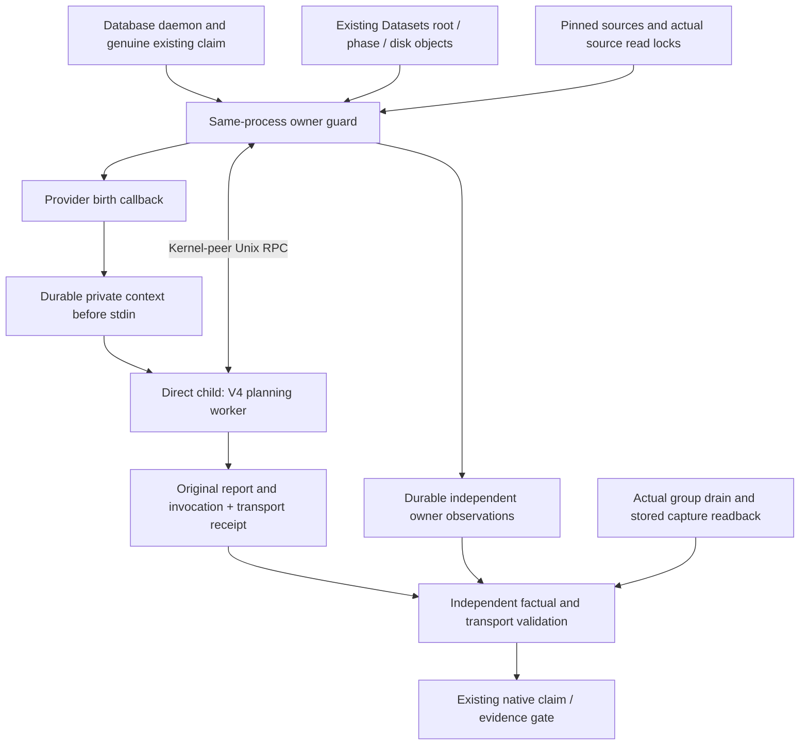

# LegalIR production owner handoff

Date: October 17, 2026.

This guide describes the new Grok planning transport and the remaining work to
connect it to the supervisor. It supplements the
[operations guide](legal-ir-supervisor-operations-2026-10-16.md). The published
automatic Grok route is on Accelerator main at
`2e3e2a271de16e2bbf9d80b77fc6e66bec90a252`. The production handoff described here
is an isolated source candidate, with private tests; it is not deployed.

The latest portable contribution adds `grok_fresh_task_capture_worker`, `grok_fresh_task_capture_transport` and `grok_fresh_task_capture_check`, plus their two test files. Its [independently audited main-based suite](../../artifacts/legal-ir-supervisor-recovery-20261018-04/fresh-capture-portable-normal85-independent-return-audit-v1/review.json) passed 85 cases and 255 phases, including the unchanged 20 offline-worker cases, in 17.650 seconds. All nine source/environment/process invariants passed. These five files are published on Accelerator `origin/main` as [`fd9189a8`](https://github.com/endomorphosis/ipfs_accelerate_py/commit/fd9189a8af8dce89826ce2f062a2efbe34182074), with exact remote readback in the [publication closeout](../../artifacts/legal-ir-supervisor-recovery-20261018-04/portable-fresh-capture-main85-source-v1/execution-01/publication-01/result.json). The separate private M2 entry/setup/handoff is excluded, and dispatch remains hard-disabled.

Its [independent publication audit](../../artifacts/legal-ir-supervisor-recovery-20261018-04/portable-five-file-publication-independent-return-audit-v1/review.json) verifies the exact five additions and sole parent, 28,173 committed index entries, all 1,395 source bodies, 71 closed Git command pairs, unchanged canonical authority/hooks and actual owner/source-lock closure. The owned index and main ref intentionally changed; old preparation controls must not be reused as current Git metadata. No durable per-Git-child birth evidence is invented.

The [expanded integration failure](../../artifacts/legal-ir-supervisor-recovery-20261018-04/fresh-capture-normal384-execution01-independent-failed-return-audit-v1/review.json) preserves 382 passing cases and two SDK fixture setup errors. Recorded CPU stall pressure was 50.28% against the unchanged 50% safety threshold. No lease was acquired by either failed fixture. The 79 added M2 metadata cases passed, but neither this partial result nor the passing portable suite establishes native capture, an accepted task or Lean admission.

The next worker contract needs an explicit private fake-credential fixture, bound to the sealed request, slot/fingerprint, source generation, original deadlines and actual loopback namespace. Initialize the genuine storage-wrapper singleton explicitly with distributed mode disabled before importing the secrets manager; then initialize the latter against an owned private file before its first global lookup. Neither singleton may be reset or inherited by assumption. No ambient secret lookup or mutable readiness flag may unlock M2. The whole caller must enter RootlessKit before constructing the same-process resource owners; wrapping only its child would break the existing PID, descriptor and custody joins. The approved production toolchain image remains a separate prerequisite from installed-CLI loopback diagnostics.

The [V2 helper proposal](../../artifacts/legal-ir-supervisor-recovery-20261018-04/private-fake-credential-helper-source-v2/manifest.json) fixes the stale-clock mutation finding in its [independent source review](../../artifacts/legal-ir-supervisor-recovery-20261018-04/private-fake-credential-helper-v2-independent-source-peer-v1/review.json). The [actual 112-case normal suite](../../artifacts/legal-ir-supervisor-recovery-20261018-04/private-fake-credential-normal112-source-v1/execution-01/tests.json) passed 336 phases and all nine invariants in 15.935 seconds: the original 85 plus 27 helper metadata/file/memfd and clock-boundary cases. It proves no manager initialization: the actual helper latch and retained list stayed untouched. This proposal is unpublished, unwired and cannot remove M2's dispatch refusal. Next test the genuine offline storage/secrets APIs in a fresh isolated process, including singleton refusal, no ambient secret/distributed initialization and actual thread behavior. A future worker must use the existing `prepared['client']` so genuine intermediate acknowledgments remain in the matched contiguous owner/client receipt stream. Preserve the original hard process deadlines; clock checks cannot preempt a genuine API call.

The latest caller/lifecycle correction passed [49 focused cases and 147 phases](../../artifacts/legal-ir-supervisor-recovery-20261018-03/private-M1-caller-normal49-independent-return-audit-v1/review.json), including real owner-context metadata validation and five file/process/clock cleanup controls. CallerV7 retains the original checker and explicitly selects LifecycleV4. The new lifecycle attempts genuine original STOP even after passive proof errors, without granting worker closure from missing context. The [independent native04 return audit](../../artifacts/legal-ir-supervisor-recovery-20261018-03/private-M1-native04-offline-transport-independent-return-audit-v1/review.json) confirms diagnostic-only success: three ACKs at 0.435/0.511/0.562 seconds, genuine START/STOP, process/source cleanup, both new disk reservations released and durable, and expected exit 2. Its actual private execution readback remains one RUNNING attempt with a `started_outcome_unknown` callback. No full native, task, Grok or Lean qualification is granted; the candidates remain unpublished.

The [next capture/native-return design](../../artifacts/legal-ir-supervisor-recovery-20261018-03/private-M2-capture-native-return-source-design-v1/plan.json) reuses the genuine profile, router capture and post-drain handoff checks. Capture must join the actual returned worker process, its accepted native session UUID, allocation-store readback and pinned transport receipt. Historical planning worker v04 and its acceptance artifacts are bound to the original task and must not be relabeled for a fresh task. A genuine Grok stage needs a fresh admitted task, portable worker, actual credential selection, pinned binary/configuration and fresh owned homes. None of these steps settles the offline UNKNOWN or rearms LIR-9001.

An October 18 [inventory correction](../../artifacts/legal-ir-supervisor-recovery-20261018-04/capture-integration-inventory-v1/inventory.json) supersedes the earlier design's limited loopback inventory. A historical fixture ran the installed Grok CLI inside an isolated network namespace, with a local fake provider, genuine ACP create/name/close and real router capture under `grok_cli`. Its [independent audit](../../artifacts/legal-ir-supervisor-recovery-20261016-02/grok-automatic-native-03-closed-independent-audit-v1/audit.json) covers that historical generation only. This is stronger than a stand-in process with a seeded capture row, but it proves neither real-provider quality nor production configuration. The current router changed and requires fresh regression and installed-CLI validation. The unchanged binary hash alone does not transfer the old result.

The new [namespace topology design](../../artifacts/legal-ir-supervisor-recovery-20261018-04/M2-rootless-topology-source-design-v1/plan.json) enters the namespace before constructing the complete M2 provisioning caller. This preserves the existing direct supervisor, daemon and worker relationships. The outer launcher needs its own charged custody; it cannot lend resource capabilities across processes. Original absolute work/native/parent/STOP clocks remain 240/300/360/30 seconds, and production ACKs retain the one-second ceiling. Explicitly retain the existing global scheduler path across UID mapping. Wrapping just the worker, assuming RootlessKit forwards sealed descriptors, or inheriting the old fixture's 600-second/5-second protocol would not satisfy this design. This topology is source design, not an executed qualification.

The current integrated EntryV3-r2 candidate passed [224 normal-package cases](../../artifacts/legal-ir-supervisor-recovery-20261018-03/private-M1-entry-normal224-qualification-source-v2/execution-01/tests.json), with 672 passing phases and complete source, environment and process cleanup. Its [independent return audit](../../artifacts/legal-ir-supervisor-recovery-20261018-03/private-M1-normal224-independent-return-audit-v1/review.json) binds that exact source generation. Accelerator main includes the default-off offline worker components at `a2c799f301aebf21d0d412b84b991c5e23d585a8`; the separate M1 entry and handoff remain unpublished candidates.

Final preflight corrected a checker defect: real claim admission adds `body.completion_receipt` and returns immutable task snapshots. The [V3 review](../../artifacts/legal-ir-supervisor-recovery-20261018-03/private-M1-checker-v3-independent-source-peer-v1/review.json) verifies the exact allowed transition and preserves every other body field, revision, attempt, lease, fence and route check. The focused [42-case checker/caller run passed](../../artifacts/legal-ir-supervisor-recovery-20261018-03/private-M1-caller-normal42V3-independent-return-audit-v1/review.json) with 126 passing phases. Earlier failed preparations and superseded non-executable launch packets remain historical evidence.

The first genuine M1 diagnostic reached START and profile construction but failed before worker launch because the task's private board namespace differed from the supervisor's inferred namespace. Its [independent failed-return audit](../../artifacts/legal-ir-supervisor-recovery-20261018-03/private-M1-native01-failed-return-independent-audit-v1/review.json) verifies native STOP, process/source closure and both released disk reservations. No ACK was produced; UNKNOWN callback evidence remains preserved. The separate outer log-pinning failure left the caller's exit code unrecorded, which must not be reconstructed from expected control flow.

The [Entry V2 namespace correction](../../artifacts/legal-ir-supervisor-recovery-20261018-03/private-M1-entry-v2-namespace-independent-source-peer-v1/review.json) binds the genuine task-body namespace before signing, puts it explicitly in the supervisor argv, checks actual child argv/task identity and supplies the same namespace to the completion service. The task body, renderer's conflict check and ordinary/M0 paths are unchanged. The [actual 222-case audit](../../artifacts/legal-ir-supervisor-recovery-20261018-03/private-M1-normal222-independent-return-audit-v1/review.json) verifies all previous 220 cases plus two real projection cases, 666 passing phases and complete source/resource closure. Caller V4 and Checker V3 retain their separately required focused test gate.

Each diagnostic uses a new private cap-one task and the original 240/300/360-second work/child/parent clocks with a 30-second STOP allowance. Successful offline ACKs and cleanup would remain transport evidence. The deliberately refused missing-capture callback may remain RUNNING/UNKNOWN, with no settlement or completion authority; the diagnostic then exits 2. Original LIR-9001 remains blocked with both spent attempts retained. No new provider call, training result, legal conversion or Lean admission follows from these source tests.

The second diagnostic exposed a caller/entry socket contract mismatch: Quack already owned its socket directory, while the production listener requires a fresh parent. EntryV3-r2 and CallerV5 select a separate absent listener directory without changing real listener ownership checks. The third diagnostic passed that freshness stage but the unchanged owner validator refused the caller's descriptive fingerprint, which must instead have the required sixteen lowercase hexadecimal characters. A deterministic digest of a fixed public offline label supplies metadata only; it cannot supply a selected API key or authorize provider dispatch.

The third diagnostic also exposed a separate cleanup hole. After the owner-context refusal, the child reported that a worker had started, but the context file containing its durable birth/group identity had never been published. Passive cleanup tried to read that file and raised before STOP. The [actual failed-run audit](../../artifacts/legal-ir-supervisor-recovery-20261018-03/private-M1-native03-failed-abort-independent-return-audit-v1/review.json) preserves the missing ACK/context evidence, UNKNOWN callback, absent known process groups and source locks, released child reservation and still-charged parent reservation. Only the exact expired caller was signaled after its original deadline; the actual direct return is -15. No native STOP or parent cleanup success is inferred. The lifecycle correction must always reach the original bounded STOP stage after a passive observation error while keeping worker closure false if identity evidence is unavailable.

As of October 18, the authenticated Quack repository correction, private
log/reservation cleanup and safer diagnostics passed all
[145 normal-package cases](../../artifacts/legal-ir-supervisor-recovery-20261018-01/private-M0-entry14-normal145-source-v1/execution-01/tests.json)
with 435 passing phases in 96.820 seconds. The preceding private attempt
recorded child exit 139 and a START health
timeout, with only an intent and no durable construction or closure result.
Its expired caller was stopped by a birth-verified, single-process abort;
the original claim remains charged and the child disposition remains UNKNOWN.
A separate standard-library experiment reproduced SIGSEGV in both repeated
timed-dump children and successful completion in both controls on Python 3.12.3.
This supports replacing the unsafe diagnostic mechanism, but does not prove
the exact cause of the private attempt's abnormal exit. Bounded diagnostics
and original-deadline reconciliation for missing outcomes are now installed
in the owned integration view and included in the 145-case run. The subsequent
private construction reached profile initialization, then rejected a missing
portal-bridge import. Its child closed genuinely, but parent STOP remains
unproved; the expired parent was aborted with all claims and receipts preserved.
The next candidate adds the genuine preload and durable cleanup-error telemetry,
with all 153 component cases now passing in 102.525 seconds. The fresh private
attempt `/tmp/pytest-of-barberb/m0-v15-10` genuinely constructed the profile,
passed its live check and recorded successful native START and STOP. Its child
cleanup receipt is missing, so overall qualification remains false and both
512 MiB disk claims remain charged. Only the expired caller was subsequently
aborted; all receipts and claims were preserved. A shutdown timing correction
is under review within the original deadlines.
Datasets resource changes separately passed all 307 cases and reached main as
`7bb5602b8c265234686be9628bba869e8abd272d`. The operations guide records exact
receipts, earlier failures and the later raw Git index drift.
The passive-cleanup candidate subsequently passed all 158 normal-package cases
and 474 phases in 102.530 seconds; the independent audit verifies all 1,371
source hashes, ten controls and actual component cleanup. The fresh native
lifecycle run M011 subsequently passed: the independent checker and read-only
return audit verify actual construction, START, child closure, STOP, released
new resource claims and process/source-lock cleanup. Full provider transport
and productive dispatch remain unqualified.
No test result here supplies Lean admission or rearms the original blocked task.

Current next work is portable adoption of the validated lifecycle changes and a separate private Grok provider-handoff qualification. That experiment must bind the genuine owner context before worker stdin, retain its original deadlines and source/resource custody, verify temperature zero on every request, and close the worker group and owner transport. M011 supplied no provider dispatch or full-transport evidence and cannot reopen LIR-9001 or change its spent attempt cap. The ordinary Quack identity fix and portable regression file are separately published as `4a45533a7d3b800d9c685e90b96e6ca52c2cd7ad`; this does not deploy the private lifecycle candidates.

The first portable portion now reached main as [`cdcb0d91`](https://github.com/endomorphosis/ipfs_accelerate_py/commit/cdcb0d91e1e7675498f0fe7a9295123f2f31f7f1): bounded startup diagnostics, explicit read-only/no-lazy-fetch Git query settings and their normal regression files. All 36 component cases and 108 phases passed with complete source/control/environment/process closure. The query settings fix an import-time path that discarded the caller's Git safeguards; the preceding 33-case test pass remains an overall failed run because its index identity changed. See the operations guide for the separate preparation, failed-run, actual qualification and publication receipts. This publication does not include the private M0 entry or provider dispatch.

The [absolute RPC deadline V2](../../artifacts/legal-ir-supervisor-recovery-20261018-02/grok-owner-client-absolute-rpc-deadline-source-v2/manifest.json) subsequently passed all 18 existing plus 13 new real socket cases and 93 phases, including full source/control/environment/process closure. It is published on main as [`f1161d18`](https://github.com/endomorphosis/ipfs_accelerate_py/commit/f1161d183a923541c4c1cb461cfb0102d2a287c2). The one-second ceiling and original work margin stay fixed; byte arrivals and slow final validation cannot renew them. This component result does not measure the genuine resource-backed owner handshake.

The [M1a offline components](../../artifacts/legal-ir-supervisor-recovery-20261018-02/private-M1a-offline-components-source-v1/manifest.json) provide a default-off sealed-request worker and a checker for the first handoff-completion call. The corrected [actual 20-case run](../../artifacts/legal-ir-supervisor-recovery-20261018-03/M1a-normal20-qualification-source-v2/execution-01/tests.json) passed all 60 phases and nine invariants in 1.679 seconds. Its [independent return audit](../../artifacts/legal-ir-supervisor-recovery-20261018-03/M1a-normal20-execution02-return-audit-v1/review.json) verifies the complete source/index/control checks, empty environment delta and actual process/source-lock closure. The first run remains failed at 19/20: its positive pipe fixture embedded an invalid Python string. The [fixture-only correction](../../artifacts/legal-ir-supervisor-recovery-20261018-03/M1a-offline-components-source-v2/manifest.json) preserves both product bodies and all assertions, and checks the inner script before spawning it. These are component tests, with no genuine resource-backed ACK or native qualification.

The [accepted-descriptor and first-callback seam V2](../../artifacts/legal-ir-supervisor-recovery-20261018-02/private-M1a-accepted-stream-seam-source-v2/manifest.json) passed [independent source review](../../artifacts/legal-ir-supervisor-recovery-20261018-02/private-M1a-accepted-stream-seam-v2-independent-source-peer-v1/review.json). The actual M1 entry must retain the sealed metadata descriptor and digest; the handoff checks that custody at binding and before launch. Its private callback calls the genuine checker first, retains the missing-capture observation and explicitly refuses task completion. The ordinary path and construction-only M0 remain unchanged. The [combined actual 25-case suite](../../artifacts/legal-ir-supervisor-recovery-20261018-03/M1a-seam-normal25-qualification-source-v1/execution-01/tests.json) passed all 75 phases and nine invariants in 1.673 seconds, including five real descriptor cases and nine genuine normal module identities. The separate sealed M1 entry and actual first callback still need qualification. A public empty allocation capture lookup also represents an unavailable connection and does not prove durable row absence.

The three qualified component files are published on main as [`a2c799f301aebf21d0d412b84b991c5e23d585a8`](https://github.com/endomorphosis/ipfs_accelerate_py/commit/a2c799f301aebf21d0d412b84b991c5e23d585a8), with exact remote readback in the [actual publication closeout](../../artifacts/legal-ir-supervisor-recovery-20261018-03/M1a-normal20-execution-02/publication-01/result.json). This adds only the default-off worker, checker and corrected component test; the entry and handoff seam are not included. No native resources, provider or original task were used by publication, and canonical sources and controls stayed unchanged.

Source review of the real callback path found a separate settlement limit. The offline worker deliberately exits zero after ACKs; the first missing-capture callback then refuses completion. Existing terminal provider-failure custody requires a genuine nonzero process exit, so it cannot turn this outcome into FAILED. The database can retain its `started_outcome_unknown` intent and RUNNING attempt. A future native diagnostic must report the actual task state separately from observed ACK transport. Do not fabricate a nonzero exit, reuse planning-specific administrative settlement, reset the spent cap or treat UNKNOWN as full qualification.

## Ownership and data flow

The new bridge requires the database daemon and the genuine existing Datasets
root, phase and parented disk capabilities in the **same process and owning
thread**. The historical launcher holds those capabilities in a separate parent
process. Its existing topology cannot supply this bridge by serializing leases
or copying a JSON context. A new owner profile must compose the genuine objects
at the provider invocation seam.

The context binds the exact database claim, attempt, fence, Portal revision,
native lease ancestry, allocation identity, credential slot, source profile,
worker birth and original absolute deadlines. It conveys metadata. Every live
acknowledgment rechecks the genuine owner; the worker cannot acquire a new root
lease or authorize its own execution.

## Implemented components

| Component | Candidate and current evidence |
| --- | --- |
| Worker and runtime adapter | [V4-r2 manifest](../../artifacts/legal-ir-supervisor-recovery-20261016-02/grok-production-planning-worker-source-v4-r2/manifest.json): 32 private cases and 52 subtests passed; original named worker definitions except `main` preserved. |
| Kernel-peer owner client | [V2 manifest](../../artifacts/legal-ir-supervisor-recovery-20261016-02/grok-production-owner-client-candidate-v2/manifest.json): 18 private IPC cases passed. |
| Existing-capability factory | [V3 manifest](../../artifacts/legal-ir-supervisor-recovery-20261016-02/grok-production-owner-factory-candidate-v3/manifest.json): actual profile pin must equal the declared profile digest; four metadata cases passed. Genuine constructor exercised successfully in private M011; no provider transport qualification. |
| Charged exact listener | [V2 server manifest](../../artifacts/legal-ir-supervisor-recovery-20261016-02/grok-production-owner-server-candidate-v2/manifest.json): nine physical socket/path cases passed against the unchanged listener bytes. No actual native reservation constructor was exercised. |
| Synchronous server | Same V2 manifest: ten private frame cases passed, including fragmentation and deadline exhaustion. Each frame has an absolute limit; byte arrivals cannot reset it. |
| Factual and transport joins | [Validator manifest](../../artifacts/legal-ir-supervisor-recovery-20261016-02/grok-planning-transport-acceptance-source-v1/manifest.json): nine metadata cases and 59 subtests passed. The original factual checker is byte-identical. |
| Native acceptance binding | [New gate manifest](../../artifacts/legal-ir-supervisor-recovery-20261016-02/grok-planning-transport-native-gate-source-v1/manifest.json): five negative cases and 32 subtests passed. The native publisher was not called. |
| Concrete same-process profile | [Profile manifest](../../artifacts/legal-ir-supervisor-recovery-20261016-02/grok-production-same-pid-profile-source-v1/manifest.json): 22 metadata cases passed against the actual main bridge's field names and normal module mapping. The genuine constructor and native lifecycle passed private M011; no provider handoff occurred. |

These are 109 distinct cases and 143 separately counted unittest subtests across
the component suites. They are ordinary private source, local socket and file
fixtures. Standalone test imports were forwarded explicitly; they do not qualify
normal project package imports. They opened no product database, invoked no
provider and obtained no native grants. Test wall times are not legal inference
or training benchmarks.

The [component audit](../../artifacts/legal-ir-supervisor-recovery-20261016-02/grok-production-transport-private-tests-independent-audit-v1/review.json)
and [native-gate negative-test audit](../../artifacts/legal-ir-supervisor-recovery-20261016-02/grok-planning-transport-native-gate-private-tests-independent-audit-v1/review.json)
independently join source hashes, actual test logs and counts. The
[V3 daemon handoff](../../artifacts/legal-ir-supervisor-recovery-20261016-02/grok-production-daemon-handoff-source-v3/manifest.json)
and its exact opt-in patch also passed
[source review](../../artifacts/legal-ir-supervisor-recovery-20261016-02/grok-production-daemon-handoff-v3-source-peer-v1/review.json).
That review parsed the actual patched source; it did not import or execute the
daemon. The default provider route stays unchanged when the factory is absent.

The [profile review](../../artifacts/legal-ir-supervisor-recovery-20261016-02/grok-production-same-pid-profile-source-peer-v1/review.json)
and [22-case return audit](../../artifacts/legal-ir-supervisor-recovery-20261016-02/grok-production-same-pid-profile-private22-return-audit-v1/review.json)
verify the actual bridge field mapping and private test scope. Main's serialized
bridge binding has no owner-session field: that join comes from the genuine
claim, typed attempt and database owner. The profile retains only the already
joined alias for later dispatch, so unrelated larger bridge metadata is not
forced through the smaller RPC decoder.

The [integration bundle](../../artifacts/legal-ir-supervisor-recovery-20261016-02/grok-production-owner-integration-bundle-v1/README.md)
indexes the exact six package modules, fresh controller files and two opt-in
patches. Its [static verification](../../artifacts/legal-ir-supervisor-recovery-20261016-02/grok-production-owner-integration-bundle-v1/verification-01/result.json)
checked 23 source files and 17 evidence files, compiled source syntax without
executing project code, and reconstructed both reviewed main postimages in
memory. That verification is not a normal import test, task execution or admit.

## Integration against current main

The [fresh source view](../../artifacts/legal-ir-supervisor-recovery-20261016-02/grok-production-normal-main-view-v2/preparation-v1/view-pins.json)
uses actual Accelerator main `eaaec0ac55af7b269c41f087f68c717af1151ebf`.
It contains 498 source files, the six new modules, both exact opt-in patches and
six package test files. The two patch preimages still match this main revision.
The [independent return audit](../../artifacts/legal-ir-supervisor-recovery-20261016-02/grok-production-normal-main-view-v2-return-audit-v1/result.json)
rehashed every source and 11 Git controls and independently parsed the full
28,148-entry index. The canonical checkouts and earlier published view were
preserved. The first preparation's missing dependency path and refusal remain
recorded; the corrected preparation adopted its owned, unmaterialized clone.

A later [one-file source refresh](../../artifacts/legal-ir-supervisor-recovery-20261016-02/grok-production-normal-test-view-refresh-v2/refresh-01/view-pins.json)
keeps the same main base, all 498 paths and all 11 Git controls. It removes the
permanent whole-file hash literals from the reusable repository smoke test.
Exact generation hashes remain mandatory in the external QA request and real
AST seals. The other five forwarded test bodies and all production source bytes
are identical. The [refresh closeout](../../artifacts/legal-ir-supervisor-recovery-20261016-02/grok-production-normal-test-view-refresh-v2/refresh-01/closeout.json)
records the single changed path and actual release of four source leases; no
Git command, package test, provider or native operation ran during that refresh.
The earlier return audit describes the parent generation, not these new test
bytes.

The next [two-file refresh](../../artifacts/legal-ir-supervisor-recovery-20261016-02/grok-production-normal-test-view-refresh-v3/refresh-01/view-pins.json)
corrects the smoke test for the package's genuine lazy `ModuleType` subclass
and restores the router's missing `_grok_requirements_allow_zero` entry point.
That entry point delegates to the current strict requirements validator with
`zero_temperature=True`; it does not bypass system policy. All original router
code remains identical. Its original bytes were preserved separately before
application. The [independent return audit](../../artifacts/legal-ir-supervisor-recovery-20261016-02/grok-production-normal-test-view-refresh-v3-return-audit-v1/result.json)
checked all 498 current source files, the exact two changes, all 11 Git controls
and the original source-lock identities. The proposed publication now has 15
paths, including this router correction.

The normal-package suite has 177 expected cases: the earlier 111 regression
cases, 63 component cases and three new import/integration checks. These counts
overlap the component results above and are not 177 additional independent
behaviors. Unlike the earlier narrower regression run, this suite loads the
real repository conftests and AST-seal plugin. Its first
[execution](../../artifacts/legal-ir-supervisor-recovery-20261016-02/grok-production-normal-package-qa-v2/normal-main-01/execution-01/pytest-outcome.json)
stopped before collection because the harness rejected the genuine hardware
detector's `platform.processor()` subprocess. The failed generation is retained;
its [closeout](../../artifacts/legal-ir-supervisor-recovery-20261016-02/grok-production-normal-package-qa-v2/normal-main-01/execution-01/closeout.json)
proves process and source-lock cleanup. It is not a passing test receipt. A
corrected harness must permit and record the exact bounded local hardware probes
while retaining the real conftests, private fixture database and provider ban.

Subsequent real runs exposed ordinary configuration requirements: the installed
Torch/CUDA runtime needs a bounded `ldconfig -p` lookup, and Dill opens the real
null device nine times to identify Python file classes. The harness permits
only those genuine pinned callers and records actual probe results. Its
per-process address-space limit is now 8 GiB because the original 4 GiB limit
caused an actual AST-parser `MemoryError`; the RSS guard remains 4 GiB. These
are source-QA limits, not changes to training, model context or campaign caps.

The [V8 pytest outcome](../../artifacts/legal-ir-supervisor-recovery-20261016-02/grok-production-normal-package-qa-v8/normal-main-06/execution-01/pytest-outcome.json)
records 177 passing cases, zero failures/errors/skips, with 72 passing subtests
in the retained pytest log. Its overall driver still refused a native Torch
submodule without a Python import spec, so the V8 closeout remains failed and
cannot authorize publication. A final exact native-submodule provenance check
and fresh full run remain required. Later graph captures established that real
native modules can be unregistered and that a parent attribute can differ from
the child's canonical module name. The harness now records the actual bounded
graph, aliases, registrations, object identities and pinned root extension.
Ordinary Python import-origin checks remain strict.

The [V11 pytest outcome](../../artifacts/legal-ir-supervisor-recovery-20261016-02/grok-production-normal-package-qa-v11/normal-main-09/execution-01/pytest-outcome.json)
again records 177 passing cases and zero failures/errors/skips. Its actual 177
AST seals and unchanged native module graph also passed. The
[owner closeout](../../artifacts/legal-ir-supervisor-recovery-20261016-02/grok-production-normal-package-qa-v11/normal-main-09/execution-01/closeout.json)
is nevertheless failed: the driver's environment-restoration comparison returned
false. Source inspection found that installed pytest sets `PYTEST_VERSION`
inside `pytest.main()` and restores its entry value afterward; the harness had
compared a collection-time snapshot with the environment after that restoration.
V11 did not record the differing key, so this is a source-based diagnosis, not
an observed historical environment diff. A fresh harness must check the complete
environment before framework teardown, verify the exact framework-owned
restoration after return, and record differing key names without secret values.
Every attempted run's actual process and source-lock cleanup is retained
separately from its test result. Failed overall closeouts cannot authorize
publication even when the behavior tests passed.

The fresh [V12 complete closeout](../../artifacts/legal-ir-supervisor-recovery-20261016-02/grok-production-normal-package-qa-v12/normal-main-10/execution-01/closeout.json)
passes overall: 177 cases, 72 separately counted subtests, 177 actual AST seals,
zero failures/errors/skips, and both full environment checks. Driver wall time
was 63.196 seconds; complete owner wall time was 68.245 seconds, with peak
sampled group RSS of 951,095,296 bytes. These are source-QA measurements.
All recorded processes closed, the original group was empty, and all three
source-lock identities and actual release checks passed with no cleanup errors.
The [independent return audit](../../artifacts/legal-ir-supervisor-recovery-20261016-02/grok-production-normal-package-qa-v12-return-audit-v1/result.json)
rehashed the 611 request sources, 498 view sources, 11 Git controls and 2,428
installed runtime code files. The native graph retained its actual 43 nodes,
42 edges, alias and unregistered child. V11 remains failed. V12 establishes
normal source integration; it does not establish native execution or Lean
admission.

The first [15-file publication attempt](../../artifacts/legal-ir-supervisor-recovery-20261016-02/grok-production-fifteen-file-source-publication-v1/executions/production-owner-main-v1/result.json)
refused during preservation baselines, before staging, committing, querying the
remote or pushing. The old metadata walker excluded only the top-level Git
object store and descended into nested submodule stores and unrelated historical
test fixtures. Its strict regular-file reader correctly rejected that population.
The [independent failed-return audit](../../artifacts/legal-ir-supervisor-recovery-20261016-02/grok-production-fifteen-file-source-publication-return-audit-v1/result.json)
verifies 24 closed read-only Git operations, unchanged qualified source/runtime
pins and release of all four source locks. The incomplete canonical preservation
baseline is unverified, rather than evidence of a mutation. The correction must
scope Git administrative controls explicitly, leave object and unrelated fixture
payloads unread, and retain the existing size and hardlink protections. It does
not require another production-source change or a larger disk allowance.

The second publication attempt staged the exact 15 regular postimages, then
refused before commit/push on a preservation comparison. Its
[independent return audit](../../artifacts/legal-ir-supervisor-recovery-20261016-02/grok-production-fifteen-file-source-publication-return-audit-v2/result.json)
verifies the full 28,160-entry staged index, 93 closed Git operations, an actual
remote-base readback and release of all four source locks. Current readback
matches all selected source fingerprints and canonical root authority. The
observed differences are in six foreign P branch/worktree controls and one
foreign directory membership; the historical first differing field was not
persisted. A continuation must preserve that independent progress, explicitly
separate protected inputs from observed foreign state, and bind the exact staged
index. It cannot reset the view, adopt unreviewed foreign code or publish against
a different remote base without integration and fresh qualification.

The V3 continuation did not execute: its source review found that two fields in
the retained audit contain evidence lists, while the reader required booleans.
V4 joined the ten control observations and one remote-readback record to their
exact evidence. Its [actual attempt](../../artifacts/legal-ir-supervisor-recovery-20261016-02/grok-production-fifteen-file-source-publication-v4/executions/production-owner-main-v4/result.json)
then refused during preservation baselines, before mutation. The persisted
deltas identify a 132-byte foreign branch-tracking addition in canonical P's
Git config. The [bounded observation](../../artifacts/legal-ir-supervisor-recovery-20261016-02/grok-publication-P-foreign-branch-config-observation-v1/result.json)
proves that removing only that exact stanza in memory reconstructs the old
config digest. Removing its two exact records from a genuine effective-config
read reconstructs the old effective-config digest too. The real config was
preserved. This permits a narrow reviewed continuation; it does not permit
accepting arbitrary config changes or ignoring protected authority.

The [reviewed V5 publisher](../../artifacts/legal-ir-supervisor-recovery-20261016-02/grok-production-fifteen-file-publisher-final-source-peer-v5/review.json)
then completed the exact 15-file publication as Accelerator
[`12ea68f28a98ba3f443979d7f60b68d74e047124`](https://github.com/endomorphosis/ipfs_accelerate_py/commit/12ea68f28a98ba3f443979d7f60b68d74e047124).
The [actual result](../../artifacts/legal-ir-supervisor-recovery-20261016-02/grok-production-fifteen-file-source-publication-v5/executions/production-owner-main-v5/result.json)
records one ordinary commit, one immutable non-force push and exact remote-main
readback. All six preservation observations retained their raw differences and
verified the exact foreign config addition; no other protected difference was
allowed. Final source/runtime validation followed the last Git operation, all
four source locks released and no cleanup error was recorded. Canonical source
checkouts were preserved. The pre-staging view pins remain historical controls;
the committed view now has new HEAD/index/ref metadata. This publishes the
tested source generation, not the later SDK/entry candidates or a production
deployment.

The [independent closed-publication audit](../../artifacts/legal-ir-supervisor-recovery-20261016-02/grok-production-fifteen-file-source-publication-return-audit-v5-r3/result.json)
verified 3,284 Git objects, the exact 15 regular postimages, sole base parent,
complete 28,160-entry index, 185 closed command outcomes, all four remote-output
digest joins, six configuration proofs and all four original source-lock owner
keys absent. Direct URL push left the local packed `origin/main` at the base;
the actual remote query returned the published commit. The generic Git journal
does not persist child PID/birth records, so the audit does not invent an
independent post-return observation of those children.

The independent return review observed a later canonical P edit at 22:59:36 UTC,
after the publisher's result at 22:59:16 UTC. Its exact diff changes the resource
module's ceiling from 200 GB to 220 GB and updates the accompanying comment.
No campaign ledger was opened to infer its applied limit. Preserve that source
change when merging the SDK deadline work; SDK V4's old resource-module preimage
must no longer be written over the live file. The recorded publication cutoff
and current-source compatibility are separate observations. This edit does not
invalidate the published commit or authorize reuse of stale native source pins.

The [SDK V5 merge](../../artifacts/legal-ir-supervisor-recovery-20261016-02/grok-native-absolute-admission-deadline-sdk-source-v5/manifest.json)
preserves the current 220 GB ceiling/comment and all reviewed deadline changes.
Its [fresh private tests](../../artifacts/legal-ir-supervisor-recovery-20261016-02/grok-native-deadline-sdk-v5-private-fixture-tests-v1/README.md)
passed all 11 cases and 33 phases in 0.648 seconds of harness wall time. Four
actual RSS samples reached 36,864,000 bytes; this is a sampled maximum, not a
continuous peak or model memory measurement. The runner records PID/birth and
the source-lock inode, verifies its owner key absent after context closure,
and observes nine empty private schedulers with no added live threads. This
does not deploy the SDK or qualify the complete native entry.

The [independent SDK V5 return audit](../../artifacts/legal-ir-supervisor-recovery-20261016-02/grok-native-deadline-sdk-v5-private-fixture-return-audit-v1/result.json)
verified the actual 11/33 outcomes and JUnit, current preimages and candidate
origins, nine empty private scheduler files, absent original runner PID/birth,
same source-lock inode and original owner key absent. The [entry V5 rebind](../../artifacts/legal-ir-supervisor-recovery-20261016-02/grok-production-same-pid-fixture-entry-binding-source-v5/manifest.json)
now explicitly selects SDK V5; its [independent source peer](../../artifacts/legal-ir-supervisor-recovery-20261016-02/grok-production-same-pid-fixture-entry-binding-source-v5-independent-peer-v1/review.json)
verifies that only the disk source hash/comment changed from entry V4. All
launch logic, runtime/supervisor/daemon patches, M0 composition and fifteen
proposed metadata tests remain unchanged. Those entry tests and native M0
still need a fresh integrated normal view and genuine private producer
materials. The SDK fixture result supplies no native qualification transfer.

## Canonical SDK adoption: October 18

The [canonical adoption](../../artifacts/legal-ir-supervisor-recovery-20261018-01/sdk-v5-canonical-adoption-v1/execution-01/result.json) has now installed all four SDK V5 postimages under a real exclusive P source lease. The [independent audit](../../artifacts/legal-ir-supervisor-recovery-20261018-01/sdk-v5-canonical-adoption-return-audit-v1/review.json) verifies genuine package initializers, all 11 deadline cases, nine empty private schedulers and actual owner/child/source-lock closure. This supersedes the earlier statement that SDK V5 is only a candidate; those standalone fixture receipts remain historical. The current 220 GB source ceiling is preserved, with no host-ledger migration inferred or performed.

The subsequent [normal repository resource run](../../artifacts/legal-ir-supervisor-recovery-20261018-01/sdk-v5-repository-regressions-v3/execution-01/tests.json) passed 261 cases in 14.640 seconds through all five real P conftests. This includes 238 existing resource cases, the 11 deadline cases and 12 strict/parented cases using genuine private schedulers and resource owners. There were 817 passing reports: 783 unique case/phase pairs plus 34 additional call reports. Exact collected source paths, real package origins, unchanged source hashes and [actual owner cleanup](../../artifacts/legal-ir-supervisor-recovery-20261018-01/sdk-v5-repository-regressions-v3/execution-01/result.json) passed. Earlier failed harness generations are preserved separately. These are resource regression timings, not legal inference or training measurements.

The [entry V6 source](../../artifacts/legal-ir-supervisor-recovery-20261016-02/grok-production-same-pid-fixture-entry-binding-source-v6/manifest.json) tightens only sealed metadata's integer attempt-cap check relative to V5. Its [separate normal-package run](../../artifacts/legal-ir-supervisor-recovery-20261018-01/entry-v6-normal-tests-v2/execution-01/tests.json) passed all 15 binding and 48 sealed-metadata cases, with 189 passing phases, three real A conftests and 36 actual A/P module origins. Harness test time was 23.873 seconds, with pytest reporting 22.94 seconds; this is source QA, not legal throughput. The genuine mandatory AST-seal catalog is private to that run. The first isolated-interpreter attempt failed before collection because it excluded the already installed user-site DuckDB package; the preserved V2 run uses the same normal interpreter mode as the existing integration harness and retains exact source-origin checks. A real Torch CUDA availability probe emitted an out-of-memory warning; no CUDA qualification or training was performed.

The [fresh integration view](../../artifacts/legal-ir-supervisor-recovery-20261016-02/grok-native-entry-integration-view-v1/native-entry-02/owner/view-pins.json) contains 1,357 exact source/configuration/schema files totaling 60,688,703 bytes and a full 28,160-entry index. It preserves the published 498-file source population in its original view. Preparation completed in 122.904 seconds using 3,116 journaled local Git calls, with no network fetch, weights or product database. The first preparation's disappearing-process observation failure is retained separately; the replacement helper handles `ProcessLookupError` as the same absent-process case as `FileNotFoundError`. Native M0 remains a distinct construction-and-closure experiment with genuine private authority, resources and producer receipts; it cannot reopen the original blocked task or supply Lean admission.

## Runtime ordering

Review of the concrete M0 caller found a startup defect before native execution: the private daemon hook returned before the ordinary credential-bound `NativeOwnerHeartbeat` was created, while the unchanged health adapter requires its real typed-owner observations. Closing the composition before waiting for START also removed the custody the parent must observe. The [M0 V3 and Entry V8 source review](../../artifacts/legal-ir-supervisor-recovery-20261016-02/grok-production-same-pid-heartbeat-entry-v8-independent-source-peer-v1/review.json) selects a genuine heartbeat retained before `.start()`, keeps the real composition live until ordinary STOP or the original work cutoff, and checks the heartbeat thread is stopped and its client detached before releasing native/source resources. The fixed hold ends at `min(work_deadline, native_deadline - 10, grant_deadline - 10)`; it never renews those clocks. The earlier V7 omission of the work cutoff remains rejected source. Twelve proposed real signal/clock cases and genuine M0 execution remain pending for this generation; the earlier 63-case receipt is explicitly for V6.

A separate hardening issue remains under implementation. The ordinary daemon becomes nondumpable before requesting its bootstrap credentials, so a same-UID parent cannot rely on reading its `/proc/<pid>/cwd` or `/proc/<pid>/fd` afterward. Do not add ptrace authority, relax hardening or replace kernel observations with JSON assertions. The proposed private-path transport uses the existing authenticated Unix peer to pass the actual sealed memfd and a directory descriptor the child opens from `.`. The parent must compare their kernel identities, admitted root and seals, close all received descriptors, and reject malformed or unexpected ancillary data. The ordinary closed JSON/bootstrap behavior stays separate. This proposal is not yet a native qualification result.

The local Datasets checkout is behind its cached main, so publication also needs a selective merge. Read-only comparison found aggregate storage diagnostics on main that whole-file SDK V5 publication would remove. The [SDK V6 merge](../../artifacts/legal-ir-supervisor-recovery-20261018-01/sdk-v6-publication-compatible-source-v1/manifest.json) preserves those diagnostics, the current CPU-PSI helper, the 220 GB source ceiling and all deadline changes. It also supplies portable versions of the 23 deadline tests with identical behavioral test-function ASTs; machine/source provenance belongs in the invoking owner. The [actual canonical adoption](../../artifacts/legal-ir-supervisor-recovery-20261018-01/sdk-v6-canonical-adoption-regressions-v2/execution-01/result.json) now replaces only the disk module, installs the two portable test files and passes [292 real resource cases](../../artifacts/legal-ir-supervisor-recovery-20261018-01/sdk-v6-canonical-adoption-regressions-v2/execution-01/tests.json) in 14.703 seconds, with 910 passing reports and genuine module/spec identity checks. Its write lease closed only after actual child drain and a subreaper `ECHILD` observation. The preceding write-lease timeout changed no source and launched no child. The cached branch is not a fresh remote readback, and no dirty checkout is reset.

The [disposable native fixture plan](../../artifacts/legal-ir-supervisor-recovery-20261016-02/grok-production-same-pid-disposable-fixture-plan-v1/README.md)
indexes 58 source-verified API signatures and 28 materials. Its first milestone
is genuine construction and closure inside the approved daemon child, followed
by one private claim and a quiet worker, then independent evidence acceptance.
The existing admitted launcher hard-binds its supervisor and daemon entries;
an arbitrary standalone artifact script cannot obtain that bootstrap. The new
composition therefore needs an explicit, default-off binding inside the approved
child. That child must acquire its own genuine P root, phase, disk and source
capabilities and construct the daemon/profile on the same PID and thread.
The fixture uses new private stores and cap1; it cannot retry the original task.

The first [M0 composition source](../../artifacts/legal-ir-supervisor-recovery-20261016-02/grok-production-same-pid-disposable-fixture-source-v1/README.md)
is deliberately not executable through the current launcher. Its
[independent source review](../../artifacts/legal-ir-supervisor-recovery-20261016-02/grok-production-same-pid-disposable-fixture-source-peer-v1/review.json)
also found a concrete deadline bug: productive disk admission uses native
remaining time and can consume the cleanup reserve. Existing scheduler lock and
currentness paths need an explicit admission-deadline contract; a smaller
relative timeout alone does not bound them. The isolated SDK and entry-binding
candidates must resolve those issues and receive fresh tests and native
validation before this composition can be used. No original task or canonical
SDK source was changed by preparing these candidates.

The [SDK V4 candidate](../../artifacts/legal-ir-supervisor-recovery-20261016-02/grok-native-absolute-admission-deadline-sdk-source-v4/manifest.json)
now has an independent source review and [11 passing private fixture tests](../../artifacts/legal-ir-supervisor-recovery-20261016-02/grok-native-deadline-sdk-v4-private-fixture-tests-v1/execution-01/result.json).
They exercised actual thread/flock contention, absolute deadline expiry, queued
waiter retirement, retained unknown startup custody and late heartbeat cleanup.
Pytest took 0.54 seconds; the harness took 0.646 seconds. All 33 test phases
passed, all nine private scheduler files ended with no leases or waiters, no
additional live threads were observed, and the canonical P read lease closed.
The recorded `getrusage` highwater is not qualified as this fixture's memory
peak; there was no in-run RSS sampler. These are explicit standalone candidate
tests using four exact candidate resource modules and two pinned canonical
helpers, with empty package initializers. They are not normal-package import
qualification, training throughput, host resource admission or native execution.
The live canonical tree and the 498-file qualified Accelerator view were not
modified by these tests.

The [entry V3 source](../../artifacts/legal-ir-supervisor-recovery-20261016-02/grok-production-same-pid-fixture-entry-binding-source-v3/manifest.json)
explicitly selects SDK V4. Its [independent review](../../artifacts/legal-ir-supervisor-recovery-20261016-02/grok-production-same-pid-fixture-entry-binding-source-v3-independent-peer-v1/review.json)
also verifies the issuer-thread correction: each background currentness check
enters its own original work/native deadline scope before probing genuine
parent leases, and checks the work clock again after source and peer metadata.
Context variables do not automatically carry the constructor's scope into this
thread. The prior failed review remains retained. Integrated entry tests, fresh
native producer materials and genuine same-PID M0 execution remain outstanding.

Preparation then identified a separate admission mismatch. The unchanged local
admission API inventories every tracked task source, with limits of 1,000,000
bytes per file and 4,000,000 bytes total. The Accelerator daemon alone exceeds
the per-file limit. The [entry V4 candidate and executable checklist](../../artifacts/legal-ir-supervisor-recovery-20261016-02/grok-production-same-pid-fixture-entry-binding-source-v4/README.md)
therefore use a tiny private task Git repository with its genuine CID, baseline
commit and tree, while separately pinning the complete runtime source root.
The signed launch, bootstrap child cwd and attached Quack repository must join
both identities correctly. Its [independent source review](../../artifacts/legal-ir-supervisor-recovery-20261016-02/grok-production-same-pid-fixture-entry-binding-source-v4-independent-peer-v1/review.json)
passed. Its fifteen proposed tests have not run. Admission limits stay unchanged. Fresh private construction tests
are already within the authorized smoke scope; an API named approval is not a
new user-permission requirement. Original spent-task authority remains excluded.

At `PortalImplementationDaemon.invoke_provider`, the final worktree and Portal
attempt are known. The opt-in owner profile must use those actual values and the
genuine current database attempt to prepare the bridge. The worker command needs
the context path, expected request hash, allocation ID and immutable transport
capsule before process creation. The context file itself is published only after
the actual `Popen` child birth is observed.

Compose the existing birth callback with `server.bind_child` in `on_started`.
The existing stream runner executes that callback before its stdin writer. The
worker reads the complete original prompt before opening the private context.
Retain the complete prompt, original proposal/report/invocation schemas and all
factual predicates.

Service the server through `cancel_requested` on the owner thread. That hook
runs even for a quiet child. `on_progress` is observational and suppresses
exceptions, so it cannot guard authority. A failed currentness check must latch
cancellation and use the existing strict process-group cleanup.

Preserve the original owner work/native deadlines. Do not replace them with a
new `now + timeout`. The worker floors its remaining runtime timeout, keeps the
output bound fixed, preserves the explicit owner allocation and prebound slot,
and uses temperature zero.

## Filesystem and accounting

The existing strict attempt inventory rejects sockets. The listener consumer
therefore creates one exact private socket in a sibling directory beneath an
already admitted named root. It precharges that socket through the genuine
existing disk reservation before creation. Physical sampling verifies the
descriptor, device/inode, ownership, permissions, link count and exact sole
directory entry. Any replacement or extra entry refuses.

The strict attempt inventory, named roots, campaign cap and resource limits are
unchanged. Context and observation JSON files stay inside the charged attempt.
Socket cleanup requires actual absence of native consumers and the owned
process group, then removes only the exact owned endpoint and empty directory.

## Acceptance and qualification

The original factual checker still verifies all 64 tasks, 34 goals, 24 parent
crosswalks and 115 edges. The additive checker joins worker receipts to
independently durable owner rows and a separately pinned full source profile and
capsule. It checks actual claim/fence/resource identities, stage order, both
absolute deadlines and original report/invocation hashes. Copied worker ACKs
alone cannot satisfy it.

The helper checks the capsule's actual cleanup reserve before its owner
callback; the client enforces its existing three-second margin after receiving
an ACK. Those are distinct checks. The validator preserves that contract.

After the actual worker and group drain, the independent owner must read the
native capture from the genuine allocation store, join its allocation, native
session, provider, workspace and resume style, and freeze the observation. Do not
poll that store concurrently with worker writes. The final native acceptance
binding must rederive the joined descriptor under the current authenticated
claim before recording and reading back the actual native evidence.

Next qualification must cover:

1. Normal project imports and the opt-in provider callsite with the new complete
   source generation.
2. Genuine same-process capability construction and real claim/source/native
   guards; the separate-owner launcher remains unsupported.
3. Actual quiet-worker RPC latency, including queue wait, complete source
   hashing, claim protection, native renewal and disk/group sampling.
4. Context publication before stdin, owner revocation, partial frames,
   persistence failure, deadline exhaustion and strict cleanup on failure.
5. Independent post-drain capture, factual/transport recheck, genuine evidence
   write/readback and final resource/source closure.

The runner's default one-second polling period cannot be assumed compatible
with the client's one-second RPC timeout. Bind a shorter opt-in cadence and
measure the complete genuine path. Private socket tests do not establish that
the production latency fits. Any later timeout change must remain bounded by
the unchanged original deadline and have its own reviewed source evidence.

### Disposable qualification fixture

Use a newly named private fixture with its own genuine database claim and
allocation store. Do not select the original campaign task, reopen its attempt,
or reuse a historical resource grant. The full capture experiment has not run
yet; the separate offline ACK diagnostic above does not provide its capture
acceptance. A loopback provider can exercise process/store plumbing under its
own label, but cannot qualify the unchanged `grok_cli` handoff, real Grok
inference quality or legal admission.

Construct `ExistingSamePidOwnerProfile` in the thread that owns the real
`DatabaseImplementationDaemon`, initialized `AllocationStore`, root and phase
`ResourceLease` objects, and unused `ParentedPhaseResourceReservation`.
Pass the actual held source locks, full source pins, source-profile pin, capsule
pin and original absolute deadlines. The profile's constructor validates those
objects; a serialized replacement or an inherited parent-process lease is not
an acceptable fixture. The bridge's `provider_handoff_binder` supplies the
genuine current attempt to `bind_portal_attempt`; the resulting opt-in factory
then receives the final provider workspace through the real invocation path.

| Case | Evidence required |
| --- | --- |
| Quiet worker | Context fsynced after observed child birth and before stdin; complete owner-guard and RPC latency measured with the 0.05-second poll cadence. |
| Claim or source revocation | A genuine currentness check refuses; the existing process-group cleanup drains the worker and retains the refusal. |
| Fragmented or incomplete frame | The original absolute frame deadline expires; incoming bytes do not extend it. |
| Context or observation persistence failure | No unauthenticated worker continuation; durable diagnostics and actual process/resource closure. |
| Work deadline exhaustion | Cleanup stays within the original native deadline and the capsule's reserved margin. |
| Successful disposable transport | After worker drain, a separate owner readback freezes the actual native capture; factual and transport checkers join the exact report, invocation, owner rows and source generation. |
| Final acceptance and cleanup | Genuine native evidence is written and read back under the current private claim; actual group absence, listener removal, source-lock release and resource closure are observed. |

Report per-RPC latency including queue wait, source hashing, claim protection,
native renewal and physical disk/group sampling. A fast socket-only fixture
does not cover those costs. Preserve failed fixture generations and distinguish
an observed provider response, accepted transport evidence and legal admission
in every result. Any unknown consumer or resource state remains unresolved
rather than being replaced by a successful cleanup flag.

The supervisor remains stopped. The original task's last authenticated state is
BLOCKED revision 13, with failed attempt 2, both spent UNKNOWN ordinals and cap 2
preserved; this is historical authenticated evidence, not a fresh database read.
This implementation grants no retry, rearm, successor attempt or cap increase.
Source tests, control-plane evidence and native routing do not admit legal
semantics. Only genuine `lake build <Lib>` provides Lean admission. The
Constitution remains unformalized.

## 2026-10-19 genuine offline manager and allocation diagnostics

The [closed diagnostic checkpoint](../../artifacts/legal-ir-supervisor-recovery-20261019-01/progress-01.json) records three successful fresh Python
processes: genuine offline storage/secrets/strict-slot initialization, preservation
of an existing storage singleton, and preservation of an existing secrets singleton.
The positive process used real DuckDB, passed four strict binding refusal controls,
and executed read-only counts showing zero rows in both `cli_sessions` and
`cli_session_aliases`. An empty public session lookup remains insufficient evidence
of table absence. Prior-singleton cases exercised genuine first-instance factory
retention and the probe's refusal preconditions; they did not call the helper's
authority initializer.

The isolated interpreter initially excluded the locally installed DuckDB package.
The successful run staged exactly 48 pinned existing files (55,017,948 bytes),
including native extension and distribution metadata, inside the genuinely admitted
128 MiB attempt. It enabled only that dependency root, streamed binary copying and
verification, preserved `-I`, and enabled no editable user-site hooks. Distribution
and engine versions were recorded separately (both observed as 1.5.5). No package
or weights download occurred. The original resource policy, 512 MiB memory budget,
one CPU slot, eight process slots and 240/300/360-second original clocks remain
unchanged. RootlessKit runtime state retained its immutable 1 MiB external charge;
strict artifact accounting was not weakened. Failed admission and missing-backend
attempts remain failed in their own immutable receipts.

This establishes lower-layer API behavior, not helper activation or native Grok
qualification. The positive process had one Python thread but first observed 20
native threads after the first allocation query; all later snapshots remained at
20. The existing helper's strict single-thread gate stays closed. The next work is
to qualify an owned quiescence or staged initialization contract using the same
prepared owner client; no singleton reset or fabricated owner authority is allowed.
All actual child returns, source custody and resource closure have separate evidence
in the checkpoint. Full384 remains failed with 382 passes and two setup errors.
The supervisor remains stopped; the original task's last authenticated BLOCKED
revision 13, failed attempt 2, cap 2 and UNKNOWN histories remain unchanged.
Only `lake build <Lib>` grants Lean admission. The Constitution is not formalized.

## 2026-10-19 public DuckDB quiescence and actual helper guards

The [audited checkpoint](../../artifacts/legal-ir-supervisor-recovery-20261019-01/progress-02.json)
records two further isolated three-process diagnostics. In both, public
`duckdb.close()` reduced native threads from 20 to 1. The single-thread state
remained observed after strict slot readback and actual read-only SQL counts of
zero in both capture tables. No second close was needed. This is observed public
API quiescence in an owned disposable process, not permission to close another
owner's connection or reset global state.

The second diagnostic called the frozen helper's actual guards separately.
`_single_thread()` passed. `require_live_network()` raised `PermissionError` with
errno 13; the complete syscall trace independently shows EACCES when it stats
`/proc/1/ns/net`. The original guard pair therefore failed, even though the
observational diagnostic completed successfully. The initializer was not called,
and no owner client, provider call or authority was fabricated.

The next candidate is an explicit self-only namespace-ownership witness using
held network/user namespace descriptors, typed NSFS ioctls, exact restricted
kernel UID/GID mappings and unchanged loopback/route checks. It must retain the
separate actual outer/inner launch observations. Source research is not kernel
availability evidence; the candidate has not run at this checkpoint and is not
a generic PermissionError fallback. The original PID1-based guard remains intact.

Both completed runs retained the 128 MiB disk envelope, immutable 1 MiB runtime
charge, original deadlines, source custody and full syscall checks; their current
processes, source keys and acquired resource claims closed cleanly. Historical
failed attempts and the older unresolved native03 claim remain preserved.
Full384 still has 382 passes and two setup errors. The supervisor remains stopped,
the original BLOCKED revision-13 task and UNKNOWN histories are unchanged, and
there is no new publication, model training, legal conversion or Lean admission.
Only `lake build <Lib>` grants Lean admission; the Constitution is not formalized.

## 2026-10-19 tested candidate network guard and ARM64 acceptance correction

The [audited checkpoint](../../artifacts/legal-ir-supervisor-recovery-20261019-01/progress-03.json)
records 161 passing historical-base candidate tests: 76 helper controls plus all
85 unchanged capture regressions, with all 483 phase reports and nine invariants
passing in 17.39 seconds. These are source tests, including isolated syscall
metadata doubles; they do not qualify a live initializer or current origin/main.

The subsequent isolated diagnostic called the actual candidate helper guard from
that source view and passed. Its complete trace joins all 22 namespace ioctls:
eight independent witness calls and fourteen candidate-helper calls. Six candidate
namespace descriptors and eight map/route readers closed, with real readonly and
CLOEXEC observations. The original PID1-based guard still refuses with errno 13;
its thread guard passes. The candidate observes a self-owned restricted namespace
without claiming that its expected policy argument is authenticated.

Two preceding runs remain failed: one acceptance checker used an x86-specific
O_NOFOLLOW value on ARM64, and the next trace parser omitted strace's exact
`(deleted)` suffix on four successful route-descriptor closes. The corrected
checker uses platform flag constants; the corrected parser retains actual fd,
return-code and lifetime checks. The new successful run verifies those corrections.
All three runs retain their real returns and independent closure evidence.
Resource limits and original deadlines are unchanged; no failed receipt was
relabeled as successful.

The [next binding design](../../artifacts/legal-ir-supervisor-recovery-20261019-01/private-fake-credential-initializer-minimal-integration-design-v1/design.json)
identifies seven source files and a second PID1-dependent check in M2 setup.
Explicit sealed-policy wiring must cover both paths, preserve the distinct
owner/fixture/worker digest DAG and reuse the same prepared owner client and ACK
ledger. The initializer, M2 dispatch and supervisor remain disabled. Full384 is
still 382 passes plus two setup errors; the original BLOCKED task, UNKNOWN
histories and native03 claim remain preserved. No new publication, training,
legal conversion or Lean admission occurred. Only `lake build <Lib>` grants Lean
admission, and the Constitution is not formalized.

## 2026-10-19 authenticated initializer candidate and 400 regression tests

The [closed checkpoint](../../artifacts/legal-ir-supervisor-recovery-20261019-01/progress-04.json)
records 400 passing component tests in 34.81 seconds, including all 256 preserved
regressions and 144 new cases. All 1,200 phase reports and nine invariants pass.
The independent audit checks the actual closed runner, source locks, process
drain, 1,437 source hashes, 11 Git controls and the full 28,173-entry index.
These are historical-base source tests; the earlier full384 result remains
382 passes and two setup errors, and current origin/main is not qualified.

The seven-file default-off candidate now binds the sealed worker request S to
fixture F and original owner prelaunch digest R. It preserves the same prepared
owner client, allocation store, real ACK ledger and original deadlines. The
private source profile includes all 14 dependencies. The exact 48-file DuckDB
closure is authenticated before import/query, and public DuckDB close precedes
the unchanged single-thread gates. Both helper and M2 select the owned-rootless
network guard only through the explicit private policy. The old default refusal
and PID1-based path remain.

Review found and fixed fixture checks placed in the older offline methods,
a buffered 54 MB dependency readback, and missing deadline checks after file
operations. The corrected capture path retains and rereads the fixture identity;
the offline methods match their predecessor. Dependency readbacks stream in
1 MiB blocks. The checker requires actual single-worker final snapshots and
preserves the original one-second ACK and work deadlines. Earlier unselected
source generations and their requires-revision review remain intact.

The genuine initializer has not yet run with this candidate. A fresh M2
provisioning and acceptance caller must bind the real source/profile/capsule,
claim, resource owner, sealed fixture and same prepared client before a separate
native capture test. Source tests do not satisfy that requirement. The supervisor
is stopped, the original task and UNKNOWN histories are preserved, and no new
publication or legal training/inference occurred. Only `lake build <Lib>` grants
Lean admission; no Lean admission is claimed and the Constitution is not formalized.

## 2026-10-19 genuine M2 candidate: 579 passing regression cases

The [closed checkpoint](../../artifacts/legal-ir-supervisor-recovery-20261019-01/progress-05.json)
records 579 passing component tests in 48.31 seconds: all 445 prior cases plus
134 new cases. All 1,737 phase reports and ten invariants pass. The closed-run
audit verifies the actual prior 400 and 445 test identities, 1,442 source hashes,
the four canonical SDK dependencies, eleven Git controls, the complete
28,173-entry index, and original process/source-lock closure.

The private transport now writes a durable preparation checkpoint before stdin
or native dispatch. It retains the genuine prepared client/store and contiguous
owner ACK prefix, with actual prewrite and postwrite owner observations. A real
same-inode persistence witness records only metadata, never credential values.
The separate acceptance checker requires original source, claim, resource,
sealed request/fixture/context, clock and worker identities. Checkpoint evidence
cannot grant native capture, task completion, or Lean admission.

Review found that deadline preparation required state/run before the genuine
runtime created it. The successor adds read-only private preflight requiring the
exact prospective path, an owned private runtime directory and absent state/run.
Full construction still requires the complete owned hierarchy. Original/default
validation and original 240/300/360-second clocks remain. The first 579-case run
had 578 passes and one mistaken new structural-test function name; that run is
preserved. The test-only correction changes no product bytes or case count.

The genuine caller, namespace entry, outer owner and independent lifecycle now
have source reviews and actual component tests. Review also corrected the public
binary size bound and preserved the caller's original parent cleanup interval.
The live diagnostic outcome is recorded separately below; these are historical
source candidates, not current-main qualification or publication.

The failure-path successor preserves an oversized failed trace without changing
the 40 MiB monitor or acceptance limit, within the already charged 128 MiB
artifact envelope. Other file, ownership and alias checks stay in place. A
failed preservation receipt is fsynced before the genuine owning process can
finalize storage; no trace is truncated or accepted. All seventeen focused
ordinary-file tests and 51 phases passed. These are separate standalone tests;
the new finalizer has not yet had another native run.

The genuine private live attempt failed during the global named-root disk inventory. Its trace reached 42,237,575 bytes, exceeding 40 MiB by 294,535 bytes, before any supervisor/worker execution or initializer checkpoint was observed. The child tree drained, but the old finalizer rejected the oversized evidence and parked the owner. After a separately reviewed late maintenance stop of only the exact drained owner through a pidfd, the actual root exit was 143; this is a failed run, not native STOP qualification. The audit proves original process and source-FD closure through OS exit. The 673,185,792-byte disk claim remains retained, unchanged and unfinalized. The original epoch was never reset.

The trace contains 58,504 close records totaling 10,935,202 bytes. Omitting only these unused trace records would reduce this observed prefix to 31,302,373 bytes. This is a measured opportunity, not a completed optimization or proof that the full run will fit. File-open/network/namespace/process observations and independent real FD-closure checks must remain. No second live attempt or initializer success is claimed.

No legal training, Hub upload, weight download, storage-policy change, or new
publication is claimed. The original task and native03 UNKNOWN claim remain
unchanged. Only `lake build <Lib>` grants Lean admission; no Lean admission is
claimed and the Constitution remains unformalized.

### 2026-10-19: reduced trace, clean failed-run closure, tested receipt graph

The [current checkpoint](../../artifacts/legal-ir-supervisor-recovery-20261019-01/progress-06.json) records 84 passing standalone harness tests (252 phases) and 44 passing receipt-graph filesystem tests (132 phases, 2.28 seconds). The existing 579-case product QA remains unchanged. The 44-case run used a genuine current scheduler grant and source lease; independent audit verified process, source and SDK closure, and 138 regular output files totaling 192,526 bytes within its 64 MiB reservation. These tests validate metadata/filesystem behavior; they do not admit an initializer, legal span or Lean corpus.

Fresh live attempt E02 still failed before initializer proof. Its preserved trace reached 42,078,239 bytes, exceeding the unchanged 40 MiB limit by 135,199 bytes. The failure-path fix worked: actual descendants drained, storage and native grants finalized, and source locks closed. It left no new retained claim. The earlier E01 642 MiB reservation remains retained with its original row hash; no original files were deleted and no administrative reconciliation has run yet.

Directory opens accounted for 38,505,542 bytes (91.5%) of E02's trace. Source review found twelve global inventories before the initializer checkpoint; batching the three outer charge labels could save two untraced inventories, but cannot fix the first traced census alone. The focused run independently recorded 48.79 seconds in its final global inventory, versus 0.034 seconds in owned-attempt inventory and under 0.001 seconds waiting for the ledger lock. No autoencoder throughput improvement is claimed.

The fixed two-receipt recovery graph preserves all three original charge labels and derives paths from the original pinned recipe. It passed source review and the 44 tests. Actual reconciliation still requires the separately reviewed, genuinely admitted single-owner controller and independent postwrite accounting. A child storage-slice API does not exist today; introducing it changes the SDK accounting contract and requires a new provenance and QA generation. Every directory-open security observation must remain. Seccomp filtering and lossless streaming compression are research candidates requiring explicit coverage, bounds and measured runtime behavior.

The original task/native03 claim, current-main qualification and production supervisor remain unchanged. No legal training, Hub upload, weight download, or Lean admission occurred. The Constitution remains unformalized.

### 2026-10-19: E01 reservation released without deleting evidence

This update supersedes the retained-E01 state in checkpoint 06. A genuinely admitted maintenance owner completed one public `reconcile_retained_reservations_batch` call for reservation `3987ec3300de440a9d088a3c878c3c25`. The [independent closed-run audit](../../artifacts/legal-ir-supervisor-recovery-20261019-01/e01-administrative-closeout-execution-e01-independent-return-audit-v1/review.json) verifies actual root exit 0, the durable API return, fresh postwrite accounting and the maintenance owner's complete resource/source closure. The old 642 MiB promise is released and marked durable; all 11 original files, totaling 42,265,016 bytes, retain their exact hashes. This restores reservation headroom; it does not claim 642 MiB of physical file deletion. Original owner/native identifiers, failure and retention history remain intact. Do not repeat this reconciliation: its original row preimage has changed.

The recorded postwrite census charged 180,034,619,257 bytes against the unchanged 220,000,000,000-byte cap. That observation precedes the maintenance owner's own 64 MiB release and later result metadata; it is not a claim about current disk usage. The separate finalization recorded a 19.07-second global inventory. An earlier focused run recorded 48.79 seconds under different conditions; these observations do not establish a controlled speedup. Original native03 and task histories were not changed. The original E01 run still failed with exit 143.

The separate speed API, `account_external_bytes_batch`, now has [frozen three-file source](../../artifacts/legal-ir-supervisor-recovery-20261019-01/atomic-external-charge-batch-sdk-source-v4/manifest.json), [root source review](../../artifacts/legal-ir-supervisor-recovery-20261019-01/atomic-external-charge-batch-v4-root-source-peer-v1/review.json) and [independent source review](../../artifacts/legal-ir-supervisor-recovery-20261019-01/atomic-external-charge-batch-sdk-independent-source-peer-v2/review.json). It preserves individual charge labels and amounts, performs one fresh global accounting and one atomic ledger write, rechecks original deadlines before commit and acknowledgement, and explicitly refuses external charges in the validation profile. A late acknowledgement failure can follow a complete commit and must remain unknown without automatic retry or rollback.

These are artifact postimages, not adopted SDK changes. All prior module ASTs remain exact after removing only the five added methods. The 27 runtime scenarios are planned, not executed. A fresh three-file SDK/source generation and normal QA with genuine owners, profile regression and closure evidence remain necessary. Existing 579-case product QA does not qualify this new API. The already completed 84 harness and 44 receipt-graph tests remain separately scoped evidence.

Batching the three outer precharges can remove two untraced global inventories after qualification. It cannot fix E02's first traced inventory or make the failed trace pass the unchanged 40 MiB limit. Supervisor startup remains unverified. No new live attempt, legal training, Hub upload, weight download, canonical source adoption, Git publication or Lean admission is claimed. Only `lake build <Lib>` grants Lean admission; the Constitution remains unformalized.

The [standalone codec result](../../artifacts/legal-ir-supervisor-recovery-20261019-01/e02-preserved-trace-codec-execution-e02/result.json) provides a measured storage opportunity. All three streaming zlib passes reproduced the original 42,078,239 bytes, SHA256 and 76,907 newline characters exactly, with complete stream EOF and no unused bytes. Peak process RSS across the passes was 15,171,584 bytes. Per-pass pipeline times include file reads, hashing, compression, bounded decompression and verification; cache state was uncontrolled. These are not autoencoder or live-capture timings.

| zlib level | Compressed bytes | Pipeline wall seconds |
| --- | ---: | ---: |
| 1 | 1,652,384 | 0.1453 |
| 3 | 1,615,968 | 0.1514 |
| 6 | 1,337,538 | 0.2725 |

The first codec invocation refused the newly authored diagnostic source's group-write permission before opening the trace. Only that new source artifact's mode changed from 0664 to 0600; its source bytes and the original trace's mode/content stayed unchanged. The separate second invocation exited 0. Actual tool returns and the permission repair are preserved. No compressed trace copy was written. Compression does not itself satisfy the existing 40 MiB raw limit: live integration still needs bounded capture, backpressure/durability/failure tests, streaming security audit and unchanged admission semantics. The original live run remains failed.

The [next component-test plan](../../artifacts/legal-ir-supervisor-recovery-20261019-01/atomic-external-charge-batch-first-run-plan-v2/plan.json) avoids cloning a full repository merely to test this SDK API. Source review identified an 11-file normal package closure totaling 448,816 bytes. A bounded local Git initialization can support the existing genuine source WRITE/READ leases without history, object-database copying or new lease abstractions. The proposed 16-case gate must keep all source, Git controls, fixtures and results inside its original 64 MiB aggregate and original clocks; actual imports must reject HACC, canonical fallback and unlisted modules. Opened validation cases must still run the genuine attached child and seal/finalize normally. This plan is unimplemented and unexecuted; full 27-scenario and repository QA remain separate requirements. See [checkpoint 07](../../artifacts/legal-ir-supervisor-recovery-20261019-01/progress-07.json) for the consolidated state.

### 2026-10-19: partial SDK validation and preserved admission failures

The following E01–E04 names identify the **batch SDK component** runs, separately from the original M2 initializer attempts. The first16 gate has not passed. All actual root returns were saved before reading owned outputs; the failed receipts remain intact.

| Component attempt | Actual test outcome | Own storage disposition |
| --- | --- | --- |
| E01, controller V3/test V2 | Collection refused an unlisted normal router discovery; zero cases ran. | Released and durable; independently audited. |
| E02, controller V4/test V2 | Disk-ledger lock wait failed before the test launch handshake; zero cases ran. | Full 64 MiB claim retained, `context_failed`; not finalized. |
| E03, controller V5/test V2 | 11 passing calls, five setup errors, 43 phase reports and 16 fixture directories. | Released and durable; independently audited. |
| E04, controller V6/test V3 | Source admission timed out before source/native/disk grants or tests. | No reservation acquired; false release flags mean not acquired. |

The normal package view now includes the genuine pinned `ipfs_backend_router.py` requested by the initializer. Its 12 real package files total 484,108 bytes. No stub, ignored discovery refusal, HACC fallback, module replacement or canonical logic-tree substitution was introduced. The compiler, decompiler and parser were not exercised by this component test.

Controller V5 raises only the disk-ledger queue allowance from 30 to at most 60 seconds, bounded by the original work and operation clocks. It also preserves bounded cleanup exception reasons and a genuine public reservation snapshot, explicitly distinguished from fresh ledger readback. E03 reached the tests and finalized its own reservation. Its 207.10-second outer interval includes a 51.93-second final global inventory and an 11.40-second ledger-lock wait; its test wrapper took 9.184 seconds. These are component observations under uncontrolled load/cache conditions, not autoencoder throughput or a controlled speed comparison.

Four E03 setup failures recorded genuine CPU pressure of 50.24% or 50.92%, above the unchanged 50% gate. The fifth crossed its original one-second setup deadline. The scheduler's unchanged backoff is two seconds, so the old setup scope could not outwait that backoff. Reviewed test V3 changes only six bootstrap constants: two shared setup scopes become four seconds and four public admission waits become three seconds. Original fixture-native eight seconds, all test bodies/assertions, negative-test deadlines, proof thresholds and backoff remain unchanged. V6 rebinds these sources and keeps the exact package-plus-test body check at 520,985 bytes, within 512 KiB.

E04 encountered a real queued source writer; no foreign process was signalled and source-lease fairness was preserved. The admission mutex later became free, with all 63 pinned sources unchanged. A proposed fresh run was then withheld by real pressure readiness: one preflight observed 54.26%, a separate finite observation window reached 59.63%, and the final sample was 54.64%. E05 was **not started**. Read-only PSI observations do not grant SDK admission or predict future safety. Persistent pressure must still refuse the new fixture setup. Original outer WORK180/NATIVE240/STOP30, one CPU, 768 MiB, two child slots, aggregate 64 MiB and the 220,000,000,000-byte campaign cap remain unchanged.

A separate SDK bug remains: child attachment changes in-memory binding/history before the ledger update succeeds. A lock failure can leave memory ahead of the committed row and obstruct strict finalization. The source order and E02's retained old-child row support this diagnosis; E02's omitted cleanup reason prevents claiming its exact second exception as observed fact. The [transaction design](../../artifacts/legal-ir-supervisor-recovery-20261019-01/parented-child-binding-transaction-design-source-v1/design.json) keeps pending actual-child custody separate from committed binding, gates cleanup on every observed group, and preserves UNKNOWN after a write may have begun. It includes base/Validation first-attachment limits and genuine contention/write-failure regressions. It is not implemented or qualified, and the 60-second queue allowance does not fix it. Do not hand-edit or silently release E02 reservation `d9d3d4cac82c4d2aa07ac38eebb90ac1`; its full 67,108,864-byte promise remains charged.

[Checkpoint 08](../../artifacts/legal-ir-supervisor-recovery-20261019-01/progress-08.json) binds the source reviews, actual returns, independent E01–E04 audits, readiness evidence and [remaining coverage plan](../../artifacts/legal-ir-supervisor-recovery-20261019-01/atomic-external-charge-batch-remaining-qualification-plan-v1/next-packet-plan.json). Next: obtain real safe admission for one fresh exact V6/test V3 gate; implement and test attachment transactions; complete the full batch/legacy/repository QA generation before adoption. The first16 overlap the original 27 scenarios and do not imply a simple 11-case remainder. Historical 579/307 results do not qualify these SDK sources.

No canonical SDK adoption, new Git publication, legal inference/training, model or weight download, Hub upload, supervisor startup or Lean admission occurred in this increment. The original M2/task/native03 history and previously completed original-E01 reconciliation are unchanged; do not repeat that reconciliation. Only `lake build <Lib>` admits Lean. The Constitution remains unformalized.

### 2026-10-19: transactional child handoff passes its focused regressions

The isolated attachment correction now has actual runtime evidence for an already-bound Parented attempt. It stages the observed child separately from the committed row/child/history, preserves custody after a pre-write refusal, and retains the full disk promise after an uncertain writer response. The canonical SDK has not been replaced.

The genuine `lir-attach3-e01` attempt passed all **3 cases / 9 setup-call-teardown phases / 3 real case directories**. The cases exercised a real ledger-flock timeout before any selected-row write, a normal two-child handoff, and an exception after the real writer completed. The test wrapper took **2.5866 s**; owner epoch to current post-save acknowledgement took **77.0669 s**. Its final fresh global accounting took **35.6578 s**, with one inventory and one strict attempt inventory. These are resource-component timings, not legal-IR inference/training or a controlled speed comparison.

Independent selected-row/native/process/source auditing confirmed the outer reservation released durably, its actual native leases and waiters absent, all observed owner/child births absent, and selected source locks closed. All three private schedulers had zero leases/waiters. The uncertain-write fixture deliberately kept its private **65,536-byte ACTIVE claim**, with durability false and no release. The production batch E02 row remained exactly equal to its earlier retained **64 MiB** row. The old M2 E01 recovery was not repeated. Exact critical rows, waits, scenario notes and observations are archived in the audit packet, with 69 output-file pins totaling 641,379 bytes.

CPU placement now uses two fresh bounded kernel observations and selects one already allowed CPU within the original work epoch. A read-only probe found CPU 0/1 fully busy while other allowed CPUs were idle; that probe selected CPU 4 and changed no affinity. The actual regression attempt freshly selected CPU 3 and verified its own singleton affinity. Selection grants no resources and leaves global PSI/native/source gates unchanged. The normal view contained 12 pinned source files; 10 project modules were actually loaded, with router discovery distinct from execution.

The next first16 runner is independently source-reviewed for the earlier source generation and keeps the original TESTV3 bytes, all 16 nodeids, **16 / 48 / 16** acceptance and WORK180/NATIVE240/STOP30, 1 CPU/768 MiB/2 slots/64 MiB. The larger candidate plus unchanged tests total 528,224 source bytes, so its install-only copy guard explicitly rises from 512 to 544 KiB; the complete pre-copy proof and all fixed allowances still fit the same 64 MiB reservation. This is not a campaign cap, native grant or context increase. Two bounded read-only windows refused every reading (latest CPU PSI 72.64 > the private-fixture readiness threshold 50); **no first16 intent, output or SDK attempt was created** at this snapshot. Earlier batch E03 remains historical 11 passing calls plus 5 setup errors, not a new-generation pass.

Final provenance verification then caught concurrent canonical edits at 17:30:03 UTC, after the successful three-case run: resource_scheduler.py, existing_resource_scheduler.py and autoencoder_resource_recovery.py differ from the frozen controller pins. A stable double observation captured all 14 selected canonical files and archived those three changed source bodies without importing them. The old first16 controller must now refuse this source generation. The earlier successful regression receipt remains immutable and qualifies only its actual tested source generation. Reconcile and independently review the other agent's changes, then freeze the new exact producer/normal-package/controller closure before another run; do not bypass the guard or silently reuse the earlier pass. Rebinding the two changed package inputs would make the package 503,744 bytes and package plus unchanged first16 tests 540,621 bytes, still below the declared 544 KiB copy-only ceiling; this arithmetic is not approval or qualification.

The separately reviewed Base/Validation diagnosis distinguishes raw Base initial-attempt binding from Validation's prebound attempt and first-child custody. Base's acknowledged binding must survive a later census failure; Validation also needs cleanup custody to remain reachable after productive closeout refuses. Those wider fixes, the remaining 27-case requirements, unchanged normal repository QA, canonical adoption and a fresh supervisor/native run remain outstanding.

Campaign accounting remains **220,000,000,000 bytes**. No model weights were loaded/downloaded, training or inference run, encoder context changed, Mathlib imported or legal span admitted. `lake build <Lib>` remains the only Lean admit. The Constitution remains unformalized. This milestone does not establish supervisor startup, legal-IR convergence, decoder fidelity or current-main qualification.

Evidence: [progress 09](../../artifacts/legal-ir-supervisor-recovery-20261019-01/progress-09.json), [actual regression audit](../../artifacts/legal-ir-supervisor-recovery-20261019-01/parented-child-attachment-execution-e01-independent-audit-v1/audit.json), [reviewed first16 runner](../../artifacts/legal-ir-supervisor-recovery-20261019-01/parented-child-binding-first16-controller-source-v1/manifest.json), and [Base/Validation diagnosis](../../artifacts/legal-ir-supervisor-recovery-20261019-01/base-validation-first-attachment-design-diagnosis-v1/diagnosis.json).

### 2026-10-19: reconciled source generation passes first16 accounting tests

The concurrent scheduler/facade/recovery edits were reviewed and preserved alongside the isolated attachment correction. A new immutable twelve-file closure and controller explicitly bind all three changed canonical sources, both compatibility reports and the stable capture. The runner and import guard are byte-identical to the reviewed first16 predecessor; only generation pins and four exact source-byte totals changed. No prior pass was transferred to the new generation. New read-only inspection APIs remain unused and independently unqualified.

The genuine **generation 2 `lir-attach16-e01`** attempt now passed **16 exact nodes / 48 unique passed phases / 16 real case directories**, including successful teardown. Its actual root returned 0 with a CURRENT original-native acknowledgement. Test-wrapper wall time was **4.8022 s**; owner epoch to post-save acknowledgement was **79.6626 s**. Finalization used one fresh global accounting inventory (**35.9631 s**) and one strict attempt inventory. These are resource-component measurements, not legal-IR per-span/bridge-on timings or a controlled speed comparison.

Independent actual-output and selected-state auditing confirmed the global reservation `7da03ee9146d45669c68ad2a1cffcb40` released durably, native/source/process custody closed, and all 17 rows across 10 private fixture ledgers released durably with empty private leases/waiters. Six invalid-input cases created no private scheduler or ledger. The view contained 12 pinned source files and actually loaded 11 project modules; router discovery was not counted as execution. All 90 regular output files totaled 731,651 bytes, and the 89 pre-receipt durable-file pins matched. The production E02 selected row remained exactly equal to its prior retained 64 MiB row at audit time. No recovery or foreign cleanup was performed.

The owner freshly selected allowed CPU 2. The same original WORK180/NATIVE240/STOP30, 1 CPU/768 MiB/2 slots/64 MiB profile and proof thresholds remained active. Exact package-plus-test source size was 540,621 bytes within the already declared 544 KiB copy-only guard, with the complete pre-copy budget proof unchanged. Campaign accounting remains 220,000,000,000 bytes. This pass completes the first16 component gate for this precise generation; the earlier three real attachment regressions remain evidence for their earlier generation and are not silently requalified.

Remaining work includes the distinct Base/Validation first-attachment and stopped-custody failure paths, remaining 27-case requirements, unchanged normal repository QA, canonical adoption, and fresh native initializer/supervisor qualification. New inspection APIs need their own original-deadline/late-ack tests before use. The supervisor is still unverified. No model training/inference, weight download or new legal admission occurred. Only `lake build <Lib>` is a Lean admit; the Constitution remains unformalized.

Evidence: [progress 10](../../artifacts/legal-ir-supervisor-recovery-20261019-01/progress-10.json), [actual first16 audit](../../artifacts/legal-ir-supervisor-recovery-20261019-01/parented-child-binding-first16-execution-e01-independent-audit-v1/audit.json), and [reconciled runner](../../artifacts/legal-ir-supervisor-recovery-20261019-01/parented-child-binding-first16-controller-source-v2/manifest.json).

### 2026-10-19: Base/Validation attachment correction passes fresh component regressions

The isolated three-file SDK candidate now stages Base initial attempt/child binding and captures a real Validation child before fallible productive guards. Committed fields advance only after the exact selected-row write and lock acknowledgement. Uncertain writes preserve their snapshots and full claims. The new `close_stopped_native()` closes genuine stopped native custody without releasing disk; it checks actual scheduler-row disappearance and original clocks. Once that close enters ACK or UNKNOWN, an outstanding owner cannot resume productive writes. Validation cleanup remains reachable after `_opened=False`, while sealing and strict finalization stay mandatory. No canonical SDK adoption occurred.

The unchanged candidate passed three fresh component suites, each with complete setup/call/teardown evidence and independent selected-resource/output auditing:

| Suite | Nodes / passed phases / real directories | Test-wrapper wall time | Owner epoch to final ACK |
| --- | --- | --- | --- |
| New Base/Validation focused7, E02 | 7 / 21 / 7 | 3.3707 s | 79.2893 s |
| Existing Parented attachment regressions | 3 / 9 / 3 | 3.2736 s | 90.1933 s |
| Existing first16 accounting/normal Validation cases | 16 / 48 / 16 | 5.0519 s | 79.7106 s |

The first focused7 attempt remains failed: three raw Base native admissions observed CPU pressure 53.95%, 53.05% and 50.07% against the unchanged 50% proof threshold, then exhausted their original three-second operation scopes before attachment or child launch. Four calls passed; three calls and three teardowns failed. Its independent audit confirmed closed native custody and preserved full claims. The successful E02 used the same source, tests, proof thresholds, backoff and clocks; no failed result was relabeled.

Each focused7 attempt preserves seven full private 65,536-byte claims (458,752 bytes per attempt), including the real 65,537-byte overage payload. The Parented suite preserves its expected one UNKNOWN full private claim; its other five rows released durably. First16 released all 17 private rows across ten empty private native schedulers; six invalid-input cases created no scheduler or ledger. All four outer attempts released their own claims and native/source/process custody. The unrelated production E02 retained 64 MiB row remains unchanged; original M2 E01 recovery was not repeated. In focused7, stopping failed children never released their productive work gate. Installed normal package source remains twelve files; actual loaded module counts were ten for focused7/Parented3 and eleven for first16.

All runs retained original WORK180/NATIVE240/STOP30, 1 CPU/768 MiB/2 slots/64 MiB. Readable package-plus-test bytes were 560,999 (focused7), 552,292 (Parented3), and 560,069 (first16). The copy-only ceiling is 576 KiB for focused7/first16 and 544 KiB for Parented3; the complete pre-copy 64 MiB allowance proof is unchanged. Campaign accounting remains 220,000,000,000 bytes. These are resource-component wall times, not controlled speed comparisons or legal-IR per-span/bridge-on measurements; no legal-IR target timing is asserted.

Remaining grouped27 requirements and normal repository QA still precede adoption and fresh initializer/supervisor qualification. These three suites are not a scalar 26-of-27 completion claim. Native release UNKNOWN/late-ACK fault injection and broader admission/partial-open uncertainty remain separately unqualified. The supervisor has not been restarted by this work. No model inference/training, weight download, context increase, Mathlib import, Git publication or legal admission occurred. Only `lake build <Lib>` is a Lean admit; the Constitution remains unformalized.

Evidence: [progress 11](../../artifacts/legal-ir-supervisor-recovery-20261019-01/progress-11.json), [SDK contract](../../artifacts/legal-ir-supervisor-recovery-20261019-01/base-validation-binding-transaction-sdk-source-v1/contract.json), [focused7 audit](../../artifacts/legal-ir-supervisor-recovery-20261019-01/base-validation-attachment-execution-e02-independent-audit-v1/audit.json), [Parented audit](../../artifacts/legal-ir-supervisor-recovery-20261019-01/base-validation-parented3-compatibility-execution-e01-independent-audit-v1/audit.json), and [accounting audit](../../artifacts/legal-ir-supervisor-recovery-20261019-01/base-validation-first16-compatibility-execution-e01-independent-audit-v1/audit.json).

### 2026-10-19: compatibility successor reviewed; fresh execution stopped before source admission

The new isolated SDK candidate restores ordinary stopped recovery after automatic context cleanup while keeping explicit manual native close terminal. Base legacy release and Parented strict release may finish disk bookkeeping only after an automatic native acknowledgment, fresh stopped identity checks and fresh accounting. Pending bindings, manual close and uncertain writes still block that path. Structural childless input errors are distinguished from real child custody, I/O, locks, deadlines and writer uncertainty. A narrowly tagged same-child resume consumes its permission before fallible checks; genuine process identity and original clocks remain required. The candidate also preserves the existing bare cleanup error type and records a separate bounded reason.

These are source-reviewed changes, not deployed or runtime-qualified changes. The earlier focused7/Parented3/first16 passes belong to the preceding `a81c` candidate and do not qualify this successor. The exact package is 537,360 bytes; each prepared suite fits the existing 576 KiB copy ceiling and full 64 MiB pre-copy proof. Four reviewed runners preserve their original resource profiles. The additional genuine two-child runner explicitly requires a future three-process grant for the pytest worker plus two children; its other limits and original clocks stay unchanged.

Two fresh focused7 attempts both stopped at the canonical source admission lease after about 30 seconds. Each executed **zero tests, zero phases and zero case directories** and acquired no native or disk reservation. Their failure receipts and independent audits are preserved. Read-only lock snapshots showed queued writers behind an existing reader, consistent with the admission refusals. Those snapshots do not prove which process held each lock continuously through either wait. No lease was removed, bypassed or signaled, and no deadline was renewed. All sixteen preceding full private claims (1,048,576 bytes) and the retained production E02 claim (64 MiB) remained unchanged. The dependent suites have not run. A short pause in source-writer requests is needed; existing readers can continue.

Ten new batch-boundary/fault cases and three genuine child-resume/automatic-cleanup cases now have frozen source reviews. Expected counts are not observed passes. Remaining native/stopped-write uncertainty and broader coverage requirements stay open. The normal repository QA work keeps the intended 335 current cases separate from the archived 15-case capacity suite; neither population has been freshly collected or executed. Its full source/Git preparation requires fresh authenticated bindings and a separately admitted proposed 256 MiB budget. The source draft is being refined; it is not an execution-ready receipt. A reviewed plan also identifies a real 5 MiB filesystem for a bounded free-space refusal without disk filling, but it still needs a separately declared external-path controller.

No canonical SDK adoption, GitHub publication, supervisor startup, model training, weight download or legal admission happened. The campaign cap remains 220 GB. Only `lake build <Lib>` grants Lean admission; the Constitution remains unformalized.

Evidence: [progress 12](../../artifacts/legal-ir-supervisor-recovery-20261019-01/progress-12.json), [SDK contract](../../artifacts/legal-ir-supervisor-recovery-20261019-01/base-validation-normal-QA-compatible-sdk-source-v1/contract.json), [first refusal audit](../../artifacts/legal-ir-supervisor-recovery-20261019-01/compatible-sdk-focused7-execution-e01-independent-audit-v1/audit.json), [second refusal audit](../../artifacts/legal-ir-supervisor-recovery-20261019-01/compatible-sdk-focused7-execution-e02-independent-audit-v1/audit.json), and [genuine child-case contract](../../artifacts/legal-ir-supervisor-recovery-20261019-01/genuine-resume3-controller-source-v1/contract.json).

## Initial-open uncertainty follow-up (2026-10-19)

The current isolated SDK candidate is `artifacts/legal-ir-supervisor-recovery-20261019-01/base-validation-initial-open-transaction-sdk-source-v1/manifest.json` (`ff405e846e3d…`). It replaces the preceding source candidate for future qualification; it has not been adopted into the canonical tree or executed. Independent source review passed (`base-validation-initial-open-transaction-sdk-independent-source-review-v1/review.json`, `5123f7645f09…`).

Source review found that a successful initial disk write followed by a response exception could leave the object unentered and permit another open, while an activation exception could trigger a retention rewrite of an uncertain row. The successor adds explicit open dispositions, duplicate-ID refusal, exact preimages, a single-use write ticket and a marker after genuine atomic-writer completion. Initial reservation, activation, parented metadata and validation metadata publish only after unlock and the appropriate original-clock acknowledgment. Uncertainty blocks productive work and disk rewrites; only genuine stored-handle native cleanup remains available. A failed open authorizes no child launch. Controllers must retain and drain their actual Popen handles independently; no newly supplied child after failed open is covered by this SDK change.

The two focused regression sources are frozen in `base-initial-open-uncertainty-focused2-source-v1/manifest.json` (`10b01995b19b…`) and passed independent source review (`ea1b5e7e8a3d…`). They delegate the real writer, observe its physical row, then fail its response for initial reservation and activation. Intended counts are 2 cases, 6 phase reports and 2 case directories. These are unexecuted expectations. The package plus test is 581,702 bytes, within the unchanged 589,824-byte copy-only limit; the original full 64 MiB resource admission is still required. No campaign cap or native grant changed.

Normal-QA V2 has complementary scoped source reviews, recorded in `normal-QA-v2-reviewed-addendum.json`. The disabled composition preparer V2 distinguishes exact historical source/review files from new immutable approval/capture evidence. It neither captures fresh evidence nor activates a runner and remains bound to the older paused SDK generation. A new reviewed source/config generation must bind the successor; historical pins must not be silently substituted.

The two earlier actual attempts targeted predecessor `ecc94ec71610…`, not this successor. Both stopped at source admission with zero tests and no acquired native/disk grant. Their audits and full retained claims remain preserved; no third blind retry has started. Required next steps are a reviewed successor-controller generation, fresh provenance/readiness, genuine admission, execution and output audits. Current 335-case normal QA and separate archived 15-case compatibility QA remain unrun for this SDK. Parented/Validation metadata faults, late/open-unlock acknowledgment faults, native acquire response loss and native-release UNKNOWN/late acknowledgment remain additional coverage gaps.

No supervisor restart, canonical adoption, GitHub publication, model training/inference or Lean admission is claimed. Only `lake build <Lib>` can admit Lean; the Constitution remains unformalized.
### 2026-10-19: two actual initial-open regressions passed; broader admission remains pending

The successor SDK (`ff405e846e3d…`) now has a closed, independently audited two-case runtime result, superseding the earlier source-only status for these two cases only. The distinct `initial-open-focused2-controller-source-v1` used its reviewed exact sources, genuine source leases, native grants and original 64 MiB disk reservation. Source availability was observed before launch; the actual guards acquired their leases. No lock bypass, deadline extension or third retry of the predecessor controller occurred.

Both tests delegated the genuine ledger writer, observed its committed physical row, and then failed its response: initial reservation and activation. Actual counts were 2 cases, 6 passing phase reports and 2 private case directories. The initial reservation acquired no native handle; activation released its actual handle once, and a subsequent manual close observed the existing acknowledgment without a second native producer. The uncertain disk rows remain fully reserved/active (65,536 bytes each); they were not repaired or released. Direct-write refusal preserves the ledger bytes and inode metadata; this is not a direct measurement of temporary-file or fsync entry.

Evidence is under `artifacts/legal-ir-supervisor-recovery-20261019-01/`: `initial-open-focused2-execution-e01/root-tool-return.json`, the exact result `/tmp/pytest-of-barberb/lir-open2-e01/result.json` (`788b6bb62a7b…`), and two independent audits: `initial-open-focused2-execution-e01-independent-audit-v1/audit.json` (`089e8dad79be…`) and `initial-open-focused2-execution-e01-independent-current-closeout-audit-v1/audit.json` (`15cdbfe09c53…`). The root's exact final tool return was durably saved before owned runtime-output reads. The outer disk row is released/durable; its three owned native IDs, processes and source holds were absent at audit time. The prior 16 private full claims and production E02's retained 64 MiB row were unchanged in those selected, non-atomic observations.

Resource QA timing: test wrapper 0.377 seconds; controller epoch to final native acknowledgment 78.603 seconds; root final-return durable save at 105.638 seconds, all within the original WORK 180 / NATIVE 240 seconds. Fresh final storage accounting took 35.759 seconds over 1,645,319 inventory entries. This identifies a resource-control cost; these are not legal-IR span, bridge or training-throughput measurements. The campaign cap remains 220,000,000,000 bytes and the per-worker limit is unchanged.

Next are newly reviewed successor-bound focused7 and its dependent components, remaining uncertainty fault cases, and current normal335 plus separately archived15 QA. Historical controllers and passes do not qualify this successor. Canonical adoption, publication, supervisor startup, model training and legal qualification remain pending. Only `lake build <Lib>` admits Lean; the Constitution remains unformalized. The machine-readable current handoff is `continuation-13.json`; `continuation-12.json` and its frozen document pins remain accurate historical records.

### 2026-10-19: current seven-case attachment suite closed; nine resource regressions now passed

The exact successor SDK `ff405e846e3d…` passed the additional focused7 suite: 7 cases, all 21 setup/call/teardown reports, 7 private directories and 6 genuine gated children stopped and waited before their output reads. Together with the separate focused2 run, this is 9 current resource regressions; it is not the broader grouped27 or normal repository QA. The actual Validation module was loaded in the normal private package view; 12 package sources were pinned and 10 project modules loaded. No parser, compiler, decompiler or autoencoder qualification follows.

Independent actual audit `initial-open-focused7-execution-e01-independent-audit-v1/audit.json` (`91882f86cbb7…`) verified the exact result, 96 durable file hashes, source provenance and closeout. Separate current-closeout audit `initial-open-focused7-execution-e01-independent-current-closeout-audit-v1/audit.json` (`39d4b1f40577…`) verified the selected outer row, owned native/process/source closure and prior-claim preservation. Seven failed private rows remain ACTIVE with their full 65,536-byte promises (458,752 bytes); three Validation seed rows are separately released/durable. The prior 18 private claims and production E02's retained 64 MiB row were unchanged at the selected audit times. These observations do not constitute a fresh independent global filesystem census or a future capacity guarantee.

The exact final root tool return was saved and fsynced before owned runtime-output reads. Tests took 3.503 seconds; controller epoch to final acknowledgment was 79.471 seconds, and the root return was durably saved at 81.335 seconds, within the original WORK 180 / NATIVE 240 seconds. Fresh producer final accounting took 36.309 seconds over 1,646,141 entries. These are resource QA timings, not legal-IR span, bridge or training-speed measurements. The 220,000,000,000-byte campaign cap, original 64 MiB run reservation and per-worker limit are unchanged.

Preparation also fixed an actual legacy-review schema mismatch without changing the old receipt or modern checks. Frozen preparer V1 was never invoked; reviewed V2 produced the current controller once. The configuration is 62,048 bytes and preserves all 148 earlier source fingerprints plus the new bindings (172 total). Genuine private-view Git initialization and source-lease Git queries ran; no root Git synchronization/publication occurred. `continuation-13-clarification-01.json` corrects the older handoff's overbroad Git field without rewriting it.

The next dependent3, first16 and remaining10 components have a frozen source-discovery map, including their different historical schemas, nodeid formats and actual release expectations. Successor-bound source preparation and independent compatibility review are in progress; no pass is borrowed from their older runs. Separate genuine resume3 still needs an admitted three-process profile. Remaining uncertainty coverage, current normal335 and separately archived15 QA, canonical adoption and fresh initializer/supervisor qualification remain pending. Only `lake build <Lib>` admits Lean; the Constitution remains unformalized. Current evidence and next actions are in `continuation-14.json`.

### Current recovery status: 38 independently audited resource cases

The three additional SDK suites passed and closed their owned resources. The current total is 38 cases/114 test phases; ordinary335 and separate archived15 QA, canonical adoption and supervisor startup remain pending. The successor-bound normal-test setup and capture helper V3 passed source review, without execution or grants. See [the concise current status and next work](legal-ir-supervisor-recovery-status-2026-10-19.md) for receipts, timing scope and remaining prerequisites.

The genuine child-resume follow-up is now independently audited and closed: **41 current resource-regression cases / 123 phases** in total, with three-slot admission and five child waits verified. The [current status](legal-ir-supervisor-recovery-status-2026-10-19.md) includes its audit and narrow overlap-wording clarification. No normal335/archived15, model, Lean or supervisor qualification is implied.
