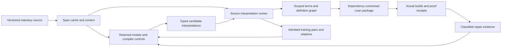

# LegalIR autoencoder and unified Lean 4 corpus implementation plan

Date: October 13, 2026. Objective: improve `ipfs_datasets_py` LegalIR autoformalization and assemble source-grounded spans into scoped term, entity and definition graphs, then generate a dependency-connected, versioned Lean 4 corpus.

The implementation should connect the existing source caches, learned decoders, review contracts, definition bridges, graph owners and native build gates. The first deliverable is a small connected statutory corpus with reproducible source identities, reviewed interpretations, complete graph endpoints and an actual Lean build. Model improvements are measured against that corpus and the retained training controls.

This roadmap incorporates the [comprehensive training review](legal-ir-training-review-and-corpus-plan-2026-10-13.md), including 370 retained summaries across 63 decoder/native4096 directories, 36 delivery reports and 206 verified historical report hashes. Those counts include controls and repeated attempts. Detailed experiment outcomes remain in that review; this document specifies the work to implement next. The [machine-readable backlog](../../artifacts/autoencoder-comprehensive-review-20261013/implementation-backlog.json) records dependencies and acceptance criteria.

A later [training evidence refresh](../../artifacts/autoencoder-comprehensive-review-20261013/training-evidence-refresh-20261013.json)
verified those historical hashes unchanged and added 12 temporal-attention
report bindings plus the checkpoint's raw identity. That separately owned
experiment is now completed, published and unselected; the earlier pending
designation is superseded below and in the training review.

## Implementation progress on October 13–15

### Combined V2 definition-use review interfaces implemented

Local commit `e289e1bc059f3ad975bc2c3072a077a676337e4a` adds [versioned combined-use review preparation, subjects and assessments](../../artifacts/legal-corpus-contracts-20261013-01/datasets/docs/autoencoders/corpus_definition_use_review_v2.md). It regenerates the complete alias-use candidate from both original source/context groups and lookup inputs before invoking the existing authentication engine. The signed subject binds the full joint AST, both unchanged original definitions, explicit unproved alias, complete context population and a new combined scope CID. A key scoped only to either original definition, or a signature from an old graph/definition domain, cannot authorize this larger subject.

**192 unique tests pass: 49 new authored cases and 143 legacy regressions.** They cover exact source/component replay, full-joint rather than alias-only binding, two-role authorization and revocations, distinct combined scope, complete signed contexts, current negative-table dependencies, domain separation, bounds before optional owners, and separate raw-file/canonical commitments. All 31,373 existing tracked entries and ten gitlinks remain unchanged; three files are added. Earlier 290/251/255-test milestones below retain their own dated populations.

The [retained fictional pending example](../../artifacts/legal-corpus-v2-use-review-20261015-01/authored-pending-review-01/manifest.json) has 13 physical contexts, 78 open obligations and the unchanged 33-node/58-edge candidate graph. Its review manifest preserves all 97 original artifact rows and 179 original edges exactly, then adds component raw and full-canonical commitments, combined scope and fixed review-policy binding: 101 artifacts/183 edges. Ordered artifact population and graph-reachable BFS closure remain separate. Its review registry/policy are unavailable, keys/reviews are empty, authenticated evidence is zero and assessment remains pending/blocked. All semantic, human-review, governing-use, training/gold and Lean/admission authority remains false. Synthetic signature tests establish no real review.

The fixed review contract states that the alias is assumed, both originals remain unchanged and only the first matching body role supplies the representative lookup; `per_occurrence_lookup_verified=false`. Legal and formal reviewers declare decisions about that exact combined interpretation and representation. Authentication records their declarations under selected keys; it does not establish legal truth. Actual statutory meanings/reviews/admissions remain zero.

The [07:29:16 UTC bounded training refresh](../../artifacts/legal-corpus-v2-use-review-20261015-01/training-delta-v01.json) retains all 68 summary identities and finds no new bounded qualifying metadata, completed training, scored successor or saved-score diagnostic since 06:51:48. The six prior non-training exclusions and source-integration delivery remain dated evidence, without re-reading their bodies. F18 remains the trained/scored control and qualified archive at `c9cce4586dd96518088662fb12831173e98e36cc`, with scientific failure/no promotion; F19 remains the completed saved-score diagnostic. Its score/exposure findings and unexecuted compound freezing-plus-margin proposal remain unchanged. No F20 state is inferred, and no training or numerical rescoring is run.

The next code slice is compatible **V2 native corpus preparation/build integration** for this exact candidate and separately pinned review/dependency evidence. Actual source/meaning/applicability decisions and legal/formal reviews, governing-use qualification, any claimed per-occurrence lookup and native build qualification remain separate gates. All 24 task statuses/dependencies are unchanged. This contribution performs no native Lean process, model training, resource action or remote publication. [Progress and exact evidence pins](../../artifacts/legal-corpus-v2-use-review-20261015-01/implementation-plan-progress-v01.json) record the implementation. Earlier “next combined-use review domain” statements below describe their earlier cutoffs and are superseded by this interface milestone.

### Explicit V2 definition-use candidate and native alias assumption implemented

Local commit `6b5ee085a9ffc4cb2492552ca31b335badfd1fc1` adds [the bounded V2 definition-use adapter](../../artifacts/legal-corpus-contracts-20261013-01/datasets/docs/autoencoders/corpus_definition_use_v2.md). It replays two complete V2 definition/context preparations and the existing scoped lookup, checks the selected donor against its exact head/definition/source records, and retains both original ASTs. A separate caller-declared unary biconditional aliases one complete consumer body predicate to the selected donor head; the joint native expression conjoins both originals and that assumption. The original graph owner already supports definition-to-definition `USES_DEFINITION`, so no norm or graph relation was invented. All 31,370 existing tracked entries and ten gitlinks remain unchanged; three files are added.

**255 unique tests pass: 44 new authored cases and 211 legacy regressions.** They cover exhaustive small-model alias semantics, exact source/native/lookup bindings, repeated-role completeness, original AST preservation, resealed derivative refusal and byte/metadata checks before optional owner loading. The 290-test compiler and 251-test review milestones below retain their separate dated populations. The [retained fictional component](../../artifacts/legal-corpus-definition-v2-use-20261015-01/authored-alias-component-01/manifest.json) has 33 nodes/58 closed edges, 13 physical contexts, 78 open obligations and 97 dependency artifacts/179 dependency edges. Complete supplied tables, including negative evidence, remain dependencies.

The initial profile accepts two distinct physical documents and one supplied V2 candidate per endpoint, under exactly matching declared applicability and existing release/edition constraints. It binds every matching consumer body role consistently. Its single lookup names the first matching role in original binding order: `lookup_coverage=representative_first_occurrence_whole_predicate_assumption` and `per_occurrence_lookup_verified=false`. This is an explicit unreviewed alias assumption. It supplies neither per-offset governing lookup nor legal identity. All semantic, review, admission, training/gold and Lean flags remain false. There are zero actual statutory meanings/reviews/admissions. Reviews of either original cannot authorize the new component.

The [06:51:48 UTC bounded training refresh](../../artifacts/legal-corpus-definition-v2-use-20261015-01/training-delta-v01.json) preserves all 68 summary identities and finds no new completed training, scoring successor or saved-score diagnostic. Six newly inventoried census/native-component/source-integration metadata reports establish no such successor. The source-integration completion covers five already implemented source-review/adjudication/application/history/binding owners and retains all 560 pending source units with zero responses/reviews; it supplies no separately implemented definition-use owner or compatible meaning review. Its native/census reports do not establish statutory corpus admission. F18 remains the trained/scored control and qualified archive at `c9cce4586dd96518088662fb12831173e98e36cc`, with scientific failure/no promotion; F19 remains the completed diagnostic with its exposed cases, tune regression and unexecuted compound four-tensor recipe caveat unchanged. No F20 execution/state is inferred.

The next interface is a separately versioned **combined-use review subject/domain**, binding both originals, the exact alias/native AST, graph and complete source/lookup dependencies. Actual source/meaning/applicability decisions and legal/formal reviews, per-occurrence lookup where claimed, and compatible V2 native build qualification remain separate gates. Same-document multi-definition scope carriers and arbitrary norm uses remain unsupported in this first profile. All 24 task statuses/dependencies remain unchanged. This slice performs no model training, native Lean process, resource action or remote publication. [Progress and evidence pins](../../artifacts/legal-corpus-definition-v2-use-20261015-01/implementation-plan-progress-v01.json) record the exact implementation. Earlier “next definition-use binding” statements below describe their earlier cutoffs and are superseded by this bounded candidate implementation.

### V2 occurrence contexts and definition-only review interfaces implemented

Local commit `8f33492f4a639aa0ee3218653c63e467cd01d3ea` extends the previous V2 compiler/corpus candidate with [V2 context and review interfaces](../../artifacts/legal-corpus-contracts-20261013-01/datasets/docs/autoencoders/corpus_definition_review_v2.md). Context packets replay the original official V2 view and bind each exact physical occurrence. Definition-only review preparation, subjects and assessments reuse the existing authentication/dependency engines, retain the original AST, symbols and applicability declaration, and require the complete ordered context population. Original raw-file hashes and full canonical report hashes remain distinct; replay preserves caller-lowered source, sampling and compiler limits. The new claim schema/audience prevents v1 signatures from authorizing a V2 subject.

**251 unique tests pass: 84 new authored cases and 167 legacy regressions.** Three captured legacy context packets remain byte/value exact. The original tracked context test was restored exactly to its parent blob; the 33 new context tests now occupy a separate file, as recorded in the [test-path correction](../../artifacts/legal-corpus-definition-v2-review-20261015-01/context-test-path-correction-v01.json). Final counts use the four disjoint JUnit populations in the validation receipt. Earlier receipts retain their dated test paths and results. Independent wrapper review passes 56 checks and 19 separate rejection probes; [pending-example readback](../../artifacts/legal-corpus-definition-v2-review-20261015-01/independent-pending-example-readback-v01.json) passes 32 checks.

The retained fictional example has seven physical occurrences, seven context packets, 42 open obligations, 43 declared dependency artifacts and 42 closed dependency edges. Its registry and policy are unavailable and its reviews are empty: assessment remains pending, with zero authenticated evidence and `accepted_view_eligible=false`. It creates zero actual statutory ASTs, reviewed meanings, semantic admissions, training targets or Lean admissions. Synthetic signing tests exercise authentication only. No actual source/meaning answers or reviewers were supplied.

The [06:10:46 UTC bounded training refresh](../../artifacts/legal-corpus-definition-v2-review-20261015-01/training-delta-v01.json) retains all 68 summary identities and finds no new completed training, saved-score diagnostic or independently qualified scored successor. Three newly inventoried resource/acquisition continuation metadata files explicitly report no training/admission and supply no F20 execution or scientific qualification. F18 remains the latest trained/scored control and qualified archive at `c9cce4586dd96518088662fb12831173e98e36cc`, with scientific failure and no promotion. F19 remains the completed saved-score diagnostic: all three donors retain 154/168 on both training routes; both mixes retain the 93/96 old-tune regression versus 94/96, 48 joint/47 raw development and 34/27 evaluation. Its six gold spans are already feasible at rank 2–3 in top eight but shorter spans remain selected. The unexecuted four-tensor freezing-plus-margin proposal does not isolate a causal margin effect without a matching control.

Next implement explicit definition-use and selected native-symbol binding, while actual source/meaning/applicability review remains pending. An actual complete use, compatible V2 native build and reviewed dependency closure are still required for the connected statutory milestone. All 24 task statuses/dependencies and previous scientific evidence remain unchanged. This contribution runs no model training, native Lean process or remote publication. [Implementation progress](../../artifacts/legal-corpus-definition-v2-review-20261015-01/implementation-plan-progress-v01.json) records the exact source/evidence pins. Earlier sections below describe their own dated cutoffs; their former “next review interface” statements are superseded by this section.

### V2 definition-only compiler and corpus candidate implemented

The [V2 definition guide](../../artifacts/legal-corpus-contracts-20261013-01/datasets/docs/autoencoders/legal_source_definition_v2.md) documents implemented local commit `4e4ea1afa0226c62fdd28e1678cd4046feb90218`. The new compiler replays the complete V2 sampler and accepts explicit unreviewed unary `means`/Boolean declarations with declared title or section applicability. It reuses shared Boolean lowering and exact source records. The corpus adapter emits a definition-only candidate graph, full AST/symbol companion and source/context evidence, with no invented norm, ground entity or automatic use binding. Large original source reports remain separately pinned inputs.

**290 tests pass: 48 new authored cases and 242 legacy regressions.** The original FOL/TDFOL definition outputs match the captured baseline exactly except producer pins/report hashes. Independent corpus review and the [authored example readback](../../artifacts/legal-corpus-definition-v2-implementation-20261015-01/independent-authored-example-readback-v01.json) pass. The retained example has 16 nodes/28 closed edges, two original occurrences plus five derived role subspans, and seven contexts with 42 open requirements. All four original sampler blocks remain separate source evidence. These are fictional engineering fixtures; no actual statutory AST, reviewed meaning, gold target or Lean admission was created.

The next code slice is a compatible V2 context/review subject using the existing authentication/dependency engines. Actual independent source/meaning review, a real supported use and lookup-to-native binding, and V2 native build qualification remain pending. Existing v1 signed subjects cannot be relabeled for the new profile. Source selection, broad constructor support and all 24 task statuses/dependencies remain explicit; this candidate contribution completes none of the broader corpus acceptance gates by itself.

The [05:41:44 UTC training refresh](../../artifacts/legal-corpus-definition-v2-implementation-20261015-01/training-delta-v01.json) retains all 68 prior summary identities, with no newly completed training or saved-score diagnostic in its bounded inventory. F18 remains the trained/archive control and F19 the completed diagnostic; all earlier score, exposure, no-promotion and future-recipe limitations remain in force. No model training, Hub publication or Lean process ran for this contribution.

### V2 definition-only profile specified; existing compilers reused

The [definition profile specification](legal-ir-definition-profile-extension-spec-2026-10-15.md) now gives six concrete implementation stages and a [source-case/test matrix](../../artifacts/legal-corpus-definition-profile-spec-20261015-01/profile-case-matrix-v01.json). The definition-only unary Boolean compiler, standalone native preparation, ordered cross-paragraph atom custody, graph primitives and scoped resolver already exist. The missing first slice is a versioned **V2 source/context replay and definition-only corpus/review adapter**. The old definition path regenerates a legacy document that refuses this exact §101 HTML; its paragraph identities cannot be substituted for the V2 blocks.

Keep original whole-block sampler refs exact. Derive additional head/cue/body subspan occurrences through the existing source owner against the same V2 source version/view, retaining enclosing contributors and each new occurrence's context. Keep title applicability separate from physical document scopes; reuse explicit external lookup rather than inventing title/global equivalence or cross-document parent links. The 2.79 MB complete sampling report remains separately pinned evidence, outside one-MiB sealed companions. All 560 source blocks/3,360 open requirements remain retained; selected complete review subjects keep their finite occurrence/byte bounds.

Candidate 45/block 54 is a bounded definition-only review target; its meaning, unary suitability and separate title preamble remain undecided. Candidate 99's repeated mentions do not supply a norm. Unreviewed authored candidates can test the new mechanics; actual statutory graph/training/Lean admission still needs compatible independent interpretation and source/use evidence. This is a specification, with zero product changes, legal reviews or admissions; all 24 task statuses/dependencies are preserved.

The [05:25:16 UTC training refresh](../../artifacts/legal-corpus-definition-profile-spec-20261015-01/training-delta-v01.json) finds all 68 prior summary identities exact and no new completed training or saved-score diagnostic in its bounded inventory. F18 remains the trained/archive control; F19 remains the completed diagnostic. Preserve its feasible gold top-eight spans, continued shorter selections, tune regression and unexecuted four-tensor recipe caveat. This slice runs no training or native build.

### Source-first definition review packets and completed F19 diagnostic

The [§101 review index](../../artifacts/legal-corpus-definition-review-packets-20261015-01/section101-review-01/README.md) now provides **134 ordered packets and 134 blank preparation drafts**, retaining all 560 normalized source blocks, the 426 other context/control blocks, original HTML/acquisition and exact sampler/source records. Each packet contains its complete target text, full source/version/occurrence/context references and access to the whole view. It has seven unanswered source questions and six unanswered meaning-proposal questions: 938 and 804 blank prompts respectively. All 3,360 original context requirements remain open; paragraph inputs are not 134 complete reviewed definitions.

The [literal-cue inventory and profile decisions](../../artifacts/legal-corpus-definition-review-packets-20261015-01/cue-review-questions-v02.json) retain 397 overlapping source observations across all 134 inputs, including 66 with no literal definition operator. Keywords are navigation aids and fill no answers. Scope preambles, a repeal marker, multi-paragraph lists, the closing continuation at block 97, construction rules and the external Title 1 reference stay explicit. The smallest proposed profile work is reviewed title-wide applicability plus ordered multiple-occurrence contribution custody. Reuse the existing occurrence, Boolean-atom source-binding and complete-context review owners for those contributions; no replacement selector or custody engine is required. Definition operators, sorts, ASTs, inherited attachments and real use bindings remain undecided. A definition-only source cannot be forced into the existing definition-plus-unary-norm bridge by inventing a norm.

These are artifact-only display and preparation files. Existing source-packet APIs require their original request/replay collections; native definition-review APIs require an already-supported typed interpretation. The new drafts spoof neither schema and are not compatible signed submissions. All answers, reviewer/exposure declarations, gold masks, ASTs and semantic bindings remain blank or zero. Existing product commit `c5149abeac4c4f5f735125c190d324efe19ab7c4` and the 24-task dependency graph/statuses are unchanged. Actual source/meaning review is still pending under LIR-06.

The [05:03:15 UTC training-evidence delta](../../artifacts/legal-corpus-definition-review-packets-20261015-01/training-delta-v01.json) adds **F19, a completed saved-score conditions/composition diagnostic**, not a trained checkpoint. The F15 baseline and two fixed mixes stay 154/168 complete training IR on both routes. The F17-actor/F18-readout and F17-actor/F17-readout mixes retain 48 joint/47 raw development and reach 34/27 evaluation, but old tune is 93/96 versus F15's 94/96. The two targeted conditions cases still select shorter spans even though all six donor gold spans rank 2–3 inside the actual top eight and complete assignments are feasible. Candidate inclusion is not the observed bottleneck for these six exposed records; neither a causal training explanation nor a successful repair has been established.

F19 performed zero model/encoder calls, optimizer updates, new weights or model publication, and supplies no portable composed checkpoint or promotion. Saved actual reviews qualify its source PR1307/root PR575 integration; hosted CI remains unpassed. F18 remains the latest trained control and qualified model archive at `c9cce4586dd96518088662fb12831173e98e36cc`, with scientific failure unchanged and all 68 summary identities exact. Preserve F19 as completed evidence rather than proposing those same diagnostics again. Its proposed F18-only, four-tensor/130-active-scalar conditions-margin recipe remains unexecuted; freezing plus margin is a compound recipe and cannot isolate a causal margin effect without a matching control. This update starts no training.

### Source-structured sampling implemented; F18 publication qualified

The [whole-source sampling guide](../../artifacts/legal-corpus-contracts-20261013-01/datasets/docs/autoencoders/legal_source_sampling.md) documents the new pure `legal_source_sampling` module at isolated local commit `c5149abeac4c4f5f735125c190d324efe19ab7c4`. It reuses the existing whole-DOM V2 official view and source version/occurrence/context owners; earlier extraction owners and their coordinates are unchanged. A fresh acquisition records the required real HTTP observations for the exact same §101 bytes. The older V1 extractor's refusal of a continuation paragraph is preserved; no new HTML parser or trust engine was added.

The [actual §101 preparation and full validation](../../artifacts/legal-corpus-source-structured-sampling-20261015-01/actual-section101-01/integration-receipt.json), followed by [independent exact readback](../../artifacts/legal-corpus-source-structured-sampling-20261015-01/extraction-fit-independent-real-readback-v02.json), retains all **560 blocks, 1,681 sealed records and 3,360 open context obligations**. The [134 complete paragraph candidate inputs](../../artifacts/legal-corpus-source-structured-sampling-20261015-01/actual-section101-01/candidate-inputs.jsonl) are separate from 426 retained metadata, source-credit, history, editorial and statutory-note controls. Both populations remain unreviewed; all gold masks are zero. The full normalized view has 71,598 characters and 72,592 UTF8 bytes. The original nine literal pilot units and 20-row cache sample keep their original identities and unresolved joins.

**29 focused tests**, Ruff/Black checks, 15 independent implementation checks, five separate adversarial probes and 37 real-source readback checks pass. Split/nested paragraphs cannot expose an action prefix without its condition as a primary candidate: pieces are withheld and their complete parent range is retained with open context. Finite input/output budgets refuse truncation; replay rejects resealed omissions, reordering and changed masks. These checks qualify source geometry and input preparation, not meanings, definitions, hierarchy, training targets or Lean admission.

The [04:10:14 UTC training/publication delta](../../artifacts/legal-corpus-source-structured-sampling-20261015-01/training-publication-delta-v01.json) qualifies completed **F18** archival publication at `c9cce4586dd96518088662fb12831173e98e36cc` from saved independent completion and immutable-readback evidence: 395 files, 105,151,374 bytes and 42 resume groups. Saved actual reviews also qualify source PR1306 merge `a8d2eb15a24d6003c210d8b96ace481865769160` and root PR574 merge `26c07127043e3faca21fc51ea559c6d8b1513743`. This supersedes the earlier pending-upload/F17-latest-archive cutoffs below. F17's prior archive evidence remains retained. Hosted CI did not pass because the recorded jobs could not start under a billing lock. This is saved-public-evidence qualification, not a fresh remote or numerical reload.

F18's scientific failure, 154/168 complete training IR, failed parent-ablation signal and no-promotion disposition remain unchanged; all 68 summary identities and score reports are exact. The next content milestone is independent source-role/applicability/meaning review of the prepared paragraphs and a minimal typed definition/use profile, followed by an actual connected semantic graph and supported Lean build. No new training was run for input preparation, and the 24-task dependency graph/statuses remain unchanged.

### Connected pilot: content coverage and concrete implementation gates

The [connected statutory pilot specification](legal-ir-connected-statutory-pilot-spec-2026-10-15.md) and [machine-readable pilot plan](../../artifacts/legal-corpus-connected-pilot-20261015-01/connected-pilot-plan-v01.json) refine the next milestone using actual retained source content. **None of the 96 retained cache matches intersects the nine candidate operative-text units.** The only markup overlap is a repeal-marker request. This bounded sample consists of heading/citation/amendment/history fragments, with source roles still unreviewed; it establishes no whole-cache prevalence. The nine source units have no explicit lexical statutory definition.

A new local source-only review input preserves all nine complete units (1,891 characters/UTF8 bytes), exact request/source/occurrence/context refs, zero training/evaluation-gold masks and no formal outputs. An official 2024 §101 definition candidate was downloaded with exact byte custody; canonical extraction, title-scope applicability, source correspondence and interpretation remain pending. The current section-local unary `means`/O-P-F adapter cannot be presented as a complete representation of these richer clauses or as an automatic cross-section bridge.

The concrete next slice is source-structured sampling plus canonical definition extraction, actual independent source/meaning decisions, and the smallest versioned typed-profile extension needed for one real definition/use pair. Two actual norm users then test exact definition sharing. The specification gives source cases, negative controls, input/owner mappings and measurable P0–P5 graph/Lean/evaluation gates, under the unchanged 24-task DAG. The existing 20–40-provision objective remains a later review-batch target. All actual source, semantic, training and Lean admissions remain pending.

At the [03:09:19 UTC publication delta](../../artifacts/legal-corpus-connected-pilot-20261015-01/training-delta-v01.json), the same 68 training summaries and qualified F18 result reports remain unchanged. The failed first upload chunk is now independently reconciled absent; resume preparation is qualified and completed publication remains unqualified at that cutoff. This supersedes the earlier unknown-chunk state below. F18 still failed scientific acceptance, and F17 remains the latest qualified immutable archive at this cutoff.

### Qualified scored F18 ablation; scientific acceptance fails

The [current training-frontier audit](../../artifacts/legal-corpus-graph-readiness-20261015-01/current-training-frontier-F18-v01.json), with cutoff **October 15, 2026 at 02:17:36 UTC**, supersedes the earlier unscored F18 observations. **F18 modality/conditions retention CE is now a completed, independently reviewed scored control. Its technical gate passes; strict scientific success and the narrower parent-ablation signal both fail, and default promotion remains false.** F18 is the latest scored control. The latest independently qualified immutable model archive remains F17 at `290c266d72b8c298ec21db0f9b0857b008914caf`.

The audit independently reaggregates **864 panel count cells and 576 comparator field gain/loss tables**, plus 144 initial descriptive tables, from the separate counter's public per-ID boolean ledgers. All agree with the primary analysis and independent recount. The **60 state panels, 54 scored sets and 36 paired comparator scopes** include nine authored scored populations and an unscored eight-case statutory population. All nine retained F17 panel counts and source-scope hashes match its original analysis. The live census remains **68 unchanged summary metadata identities**; this update qualifies existing outputs and starts no new numerical run.

F18 starts from all 42 trained F15 states, with six selected tensors, **325 active and 650 inactive scalars**, and 36 frozen tensors. F16/F17 are comparators, not donors. The fixed recipe uses fresh Adam, 32 updates, batch 12, learning rate 0.001 and seed 1729; modality CE coefficient 2, doubled whole-conditions weight on two training-derived rows, and masked F15 KL at weight 1/temperature 1 with the full `6B` denominator. Latent conditioning remains disabled. Experimental accounting is 1,312 model forwards and 1,664 source occurrences; the separate synthetic fixture brings totals to 1,313 forwards, 33 updates and 1,666 occurrences.

Complete training IR stays **154/168 on both raw and joint routes**, below the predeclared minimum 155. The two targeted conditions-only errors remain wrong on both routes: **zero of two repaired**. A single modality gain improves training modality counts to 162 raw/163 joint without repairing either complete rule. All 32 permission modalities survive with no abstention; this does not establish complete permission-rule correctness.

F18 retains old-tune **94/96 on both routes**, recovering F17's named old-tune loss. Authored development is **46 joint/45 raw**, versus F16/F17's 48/47: both `targeted-loss-authored_dev-actor_duration_name-1-p-{absent,present}` gains are lost. Authored evaluation is **34 joint/27 raw**, versus F17's 33/27, restoring its condition/exception joint loss. F18 also loses F17's `temporal-contrast-tuning-object_duration_title-0-f-present` on both routes and `matched-temporal-authored_eval-object_duration_title-1-o-absent` on both routes. There are no complete-IR loss IDs against F15/N11; these gains and losses cannot override the failed training floor or strict comparator policy. Fresh development and test remain 0/36.

Primary analyzer and model share an author; the separate counter shares its author with the training audit, and coordinate/greedy/joint AST kernels remain shared. The actual result review checks public runtime/resource/trace metadata, scalar aggregation, modality CE and KL arithmetic within its stated tolerances. It does not independently reload tensors, rerun autograd, rederive candidate logits or verify complete CE from every head's logits. All diagnostic populations are previously exposed; statutory accuracy, active latent benefit, broader logic-family correctness, portable numerical reload and Lean qualification remain unestablished.

F18's preparation review covers **395 files / 105,151,374 bytes**, with an expected final 6,471 remote identities and a separate planned 155-byte `.gitattributes` append. That is a preparation qualification. The first payload upload ended with a TLS error and unknown outcome requiring reconciliation; no completed immutable F18 readback or source/root delivery is qualified in the bounded inventory. Preserve F17's independently qualified archive and source/root deliveries separately.

Preserve the already written **source-only next-diagnostics proposal**: separately qualified saved-head composition and conditions-end ranking diagnostics may inform a later conditions-context adapter hypothesis. These are previously exposed engineering diagnostics, not a new training/composition execution or automatic selection. Keep N10→N12 and N11→F15→F16/F17/F18 distinct, retain the existing complete-rule/permission/loss-ID acceptance gates, and require reviewed source targets before statutory training or semantic graph/Lean admission.
### Concrete graph readiness and the next connected pilot

The [retained-artifact inventory](../../artifacts/legal-corpus-graph-readiness-20261015-01/pilot-retained-artifact-readiness-v01.json), [implementation-fit audit](../../artifacts/legal-corpus-graph-readiness-20261015-01/pilot-implementation-fit-v01.json) and [new readiness crosswalk](../../artifacts/legal-corpus-graph-readiness-20261015-01/crosswalk-01/manifest.json) make the next graph work concrete. This is an artifact-only aggregation of already retained evidence; source/history assessment, original Parquet decoding and model execution were not repeated. It creates **659 sealed diagnostic records in six components**, preserving original record references and full canonical hashes. It adds no product module; local source-binding commit `11a5d50dc04cc57d029f4556d49ef4ccea98df64` remains unchanged.

| Retained evidence | Current crosswalk | Meaning for the next step |
| --- | --- | --- |
| Source and cache custody | 29,640 source records; six original parent fields; 20 cache observations; all 120 comparison cells | Keep source version, physical occurrence, cache identity, original ordinal and source view separate. |
| Literal candidates | 96 match records over 95 physical occurrence CIDs; six single-match, four multi-match and ten zero-match cache rows | Preserve all alternatives and zero matches; these counts supply no governing-source choice. |
| Pending source interpretation | 418 requests over 417 physical occurrences; all 418 geometries available; ten markup-opportunity requests lack a declared source-role record | Retain distinct requests even when geometry is shared. Geometry availability does not establish legal role or meaning. |
| Mechanical overlap | 103 positive Unicode/UTF8 half-open intersections across 59 requests and all 96 match records | 95 review-unit-contains-candidate, six candidate-contains-unit and two equal geometries. These are custody/coverage observations; they assert no semantic relationship. |
| Saved cache candidate graphs | 16 graphs, 75 node occurrences: 22 opaque interpretations and 53 issues; zero edges | Eight standalone candidates join to current observations by exact immutable repository/revision/artifact identity and full raw-row hash. The older eight-row bundle is disjoint and remains separate. All 16 source joins are unresolved. |
| Review and admission | 418 absent binding bodies; 3,762 blocked active slots; 2,926 deferred questions | Actual source choices, physical governing bindings, semantic-graph admissions, reviewed training admissions and Lean admissions all remain zero. |

The existing primary structural graph has **119,134 nodes and 178,691 edges**, with manifest-selected endpoint integrity already checked. It supplies hierarchy, provenance and citations. The separate legacy entity index has duplicate and missing-identity/endpoint observations; its lineage to that primary graph is unproven. Keep both populations explicit. Neither supplies scoped term senses or reviewed definitions by label equality. The 716 MB primary graph and original cache/Parquet bodies were not reopened for this milestone.

The repository already implements candidate graph exchange, authored unary definition/norm graphs with typed `DEFINES` and `USES_DEFINITION` edges, scoped lookup with negative/unavailable/competing outcomes, review/dependency owners, and shared/incremental Lean builds. Preserve their completed tests and authored native controls. The retained statutory lookup remains unavailable with no selected definition. The following workstreams supply actual reviewed content through those owners. The 24-task backlog remains the dependency contract: LIR-04 precedes LIR-08, LIR-09 precedes LIR-10, and LIR-11/LIR-14 precede LIR-15. Existing authored work can continue in parallel; statutory acceptance waits for each task's prerequisites:

1. **Close a bounded source selection first (LIR-02/05/06).** Use the [existing human review packets](../../artifacts/legal-corpus-review-packets-20261014-01/actual-replay-03/review/README.md) and crosswalk request references to select exact version/occurrence/region/applicability declarations with independent source/context decisions. Keep unknown, disputed and unsupported units explicit. The six retained parents are an engineering seed; select a connected statutory pilot only after identifying its definitions, uses and dependencies. Broaden toward the existing 20–40-provision target only where those dependencies justify it.
2. **Create reviewed meanings and typed assertions (LIR-04/07/08).** Bind each supported actor, modality, action, object, condition, exception and temporal qualifier to its actual source evidence and inherited scope. Express term senses, entities, definitions and norm arguments with typed identities and explicit alternatives; use the existing narrow unary profile where it is adequate and record unsupported operators/arity/sorts. Preserve autoencoder/compiler alternatives and abstentions. A cache-row match or opaque formula is insufficient to create an entity or definition assertion. Let source hierarchy and exact occurrence order govern assembly.
3. **Resolve and assemble the connected graph (LIR-09/10/11).** Add actual scoped `DEFINES`, `USES_DEFINITION` and supported norm/reference assertions through existing owners. Require all typed edge endpoints, source/interpretation companions and chosen lookup evidence. Record absent, ambiguous, external and cyclic dependencies; include negative lookup partition commitments and invalidate affected descendants when definitions, scopes, versions or choices change. Maintain edition/legal-as-of/applicability distinctions instead of merging by text label.
4. **Validate and build the first statutory Lean component (LIR-12/13/14, then LIR-15).** Obtain independent legal and formal interpretation reviews, generate modules with the existing shared library and dependency ordering, and run the native pinned toolchain for supported meanings. Check complete imports, no admitted placeholders, source/graph-to-Lean traceability, and incremental rebuilding after a definition change. Authored successful builds remain engineering evidence until statutory semantics are independently reviewed.
5. **Improve the autoencoder against those targets (LIR-17/18/19/20 and existing evaluation tasks).** Freeze dependency-cluster splits and exposure ledgers before new training; include definitions and their uses in split handling. Evaluate source correspondence, candidate coverage, scope/argument binding, complete IR, abstention and retained permission behavior separately. Use the completed F19 saved-score composition and conditions-end ranking evidence to select a changed hypothesis; do not repeat the fixed diagnostics or treat wider candidate inclusion alone as a repair. F18's failed conditions repair does not justify repeating its unchanged recipe or claiming latent benefit. Require the existing full-rule, retention and independent evaluation gates before promotion; keep model archive, graph release and Lean release qualification separate.

The next reviewable deliverable is a small independently reviewed source-and-meaning bundle with a connected scoped graph, explicit unresolved dispositions and a real Lean build for its supported subset. Review contracts and diagnostic crosswalks prepare that work; the actual independent choices and semantic targets remain to be supplied. This roadmap starts no new experiment or publication.

### Historical F18 numerical-only and postrun cutoffs, superseded above

This section preserves the earlier dated evidence; current scored qualification is given above.

The [closing training-frontier audit](../../artifacts/legal-corpus-governing-source-bindings-20261014-01/new-training-frontier-F18-v01.json)
finds a separately owned **F18 modality/conditions retention CE** child completed
while the source-binding contribution was being qualified. The live census is
now **68 summary metadata identities**, with all 66 prior identities exact and
two new summaries. This supersedes the earlier unexecuted six-tensor proposal
status below. The earlier 66-summary/no-new-run observation remains a dated
cutoff; this contribution started no training and does not rerun this child.

F18 reports initialization of all 42 tensors from the clean trained **F15 actor refinement CE**
donor, with six trainable tensors, 325 active scalars, 650 inactive scalars and
36 frozen tensors. F16 and F17 remain separate controls, not donors. The public
summary reports 32 experimental updates, 1,312 model forwards and 1,664 source
occurrences; a separate authored fixture contributes one update/forward and two
occurrences, giving totals 33/1,313/1,666. Latent remains disabled with the declared
384 placeholder dimension, fresh Adam and no inherited moments. The audit pins
the changed recipe, exact declared masks/counters and public snapshot metadata;
it reads no model, tensor, checkpoint, prediction or teacher payload.

Output-snapshot custody and its independent opaque-byte review passed under
their stated scope. The bounded public phase inventory still has no qualified
scored result, public result summary, comprehensive runtime-result review or
terminal-resource review at this audit. The analyzer handoff is explicitly
source-only and pending result qualification. Numerical completion and snapshot
custody cannot supply complete-rule scores, restored loss IDs, scientific success,
default promotion, latent benefit, statutory accuracy, a portable numerical reload
or a qualified new model release.

The **latest completed numerical child is F18**, while the **latest qualified
scored control and model archive remain F17**. F17's technical pass/scientific
failure/no-promotion disposition, named exception/old-tune losses, retained F16
development gains, immutable archive `290c266d72b8c298ec21db0f9b0857b008914caf`
and independently qualified source/root deliveries remain unchanged. Preserve
N10→N12 and N11→F15→F16/F17 as distinct lineages; add F18 as another clean-F15
branch. First qualify the existing F18 outputs against its fixed comparator and
complete-rule retention policy, with independent analysis/recount and actual
result review. Do not propose the already executed six-tensor CE recipe as new.

A later [bounded postrun metadata observation](../../artifacts/legal-corpus-governing-source-bindings-20261014-01/late-F18-postrun-metadata-audit-v01.json)
supersedes the earlier absence of terminal/runtime reviews at that dated cutoff.
The public terminal-resource audit passes within its resource scope. The later
runtime metadata review reports a pass for the declared 32-step and 632-row
metadata and authorizes authored evaluation scoring; statutory reference scoring
remains unauthorized. Independent scalar CE/KL arithmetic is unchecked, and
scientific success and the parent ablation signal are unevaluated. These source,
resource and runtime metadata phases do not supply a qualified scored result,
recount, publication or legal/training/Lean admission. F18 remains the completed
unscored numerical child; F17 remains the latest qualified scored control and
model archive. Additional phase filenames are dated observations, not evidence
that the selected scientific result changed. Existing outputs should be scored
and independently reviewed before any new experiment is proposed.

The binding contribution remains local commit
`11a5d50dc04cc57d029f4556d49ef4ccea98df64`, with 98 passing cases, the complete
33,054,054-byte original assessment/validation and stdlib readback, 418 binding
rows and all 836 old history groups unchanged. No source/guide/test or corpus
replay changed for this late training update. Actual signed source choices,
semantic graphs, reviewed training gold and Lean admission remain pending.

### Qualified candidate source-binding declarations and current training deliveries

Evidence refresh: October 15, 2026 UTC. Earlier dated cutoffs below remain
historical observations; the current bounded audit is linked in this section.

The [source-binding contribution](../../artifacts/legal-corpus-governing-source-bindings-20261014-01/implementation-receipt.json)
adds `corpus_source_bindings` at isolated local commit `11a5d50dc04cc57d029f4556d49ef4ccea98df64`, with
**98 passing focused cases**, separate source/guide review,
[original assessment and full validation](../../artifacts/legal-corpus-governing-source-bindings-20261014-01/actual-replay-01/integration-receipt.json)
and [stdlib readback](../../artifacts/legal-corpus-governing-source-bindings-20261014-01/independent-original-source-bindings-readback-v01.json).
The [guide](../../artifacts/legal-corpus-contracts-20261013-01/datasets/docs/autoencoders/corpus_source_bindings.md)
defines a candidate declaration of exact parent, comparison, document, source
version, occurrence and context references, plus declared region role and
applicability scope, jurisdiction, instrument, civil legal-as-of date and exact
same-version evidence occurrences. The signed body binds the original request
and subject, preparation and full history roots, selected current epoch/group
and all nine current answer references. Full canonical record hashes accompany
all CIDs and schemas; no literal match establishes source correspondence.

Complete supplied history replays once per operation through the unchanged
history owner. The catalog then reads already regenerated base/alignment inputs,
without a third original source replay. Source version/occurrence/context checks
reuse their existing owners; normalized and rendered geometry remain distinct.
Repeated Unicode text and shared physical records retain original occurrence,
parent, comparison and document identities. A separate binding action/audience
requires fresh legal/formal signatures through `legal_graph_review`, exact evidence,
dependencies, selected trust and original authority scope. Original source-review
principals, DIDs and known keys are excluded across the complete supplied history.
The applicability scope is a separate explicit signed declaration, not an inferred
or expanded authority scope. The civil legal date is separate from review UTC;
unknown role/date is retained and blocks a complete positive declaration.

The original collection retains **418 binding groups / seven binding pages** and
all five previous history components: **836 groups across two epochs**, with all
418 embedded current groups unchanged. The eight-component collection has
**33,054,054 canonical bytes**, with 30 producers
(all 29 prior producers exact plus this owner). Actual binding bodies, signed
claims and declared bindings remain **zero**. All 418 requests retain 3,762 blocked
active slots and 2,926 deferred questions. The explicit evaluation is the original
`2026-10-14T07:53:00Z` diagnostic selection; current wall time does not change it.
Complete input detachment precedes indexed hashing/replay; logical caps are
512 MiB, eight million nodes and depth 64, plus one 64 MiB mixed signed-evidence
budget across every old stage and the new binding population. Record/collection
caps remain 1 MiB/64 MiB. These are protocol limits, not peak-memory promises.

`structured_source_binding_declared_under_selected_profile` is the narrow
available result. It authenticates declared intent under the selected profile;
it does not establish legal truth, operative source role or date, governing-law
adoption, source/preparation migration, unique history head, conflict resolution,
semantic graph admission, training gold or Lean admission. Original contexts
remain required/unavailable and all seven deferred questions remain open. Real
reviewer trust and actual decisions still must be supplied. Existing
`legal_ir_temporal_authority` and `constraint_query` are later applicability
consumers; this milestone adds no second temporal or signing engine.

The [current training and delivery audit](../../artifacts/legal-corpus-governing-source-bindings-20261014-01/training-delivery-reuse-freshness-v01.json)
finds **66 unchanged live summary identities and no new numerical/scored run**.
F17 remains the latest completed scored control, with donor F15, whole training IR
154/168, authored-evaluation joint 33/72, old tune 93/96 and fresh development/test
0/36. Scientific success and default promotion remain false. The named
condition/exception evaluation loss and old-tune loss, F16 development retention
obligations, distinct N10→N12 and N11→F15→F16/F17 lineages, and earlier temporal,
actor-context/CE/hinge and latent controls remain part of the retained review.
No unchanged masked-retention rerun is proposed.

F17 source delivery is now independently qualified at source PR 1305 merge
`f4a823231ad52c9252504810a1b00ed4738346b6`: 32,220 prior tree entries preserved
plus exactly three opt-in decoder/test/guide additions, with all trained/published
algorithm files and the contract test matched. Root PR 573 merge
`683fb27c336147ba634fcaa989f892c284035704` is separately qualified: 15 additions,
two reviewed modifications and all 37,677 other entries exact. This supersedes
the earlier dated source/root pending status. The qualified immutable model
archive remains `290c266d72b8c298ec21db0f9b0857b008914caf`; byte custody does not
establish scientific acceptance or numerical reload. Hosted root checks were
billing failures before start, with no hosted pass claimed. Later native
source-query/replay metadata is a separate integration candidate, not a LegalIR
training result or governing-source qualification.

The already reviewed **six-tensor / 325-active clean-F15 successor proposal** is a
bounded design hypothesis, with execution readiness false and no numerical run.
Incorporate its exact mask/target provenance, loss mathematics, guarded gradients
and parity checks, fixed complete-rule comparator/floor policy and retained
co-error diagnostics before considering execution. Do not present this proposal
as newly invented, implemented or demonstrated. The present contribution starts
no training or external publication and changes no resource/cleanup policies.

The next corpus work uses the existing backlog in dependency order:

1. Supply actual source interpretation reviews and explicit source choices for
   the connected pilot, including operative/editorial/source-credit role and
   jurisdiction/instrument/date evidence. Unknowns stay visible.
2. Qualify scoped definitions, terms, entities and reference endpoints across the
   chosen provisions. Preserve alternatives, unresolved links and version scopes;
   cache aggregation alone cannot admit semantic edges.
3. Assemble complete provision interpretations with reviewed actor/action/object,
   modality, condition, exception, duration and quantifier bindings. Preserve
   permissions and complete-rule retention requirements in model evaluation.
4. Fold those qualified graph dependencies into a pinned native Lean4 corpus and
   rebuild the connected pilot. Require actual dependency closure and native
   theorem checks before marking admission complete.
5. Train changed relation/binding heads only from reviewed targets and evaluate
   candidate-blind statutory meanings plus the retained controls. Keep model
   performance, source custody and proof qualification as separate outcomes.

LIR-02 remains in progress; LIR-05/06/10 remain proposed and LIR-17 remains an
in-progress authored-control track. Their real interpretation/admission gates
remain open. This completes the candidate binding interface, not the statutory
pilot or unified Lean corpus.

### Later independently qualified F17 archive

The [current F17 frontier](../../artifacts/legal-corpus-source-history-20261014-01/new-training-frontier-F17-v04.json)
supersedes the earlier publication-pending and latest-qualified-F16 cutoffs below.
F17 now has independently qualified archive publication at immutable revision
`290c266d72b8c298ec21db0f9b0857b008914caf` in `Publicus/legal-ir-autoencoder`, prefix
`releases/20261014-joint-readout-retention-v1`. Its scored technical pass, scientific failure and
no-promotion disposition are unchanged; no new numerical child was run. The
66-summary census and all 64 prior metadata identities remain exact.

The archive adds **229 payload files / 94,548,368 bytes in nine chunks**, with
**6,076 final identities**: 5,846 prior identities unchanged, one explicitly
planned `.gitattributes` modification appending 146 bytes, and 229 additions.
Payload operations are additive; the whole protocol includes that prior-file
change. The independently reviewed completion qualifies all distinct staged and
forced CLI readback payload hashes and the exact identity maps. The independent
reviewer checked local opaque bytes and publisher-recorded immutable remote maps,
with no new reviewer network, model or checkpoint-JSON calls. This plan audit
joins retained public metadata; it does not download or open payloads.

The pre-publication review remains distinct from the actual completion review.
Archive byte custody does not establish automatic Git LFS clone materialization,
portable numerical reload, statutory accuracy, scientific success or default
promotion. F16's publication and earlier F17 availability cuts remain dated
evidence. Source/root delivery qualification stays separate. The
[current closing guard](../../artifacts/legal-corpus-source-history-20261014-01/final-training-and-review-guard-v02.json)
binds this selected frontier and the later shared-repository custody observations.
History code, its 260 focused cases, the two-epoch replay and all zero real
review/activation/graph/training/Lean-admission gates remain unchanged.

### Later scored F17 joint-readout retention outcome

The [dated F17 successor audit](../../artifacts/legal-corpus-source-history-20261014-01/new-training-frontier-F17-v02.json)
supersedes the earlier pending freeze/scoring status below. The already completed
F15-donor numerical child now has a successful output freeze, runtime-result
review, analysis, recount and independent actual public-result review. The
invocation-context failure remains retained;
the correction did not require another training run. F16 remains a comparator,
with N11→F15 branching into the distinct F16/F17 controls; N12 keeps its separate
donor/comparison. The current census stays 66, all prior 64 metadata identities
exact. A later scoring phase is not a second numerical child.

| Exposed panel | F15 donor joint/raw | F17 joint/raw |
| --- | ---: | ---: |
| Training whole IR | 154/168; 154/168 | 154/168; 154/168 |
| Authored development whole IR | 46/72; 45/72 | 48/72; 47/72 |
| Authored evaluation whole IR | 34/72; 27/72 | 33/72; 27/72 |
| Older authored evaluation whole IR | 53/72; 50/72 | 55/72; 52/72 |
| Old tune whole IR | 94/96; 94/96 | 93/96; 93/96 |
| Fresh tune whole IR | 19/36; 8/36 | 21/36; 9/36 |
| Fresh challenge whole IR | 25/36; 25/36 | 26/36; 26/36 |
| Fresh development whole IR | 0/36; 0/36 | 0/36; 0/36 |
| Fresh test whole IR | 0/36; 0/36 | 0/36; 0/36 |

F17 fails the predeclared scientific criteria: training whole IR stays 154/168
below 155, and old tune loses `native-tuning-calendula-t4-q5-p` in both routes
against F15/N11. Authored evaluation adds the joint loss
`targeted-loss-authored_eval-condition_exception_duration-0-f-present` against
F15, N11 and F16. The two F16 authored-development gains remain retained on both
routes, as do all 32 old-tune permission decisions. Permission retention cannot
erase complete-rule losses. Against N11, authored-evaluation joint whole IR stays
33→33 because another ID is gained; that net count hides the new loss. The named
loss is in exceptions, whose joint field score falls 69→68 against all three
comparators. Training actor exact is 158/168 and joint modality is 163/168, while
the complete training output remains 154/168. Technical/result checks pass;
scientific success and default promotion remain false.
No candidate is selected for statutory graph or Lean admission.

Analysis and recount agree on 50 panels, 27 paired scope/comparator panels and
45 authored score sets. The reports declare different authors, while the primary
analysis uses the training recount and seven pinned scoring helpers. The
[independent aggregate/ID cross-check](../../artifacts/legal-corpus-source-history-20261014-01/independent-F17-aggregate-crosscheck-v01.json)
verifies the retained totals and loss IDs with its public-metadata scope. Live
numerical gradients, complete preupdate argmax and scalar CE recomputation are
not independently proved by these recounts. All 464 diagnostic rows remain
previously exposed; the eight statutory cases stay unscored. Training-only masked
teacher retention supplies no statutory gold, generalization, genuine latent
benefit or portable numerical reload. F17 publication/delivery status remains
separately selected in the audit; the last qualified model archive remains F16
until an actual later publication is independently qualified.

Preserve F17 as an already implemented and scored failed scientific control.
Do not propose an unchanged joint-readout/masked-retention rerun. Diagnose the
new condition/exception complete-rule loss and the persistent old-tune loss,
including raw/joint selection coupling and shared qualifier bindings, before any
changed successor. Reviewed source targets, candidate-blind statutory annotation,
permission and complete-rule floors, retention of the F16 development gains and
predeclared independent evaluation remain prerequisites. Source binding and
scoped term/entity/definition/reference graph work continues under the unchanged
zero-review/admission gates; this update performs no training or publication.

### Regenerated candidate answer snapshot history

The [history contribution](../../artifacts/legal-corpus-source-history-20261014-01/implementation-receipt.json)
adds `corpus_source_history` at isolated local commit `855b47bcb3e82a81b713652092e05905ba25905f`, with
**260 passing focused cases**, reviewed source/guide and a complete original
two-epoch replay. This supersedes the earlier history-owner pending status below.
The existing genesis owner still accepts generation one only; the separate
[history guide](../../artifacts/legal-corpus-contracts-20261013-01/datasets/docs/autoencoders/corpus_source_history.md)
defines generation-two and later candidate answer-reference revisions.

Each revision names one exact regenerated predecessor manifest and its exact
per-request group, and supplies fresh legal/formal signatures over a common body
under a separate fixed revision action/audience. The entire preparation root,
ordered request/subject cohort, snapshot name, fixed use and all original questions
remain unchanged. Every supplied epoch is regenerated exactly once per assessment
or validation operation. All nine current selected answer references activate
atomically or none; old eligibility never carries into current eligibility.
A blocked historical parent can acquire a fresh eligible revision under explicit
current selected trust, complete evidence and chronology.

Historical roots use original actors from their own ancestor lineage, so adding
descendants or unrelated siblings preserves the sealed past. Current eligibility
separately checks original principals, DIDs and registered public keys across
all supplied epochs, including rejected claims and other branches. All supplied
fork siblings remain visible; any visible fork suppresses current eligibility
under this profile. An explicitly selected leaf and evaluation time identify a
diagnostic current projection, without authenticating a wall clock, globally
complete history, unique head, fork resolution or legal effective time.

[Original replay and full validation](../../artifacts/legal-corpus-source-history-20261014-01/actual-replay-01/integration-receipt.json)
and [independent stdlib readback](../../artifacts/legal-corpus-source-history-20261014-01/independent-original-source-history-readback-v01.json)
retain **418 requests across two epochs: 836 complete groups, 14 collection pages
and 14 epoch pages**. All 418 genesis raw groups and all 418 revision raw
adjudication groups exactly match their prior reports. Actual revision bodies,
authority claims, historical activations and current eligible groups remain
**zero**. The selected current epoch retains 418 blocked groups/3,762 active slots
and 2,926 deferred semantic/proof questions. Its explicit evaluation time is the
original diagnostic cutoff, not the current wall clock.

The five-component collection has 20,488,447
canonical bytes, with a 1 MiB record envelope and 64 MiB collection cap. The
bounded flat history accepts at most four epochs, with lower-only whole-input
logical byte/node/depth limits and one mixed signed-evidence budget across every
epoch and all three evidence stages. Complete native detachment and size checks
precede indexed evidence-body hashing and replay; no cropped branch or prefix can
silently satisfy those limits. Repeated logical input occurrences count even when
callers share references. These are protocol budgets, not peak-memory guarantees.
The original two-epoch inputs fit the defaults. Producer maps derive from the
28 unchanged prior paths plus one new owner:
29 total.

This completes bounded candidate answer-reference history and conditional current
projection. Real reviewer trust and signed source/adjudication/application/revision
decisions, authoritative head/fork governance, preparation migration, structured
governing-version/occurrence/applicability binding and downstream cross-generation
invalidation remain pending. Reuse `legal_graph_review`, version/occurrence/context
owners and `legal_graph_dependencies`; do not add a parallel signing engine.
Next qualify those source bindings, then candidate-blind statutory meanings,
scoped term/entity/definition/reference graphs and native Lean dependency builds.
Candidate history supplies no reviewed legal gold or graph/training/Lean admission.
LIR-02 stays in progress; LIR-05/06/10 retain their interpretation/admission gates.

### Training frontier and later custody changes

The [initial training/review audit](../../artifacts/legal-corpus-source-history-20261014-01/training-and-review-freshness-v01.json)
retains **F16 actor-context ranking hinge** at its dated cutoff, with the separate
N11→F15→F16 and N10→N12 lineages unchanged. Its 64 summary metadata identities
remain exact. F16 is the latest scored completed control: whole IR remains
154/168 below 155, old tune remains 93/96 after
the named `native-tuning-calendula-t4-q5-p` loss, and fresh development/test remain
0/36. Scientific success, default promotion, genuine latent benefit, statutory
accuracy and downloaded numerical reload remain unqualified. Preserve its actor
and authored-development gains as already tried controls; a changed hypothesis
must restore complete-rule retention and satisfy reviewed complete-output floors.

The later [F17 training-frontier audit](../../artifacts/legal-corpus-source-history-20261014-01/new-training-frontier-F17-v01.json)
finds one new completed numerical child, **joint-readout retention hinge**, with
two new summaries: **66 current metadata identities**, all prior 64 preserved.
Its donor is **F15**, not F16 or N12; N11→F15 branches into the separate F16/F17
comparisons. F17 already implements a changed objective: the original normalized
main loss plus 0.25 filtered actor hinge and 1.0 masked F15 distribution retention
at temperature 1, over six training-only blocks. Teacher-correct masks omit known
wrong/absent teacher components; no diagnostic/statutory label becomes a target.
Fourteen tensors/713 active scalars are selected, with 1,690 inactive scalars and
28 frozen tensors, including both N11 conditions-presence tensors. The child
reports 32 fresh Adam updates, learning rate 0.001, seed 1729, batch 12, with latent
disabled and no inherited optimizer moments. Experimental accounting is 1,312
model forwards/1,664 source occurrences; a separate synthetic fixture contributes
one forward/update/two occurrences, making totals 1,313/33/1,666. No teacher
model forwards are added; six prior capture files/240 rows are reused.

Numerical-child completion does not establish a scored or scientifically accepted
result. Output freezing was interrupted by a classified missing `multiformats`
dependency; successful freeze, runtime-result qualification, paired scoring,
recount and publication remain pending at this audit. The separate terminal
resource audit passes, preserving prior record IDs with declared body changes;
it grants no foreign-release approval or new cleanup/capacity authority.
No F17 accuracy, retention
gain, scientific success or promotion is inferred from raw completion. Its
predeclared whole-IR minimum 155 and no-loss floors against F15, F16 and N11 remain
gates, with the F16 development gains treated as retention obligations. Finish
qualification of these existing outputs before deciding whether another changed
experiment is needed. Do not propose the already implemented masked-retention/
joint-readout recipe as a new experiment or rerun it unchanged to clear custody.

The separately owned retired-history duplicate eviction supersedes an earlier
local-availability claim: the originally counted tar path is now absent, while
two preexisting local copies and an immutable Hub locator preserve restoration
locations. The 1,162-member manifest and all 27 retired summary indices remain
exact. This audit checks survivor filesystem metadata and retained independent
raw-hash evidence; it does not reopen, extract, restore or rehash the archive.
Restoration needs freshly qualified capacity. Historical availability/census
receipts stay dated, without claiming cleanup authority or newly available space.
Later background changes to legacy delivery/custody and native closing checks
add no numerical result or legal-history qualification. The
[closing guard](../../artifacts/legal-corpus-source-history-20261014-01/final-training-and-review-guard-v02.json)
records final freshness and the separately observed canonical repository/index
movement. This owned contribution performs no training, publication, cleanup,
resource-policy change or native Lean execution.

### Separately signed genesis candidate answer snapshots

The [candidate application contribution](../../artifacts/legal-corpus-source-application-20261014-01/implementation-receipt.json)
adds `corpus_source_application` at isolated local commit `89d2a5fc36806bc31fe089f595197f86b8b0736b`, with
**235 passing focused cases** and independently reviewed source and guide.
The [guide](../../artifacts/legal-corpus-contracts-20261013-01/datasets/docs/autoencoders/corpus_source_application.md)
defines the fixed `candidate_source_context_answers` use, generation one and a
null predecessor. Legal and formal authority roles separately sign one common
application body under a new fixed action/audience. It binds every upstream root,
the original request/subject/review scope, exact adjudication group, snapshot
descriptor and all nine selected answer-variant references. Original source and
adjudication actions alone do not authorize this application action.

The complete source/typed/adjudication population is regenerated once per batch.
Every required original/adjudication authority, current dependency, chronology
and whole-batch original principal/DID/public-key separation guard must pass.
Each request activates all nine references or none; a blocked request remains a
complete output row. The sole positive flag describes copying authenticated
declared answers into a candidate snapshot under selected trust. Findings and
rationales are prose declarations; they cannot establish structured governing
editions, effective dates, jurisdictions or physical occurrence choices. Every
old context, signature row, variant and raw disagreement stays unchanged.

[Full original replay and validation](../../artifacts/legal-corpus-source-application-20261014-01/actual-replay-01/integration-receipt.json)
and [independent stdlib readback](../../artifacts/legal-corpus-source-application-20261014-01/independent-original-source-application-readback-v01.json)
retain all **418 original adjudication groups**, including their typed/source
assessments. Actual application bodies, authority claims and activated candidate
snapshots remain **zero**: all 418 groups/3,762 active slots are blocked under
unavailable trust; 2,926 deferred semantic/proof questions remain pending.
The complete three-component report has 8,588,821
canonical bytes, with the unchanged 1 MiB record envelope and 64 MiB collection
cap. Complete raw/mixed JSON budgets cover all three evidence stages before
indexed evidence-body hashing. Producer counts are derived from actual pinned
maps: the 27 unchanged prior paths plus one new
owner give 28.

This is a complete **genesis candidate activation interface**, not a complete
historical source-binding application system. Generation two and non-null
predecessors are explicitly refused. A sealed earlier manifest and its cached
eligibility flags cannot establish historical authority or current applicability.
Snapshot names do not establish global uniqueness, latest-head selection or fork
resolution. Real source/adjudication/application trust and signed decisions still
need to be supplied; every graph/training/Lean admission flag remains false.

Next implement independently regenerated **historical application revisions**
with exact predecessor roots/populations and explicit policy-time evaluation;
preserve forks/conflicts and define conservative cross-generation invalidation
through `legal_graph_dependencies`. Separately add structured, independently
reviewed governing-source/applicability/occurrence bindings with exact version and
selector evidence, then candidate-blind statutory meanings, scoped definition/
entity/reference graphs and native Lean dependency builds. These later gates
cannot be cleared by candidate answer activation. LIR-02 remains in progress;
actual interpretation/admission tasks remain proposed. Existing immutable source
version/occurrence/context, scoped review and reverse-invalidation owners are
recorded as [reuse candidates](../../artifacts/legal-corpus-source-application-20261014-01/training-and-review-freshness-v01.json).

### Newly completed F16 actor-context ranking control

The [new training audit](../../artifacts/legal-corpus-source-application-20261014-01/training-and-review-freshness-v01.json)
adds completed **F16 actor context ranking hinge** after the adjudication cutoff.
Its donor is **F15 actor refinement CE**, not N12; preserve the N11→F15→F16 chain
and the separately retained N12 balanced-conditions comparison. The run performs
32 fresh Adam updates at 0.001, seed 1729, batch 12, over 168 rows/384 training
presentations. Six actor tensors/258 active scalars are trainable; 36 tensors,
including N11 conditions-presence heads, remain frozen. Latent stays disabled.
The ranking term uses weight 0.25, margin 1, and the complete authenticated filtered
training domain. Wrong-candidate selection is detached while wrong/gold scores
remain live; no held-out negative mining is qualified.

| Exposed panel | F15 donor | F16 candidate |
| --- | ---: | ---: |
| Training actor exact joint/raw | 156/168 | 158/168 |
| Training whole IR joint/raw | 154/168 | 154/168 |
| Authored development whole IR joint/raw | 46/72; 45/72 | 48/72; 47/72 |
| Authored evaluation whole IR joint/raw | 34/72; 27/72 | unchanged |
| Older authored evaluation whole IR joint/raw | 53/72; 50/72 | unchanged |
| Old tune whole IR joint/raw | 94/96 | 93/96 |
| Fresh development and test whole IR | 0/36 each | unchanged |

The two development gains on both routes are
`targeted-loss-authored_dev-actor_duration_name-1-p-absent` and `...-present`.
The old-tune loss on both routes is `native-tuning-calendula-t4-q5-p`.
Training still misses the predeclared whole-IR minimum 155, and the no-loss floor
fails versus both F15 and N11. All 32 modality permission decisions are retained;
this does not imply retention of every complete permission rule. Technical checks
pass while **scientific success and default promotion remain false**. Current
training failure counts are actor 5, actor/exceptions 1, conditions 2, modality 2 and
modality/actor 4. Actor accuracy and lower ranking hinge do not clear those whole-
output failures. Eight statutory cases remain unscored; panels are previously
exposed engineering controls, not independent legal accuracy or generalization.
Genuine latent benefit and downloaded numerical reload remain unqualified.

Preserve F16 as an already completed changed-objective control. Do not propose an
unchanged actor-ranking hinge rerun. Any changed successor must address the
remaining complete-output patterns and restore the named old-tune loss while
retaining permission/whole-rule floors. Reviewed targets, joint-decoder coupling
checks and a predeclared independent evaluation remain prerequisites. Retained
analysis/recount share an author and structural helper; source qualification,
root execution and independent arithmetic/custody reviews have separate scopes.

The retained archive revision `f5bebab6d6a75c2e4cd1ed1fa09eb3481e1dcd14` has 201 independently
byte-checked additions and 5,646 prior identities preserved, 5,847 total. The
interrupted upload, attributes correction and six resumed chunks remain distinct;
payload additions are additive but the overall protocol is not additions-only.
The audit reuses retained independent download evidence without new downloads or
weight/checkpoint reads. Source PR1304 merge `4b50ae4aac65da9166bd3b24608f32ba7e9fb23d` has 288
additions and its exact reviewed tree is qualified using the separately owned
datasets-integration Git database. Root PR572 merge `0bb1beb9330f4e6122f9c6debde9af0ffeb524c6`
has 32 additions plus only the declared datasets pointer change. No source
algorithm import or hosted-CI/numerical-reload claim follows from delivery.

The census is now **64 live summaries**: all prior 62 metadata identities remain
exact plus two F16 summary/RSS records. The 27 retired historical summaries remain
exactly indexed in the 1,162-member archive manifest. Prior62/87 cutoffs stay dated
evidence. The [closing guard](../../artifacts/legal-corpus-source-application-20261014-01/final-training-and-review-guard-v01.json)
checks further developments before closure. This contribution performs no
training, cleanup, lease/resource policy change, publication or native Lean run.

### Authenticated source adjudication declarations; application remains pending

The [adjudication declaration contribution](../../artifacts/legal-corpus-source-adjudication-20261014-01/implementation-receipt.json)
adds `corpus_source_adjudication` at local commit `b86d5723ad33dde2432f7c9a5c734618c3625289`, with
**204 passing focused cases** and independently reviewed source and guide.
The [guide](../../artifacts/legal-corpus-contracts-20261013-01/datasets/docs/autoencoders/corpus_source_adjudication.md)
documents a fixed separate action/audience with an independently selected trust
registry and policy. It reuses the shared signature verifier and the original
source subjects and dependency manifests. Legal and formal authority roles must
sign the same explicit decision body. This avoids signer metadata making common
decisions mechanically different while retaining all original response variants,
raw assessments and disagreement blockers.

Each of the nine ordered source/context slots explicitly selects an existing
authenticated answer variant or remains unresolved. Unknown/ambiguous/open
answers cannot become selected; a completed claim cannot conceal an unresolved
slot. The complete considered population, evidence bytes and original/typed
manifest identities stay bound. Whole-batch principal, DID and registered public
key separation excludes supplied original reviewers, including rejected claims
and cross-registry aliases. Chronology and the shared role/key/revocation checks
remain mandatory. The authority result means technical prerequisites under
caller-selected trust; it supplies no verification of human independence or legal
truth. Declaration counts are declarations, never adopted source selections.

[Original-population replay and validation](../../artifacts/legal-corpus-source-adjudication-20261014-01/actual-replay-03/integration-receipt.json)
and [independent stdlib readback](../../artifacts/legal-corpus-source-adjudication-20261014-01/independent-original-source-adjudication-readback-v01.json)
preserve **all 418 typed groups and their raw source assessments exactly**.
There are 3,762 unresolved active slots, 2,926 deferred questions and **zero actual
adjudication bodies, authority claims or applied decisions** under unavailable
trust. The three-component collection has 6,376,147
canonical bytes. Every record stays within 1 MiB; the complete collection stays
within 64 MiB. Complete mixed JSON and raw evidence budgets are checked before
their first body hashes. The initial replay harness refusal is retained separately
and contributes no qualification. No original context is rewritten.

This completes the declaration/authentication owner. The next implementation
must define an explicit **source/context decision application profile**: what
authenticated selections are eligible to change which versioned source bindings,
how unresolved slots block each use, how old choices remain traceable, and how
dependent interpretations and graphs become stale. Its acceptance contract should:

- Independently pin the complete original preparation, typed responses,
  adjudication assessment and selected trust roots; require the fixed dual-role,
  separation, chronology and current dependency prerequisites for each use.
- Record explicit immutable application choices with selected variant and raw
  decision-body evidence refs, version/applicability scope and change provenance;
  preserve original contexts and all competing declarations in the ledger.
- Declare which unresolved source slots block each operation. Source selection
  cannot answer the seven deferred interpretation/proof questions or establish
  equivalent legal meaning, an accepted graph or a reviewed training target.
- Recompute dependency and invalidation roots for every derived interpretation,
  entity/definition graph, training mask and Lean artifact after a source choice
  changes; stale downstream artifacts remain ineligible until separately reviewed.
- Validate the full population and independent readback, including conflict,
  revocation, stale-evidence and changed-source cases. Synthetic signed fixtures
  qualify engineering behavior; real reviewer decisions remain separately counted.

Actual legal/formal reviewer trust, source responses and adjudication declarations
still need to be supplied.
Then record candidate-blind statutory interpretations, resolve scoped definitions,
entities and cross-references, and qualify graph endpoints and a native Lean 4
dependency build. LIR-02 remains in progress; LIR-06 and admission tasks remain
proposed. No semantic graph, training target or Lean admission follows from a
declaration alone.

### Training and source delivery evidence at the adjudication cutoff

The [new evidence audit](../../artifacts/legal-corpus-source-adjudication-20261014-01/training-and-review-freshness-v01.json)
finds no newer numerical run: actor-refinement CE remains the latest completed
control. Its N11 donor, N12 comparison, training154 against minimum155, authored
joint evaluation33→34 and older joint51→53/raw48→50 gains, fresh development/test
0/36, disabled latent branch and scientific/promotion failure remain unchanged.
Preserve these completed controls; propose a changed hypothesis only after
reviewed targets and complete-output/permission floors are available.

Later local Git objects now independently qualify actor source merge
`b1fd77597867ad31f1687edc8bff090caf3d3b7d` and root merge `c5ab7034b6e923f66cd7661a3f1ae322856d6fb3`.
The source tree matches the reviewed authored tree: 215 additions against the
declared base, including two algorithm/test additions already present in the
immediate parent and 213 later additions. The root tree has 227 additions and
only the declared datasets Gitlink change; all other inherited entries are exact.
These later checks supersede the earlier metadata-only delivery qualification
at its dated cutoff. They do not alter the numerical result or establish hosted
CI or downloaded numerical reload. The actor archive's attributes correction,
62 live summaries and 27 exactly indexed retired summaries remain preserved.

The [dated background source review](../../artifacts/legal-corpus-source-adjudication-20261014-01/background-source-advance-v01.json)
binds commit `eb18ab0d24557de46d9bd804e8da69d41049874f` and the new coordination,
until-event, event-triggered deadline and exact source occurrence sidecars. These
retain caller declarations and unavailable legal authority. A Leanstral-output
custody adapter and existing native lease/engine adapter supply no new LegalIR
numerical lineage or new reservation. The [closing guard](../../artifacts/legal-corpus-source-adjudication-20261014-01/final-training-and-review-guard-v01.json)
records subsequent background source/ref advances separately. Span claim
acceptance and fenced-ingest/runtime owners on the background branch must be
reconciled during integration with this pinned corpus pipeline. Source-only
coordination, temporal interpretation, occurrence provenance, deontic and scheduler
changes are integration candidates; their presence supplies no new numerical
training result or equivalent adjudication/application qualification here.
No background owners were imported, and no training, cleanup, lease/policy change,
publication or native Lean execution was performed by this contribution.

### Typed source response records and pending disagreements

The [typed response implementation](../../artifacts/legal-corpus-source-responses-20261014-01/implementation-receipt.json)
records local commit `f4316438b146446f5ea600b5c8feacf3f29ab5a7` and **185 passing focused cases**.
`corpus_source_review_responses` adds explicit reviewer-bound declarations for
all nine source/context answers. Exact original request, subject, preparation,
question, dependency, evidence and exposure identities are preserved. Finding
status explicitly separates unavailable/ambiguous input from evidence-declared
or not-applicable answers. Unknown exposure remains unknown. The [guide](../../artifacts/legal-corpus-contracts-20261013-01/datasets/docs/autoencoders/corpus_source_review_responses.md)
explains recording and linking a retained response body before using the existing
source-domain signer. Authoring a record supplies no authenticated human review.

The unchanged source assessment regenerates once per complete batch. The typed
layer checks the indirectly signed answer/process evidence bytes and rejects
unresolved/resolved or unresolved/complete contradictions. Signed unresolved
slots must preserve their exact original order. A conservative open declaration
is allowed even with all nine answers filled. Every original signature result
and blocker remains unchanged; per-review bodies can produce differing raw
declaration hashes even when answer bytes agree. Exact typed equality does not
clear that blocker or qualify eligible legal consensus.

Authenticated valid bodies supply complete exact answer variants and respondents;
rejected or unauthenticated bodies retain their raw evidence references and
signature rows. Every active slot receives a **blank pending adjudication
request**, including equal declarations. This owner accepts no adjudication and
applies no source/context decision. It is narrower than a completed decision
workflow. At the typed-response cutoff, the next owner needed an explicitly selected adjudication authority and
decision profile; it must preserve disagreements and trace any applied decision
to independently authenticated evidence.

[Full original replay and validation](../../artifacts/legal-corpus-source-responses-20261014-01/actual-replay-01/integration-receipt.json)
and [independent readback](../../artifacts/legal-corpus-source-responses-20261014-01/independent-original-source-response-readback-v01.json)
retain **all 418 requests**, every raw source assessment exactly as previously
recorded, **3,762 pending adjudication slots** and 2,926 deferred semantic/proof
questions. Actual typed responses, signed reviews, accepted adjudications and
applied decisions remain **zero** under the retained unavailable trust inputs.
The complete six-component assessment has 13,383,921
canonical bytes; the 1 MiB record envelope and separate 64 MiB collection cap
remain unchanged. Size/cardinality checks cover every evidence group before
body hashing; a complete population is retained or refused, never cropped.

The earlier producer checkout had been retired by separately owned cleanup.
Its committed code and receipts remain intact; the [restoration receipt](../../artifacts/legal-corpus-source-responses-20261014-01/producer-checkout-restoration-v01.json)
records restoration at the exact producer-pinned path and all 26 unchanged
inherited file hashes. Canonical source/index fences are preserved. LIR-02 stays
in progress and LIR-06 remains proposed: actual reviewer trust and decisions,
candidate-blind statutory interpretations, scoped definition/entity graphs and
qualified native Lean still require their own evidence.

### Newly completed actor-refinement control

The [new training review](../../artifacts/legal-corpus-source-responses-20261014-01/training-and-review-freshness-v01.json)
found a completed **actor-refinement CE** run after the prior packet guard.
The [result summary](../../artifacts/legal-actor-refinement-20261014-01/public-result-summary-v01.json),
[analysis](../../artifacts/legal-actor-refinement-20261014-01/actor-refinement-result-analysis-v01.json)
and [independent result review](../../artifacts/legal-actor-refinement-20261014-01/actor-refinement-result-independent-review-v01.json)
agree. Its donor is the trained **N11 conditions-presence model**, not N12.
It performs 32 fresh Adam updates at 0.001, seed 1729, over 168 rows/384 training
presentations, with six actor tensors and 258 active scalars; 36 nonactor tensors
are frozen and the latent branch stays disabled. Preserve it as another already
executed responsible-head control rather than propose the same actor CE again.

| Exposed complete-IR panel | N11 parent | Actor refinement |
| --- | ---: | ---: |
| Training joint/raw | 154/168 | 154/168 |
| Authored development joint/raw | 46/72; 45/72 | unchanged |
| Authored evaluation joint/raw | 33/72; 27/72 | 34/72; 27/72 |
| Older authored evaluation joint/raw | 51/72; 48/72 | 53/72; 50/72 |
| Old tune | 94/96 | unchanged |
| Fresh development and test | 0/36 each | unchanged |

The authored-evaluation joint gain is
`targeted-loss-authored_eval-actor_duration_name-0-p-present`; both older
authored-evaluation gains are the `matched-temporal-authored_eval-actor_duration_name-1-p-absent`
and `...-present` cases. No complete-IR loss IDs were observed across the nine
paired exposed panels and all 32 permission checks passed. Nevertheless the
predeclared training floor was **155**, so technical checks pass while
**scientific success and default promotion remain false**. These are exposed
engineering comparisons; eight statutory cases remain unscored. Frozen nonactor
head logits do not imply every jointly decoded nonactor role is unchanged.
No genuine latent benefit, downloaded numerical reload or statutory accuracy is
qualified. A changed successor must address the named remaining complete-output
failure with reviewed targets and retained permission/whole-output floors.

The separately retained [archive verification](../../artifacts/legal-actor-refinement-20261014-01/hf-publication-verification-v02.json)
and [actual independent download review](../../artifacts/legal-actor-refinement-20261014-01/hf-publication-actual-independent-review-v01.json)
bind revision `1622817fd804ff5333fce7dc8d04433e4acef2e4`: 198 new files,
5,448 preserved prior identities, 5,646 total. The interrupted release retains
its failed receipt; completion used an attributes restoration and five resumed
chunks. Payload additions were additive, but the **whole protocol was not
additions-only** because of the corrective `.gitattributes` edit. This contribution
reuses retained receipts without network downloads or checkpoint reads. Reported
source PR1303 merge `b1fd77597867ad31f1687edc8bff090caf3d3b7d` is retained
metadata; its object was absent from the shared Git database at the audit, so the
merge is not independently qualified here and no source import is performed.

The new bounded metadata census has **62 live summaries**: 60 unchanged prior
paths plus two actor summary/RSS records. All 27 retired prior live summaries
are exactly indexed in a separately owned 1,162-member restoration manifest and
its retained independent archive review. Missing live paths are not missing
training history. The 87-entry prior census stays dated evidence. No cleanup,
resource-policy change or new training was performed by this response work.

### Complete human-readable source and context review packets

The [packet implementation receipt](../../artifacts/legal-corpus-review-packets-20261014-01/implementation-receipt.json)
records local commit `d04dd07e08bd220179390204b2edb77229c204e2` and **145 passing focused cases**. The additive
`corpus_source_review_packets` owner reuses the fixed source-review preparation
and unchanged source, alignment and context owners. [Full original replay and
readback](../../artifacts/legal-corpus-review-packets-20261014-01/actual-replay-03/integration-receipt.json)
preserve all **418 requests**, grouped under their six original parents without
deduplicating repeated physical occurrences. The [review index](../../artifacts/legal-corpus-review-packets-20261014-01/actual-replay-03/review/README.md)
links complete parent, normalized and rendered source views, all ten competing
official acquisitions, all sixty parent/document comparisons and the exact
1,202-entry selector projection catalog. This supplies a concrete review queue
for source/context work before provision interpretation and graph assembly.

Every acquisition retains complete ordered blocks, events, fragments and other
fields. The largest original structure exceeds the common record envelope; the
[dated refusal](../../artifacts/legal-corpus-review-packets-20261014-01/original-packet-refusal-v01.json)
is preserved. A bounded transport now reconstructs all original structures from
**83 shared document parts**, exact JSON pointers, array
indices and whole-value hashes. Heads are explicitly transport wrappers, never
relabelled original extraction schemas. No source bytes, arrays or requests are
cropped. Each record retains the **1 MiB** envelope; the complete packet has
**42,333,608 canonical bytes** within its separate
64 MiB collection cap. The independent readback checks original source bodies,
reconstruction, source geometry and derived review displays without another
Parquet replay.

The 104 derived Markdown files are inspection aids;
sealed packet records and the explicitly referenced source preparation supply
the exact evidence and signing identities. All 6,688 question slots remain
pending: 3,762 blank source/context answers and 2,926 deferred semantic/proof
questions. Reviewer identity, role, time, exposure and evidence answers remain
blank. **Actual reviews are zero**; contexts remain required-unavailable and
governing-source decisions, semantic graphs, training targets and Lean admission
remain unqualified. LIR-02 stays in progress and LIR-06 stays proposed.

Next, add a separately versioned typed response and adjudication owner bound to
the exact request, subject, question, evidence and exposure identities. Reuse
the existing source-domain signing verifier. That verifier authenticates evidence
bytes; typed validation must separately reject unknown/open answers paired with
signed complete/resolved declarations and preserve reviewer disagreement. Then
select actual legal/formal reviewer trust, collect decisions, and proceed to
candidate-blind provision interpretation, scoped term/entity/definition binding
and the existing graph-to-Lean owners. Legacy section/raw-text recorders do not
already accept this mixed parent/normalized/rendered 418-request profile.

### Reconciled latest training archive and source delivery

The [freshness review](../../artifacts/legal-corpus-review-packets-20261014-01/training-and-review-freshness-v01.json)
found all **87** retained summary metadata files and selected N11/N12 scientific
reports unchanged. At the packet-review cutoff, N12 was the latest completed numerical control, with
technical checks passing, scientific acceptance false, latent disabled and no
default promotion. Its two recovered N11 omission targets, two remaining
omissions and lost N11 training whole-IR interpretation remain the named floors
for a changed, independently reviewed successor. No new training was performed.

A separately owned [actual independent N12 archive review](../../artifacts/legal-balanced-execution-20261014-01/hf-publication-actual-independent-review-v01.json)
is now retained for immutable revision
`77e33d1c07b09a421b272e3ccb0af229933a7f82`: 176 new files and all 5,269 prior
identities preserved, 5,445 total. This plan uses that retained review; this
continuation did not repeat network downloads. Keep the earlier N11 actual
download review and prior N12 metadata-only review as distinct dated evidence.
Archive source contribution `99c0b7b0340a76d587dd4fdc77f2db28f5fd7ae3`
and source PR1302 merge `6a1c75771a8eff0ed1fa21387c6c493f3c02cd5d`
preserve every inherited entry and add 141 files without changing training
algorithms. The reviewed local root snapshot
`9560715afae323defa5e4cb5ae769cc530f10ec3` preserves the incoming tree and 150
additions; that initial audit did not qualify root remote publication.
These background deliveries are not imported into the three-file packet change.
The later retained [completion](../../artifacts/legal-balanced-execution-20261014-01/completion-review-v01.json)
and [final integration review](../../artifacts/legal-balanced-execution-20261014-01/final-integration-independent-review-v01.json)
separately verify the actual root PR570 merge
`4682b11dc511d3560c353c27eb00d2283f371740`, all 150 additions, incoming Gitlinks,
32 selected immutable commits and five recovery histories. This updates the
earlier local-snapshot cutoff without claiming a new network verification here.
Hosted CI passing, portable numerical reload and statutory accuracy remain
unqualified; archive/delivery completion does not change scientific acceptance.

### Late completed N12 balanced-conditions comparison

The final freshness scan found a separately owned N12 run completed during this
continuation. Its [public result summary](../../artifacts/legal-balanced-execution-20261014-01/public-result-summary-v01.json),
[result analysis](../../artifacts/legal-balanced-execution-20261014-01/conditions-balanced-result-analysis-v01.json),
[retained independent recount](../../artifacts/legal-balanced-execution-20261014-01/conditions-balanced-independent-recount-v01.json)
and [additional independent review](../../artifacts/legal-corpus-source-review-20261014-01/independent-latest-balanced-training-review-v01.json)
supersede the earlier prepared-only status below. Their nine paired-panel
comparisons and scientific-acceptance records agree. Earlier N11 results and N12
preparation receipts remain unchanged dated evidence; At that cutoff, N12 was the latest
observed completed numerical comparison, with no default promotion.

N12 performed **32 fresh Adam updates**, 384 training presentations over 168
rows, 1,312 model forwards including 1,280 inference forwards, and no new parent
or N11 control forwards/updates. Its latent branch remains off. Forty parent
tensors stayed frozen, two new tensors supplied 130 active scalars, and the
weighted CE recipe averaged twelve rows with weights 7/8 and 7/6. All 632
initial/protected-head comparisons and 32 permission-retention checks passed.
These are exposed engineering diagnostics; eight statutory cases remain unscored.

| Complete IR panel | N10 | N11 | N12 balanced |
| --- | --- | --- | --- |
| Training | 153/168 | 154/168 | 153/168 |
| Authored development, joint/raw | 45/72; 44/72 | 46/72; 45/72 | 46/72; 45/72 |
| Authored evaluation, joint/raw | 33/72; 27/72 | 33/72; 27/72 | 33/72; 27/72 |
| Old tuning | 94/96 | 94/96 | 94/96 |
| Fresh development and test, each | 0/36 | 0/36 | 0/36 |

N12 recovers two of N11's four added condition false-negative targets:
`n7-2bcb71aec5a8f1f606afed70` in fresh development and
`n7-5a2c8467d216f3d061a0d98c` in fresh test. It leaves the authored-evaluation
`targeted-loss-authored_eval-condition_duration-0-o-absent` and fresh-development
`n7-e08efcdf2d91af1515b84572` omissions unresolved. There are no new condition
false positives or positive-head ambiguities versus N10. However, N12 loses
N11's gained complete training interpretation
`matched-temporal-train-plain_deadline-1-p-present` in both raw and joint views.
Its authored-development gain versus N10 is the same deadline permission case
already gained by N11; it provides no new whole-IR gains versus N11.

Technical checks pass, but **scientific success is false**: the preregistered
whole-interpretation gain/retention and omission-recovery requirements are not
all met. No hyperparameter/checkpoint selection or promotion is claimed.
Preserve both N11 and N12 as distinct completed controls. Do not propose an
unchanged balanced-loss run as new work. A successor needs a changed feature,
context or joint-calibration hypothesis, the named casewise omission and
complete-IR floors, and independently reviewed statutory targets before making
corpus-quality claims. Lower loss or recovery of individual presence labels does
not establish useful latent encoding or accurate statutory interpretation.

The later [capacity clearance](../../artifacts/legal-balanced-execution-20261014-01/capacity-clearance-v01.json)
records a separately owned root-identity reconciliation and a full-run charged
bound of 140,040,787,504 bytes under the unchanged 145,000,000,000-byte limit.
It preserves all 538 prior ledger record bodies and clears 4,959,212,496 bytes of
accounted headroom. This supersedes the earlier capacity refusal; this corpus
contribution performed no reconciliation, cleanup, reservation or numerical work.
The later [immutable publication readback](../../artifacts/legal-balanced-execution-20261014-01/hf-publication-verification-v01.json)
now verifies revision `77e33d1c07b09a421b272e3ccb0af229933a7f82` of
`Publicus/legal-ir-autoencoder`, adding 176 byte-exact files and preserving all
5,269 earlier identities (5,445 total). The prefix is
`releases/20261014-conditions-balanced-v1`; its seven-chunk publication chain
begins at the N11 revision.
This archives a completed negative comparison; it does not promote the model.
Numerical completion, immutable archive/readback and final source/root delivery
remain separate qualification statuses. The [final metadata guard](../../artifacts/legal-corpus-source-review-20261014-01/final-training-and-review-guard-v01.json)
records their observed status; no
publication or producer import is inferred from a local result file.

### Existing fenced ingestion runtime to reuse

The [background owner review](../../artifacts/legal-corpus-source-review-20261014-01/background-fenced-ingestion-owner-review-v01.json)
binds the twelve-path source delivery `6c12cb4e6b640194b97e2cb1ad925b332aa9ee60`.
Reuse `span_ingest_runtime`, its fenced-ingest launcher,
`span_cache_fenced_ingest` source-manifest/staging/drain/resume owners, and
`existing_resource_scheduler`/`DaemonResourceReservation.finalize` for subsequent
controlled ingestion. This path reserves one complete attempt, streams full
census/report commitments and checks current source/code/artifact/storage
bindings when resuming. No parallel ingestion or resource engine is needed.
Its explicit canonical-root deployment and native execution were not performed
or qualified by this isolated contribution. Resource admission, native compiler
or source-scoped Lake diagnostics, authenticated source reviews and reviewed
semantic/Lean corpus admission remain distinct. An ingestion-stage native result
does not supply our pending statutory decisions or model scientific acceptance.

### Complete source and context review evidence bridge

The [source-review implementation receipt](../../artifacts/legal-corpus-source-review-20261014-01/implementation-receipt.json)
records local commit `36885941875e263e4e20acd675108d70cd0b1e98`, adding `corpus_source_review`,
its guide and 133 passing focused cases. It reuses the completed source and
review owners unchanged. [Full original-source replay](../../artifacts/legal-corpus-source-review-20261014-01/actual-replay-02/integration-receipt.json)
now binds all **418 requests** to exact base/supplement source evidence, retaining
280 original pieces, 128 unresolved references and ten markup opportunities.
Every supplied document competitor remains visible. This closes the previous
nine missing review-request geometries without selecting governing source roles.

Every request retains all sixteen distinct questions: six existing context
questions plus ten original handoff questions. The complete inventory has
**6,688 questions**, comprising **3,762 active source/context evidence declaration
slots** and **2,926 explicitly deferred semantic/proof questions**. The additive
[scope clarification](../../artifacts/legal-corpus-source-review-20261014-01/training-and-review-freshness-v02.json)
supersedes the earlier ten-active-slot proposal. Definitions,
references, exception/temporal closure, IR fidelity, global consistency and Lean
checks remain deferred. Authenticating a context declaration does not make its
underlying context available or establish its legal correctness.

Requests and subjects have a distinct source-only schema/action/audience. The
shared verifier handles explicitly pinned keys, roles, principals, revocation,
time, evidence bodies and dependency custody unchanged. Its graph-shaped fields
are documented aliases for the source-request CID/full hash and complete
question hash; no native AST or semantic graph is fabricated. Each request has
its own compact manifest binding full external transports and the complete
relevant source-record closure. Preparation is 40,523,408
canonical bytes across 7 ordered pages under the declared 64 MiB
collection cap. An earlier 32 MiB run refused the complete population; its
[dated diagnostic](../../artifacts/legal-corpus-source-review-20261014-01/original-replay-refusal-v01.json)
and nonqualifying footprint probe are retained separately. Final qualification
uses the unchanged owners and complete original replay. All component records,
pages and roots retain the common 1 MiB bound. The complete source preparation
regenerates once per assessment batch, rather than once per request.

The actual complete empty-review/unavailable-trust assessment retains **418
pending groups**, zero authenticated reviews and zero selected-trust prerequisites.
Its trust inputs and custody observations are explicit local diagnostics, not
production assets. Real Ed25519 test fixtures exercise successful authentication,
domain separation and refusal cases; fixture keys do not supply statutory reviews.
All source decisions stay unapplied, original contexts required-unavailable,
semantic graph/training/Lean admission false. The bounded [availability and
training audit](../../artifacts/legal-corpus-source-review-20261014-01/training-and-review-freshness-v01.json)
observed no production source-review registry, policy or signed bundle in its
retained scope. Private or remote assets outside that scope remain unassessed.

Next, select actual reviewer trust and collect source/context decisions and their
exact evidence bodies in this domain. Applying reviewed decisions needs a
separate versioned decision record and semantic qualification, followed by
candidate-blind provision interpretation, scoped definition/entity binding and
native lowering. The bridge supplies review infrastructure; LIR-02 remains in
progress and completed statutory review targets in LIR-06 remain pending.

### Earlier N12 preparation and capacity refusal

The [N12 preparation summary](../../artifacts/legal-conditions-recall-20261014-01/public-preparation-summary-v01.json)
and [completion review](../../artifacts/legal-conditions-recall-20261014-01/completion-review-v01.json)
were already delivered before this continuation. Source merge
`a0f60d42f836571a0023515e92dfb0e5724f0d79` and root merge
`032113789bf551ab0b84d698cacad23d24cf62f0` contain the prepared balanced-conditions
runner/decoder and checkpoint-component prototype. They were reviewed as
background, not imported into this isolated corpus contribution. Reuse their
owners rather than write another balanced-loss variant.

At the earlier preparation cutoff, N12 was **prepared only, capacity refused**: zero model forwards, updates,
checkpoints or training attempts, and no training authorization. Its proposed
recipe uses the N10 donor with forty frozen parent tensors and two new trainable
tensors (130 active values), fresh Adam, learning rate 0.001, seed 1729 and 32
planned updates. The loss is the mean of twelve per-row weighted condition CE
values, with absent/present weights 7/8 and 7/6; the sum of weights is diagnostic,
not the denominator. Nine synthetic codec tests do not qualify a trained
checkpoint round trip or real storage savings.

The unchanged 145,000,000,000-byte accounting limit requires **3,093,494,769 bytes
of additional accounted headroom** before the declared full run; physical free
space alone does not clear that condition. Those requirements belonged to the earlier preparation; later separately owned
clearance and execution are recorded in the completed comparison above. At that
cutoff N11 was the latest completed run, with four added condition-omission
regressions. The later N12 run recovers two, leaves two unresolved and loses one
N11 training whole-IR gain; fresh complete IR remains 0/36 and its latent branch
stays off. Preparation supplied no improvement evidence, and the completed N12
result fails scientific acceptance with no promotion. Preserve the named casewise
floors and independently reviewed source requirements for any changed successor.

### Complete paged alignment corpus supplement

The [alignment supplement receipt](../../artifacts/legal-corpus-alignment-supplement-20261014-01/implementation-receipt.json)
records local commit `3e95793fd20042ff3541ea949d75040f04cf365e`, adding
`corpus_parent_alignment_adapter`, 107 focused cases and its guide. The adapter
reuses the original parent/cache/sentence and alignment owners with complete
independent raw/FULL hashes and fixed-source replay. It leaves the old 4,941
record bytes unchanged and adds **24,699 candidate records across 97 pages**.
All 107 cases pass, as do the complete [original-data build and full validation](../../artifacts/legal-corpus-alignment-supplement-20261014-01/actual-replay-01/integration-receipt.json)
and [independent inventory/source audit](../../artifacts/legal-corpus-alignment-supplement-20261014-01/independent-actual-supplement-qualification-v01.json).
An earlier 100-case diagnostic run is retained separately: four fixture
assumptions were corrected and producer bytes changed during that run; its
95 passing cases are not stable qualification or additional unique test coverage.

The new inventory retains all sixty parent/document comparisons, 850 literal
anchor bindings, 1,476 normalized blocks, 1,692 parent and 1,569 official
partition memberships, 3,628 parser data events and 1,848 rendered fragments.
It also binds 1,838 derived ASCII join spaces to their complete rendered fields
and adjacent original fragments. Parser-event hashes remain before stripping;
no event is reinterpreted as an HTML byte occurrence. The fragment and gap
records reconstruct all ten complete declared rendered fields exactly.

Twenty new source versions keep the official normalized and rendered origins
distinct, with exact raw HTML and declared decoding/view/render profiles. The
complete populations add 5,854 physical occurrences and the same number of
required-unavailable contexts: **421 parent, 1,747 official and 3,686 rendered
ranges**. Of the parent ranges, 168 are the missing anchor geometries identified
earlier and 253 preserve additional partition geometry. All 628 anchor binding
observations for the missing 168 ranges now have occurrence/context records;
the 222 baseline-reusing observations still share their original 54 CIDs.
Repeated acquisitions of identical immutable source/view content share core
versions while retaining separate evidence memberships. These counts describe
source observations, not reviewed statutory meanings or formalized provisions.

Every individual record, page and root retains the unchanged common 1 MiB
envelope. Ordered page entries bind every new record CID and whole-record hash;
root references bind page hashes, ordinal ranges and complete counts. The full
bundle is 51,772,019 canonical bytes under its separate 64 MiB aggregate cap.
Its root is 47,445 bytes, largest page 51,683 bytes and largest record 174,847
bytes. Lowered page-byte/count caps force complete deterministic repartition or
refusal; omitted, reordered, duplicated or resealed evidence cannot bypass
independent source regeneration. The [final guide review](../../artifacts/legal-corpus-alignment-supplement-20261014-01/independent-guide-review-v02.json)
binds the final source/test/doc commit. The combined two collections contain
29,640 distinct candidate records, while all context and legal authority stays
unverified. Larger populations beyond this bounded profile still need separate
transport qualification.

The [source delivery freshness audit](../../artifacts/legal-corpus-alignment-supplement-20261014-01/training-and-delivery-freshness-v01.json)
supersedes earlier pending-delivery observations. It independently binds the
campaign completion at 05:37:50 UTC and delivery verification at 05:38:50 UTC,
checking 198 source and 313 external input pins, three actual committed native
results/merges, full baseline-reference body custody, independent replay,
generation fences and released leases. The retained fixture union is now **594
distinct engineering cases**: 145 source, 184 controls, 187 IR/conditions and
78 allocation cases. This adds 31 controls to the earlier dated 563-case union;
it is not a numerical training run, a count of reviewed laws or an increase in
unique model fits. Full original sixty-task acceptance remains partial, with
418 pending review units, 4,180 open requested obligations and zero review
receipts. All 85 recent summary metadata files and six selected N11 reports
remain unchanged. The [final metadata guard](../../artifacts/legal-corpus-alignment-supplement-20261014-01/final-training-and-delivery-guard-v02.json)
binds later changes and the final local commit without rewriting earlier receipts.

The bounded alignment transport and missing-range work is implemented.
The subsequent source-review bridge above binds the complete 418-request inventory
to exact base/supplement core IDs under an explicit compatible source profile.
Keep candidate proposals available while actual authenticated reviewers
decide governing source/edition, legal region, semantic interpretation and the
six context slots. Only reviewed decisions may qualify training targets or
admit term/entity/definition assertions and Lean statements. Native legacy
statutory paragraph selectors are still incompatible with these coordinate
profiles; no field renaming substitutes for an explicit reviewed bridge.
LIR-02 remains in progress; LIR-05, LIR-06 and LIR-10 remain proposed.

### Qualified parent/official alignment and pending review custody

The [source-alignment integration receipt](../../artifacts/legal-corpus-source-alignment-20261014-01/implementation-receipt.json)
records local imports `af77f9efa` and `06c6e0522`, reusing the committed
`legal_parent_source_alignment`, `legal_candidate_context_inventory` and
`legal_source_review_handoff` owners. The seven additions preserve all prior
tracked entries. All **145 focused cases** pass: 54 alignment cases, 56 context
cases and 35 handoff cases. These are engineering cases, separate from the
source campaign's retained 563-case fixture union and from statutory review.

The [original-input replay](../../artifacts/legal-corpus-source-alignment-20261014-01/actual-replay-02/qualification-receipt.json)
regenerates the complete parent rows and ten pinned HTML/view inputs, preserving
the full original report byte for byte canonically: six parents, all sixty
parent/document comparisons, 850 literal block bindings, 3,261 atomic partition
pieces and 3,628 render data events. Six complete parent fields equal their
corresponding declared data-event render fields. The normalized official view,
that render profile and the decoded Parquet field retain separate coordinate
origins; none supplies original HTML coordinates or historical producer proof.
Of the bindings, 230 belong to exact URL-matched pairs and 620 to other documents.
Metadata and note coincidences remain visible rather than selected as legal text.

The [complete diagnostic corpus join](../../artifacts/legal-corpus-source-alignment-20261014-01/review-corpus-traceability-receipt.json)
finds 222 alignment binding observations reusing **54 distinct** existing
physical occurrence CIDs; 628 observations require **168 distinct** additional
parent-field ranges. These are different denominators. The existing 4,941
candidate records remain unchanged. No new core occurrence, graph or selected
source is created by this join.

The [context and handoff replay](../../artifacts/legal-corpus-source-alignment-20261014-01/actual-context-handoff-01/qualification-receipt.json)
also reproduces both full original reports after build and complete validation.
It preserves 280 original pieces, 534 boundary observations, 128 unresolved
surface references, 1,186 intersections, 4,274 uncovered ranges and 6,646
references to 1,202 exact selector projections. Its 418 pending requests comprise
the 280 pieces, 128 references and ten markup-declared statute opportunities.
All 408 original piece/reference requests link to an existing source-role,
physical occurrence and required-unavailable context record; one additional
markup opportunity reuses an occurrence, and nine need new geometry. Every
request remains pending, with **zero actual review receipts** and 4,180 open
requested review obligations. These requests are not compatible native statutory
selectors or authenticated typed review submissions.

The [dated freshness audit](../../artifacts/legal-corpus-source-alignment-20261014-01/training-and-delivery-freshness-v01.json)
finds all 85 retained recent summaries and six selected N11 science reports
unchanged, with no additional numerical run. At its cutoff, the source campaign
has no completion/delivery receipt. A supervisor baseline-reference transport
fallback is present in its uncommitted working files; its committed driver at
that observation does not contain it. Large complete reports exceed the inline
625 KiB compressed limit. Component replay and passing fixtures therefore remain
separate from full native campaign delivery. The
[pre-close guard](../../artifacts/legal-corpus-source-alignment-20261014-01/final-training-and-delivery-guard-v01.json)
records any later changes without rewriting this earlier observation.
At 05:21 UTC, that guard confirms the identical baseline-reference driver is
now committed at `8b879b54f13d09c8f462acd066c03243cd6f662e`, alongside a
source-freeze receipt and independent geometry audit. Full campaign completion
and delivery remain pending; no new numerical training result is observed.

The next bounded source task is an independently pinned alignment supplement
that preserves all comparison, anchor, partition and render-event populations,
adds the 168 missing parent ranges with shared physical IDs, and keeps official
normalized/rendered source versions separate. Qualify paged/external-reference
transport under unchanged common 1 MiB record envelopes. Then bind the complete
418-request queue to a compatible authenticated source/region/context review
profile and actual reviewers before admitting term, entity or definition edges.
LIR-02 remains in progress; LIR-05, LIR-06 and LIR-10 remain proposed. Source
correspondence, governing edition, legal roles, context closure, training gold,
accepted graphs and Lean admission remain unverified.

The first two contributions on the isolated datasets branch
`codex/legal-corpus-contracts-20261013-01` are
`06246d39e08dde277b615ff029de25119c238741`, adding source,
occurrence, declared qualification and closed candidate-graph contracts;
`d8a49d2547a9e54b0148f8975fe79b0212feec31` adds paired-cache custody, lossless
Parquet graph exchange and the local validator CLI. These changes advance
LIR-02 through LIR-04 without changing the canonical dirty checkout. They have
not been merged or published.

The afternoon continuation integrates the already completed context/proposed
graph/dependency owners from `96bcee21651763994c2fb7f5e631594924547f78` through
merge `6cbd5343c9536de472eb43a6cc2b5effd505aa64`. It preserves the earlier corpus
modules and lazy session initialization, reuses source-scoped entity/assertion
IDs and reverse dependency custody, and adds source bridges at
`9a2cdb598959c9e110d29c33e4ea2931d3cb8736`.
The [implementation receipt](../../artifacts/legal-corpus-source-bridge-20261013-01/implementation-receipt.json)
binds source bytes, tests and actual-data smoke checks. These integration
commits remain local to the isolated branch.

The later definition milestone integrates the already completed strict cache
intake, entity-index census and configured review-verification owners from
`3122e448a44a5eee52c0e5e858a1745da4a2b2f4` through merge
`47aba3917914a7791f190c3a9dcd94cd42cb15a1`. The new definition/norm adapter is
committed at `25c1f093e1c9502722140191e18a0df8a9ea24ec`.
Its [implementation receipt](../../artifacts/legal-corpus-definition-graph-20261013-01/implementation-receipt.json)
binds exact source/test bytes and reproducible smoke receipts. Existing native
definition compilers, parsers, review and intake owners remain unchanged.

The [definition/norm profile](../../artifacts/legal-corpus-contracts-20261013-01/datasets/docs/autoencoders/legal_corpus_definition_norm_adapter.md)
now emits candidate definition and norm assertions with real `DEFINES` and
`USES_DEFINITION` endpoints. It regenerates the existing caller-declared unary
profile, preserving the universal biconditional, category guard outside O/P/F,
bound variable, composition-rebound symbols and complete joint AST. Separate
occurrences retain the scope phrase, definition block, ordered body atoms,
norm components and every intersecting physical paragraph, including descendants
and cross-paragraph atoms. No ground actor constant is substituted.

This is a specific encoded interpretation profile: section-local `means`,
Boolean unary category definitions and one complete `Each <category>
shall|may|shall not <unary-action>.` paragraph. It neither infers meaning nor
supports arbitrary objects, external definitions, conditions, exceptions,
temporal origins or legal sorts. Definition completeness, independent review,
source authenticity, context closure, Lean compilation and proof remain open.
Absolute-path producer pins also limit saved-report portability across worktrees;
the adapter preserves those pins without rewriting history.

The evening continuation integrates measured actor-boundary source merge
`c9d0f016a9fcfa327346e056e38e2ffa3b25ffa0` through local merge `0d4499d71`,
and the manifest-selected primary reconstruction owner `b5ffbeba5` through
local merge `59f7f3a63`. The latter is a separate exact primary-shard transport;
it does not reinterpret the legacy materialized index or create semantic
assertions from graph labels. Its 114 focused source-contract tests pass after
integration, and all ten detached actor contracts pass without numerical imports.

The new [graph-bound Lean preparation owner](../../artifacts/legal-corpus-contracts-20261013-01/datasets/docs/autoencoders/legal_corpus_lake.md)
at `47b42f0d6f57caf2099930b3cceaa6314552b63c` regenerates every independently pinned
candidate, then delegates the complete ordered population to the unchanged
native definition/norm Lake emitter. Each source occurrence and its character/
UTF8 geometry, typed definition/norm node, scoped term, joint AST and actual
`DEFINES`/`USES_DEFINITION` edge maps to an exact generated module and qualified
`formula_0` declaration. Prelude, root imports, pinned toolchain, Lake configuration
and normalized native request input are covered alongside all joint modules.
Exact original file hashes remain distinct from the owner's canonical JSON hashes.

The immutable preparation and fresh-directory writer/load path verify the complete
project against the original externally pinned inputs. This advances the first
bounded portion of LIR-12/LIR-13; it executes no Lean or model. The profile emits
one joint definition/norm module per candidate and explicitly retains
`shared_definition_deduplication=false`. Duplicate candidate/graph identities,
unsupported inputs, population gaps, owner `(norm_id, family)` collisions and
resource overflow refuse the complete batch without filtering or renaming.
The six-case authored preparation smoke creates one package with six joint modules,
a shared Prelude and a root, with eleven native project files and exact readback.
It provides no reviewed statutory interpretation or actual kernel-build result.
The [implementation receipt](../../artifacts/legal-corpus-lean-preparation-20261013-01/implementation-receipt.json)
records current source, test, preservation, freshness and smoke bindings.

The late continuation integrates `3f81ee869` through merge
`5e95b319d07257fe1cccae2e3cfb3cf5e8ffd61d`, adding exact primary-section
lookup, span association and source-proposal/review-request custody. All 103
focused integration cases pass. Historical paired rows with revision aliases
such as `ipfs-uscode-5016b86a` remain unsupported by its full-commit revision
profile. Preserve those original observations; do not rewrite aliases to force
an association. These source-proposal definition tags remain separate from the
explicit native quantified definition/norm profile.

The [shared-definition implementation](../../artifacts/legal-corpus-contracts-20261013-01/datasets/docs/autoencoders/legal_corpus_shared_lake.md)
at `0c87f42578225bbac86810fbb93da97ffb4ce4c7` now completes the first authored graph-to-shared-
module-to-kernel path. Its sharing key binds exact source version/scope,
definition declaration, rebound AST, symbol rebinding and physical origins.
It retains every original candidate/interpretation as a contributor. Each norm
imports its shared definition; the original ordered definition-and-norm AST,
source geometry, graph assertions and definition-use edges remain traceable.

The [final native smoke](../../artifacts/legal-corpus-shared-lean-20261013-01/native-smoke-02/integration-receipt.json)
uses one authored physical document with one definition and three norm paragraphs
(O/P/F), presented in both supported native families. Six candidates therefore
produce one shared definition and six norm modules, plus Prelude/root. The
installed Lean 4.34.1 actually compiled all nine expected modules. All six
conditional composition theorems report empty axiom-dependency lists. The
weakened `hBody : True` control was rejected with the intended application type
mismatch, and its error-recovery `sorryAx` diagnostic is retained only as failed
elaboration. All nine accepted compiled artifacts are stored and hash-checked.

The build ran offline under unchanged shared scheduler policy with a released
validation lease: two CPU slots, 2,560 MiB including parent headroom and two child
slots. Each native compiler run retains the common 60-second wall/CPU,
two-GiB sampled tree-RSS and 128-MiB workspace bounds. Compilation and conditional
obligations are now checked for this authored profile; source meaning,
authenticity, governing context, statutory admission and legal proof authority
remain false. This is not six independently formalized statutes or a reviewed
cross-section corpus.

Current checks comprise 213 distinct focused cases: the 72 existing joint-package
regressions, 31 shared-package tests, seven public imports and 103 integrated
span/section/proposal cases. New failure cases retain the exact executed source,
compiled outputs and a false-qualified receipt after post-run regeneration
failure, missing compiler binaries or lifecycle errors. The runner's natural
exit may report `process_tree_terminated=false`; forced termination is a separate
observation. The [implementation receipt](../../artifacts/legal-corpus-shared-lean-20261013-01/implementation-receipt.json)
binds final source, tests, both native controls, resource cleanup, independent
reviews and updated training evidence. Earlier successful native smoke01 and
interim preparation evidence remain separately retained.

The later source integration at local merges `0f9b8d028` and `052a6651d`
includes the completed N9 actor-ranking source delivery, original-producer span
provenance and separately acquired official-source custody. An exact occurrence
in a later official document remains an independent correspondence candidate;
it cannot attest which occurrence the original producer used. Original receipt
bindings, stored Parquet text and normalized official HTML retain their own hash
and selector namespaces. Ambiguous matches remain unselected.

The integrated extraction owner now decodes HTML deterministically before
parsing: compatible declared/BOM encodings or strict undeclared UTF8, with
conflicting declarations and unsupported transformation codecs refused. This
supersedes the earlier phase's unchanged-extraction observation. Current
candidate reports must be regenerated under the new owner pins. Earlier source
bytes, extracted views, reports and receipts remain dated evidence; do not
rewrite their hashes to make them current.

The [23:19 training/delivery freshness audit](../../artifacts/legal-corpus-incremental-lean-20261013-01/training-delivery-freshness-20261013T231901Z.json)
rechecked all 56 recent primary bindings unchanged and scanned 81 retained
summary files across six recent result roots. No later completed training result
was discovered within that scope. N9's source PR 1298 is merged at
`59561dd2979e49fd26aa3fcfed6a5edbca1f718f`; root PR 565 is merged at
`6ba624b9e1f40acdf11ed2cf69853d77bd66ede8`, and final independent integration
review passed. Its four proposed follow-up experiments remain unrun. Hosted
checks failed to start because of the recorded account billing issue; source
delivery and local validation do not constitute a hosted CI pass. The archived
N9 candidate remains unselected, with no complete-IR gain and one raw abstention
regression relative to retained CE.

The [incremental native compilation owner](../../artifacts/legal-corpus-contracts-20261013-01/datasets/docs/autoencoders/legal_corpus_incremental.md)
is committed locally at `b238379033724290757693b16e797724b55ed0ec`. It extends the
existing LegalIR pass manager with one generated-module pass per actual import
dependency. Current original source/candidate/graph inputs are regenerated even
on a cache hit. Reuse additionally binds exact generated source, current import
artifacts, compiler/implementation owners, native binaries, platform and the
complete selected installed Lean library population. Stable module-role tiers
preserve independent definitions when content-derived names change sort order.
The generic compiler now checks input/specification/output digests before reuse
and records failures once, clears stale cached outputs, blocks descendants and
continues independent work.

The [completed October 14 native benchmark](../../artifacts/legal-corpus-incremental-lean-20261013-01/native-benchmark-04/integration-receipt.json)
uses two authored physical sections, each with one scoped definition and three
O/P/F norm paragraphs, presented in both native families. Twelve candidate
interpretations produce two shared definitions, twelve norm modules and
Prelude/root: sixteen modules. It changes section A's definition/source while
preserving every original section B input byte. The final campaign observed:

| Phase | Modules compiled | Modules reused | Fresh conditional checks | Reused checks | Whole-phase seconds |
| --- | ---: | ---: | ---: | ---: | ---: |
| Original full build | 16 | 0 | 12 | 0 | 24.743 |
| Unchanged warm build | 0 | 16 | 0 | 12 | 19.824 |
| Changed-definition build | 8 | 8 | 6 | 6 | 21.730 |
| Clean changed-input build | 16 | 0 | 12 | 0 | 23.147 |

All sixteen changed-input artifact bytes and their root CID match between
incremental and clean builds; all warm artifacts match the original build.
Every fresh conditional theorem prints an empty axiom-dependency list. Thirty
fresh theorem-check occurrences across the campaign remain distinct from reused
checks and from independently formalized statutory provisions. Each phase
streams the same 12,597 installed library files (2,395,024,688 bytes) before and
after execution. Closure hashing and source regeneration dominate these small
builds, so fewer module invocations do not imply a proportional wall-time gain.
These are single timing observations, not a general speedup estimate.

The existing shared validation policy remained unchanged, and the final lease
was released. Limits remain two CPU/two child slots, 2,560 MiB including parent
headroom, at most sixty seconds per complete phase, two GiB sampled compiler
tree RSS and a 128-MiB private workspace. The bounded cache profile reuses legacy
direct-Lean `.olean` artifacts; it makes no Lake trace/cache reuse claim. Its
sealed receipt binds the complete cache and execution-observation bytes;
evidence is written and read back before receipt publication. Zero-run warm
receipts distinguish installed-version probes from module compilation.

Current focused validation comprises 237 top-level cases plus 36 detached N9
subtests: 29 incremental-adapter, 183 compiler/source, seven public-import and
18 N9 cases. The [implementation receipt](../../artifacts/legal-corpus-incremental-lean-20261013-01/implementation-receipt.json)
binds source, final checks, independent reviews, native comparison and planning
files. Earlier attempts remain separate: the initial native artifact was safely
refused after a 64-KiB capture limit truncated it; a later admission timeout ran
no compiler; another campaign passed all four native phases but failed its
reporter's excessive no-Torch-import assertion. The final reporter observes
incidental runtime imports separately from model or training execution.

The existing reasoning package eagerly imports optional SymbolicAI/Torch during
build-owner setup. The new public module remains inert, and the inspected build
path invokes no legal model, checkpoint loading, inference or training owner.
Cleaning up that existing package import boundary remains separate performance
work. Source authenticity, reviewed statutory meaning, governing-context closure,
admission and legal proof authority remain false. LIR-15 remains in progress:
reviewed cross-section resolution, negative/ambiguous lookup dependencies,
accepted-view authority and authenticated publication are still open.

The [paired-span adapter](../../artifacts/legal-corpus-contracts-20261013-01/datasets/docs/autoencoders/legal_corpus_span_adapter.md)
retains exact input JSON and each producer's ordered outputs. It accepts an
explicit source-version/occurrence/context binding checked against source
hashes and extracted-view geometry, or preserves an unresolved source join.
Compiler direct, compiler canonical and autoencoder outputs remain separate;
guided outputs, duplicates, abstentions and missing context survive. The
common bounded JSON subset is explicit; out-of-profile inputs refuse without
truncation. Historical status flags do not promote candidate records.

The [graph exchange and CLI](../../artifacts/legal-corpus-contracts-20261013-01/datasets/docs/autoencoders/legal_corpus_graph_exchange.md)
retain sealed graph envelopes beside searchable Parquet columns. File hashes,
external manifest pins, endpoint checks, bounds and exact snapshot reconstruction
are validated, with exclusive writes and readback before manifest publication.
Semantic payloads and source/review evidence addressed by graph CIDs remain
external references, so exchange integrity does not qualify legal meaning.

The prior definition phase passed 646 focused tests, including 54 definition/norm adapter
tests, the existing definition owners, imported cache/review contracts and all
prior focused source/graph tests. The earlier 100 existing EntityCache/context
compatibility checks remain separately recorded. Six authored modality/family
cases each preserve 13 source occurrences and a 25-node/58-edge candidate graph
through exact Parquet readback. These are engineering fixtures, without a
statutory accuracy or kernel-build claim.
Public imports avoid model/compiler initialization. Ruff and whitespace checks
pass. Two imported authored HTML fixtures now explicitly declare UTF8; production
extraction behavior is unchanged. Earlier broader legacy sparse-profile failures
remain separately documented; this is not a claim that the complete repository
test suite passes.

The evening stage passes 266 distinct focused checks: 142 preparation/adapter/
native-gate/import tests (including 72 new corpus-preparation cases), 114 imported
primary-graph tests and ten detached actor tests. This reruns the relevant
54 definition/norm adapter tests and nine native-gate contract tests; it does not
relabel the full prior 646-test population as freshly rerun. Two independent
reviews verify the new bounded orchestration, exact module/source mappings and
preservation of all 9,145 prior production tree entries and 43 incoming actor/
primary files. Ruff and staged whitespace checks pass. Six authored cases map
all physical source origins, five semantic node kinds and two definition-use
edges each to exact native module bodies; all eleven project files read back
exactly. Compilation, proof and legal-review authority remain false.

A [published-cache integration check](../../artifacts/legal-corpus-contracts-20261013-01/published-cache-smoke/integration-receipt.json)
validated one complete paired-v1 bundle at the pinned span-cache revision:
eight paired rows, six goals and 13 evidence artifacts. All eight rows adapted
without refusal, retaining five autoencoder outputs, five direct compiler
outputs and two canonical compiler outputs. Two selected graph bundles passed
exact Parquet readback. The sample has two compiled rows and six abstentions;
it is an integration denominator, not a corpus accuracy estimate. All eight
source-occurrence joins remain explicitly unresolved because the published
bundle does not supply verified physical source geometry.

The [legacy source-join smoke](../../artifacts/legal-corpus-contracts-20261013-01/published-cache-smoke/source-join-smoke-01/integration-receipt.json)
now verifies the locally retained 374,277,662-byte source Parquet against its
pinned digest and reads the six exact parent sections named by the complete
producer receipt. The eight sampled rows yield 97 exact stored-text occurrence
candidates: five rows have one match and three remain ambiguous. Every candidate
has exact Unicode/UTF8 geometry and open governing-context requirements; none
is selected or attested as the original producer occurrence. Physical candidate
availability therefore does not resolve the earlier historical join gap.

The [proposed-graph bridge](../../artifacts/legal-corpus-contracts-20261013-01/datasets/docs/autoencoders/legal_corpus_proposed_graph_adapter.md)
independently regenerates official HTML selectors and validates the existing
proposal against its externally committed AST/source/scope/declaration inputs.
It retains original semantic identities, ordered ASTs and unresolved references
as companion records, emitting custody edges through the existing graph export.
An [archived official-source smoke](../../artifacts/legal-corpus-source-bridge-20261013-01/archived-official-smoke-01/integration-receipt.json)
checks the full 86-row source-hash sequence for a retained source-only prediction
archive and transports one decoded paragraph into a seven-node/six-edge candidate
graph with exact Parquet readback. It invokes no model and supplies no new
interpretation or accuracy result.

Keep these source views separate. The legacy ledger addresses complete stored
Parquet text/plain; the proposed-graph owner addresses a normalized official
HTML view within one paragraph. It is not valid to substitute one selector
profile for the other. The new unary definition/norm adapter supplies a separate
supported composition profile retaining all physical occurrences and typed
definition-use links across its paragraphs. Generic proposed-graph definition
tags still do not encode biconditional, inclusion or deeming semantics; the
validated unary profile explicitly encodes only its caller-declared `means`
interpretation. Cross-section resolution and broader definition operators remain
separate work.

An implementation finding changes the next adapter step: cached
`typed-deontic-rule/v1` payloads have varying shapes, including structured
temporal objects. Do not treat that format label as the seven-field canonical
rule schema. Select and validate explicit semantic profiles before emitting
norm, entity, scoped term or definition assertions. The current custody adapter
keeps these heterogeneous cache payloads opaque and records their semantic
projection as pending. The new explicit definition adapter does not reinterpret
those caches by choosing a preferred producer output.

The next substantive milestone remains a connected 20–40-provision pilot with
verified source intake, reviewed interpretations, supported typed projections
and definition bindings. Capture physical selectors at new span production,
retain unselected legacy candidates, and establish explicit view-to-view
correspondence where needed. Actual reviewed model comparisons and a connected statutory Lean build follow
those inputs. The authored shared-definition package above now supplies actual
kernel-build and conditional-composition witnesses, without statutory review.

The [declared definition-lookup contract](../../artifacts/legal-corpus-contracts-20261013-01/datasets/docs/autoencoders/scoped_definition_resolution.md)
is committed locally at `0a219c86e29e3adcd8c067f6c6e7bb456929584d` and delegates to the existing scoped LegalIR symbol resolver. Complete original
symbol-table bytes and ordered partition membership are independently pinned;
release, edition, scope and applicability remain explicit caller declarations.
The exact query retains Unicode surface text, source-occurrence and
interpretation references, a versioned matching policy and its ordered route.
The owner uses ASCII-word normalization and lexical scope shadowing; neither is
inferred statutory applicability. No native predicate spelling is replaced.

Every lookup depends conservatively on all complete tables in its declared route,
including verified empty tables. Unavailable tables retain null content pins and
prevent reuse or selection. Ambiguous matches remain unselected. A uniquely
resolved result contradicting an explicitly requested kind, document or scope
refuses instead of substituting another candidate. Duplicate/conflicting symbol
and alias IDs, malformed scope closure, owner-wire coercions, incomplete input
populations and bounds violations refuse the complete batch.

The [final candidate lookup smoke](../../artifacts/legal-corpus-definition-resolution-20261014-01/lookup-smoke-02/integration-receipt.json)
records negative, uniquely resolved, competing/ambiguous and unavailable
outcomes. A competitor changes only partition B's seed and reopens its lookup
and explicit downstream graph/module/theorem dependency placeholders; the
independent C lookup and A/C partitions remain reusable. Those downstream nodes
are engineering controls, not actual emitted semantic graphs or compiled proofs.
An exact retained 40 USC §3318(a)(2) source occurrence citing §3301 remains
`unavailable`, without an invented target definition or selected binding. Its
raw HTML, retained extracted view and character/UTF8 geometry are independently
checked; this is not a replay under a current source extractor or legal review.

These lookup records create no semantic `USES_DEFINITION` edge automatically.
The registry is validated in full while each lookup identity binds its requested
route, allowing unrelated partition changes to preserve lookup identity. A
newly relevant outside partition requires a revised independently pinned query
from the applicability/review owner. The coverage is declared tables and routes,
not exhaustive governing legal dependencies. Existing graph review subjects
support canonical/scope profiles. The typed native review extension described
below now preserves quantified-definition ASTs in a distinct signing domain.
LIR-09 and LIR-15 remain in progress until actual reviewed
governing scope, typed binding authority and corpus integration are supplied.

The completed source-view and actor-context contributions are now integrated
locally at merges `f38de076b` and `8ba47bc51`. Their 80 imported paths comprise
79 additions and an inherited additive guide update. Existing executable corpus
owners and all earlier authored native artifacts remain unchanged. Current
focused checks include 74 new lookup tests, 32 existing resolver/dependency/import
checks, 309 imported source/context/custody tests and 19 detached actor-feature
contracts, totaling 434 focused cases. The [implementation receipt](../../artifacts/legal-corpus-definition-resolution-20261014-01/implementation-receipt.json) binds final source, tests, independent review, imported-owner preservation and planning files. No model, training, checkpoint parser or native Lean build ran during
this lookup contribution. The reviewed 20–40-provision statutory pilot remains
pending; available source-first packets have zero reviewer decisions, and the
40-family coverage inventory is not forty reviewed statutes.

The [native definition/norm review contract](../../artifacts/legal-corpus-contracts-20261013-01/datasets/docs/autoencoders/corpus_definition_review.md)
is committed locally at `8876f55f1d08b7674c4793ac1339c0f9fedd021b` and connects
those candidate records to the existing Ed25519 review verifier.
It replays independently pinned candidate, request, report and raw HTML bytes,
retains the complete native ASTs, scoped symbols, companion records and ordered
source roles, and requires a separately pinned context packet for every original
source occurrence. The retained [integration control](../../artifacts/legal-corpus-definition-review-20261014-01/typed-review-smoke-01/integration-receipt.json)
preserves thirteen occurrences and seventy-eight distinct context obligations.
Multi-paragraph definition geometry stays intact. Raw byte hashes, canonical
record hashes and CIDs retain their separate recipes.

The subject uses its own schema, claim, action and audience. Authentication
delegates to the existing signature, principal, role, validity, revocation,
context-evidence and dependency verification engine. The original graph-review
API and its thirty-two-obligation bound remain supported; the native domain
allows up to 256 occurrences and 1,536 obligations subject to complete byte
bounds. Candidate, scope, edition, AST, source/context population and declared
dependency changes reopen review. Actual Profile G verifier source is pinned
before and after assessment; installed cryptographic distribution authenticity
and continuous custody are not established by these source checks.

Two valid synthetic signatures exercise authentication. A separately re-signed
missing-context control remains incomplete; an unavailable-registry control has
zero claims and remains pending. All source-meaning, human-identity, independent
review, accepted-view, admission, training and Lean authority flags remain false.
LIR-03 has a completed typed review interface, while LIR-06 still needs actual
independent legal/formal reviewers and statutory decisions. The next corpus
binding must explicitly connect reviewed source occurrences, governing scope,
native symbols and resolution decisions before semantic graph/Lean admission.
The [implementation receipt](../../artifacts/legal-corpus-definition-review-20261014-01/implementation-receipt.json)
records the local contribution, focused checks and independent audit.
Final verification passes 107 new typed-review cases and all 48 existing
graph-review cases. Together with the 392 imported source/context/custody cases,
this continuation has 547 distinct passing cases; earlier diagnostic attempts
remain separately retained. No training, model invocation or native Lean build
ran during this review-interface contribution.

## Current inputs and existing implementations

The October 14 [freshness audit](../../artifacts/legal-corpus-definition-resolution-20261014-01/training-delivery-freshness-v01.json)
adds the completed N9 actor context features run: 32 updates, 384 presentations,
latent off, zero complete-IR gains/losses over CE or hinge controls across nine
authored panels, and no default promotion. Training153/168, authored33/72 joint
and27/72 raw, and fresh0/36 each remain unchanged. Its archived revision is
`f91692a0a695d91b793a00936dd525fbe2bafcac`; source PR1299 merged at
`d8f9e3dfc77901162e3d32343860aa4678374db0`. Rank/margin changes do not justify
another unchanged actor-only fit: the retained analysis identifies fixed
modality/presence blockers and keeps statutory examples unscored pending review.
The earlier N9 hinge experiment remains a distinct completed control.
An additive [delivery correction](../../artifacts/legal-corpus-definition-resolution-20261014-01/incoming-source-owners-review-v01.json)
also records root PR566 merged at `9fd25a0d77465782cbe53e50e81674c2d0c01efa`;
the earlier freshness receipt's unobserved root-merge state remains dated evidence.

The [03:06 UTC evidence refresh](../../artifacts/legal-corpus-definition-review-20261014-01/training-delivery-freshness-v01.json)
rechecked 83 retained summary metadata files and found no newly completed
training since the 01:50 snapshot. The N9 context-feature result and its
unselected status remain unchanged. This refresh adds completed source-parent
page replay at `769879d3e688f4419c41152a693a7d8aebfa9698`, imported locally at
`0527863b582934180922bfcf08a2eb8d04438282`. The delivered replay reproduces six
selected rows with all 45 original columns from the pinned 60,077-row parent;
it decoded ninety pages, rather than the entire parent population. Its twenty
physical cache observations yield eight verified local declaration chains and
twelve unresolved rows, with zero selected original character occurrences or
governing source bindings. Historical model execution remains unattested.

The [392-case imported-source qualification](../../artifacts/legal-corpus-definition-review-20261014-01/imported-parent-source-validation-02/validation-receipt.json)
uses authored small fixtures and preserves existing source/context/custody
owners. It does not repeat the actual parent decode, train a model or execute
Lean. The [preservation audit](../../artifacts/legal-corpus-definition-review-20261014-01/imported-parent-owner-preservation-v01.json)
checks the complete tree/index population, the six incoming paths and unchanged
canonical HEAD/index bytes. Older producer-pinned receipts retain their dated
source versions. The literal occurrence inventory below now covers those
verified rows. Original producer-occurrence selection, source/context
correspondence and independent statutory reviews remain open.

The [literal parent-view and occurrence owners](../../artifacts/legal-corpus-contracts-20261013-01/datasets/docs/guides/legal_span_reconstruction_20261014.md)
are now imported at local merge `50c2ac8076c93d249bde97678d91d4907f43b15e` from
source snapshots `1e8350134e9507a67faa85ceeed867d616ba0b1d` and
`fe041959ffc5b3c6640b223a40f84a9e643a8cff`. All seven incoming paths are additions;
existing source, corpus, native and review owners retain their exact bytes.
The local [fixture qualification](../../artifacts/legal-corpus-parent-occurrences-20261014-01/imported-fixture-validation-v01.json)
passes 118 new owner cases and 50 existing legacy-join cases, with no skips.
The incoming campaign's broader native/supervisor delivery remains a separate
observation; local import and fixture checks do not qualify that entire campaign.

The retained original-source inventory covers twenty physical cache observations
against all six selected parent fields: 120 comparisons and 96 exact overlapping
literal matches. Six rows have one match, four have multiple matches, and ten
have none. Twenty-one matches share the literal legal ID; that agreement neither
filters the comparison population nor selects a historical occurrence. The eight
verified local declaration chains and twelve unresolved chains remain unchanged.
This is a different cache/parent population from the earlier eight-row,
97-candidate source-join smoke; their counts and CIDs are not interchangeable.

The six parent strings retain 20,230 characters and 20,457 UTF8 bytes without
normalization. Sentence proposals partition every character exactly once into
143 lexical boundary candidates and 137 whitespace gaps, retaining 534
punctuation observations and 128 unresolved surface dependency mentions.
Fifty-one heading/note marker observations remain unclassified. Producer
subsection fields and diagnostic cache fragments supply no sentence or legal
region gold. Every occurrence and dependency target remains unselected, and
all training, source-meaning, graph-admission and Lean authority remains false.

The corpus adapter described below now reuses these owners and the corpus
source-record owner, with complete externally pinned populations and bounded
per-occurrence records. The complete sentence report exceeds the common one-MiB
corpus-record limit; its full original evidence stays separately retained under
a complete manifest rather than dropping partition pieces to fit. These selectors
address decoded Parquet string fields. The HTML-based statutory context/native
review profile needs separately verified view correspondence before those
selectors can be used there. Reviewed source-region roles, governing edition,
context dependencies and selected native-symbol bindings remain separate work.
The [integration receipt](../../artifacts/legal-corpus-parent-occurrences-20261014-01/implementation-receipt.json)
binds this source snapshot and its independently checked retained inventories.

The [bounded occurrence-to-corpus adapter](../../artifacts/legal-corpus-contracts-20261013-01/datasets/docs/autoencoders/corpus_parent_occurrence_adapter.md)
is committed locally at `651322cb00f166191c2b904e67b2b666351f8b18` and projects
the complete parent, cache and source-role populations into existing
source versions, physical occurrences and context declarations, plus separate
cache/role binding records. It accepts the three original report byte bodies
under independent raw and full canonical pins, then delegates regeneration to
the existing fixed owners. Supplied provenance classifications remain qualified
prior evidence; this replay does not repeat their catalog AST qualification or
attest a historical model invocation.

Every cache row keeps all six comparison cells, including zero/unavailable
matches. A shared physical range has one occurrence CID while every cache row
and match retains its own binding. Repeated text at another offset or physical
parent remains distinct. Portable source identity binds immutable file/revision,
row/group/complete-row hash and field, with local paths retained only in custody
evidence. Literal legal metadata does not supply governing edition or body roles.
Each nonempty occurrence retains an explicit required-unavailable context record.

The actual fixed-owner replay retains the complete example as 4,941 bounded
records: six source versions, six parents, twenty cache rows, ninety-six match
bindings, 1,633 physical occurrences and 1,633 context declarations, plus 1,547
role records. Roles preserve six unclassified regions, all fifty-one markers,
280 partition pieces, 128 references, 534 punctuation observations and 274 prefix
and suffix windows each. Full original values remain addressable by exact
report pointers and canonical value hashes. Original raw-report hashes/CIDs,
full canonical report hashes and corpus record seals remain distinct.

The detached JSONL collection exceeds one MiB; its manifest and every individual
record keep the unchanged one-MiB corpus limit. Complete input/collection bounds
refuse whole populations rather than selecting smaller pieces. The manifest
binds the complete ordered record/CID/hash population, original replay inputs
and selected producer source pins. Validation independently replays all inputs
and compares the entire collection. These are source/custody candidates, with
no semantic graph edges, reviewed statutory labels, inferred governing source
bindings, model execution or Lean admission.

The [adapter implementation receipt](../../artifacts/legal-corpus-occurrence-adapter-20261014-01/implementation-receipt.json)
binds final source, tests, original-source replay, complete JSONL/manifest output
and the independent pointer/population audit. The next semantic step is verified
decoded-field/official-HTML correspondence followed by independently reviewed
source-region, context and definition/entity bindings. Candidate identity and
transport do not supply those decisions.
Final verification passes all 84 adapter cases, including refusal before bulk
JSON serialization under replay and remaining aggregate budgets. The final
[original-source replay](../../artifacts/legal-corpus-occurrence-adapter-20261014-01/real-parent-adapter-02/integration-receipt.json)
has an 881,946-byte manifest, 6,013,603-byte JSONL transport and 6,210-byte largest
record. The [preservation comparison](../../artifacts/legal-corpus-occurrence-adapter-20261014-01/actual-record-preservation-v01.json)
checks that all 4,941 complete record bytes remain identical after the two
review-driven source-pin/budget hardenings. The independent audit verifies every
record seal, original role pointer/value hash, comparison and match binding,
physical range and complete source-character reconstruction. Initial passing
78-case/replay receipts remain separately dated evidence.

The [03:52 UTC refresh](../../artifacts/legal-corpus-occurrence-adapter-20261014-01/training-delivery-freshness-v01.json)
rechecks eighty-five summary metadata files and finds no newly completed
numerical run after the preceding audit. N11 and its archive remain unchanged.
It adds verified delivery of the span-reconstruction recovery campaign: 630
distinct selected engineering cases across source, control and upstream router
qualification. That denominator includes the previously retained 118 source
cases; it is not a new corpus size or an additional training result. The full
original sixty-task acceptance remains partial, and all source meaning,
training, graph and Lean authority remains false. Earlier unobserved delivery
states remain dated receipts.

The [pre-close metadata guard](../../artifacts/legal-corpus-occurrence-adapter-20261014-01/final-training-guard-v01.json)
finds no newer numerical-run summary or changed N11 result after that refresh.
It identifies an additional committed source-alignment owner,
`ca904a69f1e5d095270a9df60b66fd2ad3be3dbd`, adding
`legal_parent_source_alignment.py`, its test and a guide. Its source/guide
describe parent/official-view alignment observations, with all governing,
semantic, training and Lean authority false. This source snapshot is not
imported or independently qualified by the occurrence-adapter contribution.
Reuse and qualify that owner for the next correspondence step rather than
introducing another matcher; its delivery/test/native claims need separate
evidence review.

The [03:41 training refresh](../../artifacts/legal-corpus-parent-occurrences-20261014-01/training-delivery-freshness-v01.json)
adds the completed N11 conditions-presence CE experiment. It performs 32 fresh
updates on 168 training rows with 384 presentations, latent off and 130 active
scalars; the protected actor/modality/pointer behavior remains exact. Training
complete IR changes 153→154/168; authored development changes 45→46/72 joint
and 44→45/72 raw. Authored evaluation stays 33/72 joint and 27/72 raw; fresh
development/test remain 0/36 each. Nine paired authored panels record no
complete-IR losses, but conditions false negatives increase on authored
evaluation (5→6), fresh development (0→2) and fresh test (2→3).

Its independent result recount and immutable archive readback passed at revision
`702caba2da183f9d98a0ffd12f1240243167aab2`, preserving all 5,105 earlier archive
files and adding 164. This candidate remains unpromoted and supplies no reviewed
statutory target, latent result or Lean qualification. Preserve this completed
responsible-head comparison alongside the earlier CE/hinge/context controls;
any successor must explain how it addresses the new omission regressions.
An additive [delivery supplement](../../artifacts/legal-corpus-parent-occurrences-20261014-01/late-training-delivery-closure-v01.json)
confirms source PR1300 merged at `ebdf6539a4afaf1f10c20744cb14222ef9db4d2b`
and root PR567 at `92875093af74738f58a708230e2804e027bbd009`, with reviewed
contribution trees preserved. Hosted CI passing is not claimed. This branch
records the experiment and its delivery; its numerical runtime is not imported
by the occurrence-owner integration. Sampled resource measurements and an
absent terminal scheduler lease do not establish a complete matched pipeline
cost or absolute memory cap.

The Hugging Face API recheck found unchanged revisions for both user-supplied caches:

| Input | Pinned revision | Integration role |
| --- | --- | --- |
| [US Code span cache](https://huggingface.co/datasets/justicedao/uscode-autoformal-span-cache/tree/765176c6db79ba65c1697c21dead43666350b730) | `765176c6db79ba65c1697c21dead43666350b730` | Source/compiler/model observations, paired spans, repair goals and evidence artifacts |
| [US Code entity cache](https://huggingface.co/datasets/justicedao/uscode-autoformal-entity-cache/tree/97978d033f42014fcf84f8541b55e53630164823) | `97978d033f42014fcf84f8541b55e53630164823` | Existing graph inventory/projection; destination for additional semantic graph tables |

The implementation branch starts from available datasets main
`6cfc5a640a4715dfc4da1a8f5d180719b4bc6fbe`; a later local reference observation
found `28b9ef1f0b9da51e87b1e68ee565b43681397109`, adding unrelated numerical
obligation source support. Separately retained temporal-attention reports now
establish 32 actual updates, 632-row protected retention and immutable model
publication. The candidate remains unselected: older authored joint whole IR
fell 51→49/72, while fresh development/test whole IR remained 0/36, tied with
the fixed historical CE control. That control received zero new updates.
Record the completed comparison rather than scheduling it again. These are
source-feature results with latent input disabled, not a new bottleneck result.

The [16:32 training freshness audit](../../artifacts/autoencoder-comprehensive-review-20261013/training-freshness-audit-20261013T1632.json)
rechecks all prior historical and attention report bindings unchanged. It
observes temporal-attention source merged at `7e60814a93fb81604092a0e0627fbc1996e644b7`,
with no newly completed training run at that observation. Its actor/boundary
intake-only status is superseded by the later completed run: 32 actor-only CE
updates from N4, TRAIN full IR 153/168 unchanged, one exposed evaluation gain,
legacy 94/96 retained and exposed development/test 0/36 unchanged. The candidate
is unselected. Publication at `fa37360840c070f9318d6ad2baef87d785eac504` now has
135 immutable readbacks independently hash-verified. See the
[training audit](../../artifacts/autoencoder-comprehensive-review-20261013/actor-boundary-freshness-audit-20261013T182523Z.json)
and superseding [publication audit](../../artifacts/autoencoder-comprehensive-review-20261013/actor-boundary-publication-freshness-audit-20261013T182630Z.json).
The evening [freshness audit](../../artifacts/legal-corpus-definition-graph-20261013-01/autoencoder-training-freshness-audit-20261013T211110Z.json)
rehashed 370 historical summaries, 36 delivery reports, 206 earlier bindings,
12 attention reports and 28 actor reports unchanged, and found no new or modified
training summary after 18:45 UTC in its 600-summary scan. The actor source is now
merged upstream at `c9d0f016a9fcfa327346e056e38e2ffa3b25ffa0`, retaining measured
owner commit `04dd69b76b3c14718281d1c4ded53b721f09c328`. Its final independent
Hub review confirms the same immutable release and results. The separate root PR 564 opening receipt was superseded: integration review
records merge `4586d7e1068c0f2758a430ebc54461525d5eb11e` at 21:08 UTC. This is
source delivery evidence; no hosted CI pass is inferred.

The later [actor-ranking execution audit](../../artifacts/legal-corpus-shared-lean-20261013-01/actor-ranking-completed-freshness-audit-20261013T222316Z.json)
supersedes the previously design-only follow-up: a separately owned N9 run
completed 32 fresh-Adam updates and 384 presentations of 168 rows from the same
N4 parent, enabling the existing hinge coefficient 0.25/margin 1. Latent use
remained off, 632 protected outputs retained parity and all 62 output bodies
were hash-checked. Its saved analysis reports no complete-IR gain over retained
CE: train 153/168, exposed authored joint 33/72/raw 27/72, old 94/96 and fresh
0/36 each are unchanged. One case acquired a raw abstention regression affecting
five field metrics while joint outcomes stayed unchanged. No default promotion
is justified. Independent result review subsequently completed at 22:34 UTC. The later
[publication audit](../../artifacts/legal-corpus-shared-lean-20261013-01/actor-ranking-final-publication-freshness-20261013T224827Z.json)
now verifies immutable model revision `3c430bdb412a6bd0871f813a944dfec5b2f4c8e9`:
165 new files (84,502,852 bytes), 4,766 prior identities preserved and 4,931 total
files, with all new immutable downloads independently rehashed. This archives
the completed comparison; it does not select or promote the candidate. Earlier
prepared/pending-review observations remain dated historical receipts.
The graph/cache/Lean contributions remain distinct from these model results.

The published span-cache configurations include `paired_spans`, `formal_logic_text`, `deferred_goals`, `evidence_artifacts` and historical views. The local paired-census owner supports v2 and preserves v1 compatibility; published v1 configuration discovery is not proof that local v2 artifacts have been published. Inventory each actual bundle and representation explicitly.

The current entity stitcher already exports section neighborhoods, a term index, logic occurrences, inconsistencies and Lean units. Add semantic tables beside those files. Preserve lexical IDs and processing statuses as historical aliases rather than changing their meaning in place.

The newly completed [cache intake campaign](../../artifacts/legal-autoformalization-cache-intake-20261013-01/completion.json)
provides strict existing-row intake, a pinned index census and configured
Ed25519 review-envelope verification. Its exact 1,960,876-row entity-index census
retains 1,722,395 unresolved edge observations, 119,318 node observations and
119,134 node observations with missing identities. It records 1,722,389 repeated
raw-row instances across six duplicate groups; no endpoints are repaired or
synthesized. The newly integrated primary owners now reconstruct the 74 manifest-selected
wrapped shards through their explicit entry/source/target identities, keeping
407 older shards separate. The selected population contains 119,134 unique node
identities and 178,691 unique edge identities, with complete endpoint accounting
and no observed duplicate/conflicting identities. Thirteen `CITES_UNRESOLVED`
edges point to explicit unresolved-citation placeholders; endpoint presence does
not resolve their legal targets. These are declared structural/source/citation
records, not reviewed definition or norm assertions. The materialized index
remains its own observation population; matching counts do not prove exact row
lineage or justify reconstructing missing endpoints there.

Its second, disjoint paired-span sample is a standalone pinned table with eight
abstaining rows and ten opaque outputs. The
[integration smoke](../../artifacts/legal-corpus-definition-graph-20261013-01/cache-intake-smoke-01/integration-receipt.json)
recomputes the existing intake baseline and preserves every row/output through
the corpus adapter. The referenced complete producer receipt is unavailable,
so all eight source joins remain explicitly unavailable. A table digest is
not the complete bundle/artifact closure used in the first sample. Neither
sample supplies a cache-wide accuracy or coverage estimate.

Review-verification tests use synthetic keys and declarations; no production
trust registry or independently reviewed statutory gold is created. Reuse the
existing verifier with externally governed trust and dependency inputs, and
extend its subject contract before qualifying a new definition-candidate schema.

| Reuse | Existing owners relative to `ipfs_datasets_py/` | Required extension |
| --- | --- | --- |
| Span observation and exchange | `logic/autoformal/paired_span_census.py`, `learned_formula_observation.py`, `span_cache.py`, `span_cache_feed.py` | Uniform source/context bindings, interpretation evidence and promotion views |
| Learned inference | `logic/legal_ir/autoencoder.py`, explicit runtime registry, pointer/grouped/contextual decoder owners | Profile selection, richer structured outputs and evaluated relation/binding heads |
| Scope and review | `logic/legal_ir/canonical_statement_scope.py`, statutory review/binding owners, `temporal_bindings.py` | Reviewed natural-source declarations and supported cross-provision context |
| Definitions | `logic/autoformal/legal_source_definition_bridge.py`, `legal_source_definition_norm_bridge.py` | Reviewed and cross-section definitions beyond the existing section-local unary caller-declaration profile |
| Graph and stitching | `logic/autoformal/entity_cache.py`, `meta_ontology.py`, `knowledge_graphs/neo4j_compat/legal_ir_projection.py` | Scoped term identities, explicit graph endpoints, qualified resolution and lossless assembly |
| Lean | Definition/norm Lake adapters, `logic/autoformal/lean_units.py`, native emitters | Shared semantic library and complete modular corpus generation |
| Incremental builds | Existing LegalIR compiler/pass manager plus `logic/autoformal/legal_corpus_incremental.py`, source maps, build manifests and temporal authority | Native artifact reuse and clean/affected equivalence now pass for the authored profile; reviewed resolution/negative lookup dependencies and release authority remain open |

## Architecture and qualification



Source-first review must have an option to hide model candidates, limiting anchoring. Candidate-assisted adjudication is recorded separately. Every transformation retains exact input/output identities and its supported semantic profile.

Use separate qualification dimensions rather than making `sealed`, `in_formula`, `admitted` or `formalized` carry multiple meanings:

| Dimension | Required evidence |
| --- | --- |
| Source integrity | Exact source revision, raw bytes, physical occurrence and normalization map |
| Interpretation | Candidate, reviewed, disputed, partial or unsupported, with reviewer/adjudication evidence |
| Representation | Supported profile and complete accounting of source meaning units |
| Binding and dependencies | Resolved entity/definition identities, applicability and dependency closure |
| Native translation | Family-specific parser/typechecker and preserved structure |
| Lean compilation | Actual build of exact generated source under pinned dependencies |
| Theorem verification | Exact statement, assumptions/axiom dependencies and checker receipt, when a theorem is requested |

Create derived eligibility views for candidate graphs, reviewed graphs and checked Lean artifacts. Interpret legacy booleans conservatively during migration. Transport readiness does not confer semantic completeness. Syntax/build results do not supply review labels.

## Improve the LegalIR autoencoder and decoder

Retain three measured baselines: the selected source-only pointer decoder, a genuinely conditioned representation-specific decoder, and the selected contextual 384D/768D reconstruction states. Keep grouped heads as a separate composition baseline and the historical 8D teacher as a distinct donor. Prefer a technically validated retained parent with compatible producer/profile contracts over a newer candidate that failed retention. Neither designation grants statutory semantic qualification.

The proposed model interface has four stages. Existing owners should supply each stage where their profile fits:

1. Identify provision type and supported construction: norm, definition, constitutive statement, amendment/editorial material or unresolved input.
2. Encode source plus explicitly supplied context; use existing native producers and hierarchical windows with exact coverage. Missing context produces a visible gap. No silent truncation or reference-target access enters inference.
3. Decode a typed structure: rule count, connectives, binders, modalities, roles, source occurrences, qualifiers and their attachments. Copy lexical spans or use scoped symbol IDs; avoid a fixed statutory vocabulary.
4. Propose entity/definition bindings and profile-calibrated abstentions. Deterministic validation checks structural constraints; review and semantic evaluation establish interpretation quality.

Treat the autoencoder's vector reconstruction loss as one auxiliary objective. The practical endpoint is preservation of complete legal meaning in generated IR and its graph relationships. Retain separate measurements of a true bottleneck, a residual correction with a source skip, source-only decoding and source-plus-latent decoding. A residual branch that needs its original input is not a complete compressed representation.

Use reviewed supervision for complete ASTs, source pointers, owner/attachment relations, definition targets and support decisions. Weak compiler/teacher examples remain labelled weak. Mask unknown/disputed relations instead of treating them as negatives. Correct-parent distillation applies only to declared reviewed/correct facets or a clearly named engineering-retention objective; it must not turn parent errors into gold.

Run experiments in this order:

| Comparison | Existing evidence to retain | Proposed change and decision |
| --- | --- | --- |
| Temporal presence | Split features, parent routing, CE/margin failures and completed unselected attention comparison | Preserve the 32-update attention result and uniform/fixed-CE controls. A follow-up needs a changed recipe supported by actor/boundary diagnostics and fresh reviewed targets; require retained behavior and duration-negative fidelity. |
| Conditions presence | Completed N11 conditions-presence CE fit with one training and one authored-development complete-IR gain, unchanged authored evaluation/fresh complete IR and increased condition false negatives | Preserve completed N11 and N12 controls. N12 recovers two omission targets but loses N11's training whole-IR gain and adds no fresh whole-IR gain. A changed successor must address the remaining omissions and named whole-IR loss under reviewed-target, permission and complete-output floors; unchanged CE or balanced-loss reruns are not new hypotheses. |
| Relational binding | Pointer/joint selection, occurrence owners, coupled-span studies and completed actor-boundary CE, ranking hinge and actor-context feature controls | Preserve all three completed actor controls. Hinge and context features added no complete-IR gain; hinge also added one raw abstention regression. Address the measured modality/presence blockers through an explicitly changed recipe, then train reviewed role/definition relations with complete-IR, stopping and attachment metrics. |
| Modality adaptation | Full update, frozen heads, split features and the completed predicted-trigger/global modality residual experiment | State the changed features, supervision or architecture relative to those controls; compare the proposed adapter while preserving casewise permission and unsupported-emission floors. |
| Source representation | Actual raw/core/trained384/native768 and raw/PCA/AE controls | Evaluate incremental benefit on richer reviewed source groups with matched decoder/data/budgets; include zero/shuffled/donor controls. Introduce 8D/4096 only through their genuine producers and justified profiles. |
| Reconstruction | Successful higher-width continuations, normative and dual-bank states; existing frozen-parent v4 policy | Compare generation and relation objectives with an equal-budget retained control. Preserve full-output and per-length floors. |
| Graph context | Raw retrieval and existing learned alignment controls | Add retrieved, version-compatible definitions and known context as a named ablation. Exclude withheld review labels and future graph assertions. |

Use multiple seeds for any claim that motivates promotion; retain a bounded engineering pilot before replication. Predeclare initialization, optimizer reset/resume, actual update budget, trainable/frozen tensors, loss weights, selection rules and resource profile. Do not increase coefficients merely because the previous loss decreased: ranking, temporal and presence studies already showed interference.

## Build a reviewed corpus from the span cache

Start with approximately 20–40 connected provisions covering a useful collection of definitions and their users. The exact corpus size follows actual source structure and review capacity. Extend toward 200–500 reviewed passages only after the schema and review workflow work end to end.

Preserve a source unit for every meaningful clause, list introduction, shared qualifier, definition and excluded editorial block. A sentence can contain several rules; several spans can jointly express one rule. Maintain `supports`, `inherits_context` and `excludes_as_editorial` mappings instead of assuming one span equals one formula.

Use the current physical review recorder and declaration workflow. Record candidate-blind interpretation, source/context provenance, alternative readings, adjudication and representability. Measure work covered and unresolved work explicitly. Include known regression classes: duty wording, P-to-O shifts, duration-looking names/titles, exception attachment, modal scope, list inheritance, missing definitions and amendment-history false norms.

Holdouts use provision/revision/duplicate groups and actual definition dependencies. Do not blindly use the full citation graph's connected components: broad citations can connect most of the corpus. Build semantic dependency clusters, identify crossing dependencies and declare any shared contextual definitions. Freeze test interpretations and derived graph supervision. Published source context may be available at inference when explicitly declared; withheld answer graphs and reviewed labels may not.

## Publish lossless span and graph records

Add new tables/configurations inside the two existing datasets. Preserve earlier files and consumers. Names below are proposed interfaces, subject to the repository's schema-evolution owner.

| Dataset table | Minimum content |
| --- | --- |
| Span `source_units` | Provision/source-release IDs, raw text hash, physical occurrence, character/UTF8 selectors, normalization mapping, parent path and context references |
| Span `interpretations` | Interpretation ID, supporting source units, typed IR CID, provision kind, scope, coverage/unresolved units, producer/checkpoint/profile and qualification evidence |
| Span `reviews` | Reviewer/adjudication record IDs, source/context/interpretation bindings, status, rationale and training/evaluation eligibility |
| Graph `nodes` | Stable node ID, content version/CID, node type, scoped identity, source references and qualification |
| Graph `edges` | Edge ID, source/destination IDs, relation, assertion/version/scope references and evidence |
| Graph `mentions` | Physical source occurrence, exact surface/offsets, candidate term senses and binding-decision ID |
| Graph `definitions` | Scoped term-sense ID, defining interpretation/AST, operator, applicability, legal time, imports and evidence |
| Graph `assertions` | Full typed norm/definition/proposition, semantic arguments, qualifier attachments and supporting interpretations |
| Graph `resolutions` | Requested role/arity/sorts, candidates, chosen binding or unresolved state, applicability basis, searched index partitions, resolver version and review evidence |
| Graph `issues` | Ambiguity, missing source/context/dependency, conflicts, unsupported structure, overflow and repair references |
| Graph `build_receipts` and manifests | Exact input/output CIDs, dataset revisions, compiler/model/toolchain profiles, build/theorem statuses and cross-repository release binding |

Separate a mention, a scoped term sense and a real entity. A bare hash of `(kind, label)` is a lexical index, not a scoped legal identity. Use canonical content addressing for immutable records; stable conceptual IDs need explicit version/merge/split decisions. Record null dates and unresolved identity explicitly.

Bind raw artifacts and extracted text views separately. Official-context offsets can address normalized visible text rather than raw HTML; retain the extractor profile and exact coordinate system. If a raw-byte mapping is unavailable, state that explicitly instead of labelling normalized offsets as raw-source offsets.

Every published instance edge must have real endpoints in its graph release or an explicitly declared external dependency. Reify rules and definitions as nodes so a graph can retain ordered arguments, shared qualifiers and provenance. A simple actor/action triple cannot preserve a complete legal rule.

Alternative interpretations retain a common source binding and an explicit alternative-group identity. Do not union mutually exclusive readings into one asserted rule graph. Record partial reviewed coverage separately from unexplored alternatives.

Keep normative relations distinct from structural/provenance relations. Extend the current meta-ontology with `MENTIONS`, `DENOTES`, `DEFINES`, `USES_DEFINITION`, `APPLIES_WITHIN`, role/qualifier links, and version-change links. An embedding match proposes a candidate; it does not establish identity or equivalence.

## Resolve definitions and aggregate provisions

The existing section-local unary definition/norm bridge is the first positive composition control. Its supported caller declarations already produce native definitions and quantified norms. Extend that owner with reviewed and cross-section profiles; keep its original contract unchanged.

For each mention or category used by a rule:

1. Bind the exact source occurrence and containing provision/version.
2. Collect explicit referenced definitions, section-local definitions, applicable enclosing scopes and declared incorporation targets.
3. Filter candidates by the exact term/operator, requested role, arity and argument sorts, legal applicability, edition/time and explicit exclusions. Version recency alone does not determine applicability.
4. Select a binding only when the applicable semantics resolve it uniquely. Store the alternatives and rationale; ambiguity or unavailable time remains unresolved.
5. Add `USES_DEFINITION` and related typed edges, then recursively compute required imports. Record cycles as dependency components and classify whether their semantics are supported.
6. Assemble provision IR in declared source/hierarchy order, preserving list inheritance, ordered branches and shared qualifier attachments.
7. Emit coverage, unresolved dependencies and conflicts with the assembled artifact.

Citation traversal provides candidate context, not verified definition binding. Keep the existing bounded two-hop closure as a diagnostic view. Corpus dependency closure follows actual resolved term uses and records any resource-bound incompleteness. Do not mark a section complete merely because its cached rows are `sealed`/`gap` or sorted by hashed span IDs.

Keep source publication/edition, legal applicability time and a rule's evaluation/event clock as three distinct timelines. Temporal graph records retain the owner assertion, source occurrence, scope path, quantity/unit, event origin, clock declaration, time domain, boundary/inclusivity and lowering profile. Existing local-duration and Gregorian-date profiles can serve as controls; diagnostic event-owner predictions do not resolve a legal clock origin.

Contradictory-looking norms remain separate source-bound assertions. A consistency query must include shared applicability, time, scope and its declared semantics; do not impose a universal precedence rule or erase one assertion during entity merging.

## Generate the unified Lean 4 corpus

Use one shared semantic library and deterministic modules generated from the reviewed graph snapshot:

```text
Legal/
  Core/{Entities,Scope,Time,Definitions,Deontic}.lean
  USCode/Release_<id>/Title_<n>/Definitions.lean
  USCode/Release_<id>/Title_<n>/Section_<id>.lean
  Verification/<obligation>.lean
  Manifest/<release metadata>
```

The core should represent legal syntax and an explicit interpretation: entities and typed predicates, scoped definitions, conditions/exceptions, time and normative operators. Reuse the current parameterized interpretation in which O/P/F have supplied meanings; stronger deontic axioms require an explicitly selected semantic profile. Keep source rules as represented legal content. Prove properties about these structures and consequences under declared facts/assumptions. A theorem that a stored fingerprint equals itself supplies integrity evidence, not a theorem that the law was interpreted correctly.

A useful first composition obligation is: given `∀x, D(x) ↔ B(x)`, `∀x, D(x) → O(A(x))`, and `B(e)`, derive `O(A(e))`. This checks the shared definition symbol and its use under explicit premises. The corresponding source interpretation still needs its review evidence.

Map each graph assertion and imported definition to a Lean declaration. Reuse the existing definition/norm lowering, composition and native gates. Produce a supported-family/profile matrix and reject lossy lowering. Begin with the already demonstrated deontic/unary definition profile, then widen operators, arities, temporal clocks and composition in separate measured increments.

Replace standalone clause/statute caps and source-byte slicing with deterministic module partitioning and complete partition manifests. Keep existing standalone gates intact for historical consumers. Use full content identities and collision-free declaration mappings; short fingerprints may remain auxiliary diagnostics.

Extend the implemented corpus orchestration owners that delegate to the existing definition, family and pilot Lake emitters. Do not expand the legacy identity-unit helper into a second semantic compiler. Shared symbols are generated once, with definition dependency components imported by their users; cyclic components are represented simultaneously under the supported interpretation rather than forced into executable recursion.

Pin Lean, Lake, dependencies, prelude semantics, compiler source and generated modules. Store actual build receipts and theorem assumptions/axiom dependencies. Trace source → interpretation → graph assertion → Lean declaration → theorem. Kernel-checking a theorem under those assumptions and reviewing its correspondence to statutory text are separate steps.

## Incremental rebuilding and publication

Continue extending the existing incremental pass manager. The bounded authored direct-Lean profile above now verifies module/import/artifact reuse and clean-build equivalence. Extend that coverage to reviewed source, interpretation/review, term sense, definition version, binding, semantic profile and graph-assertion decisions. Source or interpretation changes invalidate affected descendants; a shared definition change invalidates its actual users. Toolchain/core semantics changes invalidate the applicable build/proof artifacts.

Record lookup-partition dependencies for every resolution, including resolved mentions and negative/ambiguous lookups. A newly added definition can resolve a missing binding or introduce a competitor to a previously unique one; both require reopening affected decisions even without an earlier edge to that definition. Cache keys cover generated source, imported modules, semantic profiles, assumptions, generator version, toolchain/dependencies and build settings; source hash alone is insufficient. Review-only metadata revisions can update qualification without necessarily changing generated semantics.

The implemented lookup wrapper now supplies exact declared-route table dependencies
and reverse invalidation controls through the existing dependency owner. Extend
its conservative table coverage into the actual reviewed applicability/search
owner, then connect admitted binding decisions to the graph and native preparation
profiles. Keep missing target content, a known empty supplied table, an ambiguous
candidate set and a completed human decision as separate states.

Publish additive immutable batches. A proposed entity-cache prefix is `autoformal/uscode/semantic-graph/v1/`; companion span interpretations can live under a separately versioned prefix. A sealed release manifest binds both exact dataset commits, all artifact hashes and the Lean environment. Publish the release manifest only after complete readback verification. A partial upload does not replace the previous coherent release.

Store the coordinating manifest with the Lean corpus release and reference already completed span/graph data commits. Its payload does not contain the final commit hash of the commit that stores it; retain its own content identity in the external release receipt. Advance the selected-release pointer only after the coordinator and all referenced data pass readback, using the existing guarded publication mechanism.

Classify repair feedback before training: source extraction, segmentation, semantic interpretation, entity/definition binding, unsupported profile, translation/type error, proof obligation, inconsistent assumptions or resource failure. Reuse existing deferred-goal and evidence-artifact owners. Solver failure is not automatically a bad-translation label; compiler success is not automatically a gold target.

## Work packages and sequence

| Priority | Packages | Concrete output | Acceptance |
| --- | --- | --- | --- |
| First | LIR-01 through LIR-04 | Current baseline/capability matrix, source identity adapter, qualification contract and reconstructable graph schema/export | Exact lineage/source bindings; legacy compatibility; no missing instance endpoints |
| First, in parallel | LIR-05 through LIR-07 | Connected pilot source selection, completed reviews and lossless richer IR profile | Every pilot meaning is represented or explicitly unsupported; grouped exposure and withheld labels recorded |
| Next | LIR-08 through LIR-11 | Scoped term/definition identities, resolver and provision aggregation | Correct imports/attachments, deterministic source order, visible gaps/cycles and complete accounting |
| Next | LIR-12 through LIR-15 | Shared Lean semantics, deterministic modules, actual builds and dependency invalidation | One connected pilot package builds and affected-only rebuild matches clean build |
| Then | LIR-16 through LIR-20 | Focused model experiments, graph-context ablation and evaluation/promotion | Incremental reviewed fidelity/coverage improvement without declared retention regressions |
| Release | LIR-21 through LIR-24 | Immutable release, repair feedback, operations/cost report and staged expansion | Cross-dataset readback, reproducible lineage and measured cost per reviewed/checked artifact |

Suggested first three implementation contributions are: qualification/source/bundle contracts; complete graph export plus scoped identity adapters; and the smallest reviewed definition-to-norm graph-to-Lean pilot. Review collection can proceed while deterministic adapters and export checks are implemented. There is useful implementation work before another training run.

The additive contract owner `logic/autoformal/corpus_contracts.py` and the
candidate-graph profile of `scripts/ops/legal_ir/validate_uscode_corpus_release.py`
now exist on the isolated implementation branch described above. Proposed
remaining package owner `scoped_definition_resolution.py` covers
decisions/closure. The first bounded `legal_corpus_lake.py` orchestration profile
now exists alongside `legal_corpus_shared_lake.py`, which emits exact shared
definitions and actually builds authored conditional witnesses. Extend these
owners for reviewed statutory dependency components, broader source-bound
profiles and qualified incremental builds. Extend
the existing stitcher and incremental compiler for export and invalidation.
Proposed build CLIs are `scripts/ops/legal_ir/build_uscode_semantic_graph.py` and
`build_uscode_lean_corpus.py`, consuming pinned manifests and writing new owned
output generations. Extend the current validator beyond local graph integrity
only when the cross-dataset and Lean release contracts are implemented.

## Evaluation and completion criteria

Report complete-interpretation exactness with refusals included, material error categories, qualifier/owner/definition binding, calibrated coverage versus error, whole-rule count/stopping, graph referential integrity and dependency completeness. Separate vector loss, pointer coverage, compatibility, native syntax, Lean compilation, theorem verification and reviewed source fidelity. Show per-class/case/length floors beside aggregate gains.

Required implementation checks cover equal labels in different scopes/editions, repeated identical source occurrences, list introduction and shared qualifier inheritance, character/UTF8/normalized-view offsets, unresolved or ambiguous imports, negative lookup invalidation, definition cycles, changed toolchains/imports and interrupted publication. Include provisions above the legacy 24-clause/16-statute caps to verify complete partitioning. Compare clean and incremental artifact roots. Use actual positive and negative Lean composition witnesses for the declared semantic profile; fake-runner tests alone do not satisfy the native-build criterion.

The first milestone is complete when the pilot's exact sources and context can be reconstructed; its reviewed meanings and unresolved cases are recorded; every graph relation has valid endpoints and evidence; required definitions resolve under declared scope/time; one unified Lean package builds; and a changed definition rebuilds the correct dependent modules. Publish its unresolved coverage alongside successes.

Expansion follows those measured results. Greater corpus volume, larger representations or lower loss alone do not satisfy this milestone. Preserve the earlier successful models and negative experiments as reproducible controls while widening statutory coverage.
