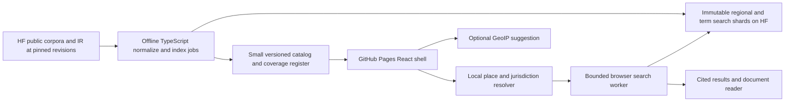
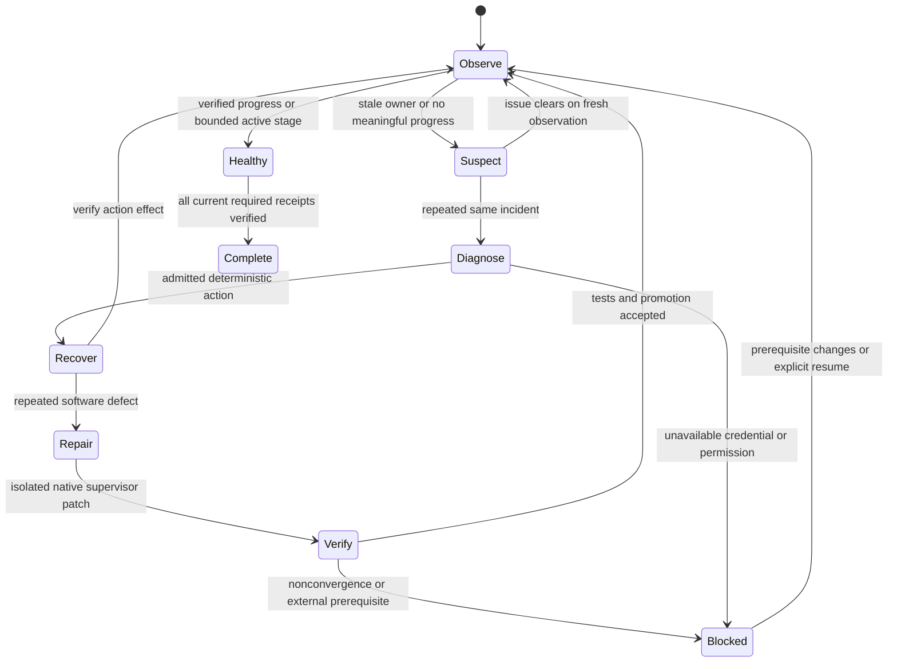

# Worldwide legal search implementation plan

Build `~/worldwidelaws.github.io` into a place-aware, multilingual legal search engine. A visitor can search a question, select any place in the world, see the relevant national, regional and local collections together, and open the underlying law with its source, date and coverage context. The deployed application runs as static TypeScript and browser workers on GitHub Pages. Offline preparation produces public, versioned artifacts from the Hugging Face organizations `justicedao` and `endomorphosis`.

The engineering campaign has a finite definition of completion: deliver the worldwide-capable product, ingest every eligible public collection found in a pinned inventory of those organizations, publish an honest jurisdiction coverage register, and pass the release gates. Worldwide architecture and worldwide data completeness are separate measurements. A country or municipality with no accessible collection remains searchable as a place and visibly has a coverage gap. Acquiring every law ever enacted is ongoing source work, not a claim that a finite software campaign can prove.

## Current repository and reuse decisions

Inspection date: 2026-10-26. Exact revisions and source references are in `research.json`. Reinspect at campaign admission because the related repositories are active and some contain unrelated changes.

| Existing surface | Finding | Planned treatment |
| --- | --- | --- |
| `src/main.tsx`, `src/AppStatic.tsx` | Static React entry point | Keep the Vite/React/TypeScript foundation; introduce the worldwide application shell behind a migration switch. |
| `src/components/WetWijzerLegalResearchApp.tsx` | Netherlands-specific titles, examples, initial search, article/chat/graph/proof workspace | Replace the information architecture; retain useful document and evidence interactions as small components. Search and place selection become the primary experience. |
| `src/lib/netherlandsCorpus.ts` | Unified and legacy Dutch HF datasets, provider interfaces, paginated retrieval and bundled sample fallback | Extract generic contracts, preserve a Netherlands adapter, add a revision-pinned catalog. Never silently present a small sample as a comprehensive result. |
| `src/lib/netherlandsGraphRag.ts`, `src/lib/netherlandsLogic.ts`, `src/lib/logic/` | Considerable retrieval, logic and parity work | Preserve existing tests and exports. Load graph, inference and proofs only after request; prove any reused semantics with fixtures. |
| `src/workers/`, client model services | Existing browser inference and embeddings | Reuse capability detection after audit. Remove automatic model warmup from ordinary search; large models require a deliberate download action. |
| `public/corpus/netherlands/current/` | Deterministic sample assets | Keep as clearly labelled regression fixtures and offline examples, with corpus/revision separated from live results. |
| `.github/workflows/deploy.yml` | Static Pages deployment; a separate typecheck step currently continues on error | Retain Actions deployment; require typecheck, contract, corpus and browser gates before uploading release artifacts. |
| `api/`, Convex, proxy scripts | Other hosting and server-oriented surfaces remain in the repository | Audit reachable imports; core worldwide search must work with these services unavailable. |
| `~/ipfs_datasets_py` | Older checkout with municipal code | Record as secondary reference. |
| `~/lift_coding/external/ipfs_datasets` | Newer `processors/legal_scrapers/country_laws_ir`, national and local collectors, Netherlands adapters | Primary reference for a selective TypeScript port. Do not import Python into the deployed runtime. |
| `~/ipfs_accelerate_py` | Current supervisor, `llm_router`, native progress watchdog, rescue and routing policies | Reuse native task authority, lifecycle, isolated worktrees, route decisions, validation and merge. Extend missing bindings rather than creating a second supervisor. |

The application should retain its current license and required notices. Porting source code and redistributing law text, boundary data, translations and embeddings each require their own provenance and rights record. Organization membership is discovery evidence, not a redistribution license.

## Product and interaction design

### Place and time are persistent search context

The header contains the product name, a place control, an effective-date control and language/accessibility preferences. The place control always states its origin: manually selected, shared URL, saved selection, approximate IP location, or device location. A visible “Change place” action works before any search. A separate “Search worldwide” scope searches the eligible corpus with progressive results and an explicit searched/remaining shard count.

Use this precedence: an explicit place in the URL; an explicit selection made in the current session; an intentionally saved selection; a best-effort GeoIP suggestion; otherwise an unselected worldwide state. Late GeoIP responses never overwrite an explicit choice. Browser language and timezone may suggest UI language, never legal jurisdiction. The search field may recognize a named place, but it proposes changing scope rather than silently replacing it.

GitHub Pages cannot inspect the visitor's request IP in application server code. For approximate GeoIP, use a replaceable, publicly accessible, browser-CORS endpoint that requires no secret, a short timeout and a visible privacy explanation. Select a provider only after checking its current terms, accuracy, retention, quota and HTTPS/CORS behavior. Default proposal: make one best-effort approximate request for a new session, disclose the third-party request beside the location control, and provide an immediate opt-out persisted locally. Do not send search text or a precise address to that provider. Where consent is required by deployment policy, offer “Suggest my approximate location” instead. Failure, VPNs and coarse country-only results must leave manual search fully usable. “Use device location” is a separate user action using browser permission; reverse geocode locally from the boundary/gazetteer pack where possible. Do not log coordinates.

Manual selection supports country, administrative region, city/municipality, postal code where licensed data supports it, and a map pin or coordinates. Text suggestions show full parent context and native/alternative names. Duplicate place names require disambiguation. A country-only guess must not choose an arbitrary city. For a coordinate near a border or inside disputed/overlapping boundaries, show candidate jurisdictions and let the visitor choose the relevant context; preserve the uncertainty.

### Search page

Desktop: a restrained header, large search input and query suggestions, a compact jurisdiction stack, result list, collapsible filters, and an optional document preview. Mobile: search and place remain visible, filters open in a sheet, and selecting a result opens a reader with a reliable return to the same scroll position. A map is optional and never required to select a place or read results.

Suggested route contract uses hashes so deep links work on static hosting:

```text
/#/search?q=parking&place=<stable-place-id>&date=2026-10-26&scope=place
/#/place/<stable-place-id>
/#/law/<record-id>?revision=<source-revision>&section=<section-id>
/#/coverage?place=<stable-place-id>
/#/sources/<source-id>
/#/compare?places=<place-id>,<place-id>&q=<query>
```

Do not include an address or exact coordinates in shared URLs by default. Validate, bound and encode route inputs. Preserve existing Netherlands links through an explicit route migration table.

Example context strip: “Amsterdam · North Holland · Netherlands · 26 Oct 2026”. The stack can also include a county, autonomous area, special district or supranational instrument when the data has evidence for that relationship. Show all supported levels together; unknown local coverage is an inline status, not an empty result group interpreted as absence of law.

Results show title in original language, optional labelled translation, issuing authority and level, place, instrument type, effective status/date precision, matched excerpt with article anchor, source collection and revision, official publisher link, and why the result is geographically included. Filters include jurisdiction level, place, topic, instrument type, language, source, and date/status. Count the searched collections; distinguish total known records from total returned matches and partial search counts. Do not combine unrelated provider scores without a documented fusion rule.

Prefer a globally ranked result list with visible authority badges and an optional “Group by level” toggle. Do not bury national laws under a city-only filter. Exact citations and identifiers rank strongly, but a nearby municipal rule cannot be treated as legally superior merely because it is geographically closer. Search ranking is relevance, not a ruling about conflicts of law.

### Reader and research tools

The reader shows breadcrumbs, title, official citation, issuer, original text, article navigation, source link, version/effective dates, retrieval date, language, rights and provenance. Provide copy citation, copy stable link, download where permitted, and adjacent provisions. Historical text, future commencement, unknown status, source outage and translation must have distinct labels. A user-selected “as of” date is applied to text and jurisdiction boundaries using each source's date precision and timezone policy.

Evidence, citations, graph relationships, optional comparison, and existing logic/proof summaries are secondary panels. A generated answer is an optional enhancement after retrieval, with citations to the exact displayed version. Search works without an account, GPU, model download, API key, chat service or Python server. Unknown, simulated or incomplete proof output cannot establish legal applicability or current law. Retrieved documents and dataset metadata are treated as untrusted content, including for prompts.

### Required interaction states

Design and test: first visit; approximate suggestion; IP unavailable; location denied; ambiguous place; changed manual location; border uncertainty; no query; no matches in searched collections; unsearched/unsupported collection; missing municipal coverage; partially loaded results; cancelled query; HF throttling/outage; stale cache; offline saved material; model unavailable; source or status unknown; translated text; historical/future law; malformed URL; and screen-reader announcements after scope changes. Every state offers a concrete next action.

Target WCAG 2.2 AA with keyboard-only place selection, semantic search and filters, clear focus, adequate contrast, reduced motion, 200% zoom, reflow at 320 CSS pixels, touch-friendly controls, and RTL layout. Prefer typography and whitespace to a globe animation or a mandatory map. Test English, Dutch, an RTL locale and a CJK script with real search fixtures.

## Jurisdiction and legal data model

Model jurisdiction as a dated directed graph, not a fixed country/province/city tuple. Nodes have stable internal IDs, names with language/script tags, aliases, a typed administrative level, optional ISO/Wikidata/publisher IDs, issuer IDs, geometry references, and validity intervals. Edges distinguish administrative containment, territorial coverage, delegated authority and a supported legal relationship. Country codes are aliases rather than the identity system. Keep disputed-boundary interpretations and geometry provenance explicit. Resolve points using a spatial index followed by precise geometry checks, including islands, enclaves, unincorporated areas, antimeridian, holes and boundary-edge ambiguity.

Separate issuing jurisdiction, territorial scope and inferred search scope. A municipality's administrative parent does not prove that every parent or supranational instrument governs every activity there. Start with territorial candidate retrieval; activity, actors, exemptions and extraterritorial rules need cited source metadata or an explicit unknown state. Use UI wording such as “Laws and sources for this place” and “Included because …”; only claim an applicability conclusion when its prerequisites and source-backed rule are represented.

Core TypeScript contracts to implement:

```ts
type CoverageState = 'verified' | 'partial' | 'missing' | 'unknown' | 'unavailable';
type DateKnowledge = { value: string; precision: 'day' | 'month' | 'year'; source: string };
type JurisdictionScope = {
  placeId: string; asOf: string; issuerIds: string[]; territorialIds: string[];
  uncertainty: string[]; relationshipEvidence: string[];
};
type LawIdentity = { sourceId: string; sourceRecordId: string; sourceRevision: string };
type CoverageCell = {
  jurisdictionId: string; level: string; sourceIds: string[]; state: CoverageState;
  indexedRecords: number | null; eligibleRecords: number | null;
  retrievedAt: string | null; verifiedAt: string | null; reason: string;
};
```

Full schemas also need document/section identities, parent-child references, original text hashes/CIDs, source URLs, publisher identifiers, instrument kind, native language, text versions, publication/enactment/commencement/repeal dates, unknown/inferred metadata, amendments, translations, licenses and attribution. Text version identity differs from a logical instrument ID. Duplicate mirrors may link equivalent text while preserving conflicting versions and source provenance. Do not invent a legal identifier when required source identity is absent; quarantine the row with a reason. A local deterministic ingestion key may identify that quarantine record without becoming an official citation.

## Source discovery and TypeScript port

Enumerate both HF organizations with pagination and follow continuation links. Pin the inventory and every dataset to a resolved repository revision; inspect dataset cards, manifests, files, configurations, splits, schemas, sizes, licenses, and representative rows. Include gated/private/inaccessible candidates as coverage entries, with no browser credential requirement. Discover raw corpora, municipal and regional records, country IR, the existing unified Netherlands dataset, and legacy split indexes. Do not infer coverage or a usable index from repository naming. Exclude code-only or unrelated repositories through recorded dispositions. A regional corpus may live in a national hub.

| Python reference in the newer datasets checkout | TypeScript destination and parity obligation |
| --- | --- |
| `country_laws_ir/schema.py`, `normalize.py`, `instrument_inherit.py` | `src/lib/worldwide/data/` and `scripts/worldwide/`: field mapping, null handling, required identity, article inheritance and date/status preservation. |
| `country_laws_ir/cidutil.py`, `reconstruct.py`, `parquet_io.py` | Identity and artifact readers: preserve canonicalization and hashes; test actual CIDs/bytes rather than inventing an equivalent-looking format. |
| `country_laws_ir/tokenize.py`, `bm25.py`, `sparse.py`, `query.py` | Browser worker/index readers and offline TS index builder: tokenizer parity, postings, ranking, stable ties and bounded traversal. |
| `country_laws_ir/structure.py`, `citations.py`, `graph.py` | Bounded section/graph expansion with evidence and deterministic limits. |
| `country_laws_ir/package.py`, `catalog.py`, `coverage.py`, `incremental.py`, `verify.py` | Revision-pinned catalog, compatibility checks, integrity, incremental update and coverage reports. |
| `netherlands_laws/jurisdiction.py`, international/national/municipal collector manifests | Jurisdiction adapters and provenance fixtures; collector networking remains upstream/offline work. |
| Existing site Netherlands corpus, GraphRAG and logic modules | Compatibility adapters and regression fixtures; do not rewrite proven logic without a demonstrated need. |

Verify the exact source filenames at admission; aliases and module layout can differ by revision. Capture small parity fixtures with upstream commit, license and expected values. Use Python only to establish reference outputs during engineering where needed. Production site code, catalog/index tooling and browser search are TypeScript/JavaScript with browser-compatible WASM where measured useful. A Python supervisor/watchdog on the developer host is an operational dependency, not part of the hosted site.

## Static search architecture and scale



Keep only the application shell, catalog summary, small gazetteer entry points and labelled examples on Pages. The global corpus, boundary detail, embeddings and indexes live as immutable public artifacts on HF, with optional CID/gateway mirrors only after integrity, CORS and availability checks. Published Pages sites have a 1 GB limit; the initial shell and application assets should stay far below it. Static hosting cannot run request-time SQL or protect credentials. See [GitHub Pages limits](https://docs.github.com/en/pages/getting-started-with-github-pages/github-pages-limits).

There are two search paths. The primary scalable path uses published, versioned indexes and bounded workers. A compatibility path uses supported HF Dataset Viewer `/search` and `/rows` endpoints with cancellation, rate limits and explicit limitations. Viewer search requires Parquet exports, uses English-oriented stemming, and has a maximum returned page length of 100; do not assume it is a complete multilingual retrieval engine, accepts arbitrary revision pins, or supports a joined filter/search query. Prove endpoint capabilities with real fixtures and keep unsupported operations out of the UI. A current-branch Viewer result must not be mixed with a pinned document version without reconciliation. See [HF Dataset Viewer search](https://huggingface.co/docs/dataset-viewer/en/search).

For a selected place, first resolve the complete candidate authority stack, then select source/index shards, then retrieve in bounded parallel batches and fuse ranked results. Store title/citation fields separately for exact lookups. Use language/script-specific tokenization and Unicode normalization without corrupting identifiers or original text. Port available BM25/postings formats where viable; otherwise publish an explicitly versioned TS-built index. Avoid downloading a country Parquet file in full on a phone. Test HTTP Range with CORS from the actual Pages origin before selecting a Parquet/WASM reader; publish smaller JSON/binary shards when Range is unavailable. Use single-thread workers when SharedArrayBuffer/cross-origin isolation is unavailable; development-server COOP/COEP headers are not evidence of Pages production behavior.

Worldwide mode must not fan out one request per country or load every index. Publish a lightweight global term/citation routing index with hierarchical shard directories and bounded result summaries. Search progressively, show searched scope, allow continuation, and never label a capped candidate set “all worldwide results”. For common terms, use staged merging/pagination with stable cursors bound to query, filters and catalog revision. Measure index size, recall and network cost before increasing breadth. Browser-only architecture has finite resource limits: if a target corpus cannot meet them, keep the place/source discoverable with a documented limitation and create an upstream artifact task rather than silently scanning gigabytes or adding a required backend.

Use IndexedDB/CacheStorage for an LRU of public artifacts keyed by content hash and revision. Apply explicit storage budgets, integrity checks and invalidation; stale/offline state remains visible. Do not cache personal queries or location histories by default. Cancel obsolete queries and scope transitions; late responses cannot update a newer search. Sanitize text, allowlist safe link protocols, and isolate rendering from arbitrary dataset HTML. Secrets, model-provider keys and supervisor state never enter the browser bundle or public build artifacts.

Proposed performance gates, measured on a recorded mid-range mobile profile and network trace: shell transfer at most 350 KiB gzip of JavaScript before optional tools; initial catalog/gazetteer transfer at most 1 MiB; first place search at most 10 MiB; warm search p95 at most 1 second on the benchmark corpus; first useful cold result p95 at most 5 seconds when upstream is responsive; at most 4 concurrent artifact requests; working search heap target at most 256 MiB. Report failed budgets explicitly and tune with measurements. These are campaign targets, not measured current performance or provider SLAs.

## Goals, subgoals, tasks and execution order

`plan.json` is the machine-readable definition. `goals.objectives.md` and `tasks.todo.md` are deterministic native supervisor bootstrap projections. Each task names its goal/subgoal, dependencies, owning repository, write scope, deliverables, acceptance evidence, exact validation argv and retry/time bounds. All tasks start `todo`; no implementation or coverage is claimed by generating a plan. `supervisor.json` uses the existing scheduler profile format and is checked against the real loader. Its extra campaign metadata does not itself authorize launches or configure providers.

The dependency graph, rather than document order, controls scheduling. The first milestone inventories active work and materializes this campaign through the native task source, wires provider/lifecycle/recovery bindings, and demonstrates the watchdog on a small canary. Next establish schemas, a pinned source catalog, geographic resolution and a real cross-country search slice. Then replace the UI, expand the inventory, harden offline/performance behavior and complete independent release validation. Preserve a single writer for shared schemas/catalogs and serialize overlapping changes. Start with one implementation lane; admit additional disjoint lanes only after ownership and merge tests pass.

The core board is not one enormous ingestion task. WWL-018 expands the pinned inventory into bounded native child tasks using `plan.json.source_expansion`: normalize, index, geography join, publish permitted immutable artifacts and independently verify each source/config/split/jurisdiction/shard. Publication uses an admitted public HF destination and host-only credentials, preserves source revisions, and records exact commit URLs, hashes, attribution and hosted-origin transport probes. Child identities are deterministic, deduplicated and bound to a native admitted plan revision. WWL-017 is a join barrier over every required child receipt. Unknown rights, missing upstream inputs and unavailable local collections retain typed coverage/blocker entries. The watchdog refreshes its persisted required task set only through the verified native expansion receipt, without resetting run or incident budgets. Source expansion may add required work; it cannot prune failed inputs to claim completion.

Parser compatibility is separate from native goal admission. WWL-002 derives typed goal contracts bound to the objective heap and task definitions: scope, assumptions, non-goals, evidence producers, validation rules, freshness, finite resource/refinement bounds and uncertainty. It must pass the native goal-quality lint and explicitly handle the root's ten children rather than silently inheriting the native default breadth of eight. These contracts are required before admission; no boolean in the scheduler JSON replaces them.

WWL-106 implements and tests the completion verifier on fixtures before release. WWL-114 prepares final closure evidence after public verification, then obtains its own ordinary task receipt. Only afterward can native root reconciliation include that receipt, verify the full accepted tree and source task set, publish root completion and drain the campaign. This avoids requiring a final task to prove its own future completion.

The supervised engineering workspace has two writable repositories: the website, and a campaign-owned isolated worktree of `ipfs_accelerate_py` for operational repairs. The datasets checkout is a read-only reference by default; acquisition or publishing work is a separate, explicit task. Never repurpose active unrelated supervisors or modify their state. Record changed files, commits, trees, fixture versions, commands, exit codes and limitations in append-only receipts. Completion requires validation against the accepted current tree and merge admission. A worker's prose or zero process exit does not establish completion.

### Provider routing

Primary implementation/planning/rescue provider: `ipfs_accelerate_py.llm_router`, `grok_cli`, exact requested model `grok-4.7`. Use the existing explicit agent route through `provider_fallback_runner.py`, not a generic text-generation call pretending to execute code. Persist sanitized route telemetry with task, attempt, stage, model, workspace identity and decision. Preserve the user's primary model when the provider is unavailable; do not silently substitute another Grok model.

The existing emergency policy is `grok_quota_auth_or_unavailable`: Codex is eligible on typed quota exhaustion, authentication failure or launch unavailability before side effects, with an unchanged candidate workspace. Generic failure, timeout, transport uncertainty, malformed output, mutation or unknown effects require reconciliation. Once the old attempt is fenced and effects reconciled, a fresh, separately admitted recovery attempt may use the same policy; never run both writers against the same candidate. Codex model selection is deployment configuration resolved at admission, not a new hardcoded model preference. Do not turn Codex into a mandatory routine reviewer or a second default implementation route. Independent validation is deterministic where possible and cannot be self-certified by the implementation model.

Bootstrap must prove actual Grok model availability, CLI authentication without exposing secrets, adapter semantics, existing authorization boundaries and the emergency Codex path. Prefer non-charging checks, then one tiny explicitly budgeted canary. Provider timeouts and heartbeats are distinct from useful progress. Preserve work rather than starting another model on an ambiguous timeout.

## Watchdog and automatic supervisor repair

The operational loop runs on the developer/CI host, separately from GitHub Pages. It observes the native task store, scheduler, active leases, process identity, validation and merge queues, resource pressure, provider decisions and a real progress cursor. A process being alive, a log growing or a heartbeat advancing is not proof of task progress. Progress means accepted artifact change, a validation stage advance, a canonical task transition, or a verified merged result. Persist the progress cursor and recovery budgets across restarts.

Inspection of `SupervisorWatchdog.__init__` shows optional `lifecycle_restart`, `rescue_planner`, request factories and `rescue_orchestrator` bindings. The default module CLI does not supply these. Enabling `rescue_execution_enabled` in JSON alone therefore does not establish working auto repair. The bootstrap/operations tasks must bind the existing lifecycle and rescue components, register them for this campaign, test the native boundary, and produce a readiness receipt. `watchdog_loop.py` supplies the executable loop and adapter contract; `watchdog.policy.json` specifies the recovery bounds. The native adapter is an explicit first-milestone deliverable, not an assumed preexisting capability. The loop does not become a second task scheduler or write native task state itself.



| Observed condition | Required response |
| --- | --- |
| Active work with fresh stage progress | Observe; keep its admitted deadline. |
| No runnable work because dependencies are running | Wait and report the dependency chain. |
| Runnable work and no owned worker for 5 minutes | Reconcile native claims/queue; start only through the registered lifecycle action. |
| Owner dead or heartbeat stale for 10 minutes, confirmed on 3 observations | Verify birth identity, process group, lease generation and effects; fence and invoke native recovery. |
| Heartbeat fresh but no useful progress for 20 minutes | Diagnose the stage, pending validation/merge and repeated error signature. Do not reset the timer for log spam. |
| Task blocked by a reproducible supervisor/router defect | Emit one deduplicated native repair task with the failing reproducer; run isolated repair, focused regressions, canary and promotion. |
| HF outage/429, temporary network or storage pressure | Respect retry-after/backoff; cache degraded results; reclaim only campaign-owned disposable data when allowed. |
| Missing credential, gated corpus, revoked permission or impossible upstream prerequisite | Preserve a typed blocker; continue independent tasks; recheck only on a meaningful prerequisite change or bounded scheduled probe. |
| User pause/stop or a campaign HOLD | Respect it; never classify it as recoverable idleness. |
| Every task is marked done | Revalidate required release receipts, source inventory disposition and accepted tree; exit success only if verified. |

Automatic repair scope includes the campaign adapter and necessary native supervisor/router modules in an isolated repair checkout. It excludes credentials, unrelated repositories, release criteria, protected policy/completion code and public law text. A repair must add a reproducer before changing the defective behavior, then pass focused tests, existing supervisor/router regressions, restart/lease and fault-injection checks. Do not repair a failed test by lowering its threshold, editing the expected success into evidence, skipping a task, clearing history or writing a completion field. Drain/fence affected tasks, promote through the native validated merge path, reload the affected lane and invalidate stale evidence as required. Store an incident bundle and rollback reference.

Default policy: 30-second polls; three confirming observations; 5-minute idle, 10-minute heartbeat and 20-minute progress thresholds; bounded 3 task attempts; 2 deterministic recoveries and 2 code-repair attempts per incident; persistent campaign repair cap; exponential cooldown up to 30 minutes. Separate provider, task, repair, validation and merge budgets. An incident ID binds the run, task, stage and normalized defect, so PID changes cannot reset its budget. Budget exhaustion is a visible blocker, never success. Watchdog process failure is covered by an optional user-systemd service with bounded restart and a HOLD-aware start condition; do not register it during planning.

Unattended completion can be pursued and checked, but cannot be guaranteed through unavailable credentials, upstream data or persistent defects. The system's guarantee is that incomplete work cannot silently become success, recoverable faults receive bounded automatic repair, and unresolved prerequisites retain evidence and remain visible.

## Validation and release gates

Use focused tests for consequential behavior and preserve the existing relevant Netherlands and logic regressions. Documentation/inventory tasks use schema, integrity and audit validation rather than tests that merely assert file existence. New functional checks must run production code and include adversarial fixtures.

Required evidence:

1. Source enumeration follows all organization pages; every eligible record/index collection has an ingest receipt or an explicit unresolved blocker. Excluded collections have a reason. Counts are tied to a pinned inventory and never extrapolated to unobserved laws.
2. Reference fixtures establish TS parity for normalization, identity, tokenization, BM25, article inheritance and bounded graph expansion. Real national, provincial/regional and municipal samples must be included; no fabricated municipality data can pass this gate.
3. Place tests cover Netherlands, a federal system, a multilingual system, a non-Latin/RTL case, an unincorporated area, overlapping/special boundaries and unknown municipal coverage. Candidate jurisdictions and “why included” evidence are checked independently of ranking.
4. Browser tests exercise manual overrides, delayed GeoIP, denial/outage, deep links, effective dates, partial worldwide search, source reader, mobile/keyboard/RTL and a completely unavailable optional model/backend.
5. Transport tests from the production Pages origin establish CORS, Range or shard fallback, worker/WASM behavior without COOP/COEP assumptions, throttling and revision consistency. Live checks have a timestamp and clear limitations; deterministic fixtures keep CI independent of transient upstream availability.
6. Measured scale, memory, transfer, relevance and accessibility budgets pass on the recorded evaluation profile. Exact citation lookup must return the expected version; no excluded jurisdiction may leak through strict scope filters. Do not claim cross-language recall without a labelled query/judgment set.
7. Fault injection kills workers and the supervisor, loses the watchdog process, freezes progress with a live heartbeat, expires a lease, repeats a router defect, simulates quota/auth failure and unknown effects, corrupts a manifest, withholds a credential, pauses the campaign and exhausts retry budgets. Verify no duplicate writers, false completion, budget reset or unvalidated repair promotion.
8. Release checks run at the accepted site commit and operational code revision. Build output contains no secret or host state. A static-hosted preview passes browser checks. Public Pages deployment follows the repository's release process; updating the planning package does not deploy the site.

A missing required corpus is an unresolved coverage blocker, not an automatically completed ingestion task. A product release may display honest coverage gaps, but the campaign cannot claim “all eligible discovered sources indexed” while such a blocker remains. Source coverage acquisition outside the snapshot proceeds as a separately versioned follow-up campaign.

## Operating the package

Run `python3 implementation_plan/worldwide_legal_search/validate_plan.py` for deterministic plan checks. Add `--native-root ~/ipfs_accelerate_py` to check the board, goals, policy dataclass and scheduler profile with the actual installed supervisor code. This performs no model call or launch. Run the packaged unit tests for the watchdog's decision and dispatch behavior.

Start implementation by handing `HANDOFF.md` plus `plan.json`, the native board/objectives and `supervisor.json` to the existing supervisor's admission process. The first tasks create a campaign-owned branch/worktree, native task-store population and runtime adapter; they do not reuse another campaign's state. The watchdog loop can be exercised with fixtures immediately. Live operation requires the first-milestone adapter and its readiness receipt; commands and exact adapter protocol are in `WATCHDOG.md`.

`research.json` distinguishes locally observed behavior, opened official documentation, unavailable remote probes and proposed design decisions. Provider access, full public dataset inventory, real mobile benchmarks and hosted-origin transport behavior are first execution milestones rather than claims made by this plan.
